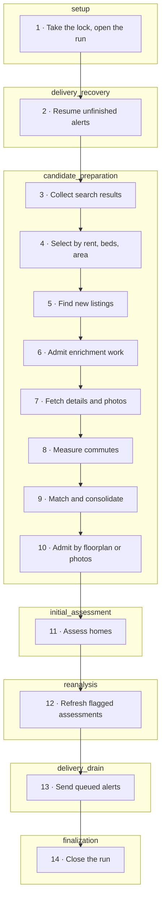
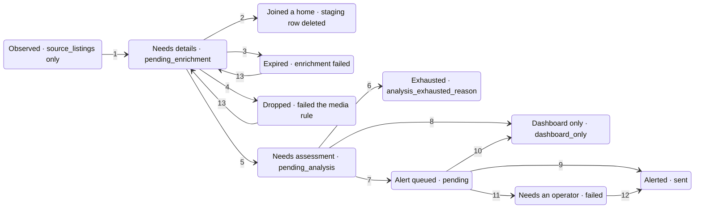

<a id="top"></a>

# The ingest pipeline

**How one run turns search results from four property portals into stored homes, paid assessments and Telegram alerts: what each stage does, what it writes down, and what it leaves for the next run.**

This page is for an engineer new to the codebase. Read the overview sections for the shape of the system, then use the stage reference and the cross-cutting sections as a lookup. Every file reference links to the exact lines on GitHub at the commit below, so you can check any claim against the code.

- **Verified against:** [`dd79f04`](https://github.com/MarcelCutts/home-finder/tree/dd79f044545a8c4edd42658ab310aa70a0fb5abd), main as of 11 Nov 2026
- **Checked on:** 11 November 2026
- **Covers:** `src/home_finder/pipeline/` and every module it calls
- **Leaves out:** Dashboard pages, deployment, the fit-score rubric in detail

<a id="overview"></a>

## A run in one minute

A run is one call of `run_pipeline` [`pipeline/flow.py:35–80`](https://github.com/MarcelCutts/home-finder/blob/dd79f044545a8c4edd42658ab310aa70a0fb5abd/src/home_finder/pipeline/flow.py#L35-L80). It starts by taking a lock, so that it is the only runner working on the database. Then it works through seven phases in a fixed order. The phase names in Figure 1 are the ones in the debug-level `pipeline_phase_*` log events, which you see with `--debug` on command-line runs [`pipeline/flow.py:458–478`](https://github.com/MarcelCutts/home-finder/blob/dd79f044545a8c4edd42658ab310aa70a0fb5abd/src/home_finder/pipeline/flow.py#L458-L478).

The largest phase, `candidate_preparation`, does most of the ingest:

- It scrapes search results from Rightmove, Zoopla, OpenRent and OnTheMarket.
- It keeps the listings that fit the rent, bedroom and area rules, and finds the ones not yet attached to any stored home.
- It fetches their detail pages and photos, and measures the commute.
- It matches each listing against stored homes, so that a flat advertised on two sites becomes one home.

Three kinds of home go on to a paid, two-step Claude assessment: homes whose source supplies a floorplan, homes with enough photos, and homes advertised only on OpenRent. The assessment and the decision about whether to send an alert are saved in one transaction, and the alert goes out over Telegram.

A run does not have to finish everything it starts. Work it cannot do now stays in the database and the next run picks it up. That includes enrichment beyond the run's cap, assessments deferred by the spend limit, and alerts waiting out Telegram's rate limit. A run that scrapes nothing new still advances that work. The code says so where the batch is handed on [`pipeline/flow.py:162–163`](https://github.com/MarcelCutts/home-finder/blob/dd79f044545a8c4edd42658ab310aa70a0fb5abd/src/home_finder/pipeline/flow.py#L162-L163).



| Stage | Writes | Picks up from earlier runs |
|---|---|---|
| 1 · Take the lock, open the run | Run row opened; spend ledger repaired | |
| 2 · Resume unfinished alerts | Alert states, receipts, home status | Alerts still queued, ready or waiting |
| 3 · Collect search results | Every parsed card stored; price changes | |
| 4 · Select by rent, beds, area | Events only; no listing state changed | |
| 5 · Find new listings | Events; the repeat price check is usually a no-op | |
| 6 · Admit enrichment work | New listings saved as staging rows | Listings still waiting for details |
| 7 · Fetch details and photos | Photos cached; no media: attempt + 1 | |
| 8 · Measure commutes | Commute events; never removes a home | |
| 9 · Match and consolidate | Listings joined to homes; refresh flagged | |
| 10 · Admit by floorplan or photos | Homes failing the media rule saved as dropped | |
| 11 · Assess homes | Assessment and alert decision in one commit | Homes still waiting for assessment |
| 12 · Refresh flagged assessments | Assessment replaced, flag cleared | Assessments flagged for a refresh |
| 13 · Send queued alerts | Alert states, receipts, home status | Alerts still queued, ready or waiting |
| 14 · Close the run | Run status; old events pruned (live runs) | |

*Figure 1. The fourteen stages of one run, in order, grouped by phase. The table lists what each stage writes, and the work it picks up from earlier runs: the four queues of idea 1. Two simplifications: the lock and spend recovery happen just before the setup phase begins, and during assessment an alert can go out before the stage ends.*

<a id="ideas"></a>

## Six ideas behind the design

Most of the code makes sense once these six ideas are clear. Each one is visible in the code, and most are also recorded in the review documents in `docs/reviews/`.

**1. A run advances queues.** The database holds four kinds of unfinished work: listings waiting for details, homes waiting for assessment, assessments flagged for a refresh, and alerts not yet sent. Each run takes what it can of each and leaves the rest. Enrichment, assessment and refreshes have per-run caps; alerts have none. So an empty scrape never ends a run early, and the work for one listing can span several runs.

**2. A listing is not a home.** A [listing](#g-listing) is one advert on one platform. A [home](#g-home) is one physical flat, which may be advertised on several platforms. A listing counts as "new" until something attaches it to a home. Stage 6 does that for every new listing: it gives the listing a [staging row](#g-staging), which is a provisional home of its own. Matching (stage 9) can later fold that provisional home into a stored one, so the count of homes can shrink at matching. A Zoopla advert for a flat already stored from Rightmove gets its own staging row first, and matching then joins it to the stored home.

**3. Each stage waits for the evidence it needs.** Details come before the commute because detail pages fill in missing coordinates. Matching comes after details because photos and full postcodes are what tell two adverts apart. The media rule comes after matching because a merged home can gain a floorplan from its other advert. The project's pipeline doc records the first two reasons and the media rule's place after matching [`docs/pipeline.md:75–80`](https://github.com/MarcelCutts/home-finder/blob/dd79f044545a8c4edd42658ab310aa70a0fb5abd/docs/pipeline.md#L75-L80). The paid assessment comes after all of them [`pipeline/flow.py:136–192`](https://github.com/MarcelCutts/home-finder/blob/dd79f044545a8c4edd42658ab310aa70a0fb5abd/src/home_finder/pipeline/flow.py#L136-L192).

**4. Write it down before acting.** Each step that has a side effect is written down before it happens:

- every observation is stored before any filter runs;
- new listings are saved before their detail pages are fetched, and homes are saved before the paid calls;
- money is reserved in a ledger before a request is sent;
- the alert decision commits in the same transaction as the assessment;
- each Telegram message part is claimed before it is sent.

If a run crashes, the next one resumes from these records. If an outcome is unknowable, for example a request that timed out after it was sent, it is held for an [operator](#g-operator) instead of being repeated.

**5. Counts are not a funnel.** A run's counts change unit along the way: several listings can collapse into one home at matching. They include work carried in from earlier runs, and a cap can hold them below what was observed. Commute results annotate homes and never remove one. Read the stored counts with the definitions in [Reading a run's counts](#x-counts), not as a funnel.

**6. One runner at a time.** Pipeline runs, maintenance commands and the admin tools that write all take a file lock next to the database file [`pipeline/run_lock.py:69–136`](https://github.com/MarcelCutts/home-finder/blob/dd79f044545a8c4edd42658ab310aa70a0fb5abd/src/home_finder/pipeline/run_lock.py#L69-L136). Read-only reports do not. A second run or maintenance command does not wait in line: it logs `runner_skipped` and returns at once [`pipeline/run_lock.py:122–127`](https://github.com/MarcelCutts/home-finder/blob/dd79f044545a8c4edd42658ab310aa70a0fb5abd/src/home_finder/pipeline/run_lock.py#L122-L127). A writing admin tool exits with an error instead.

<a id="words"></a>

## Words used on this page

The code has used several names for the same things over time. This page uses one term per idea, listed here with the code name to search for. The project's own vocabulary table is in [`docs/pipeline.md`](https://github.com/MarcelCutts/home-finder/blob/dd79f044545a8c4edd42658ab310aa70a0fb5abd/docs/pipeline.md#L83-L107). This page shortens some of its terms ("listing", "home", "anchor", "receipt") and adds a few.

Settings are environment variables. They appear on this page with their full `HOME_FINDER_` prefix, which is required.

| Term | Meaning | In the code |
|---|---|---|
| <a id="g-listing"></a>**Listing** | One advert on one platform, identified as `source:id`, for example `zoopla:70000001`. A *search card* is one listing as it appears on a search-results page. | `SourceListing`, an alias of `Property`; table `source_listings` |
| <a id="g-observation"></a>**Observation** | One sighting of a listing in search results. Every observation updates the listing's row and checks its price. | `upsert_source_listings` |
| <a id="g-home"></a>**Home** | One physical flat, built from one or more listings. Comments call it a golden record or merged property; docs/pipeline.md calls it a property aggregate. | `PropertyAggregate`, an alias of `MergedProperty`; table `properties` |
| <a id="g-canonical"></a>**Canonical listing** | The listing whose ID is the home's ID. For a new group it is the earliest-seen listing. A home that already exists keeps its ID when listings join it. | `MergedProperty.canonical` |
| <a id="g-staging"></a>**Staging row** | The provisional home that stage 6 saves for a new listing, in state `pending_enrichment` with `enrichment_status = pending`. If the listing turns out to belong to a stored home, its staging row is deleted. | `save_unenriched_property` |
| <a id="g-anchor"></a>**Anchor** | A stored home, first seen in the last 30 days, that new listings are matched against. Staging rows still waiting for details are not anchors, unless they hold a recovery grant. | `get_recent_properties_for_dedup` |
| <a id="g-seen"></a>**Seen** | A listing whose `merged_id` is set: it belongs to a home, possibly its own staging row. A listing that is not seen is "new". | `filter_new_merged` |
| <a id="g-outcode"></a>**Outcode** | The first half of a UK postcode, naming a postal district: E8 in E8 3RH. Search areas, the location rule and matching all work in outcodes. | `extract_outcode` |
| <a id="g-candidate"></a>**Candidate** | A home being carried to the next stage in this run. Being a candidate is not a decision about it. | `CandidateBatch` |
| <a id="g-admission"></a>**Admission** | Letting work into a stage. It happens under a per-run cap (stages 6, 11 and 12), under a rule (stage 10, the media rule), or under a spend check before each paid request ("spend admission"). | `CandidateAdmission` is the media rule's result only |
| <a id="g-deferred"></a>**Deferred** | Still eligible but not done in this run. Deferral by a cap or by spend admission uses no attempt. Two events carry the name but follow a used attempt: `enrichment_deferred` with reason `missing_usable_media`, and `analysis_deferred` after a failed analysis. | events ending `_deferred` |
| <a id="g-expired"></a>**Expired** | Enrichment gave up: the attempt ceiling was reached without usable media. Only a recovery grant brings the home back. | `enrichment_status = failed` |
| <a id="g-exhausted"></a>**Exhausted** | Assessment gave up: three failures, or a refusal at the spend policy's per-request attempt limit. No admin tool brings the home back; only a manual database edit does. | `analysis_exhausted_reason` |
| <a id="g-grant"></a>**Recovery grant** | A one-off permission to try enrichment again for an expired or dropped home that has no assessment and no alert history. It comes from `recovery_admin`, or automatically when a new source joins the home. | `request_enrichment_recovery` |
| <a id="g-assessment"></a>**Assessment** | The stored result of the two Claude calls: observations, ratings, value and notes. It is a different thing from a match score or the fit score. | `PropertyQualityAnalysis`; table `quality_analyses` |
| <a id="g-refresh"></a>**Refresh** | Re-running the assessment of a home that already has one, for example after it gained a second advert. It never sends an alert. | reanalysis: `reanalysis_requested_at`, `--reanalyze`, `process_reanalysis_queue` |
| <a id="g-fit"></a>**Fit score** | A 0 to 100 score computed in code from the assessment and the owner's preferences. It decides whether a new home is alerted. | `compute_fit_score` |
| <a id="g-alert"></a>**Alert** | A Telegram message about a home. A *discovery alert* announces a newly assessed home; a *price-drop alert* reports a lower rent. | `kind` = `discovery` or `price_drop` |
| <a id="g-intent"></a>**Delivery intent** | The durable alert decision for one event, keyed `discovery:<home id>` or `price:<price_history id>`. It holds the frozen message plan and its progress. Dashboard-only decisions are stored as intents too, in state `suppressed`. | table `notification_deliveries` |
| <a id="g-receipt"></a>**Receipt** | The Telegram message IDs stored when one part of an alert is acknowledged. | `receipts_json` |
| <a id="g-callback"></a>**Immediate callback** | The hook that tries to send a discovery alert right after each initial assessment completes, in live runs. | `_make_notify_callback` |
| <a id="g-drain"></a>**Drain** | One pass over every intent that can be sent, oldest first. Stages 2 and 13 each run one. | `deliver_pending` |
| <a id="g-reservation"></a>**Reservation** | The worst-case cost of one paid request, written to the spend ledger before the request is sent. | table `paid_attempts` |
| <a id="g-checkpoint"></a>**Visual checkpoint** | A saved, paid-for result of the first Claude call, reused if the second call has to be tried again. | table `visual_checkpoints` |
| <a id="g-owner"></a>**Owner** | The person the search is for. Their status on a home is one of new, interested, enquired, viewing booked, viewed, applied, offered, rejected or archived. "Tracked" means interested through offered. | `UserStatus`; `TRACKED_USER_STATUSES` |
| <a id="g-operator"></a>**Operator** | Whoever runs the admin tools to settle what the pipeline will not decide on its own: blocked and uncertain alerts, unknown spend, and manual recovery grants. | `pipeline/*_admin.py` |

<a id="story"></a>

## One flat, two runs

Here is one two-bedroom flat on Mare Street, E8, followed through two runs an hour apart. The listing IDs, times, commute and scores are invented. Every step and rule is real, and each step links to the stage that applies it.

#### Run 1, 14:05

1. **[3 · Collect](#s-collect).** The Zoopla scraper searches E8 and receives a search card for `zoopla:70000001`: £2,000 a month, two bedrooms, E8 3RH, with coordinates. Before any rule looks at it, the card is written to `source_listings` with no home attached.
2. **[4 · Select](#s-select).** £2,000 is inside £1,800 to £2,500, two bedrooms is inside 0 to 2, and E8 is one of the configured areas, so the listing is selected.
3. **[5 · Find new](#s-discover).** No home owns this listing yet, so it is new.
4. **[6 · Admit](#s-admit).** It gets a staging row in `properties`, waiting for details, with zero attempts; from now on it counts as seen. It joins this run's enrichment batch, which alternates new listings with older ones still waiting for details and is well under the cap of 75.
5. **[7 · Details](#s-enrich).** The detail fetcher checks that the page it gets back really is this advert. It reads the gallery, floorplan and description, and saves the photos under `data/image_cache/zoopla_70000001/`. The page declares a floorplan, so the flat has usable media.
6. **[8 · Commute](#s-commute).** TravelTime returns cycling and public-transport times to the destination postcode. The quicker one, 14 minutes by bike, becomes the flat's commute. A slow result would be shown, never used to drop the flat.
7. **[9 · Match](#s-match).** Matching compares listings only within a block that shares an outcode and a bedroom count. Nothing stored in the "E8, two bedrooms" block scores as a match, so the flat stays a home of its own.
8. **[10 · Media rule](#s-media).** It has a floorplan declared by the source, so it is admitted to assessment.
9. **[11 · Assess](#s-assess).** The home is saved as waiting for assessment. The spend ledger reserves the worst-case cost of each call. Claude reviews the photos and floorplan, then a second call judges value and writes viewing notes. Code computes a fit score of 72. In one transaction the assessment is stored and the policy (minimum 60) records a delivery intent, `discovery:zoopla:70000001`.
10. **[11 · Alert](#x-alerts).** The immediate callback freezes a three-part Telegram plan. Because the fit is at least 70 and the home has three or more photos, it gets a photo album plus a follow-up message carrying the buttons. Because it also has coordinates, it gets a map pin. The callback sends each part, stores each receipt, and marks the home sent.

#### Run 2, 15:07

1. **[3 · Collect](#s-collect).** The same flat appears on OnTheMarket as `onthemarket:15000001`, at £2,050, with the address "Mare Street, London E8". OnTheMarket supplies coordinates but no full postcode, on the card or on the detail page. The Zoopla card is observed again. Its price has not changed, so that observation only refreshes the listing's row.
2. **[5 · Find new](#s-discover).** The Zoopla listing is seen. The OnTheMarket listing is new, so it gets its own staging row, its own detail fetch and its own commute measurement.
3. **[9 · Match](#s-match).** Both listings sit in the "E8, two bedrooms" block. Against the stored Zoopla home, the OnTheMarket listing scores 25.8 points for coordinates about 35.5 m apart, 8.8 for prices 2.5% apart, 20 for the same street and 10 for the same outcode. It gets nothing for the postcode, because one side has only E8. That makes 64.6 points from four signals, over the threshold of 60. Three of their cached photos also hash alike, which adds 40. Both sides have photo hashes, so at least one photo had to match. Without that the pair would have been vetoed, because flats in one building share every location signal.
4. **[9 · Consolidate](#s-match).** The OnTheMarket listing joins the Zoopla home and its staging row is deleted. The home's sources become Zoopla and OnTheMarket, with a price range of £2,000 to £2,050. Because the home gained a source, its assessment is flagged for a refresh.
5. **[12 · Refresh](#s-reassess).** The home is not new, so it gets no second discovery alert. In this run's refresh stage Claude assesses it again with evidence from both adverts. A refresh never sends an alert.

The run 2 score was computed with the real scoring functions on these coordinates and prices. [Stage 9](#s-match) shows the formulas.

<a id="x-life"></a>

## The life of a home

Most of a home's state sits in one column, `properties.notification_status`. Despite its name, it is the main processing state, not just a notification flag. Its own docstring calls it a "legacy combined processing/notification projection" [`models/core.py:144–159`](https://github.com/MarcelCutts/home-finder/blob/dd79f044545a8c4edd42658ab310aa70a0fb5abd/src/home_finder/models/core.py#L144-L159). Enrichment progress has a second column, `enrichment_status`. The stages below refer to these states by name.



*Figure 2. The states a home passes through, each labelled with the column value that records it. Expired, Dropped, Exhausted and Needs an operator are states where automatic processing stops. A recovery grant restarts an expired or dropped home, an operator settles an alert that needs one, and nothing restarts an exhausted home. The numbers match the table below.*

| # | Transition | Cause | Code |
|---|---|---|---|
| 1 | Observed → Needs details | Selected and new; staging row saved with zero attempts | [`pipeline/candidates.py:307–308`](https://github.com/MarcelCutts/home-finder/blob/dd79f044545a8c4edd42658ab310aa70a0fb5abd/src/home_finder/pipeline/candidates.py#L307-L308) [`db/processing_repo.py:207–287`](https://github.com/MarcelCutts/home-finder/blob/dd79f044545a8c4edd42658ab310aa70a0fb5abd/src/home_finder/db/processing_repo.py#L207-L287) |
| 2 | Needs details → Joined a home | Matched a stored home, or grouped with another new listing whose home was then saved; the staging row is deleted | [`db/storage.py:799–850`](https://github.com/MarcelCutts/home-finder/blob/dd79f044545a8c4edd42658ab310aa70a0fb5abd/src/home_finder/db/storage.py#L799-L850) [`db/source_listing_ops.py:29–53`](https://github.com/MarcelCutts/home-finder/blob/dd79f044545a8c4edd42658ab310aa70a0fb5abd/src/home_finder/db/source_listing_ops.py#L29-L53) |
| 3 | Needs details → Expired | Reached `HOME_FINDER_MAX_ENRICHMENT_ATTEMPTS` without usable media, or a recovery grant's single try failed. `notification_status` stays `pending_enrichment`. | [`db/processing_repo.py:232–247`](https://github.com/MarcelCutts/home-finder/blob/dd79f044545a8c4edd42658ab310aa70a0fb5abd/src/home_finder/db/processing_repo.py#L232-L247) [`db/processing_repo.py:367–390`](https://github.com/MarcelCutts/home-finder/blob/dd79f044545a8c4edd42658ab310aa70a0fb5abd/src/home_finder/db/processing_repo.py#L367-L390) |
| 4 | Needs details → Dropped | Failed the media rule | [`db/processing_repo.py:84–194`](https://github.com/MarcelCutts/home-finder/blob/dd79f044545a8c4edd42658ab310aa70a0fb5abd/src/home_finder/db/processing_repo.py#L84-L194) |
| 5 | Needs details → Needs assessment | Passed the media rule; saved before the paid calls | [`db/processing_repo.py:396–523`](https://github.com/MarcelCutts/home-finder/blob/dd79f044545a8c4edd42658ab310aa70a0fb5abd/src/home_finder/db/processing_repo.py#L396-L523) |
| 6 | Needs assessment → Exhausted | Three failed attempts, or the spend policy's per-request attempt limit | [`db/processing_repo.py:577–613`](https://github.com/MarcelCutts/home-finder/blob/dd79f044545a8c4edd42658ab310aa70a0fb5abd/src/home_finder/db/processing_repo.py#L577-L613) |
| 7 | Needs assessment → Alert queued | Assessed; the policy chose an alert | [`db/processing_repo.py:615–660`](https://github.com/MarcelCutts/home-finder/blob/dd79f044545a8c4edd42658ab310aa70a0fb5abd/src/home_finder/db/processing_repo.py#L615-L660) |
| 8 | Needs assessment → Dashboard only | Assessed, but the policy chose no alert: no fit score (for example, analysis skipped), a score below the threshold, an owner who archived or rejected the home, or off market. Same transaction as 7. | [`db/delivery.py:60–120`](https://github.com/MarcelCutts/home-finder/blob/dd79f044545a8c4edd42658ab310aa70a0fb5abd/src/home_finder/db/delivery.py#L60-L120) |
| 9 | Alert queued → Alerted | The last part of the discovery alert was acknowledged | [`db/delivery.py:400–449`](https://github.com/MarcelCutts/home-finder/blob/dd79f044545a8c4edd42658ab310aa70a0fb5abd/src/home_finder/db/delivery.py#L400-L449) |
| 10 | Alert queued → Dashboard only | Archived, rejected or off market before the alert was sent | [`db/delivery.py:315–355`](https://github.com/MarcelCutts/home-finder/blob/dd79f044545a8c4edd42658ab310aa70a0fb5abd/src/home_finder/db/delivery.py#L315-L355) |
| 11 | Alert queued → Needs an operator | Telegram refused the message, or its outcome is unknown | [`db/delivery.py:357–383`](https://github.com/MarcelCutts/home-finder/blob/dd79f044545a8c4edd42658ab310aa70a0fb5abd/src/home_finder/db/delivery.py#L357-L383) |
| 12 | Needs an operator → Alerted | An operator acknowledges the uncertain last part with `delivery_admin`, or retries it and a later send's last part is acknowledged | [`db/delivery.py:465–505`](https://github.com/MarcelCutts/home-finder/blob/dd79f044545a8c4edd42658ab310aa70a0fb5abd/src/home_finder/db/delivery.py#L465-L505) |
| 13 | Expired or Dropped → Needs details | A recovery grant, from `recovery_admin` or from a new source joining the home. Only for a home with no assessment and no alert history. | [`db/enrichment_recovery.py:8–60`](https://github.com/MarcelCutts/home-finder/blob/dd79f044545a8c4edd42658ab310aa70a0fb5abd/src/home_finder/db/enrichment_recovery.py#L8-L60) |

Two words have more than one meaning here:

- **"pending"**: `notification_status = pending` means an alert is queued, but `enrichment_status = pending` means the home is waiting for details.
- **"failed"** means three things:

  - `enrichment_status = failed`: the home expired;
  - `notification_status = failed`: an alert needs an operator;
  - `pipeline_runs.status = failed`: a run's collection failed or the run raised.

Two other cases need an operator while the home stays `pending`, not `failed`. One is an alert interrupted by a crash [`db/delivery.py:239–249`](https://github.com/MarcelCutts/home-finder/blob/dd79f044545a8c4edd42658ab310aa70a0fb5abd/src/home_finder/db/delivery.py#L239-L249). The other is an alert blocked before sending, because the recipient changed or planning it raised an error [`db/delivery.py:385–394`](https://github.com/MarcelCutts/home-finder/blob/dd79f044545a8c4edd42658ab310aa70a0fb5abd/src/home_finder/db/delivery.py#L385-L394). No automatic path revisits a home that needs an operator: the drains only pick up queued, ready and waiting intents [`db/delivery.py:251–258`](https://github.com/MarcelCutts/home-finder/blob/dd79f044545a8c4edd42658ab310aa70a0fb5abd/src/home_finder/db/delivery.py#L251-L258).

<a id="stages"></a>

## The stages, one by one

Each stage below follows the same order. A one-line purpose comes first, then a summary with six fields:

- **Runs**: when the stage runs.
- **Reads** and **Writes**: what it reads and what it changes.
- **Hands on**: what the next stage receives.
- **Carries over**: what it leaves for a later run, and whether that uses up an attempt.
- **Code**: where to look.

After the summary come the steps in order, the reasons recorded for the design, and what can go wrong. Secondary detail sits in a closed "Deeper" block.

<a id="s-setup"></a>

### 1. Take the lock, open the run

*Make sure this is the only runner, repair what a crashed run left behind, and open a record of this run.*  
Phase: `setup`

- **Runs:** At the start of every pipeline run, live or dry: the first three commands in the table below.
- **Reads:** The runner lock file, the spend ledger, and which listings belong to which home.
- **Writes:** A `pipeline_runs` row with status `running`, repairs to `paid_attempts`, and missing copies of cached images.
- **Hands on:** The open run, the storage connection, the event recorder and, on live runs, the Telegram notifier.
- **Carries over:** Nothing. If another runner holds the lock, the whole run is skipped and nothing is queued.
- **Code:** [`pipeline/flow.py:35–124`](https://github.com/MarcelCutts/home-finder/blob/dd79f044545a8c4edd42658ab310aa70a0fb5abd/src/home_finder/pipeline/flow.py#L35-L124) · [`pipeline/run_lock.py:44–136`](https://github.com/MarcelCutts/home-finder/blob/dd79f044545a8c4edd42658ab310aa70a0fb5abd/src/home_finder/pipeline/run_lock.py#L44-L136) · [`pipeline/cache_recovery.py:12–27`](https://github.com/MarcelCutts/home-finder/blob/dd79f044545a8c4edd42658ab310aa70a0fb5abd/src/home_finder/pipeline/cache_recovery.py#L12-L27)

#### How a run starts

| Command | What happens |
|---|---|
| `uv run home-finder` | One live run, then the process exits [`main.py:291–297`](https://github.com/MarcelCutts/home-finder/blob/dd79f044545a8c4edd42658ab310aa70a0fb5abd/src/home_finder/main.py#L291-L297). |
| `uv run home-finder --dry-run` | One run with Telegram switched off. It still scrapes, writes the database, calls TravelTime and pays for analysis. See [Running it safely](#x-run). |
| `--serve --with-pipeline` | The dashboard plus a loop in the same process. The first run starts 30 seconds after startup. Each later run starts 55 minutes, plus 0 to 5 minutes of random jitter, after the previous one *finishes* [`web/app.py:63–98`](https://github.com/MarcelCutts/home-finder/blob/dd79f044545a8c4edd42658ab310aa70a0fb5abd/src/home_finder/web/app.py#L63-L98) [`config.py:339–343`](https://github.com/MarcelCutts/home-finder/blob/dd79f044545a8c4edd42658ab310aa70a0fb5abd/src/home_finder/config.py#L339-L343). |
| `--serve` | The dashboard only, with no pipeline. The Fly image runs `--serve --no-pipeline`, which means the same [`Dockerfile:42–44`](https://github.com/MarcelCutts/home-finder/blob/dd79f044545a8c4edd42658ab310aa70a0fb5abd/Dockerfile#L42-L44) [`fly.toml:4–6`](https://github.com/MarcelCutts/home-finder/blob/dd79f044545a8c4edd42658ab310aa70a0fb5abd/fly.toml#L4-L6). |
| `--scrape-only` | Not a pipeline run. It scrapes and prints, opens no database, and still takes the lock [`pipeline/collection.py:96–141`](https://github.com/MarcelCutts/home-finder/blob/dd79f044545a8c4edd42658ab310aa70a0fb5abd/src/home_finder/pipeline/collection.py#L96-L141). |

The repository installs no cron job [`crontab:1–5`](https://github.com/MarcelCutts/home-finder/blob/dd79f044545a8c4edd42658ab310aa70a0fb5abd/crontab#L1-L5). The Docker `collector` target runs a single live run [`Dockerfile:39–40`](https://github.com/MarcelCutts/home-finder/blob/dd79f044545a8c4edd42658ab310aa70a0fb5abd/Dockerfile#L39-L40).

Before any command runs, settings are validated as they load. An unknown `HOME_FINDER_` name, a malformed `.env` line, an unknown borough name or an area that is not an outcode, any other invalid value, or a minimum above its maximum stops it [`config.py:30–47`](https://github.com/MarcelCutts/home-finder/blob/dd79f044545a8c4edd42658ab310aa70a0fb5abd/src/home_finder/config.py#L30-L47) [`config.py:94–121`](https://github.com/MarcelCutts/home-finder/blob/dd79f044545a8c4edd42658ab310aa70a0fb5abd/src/home_finder/config.py#L94-L121) [`config.py:348–480`](https://github.com/MarcelCutts/home-finder/blob/dd79f044545a8c4edd42658ab310aa70a0fb5abd/src/home_finder/config.py#L348-L480). A notifying run, meaning a live run or `--serve --with-pipeline`, also refuses to start without a Telegram bot token and a nonzero chat ID [`main.py:216–224`](https://github.com/MarcelCutts/home-finder/blob/dd79f044545a8c4edd42658ab310aa70a0fb5abd/src/home_finder/main.py#L216-L224). `--check-config` validates settings and reports which features have their prerequisites, without network or database access [`main.py:207–214`](https://github.com/MarcelCutts/home-finder/blob/dd79f044545a8c4edd42658ab310aa70a0fb5abd/src/home_finder/main.py#L207-L214).

#### How it works

1. `exclusive_runner` takes a non-blocking `flock` on `<database path>.runner.lock`. The path is resolved first, so a symlink and its target share one lock [`pipeline/run_lock.py:69–106`](https://github.com/MarcelCutts/home-finder/blob/dd79f044545a8c4edd42658ab310aa70a0fb5abd/src/home_finder/pipeline/run_lock.py#L69-L106). A second run gets `RunSkipped.ALREADY_RUNNING` immediately and logs `runner_skipped` [`pipeline/run_lock.py:109–136`](https://github.com/MarcelCutts/home-finder/blob/dd79f044545a8c4edd42658ab310aa70a0fb5abd/src/home_finder/pipeline/run_lock.py#L109-L136). The CLI ignores that return value and exits with status 0 [`main.py:279–297`](https://github.com/MarcelCutts/home-finder/blob/dd79f044545a8c4edd42658ab310aa70a0fb5abd/src/home_finder/main.py#L279-L297).
2. `recover_abandoned_spend` repairs the spend ledger once per lock ownership. Attempts reserved but never sent are released. Attempts sent with no recorded outcome become `unknown` and keep their reservation, because they may have been billed [`pipeline/run_lock.py:44–62`](https://github.com/MarcelCutts/home-finder/blob/dd79f044545a8c4edd42658ab310aa70a0fb5abd/src/home_finder/pipeline/run_lock.py#L44-L62) [`db/spend.py:134–154`](https://github.com/MarcelCutts/home-finder/blob/dd79f044545a8c4edd42658ab310aa70a0fb5abd/src/home_finder/db/spend.py#L134-L154). This runs on dry runs too.
3. A `pipeline_runs` row is inserted with status `running` [`db/runs.py:36–47`](https://github.com/MarcelCutts/home-finder/blob/dd79f044545a8c4edd42658ab310aa70a0fb5abd/src/home_finder/db/runs.py#L36-L47). The new ID is kept even if cancellation arrives while the insert commits [`pipeline/flow.py:96–110`](https://github.com/MarcelCutts/home-finder/blob/dd79f044545a8c4edd42658ab310aa70a0fb5abd/src/home_finder/pipeline/flow.py#L96-L110).
4. `repair_merged_image_caches` copies cached images from listings that joined a home into that home's cache folder, wherever a copy is missing. Merges commit to the database first and copy files afterwards, so this step completes any copy that a crash interrupted [`pipeline/cache_recovery.py:12–27`](https://github.com/MarcelCutts/home-finder/blob/dd79f044545a8c4edd42658ab310aa70a0fb5abd/src/home_finder/pipeline/cache_recovery.py#L12-L27) [`utils/image_cache.py:107–154`](https://github.com/MarcelCutts/home-finder/blob/dd79f044545a8c4edd42658ab310aa70a0fb5abd/src/home_finder/utils/image_cache.py#L107-L154).
5. Live runs create the Telegram notifier, which builds its bot client lazily, on the first send [`pipeline/flow.py:113–123`](https://github.com/MarcelCutts/home-finder/blob/dd79f044545a8c4edd42658ab310aa70a0fb5abd/src/home_finder/pipeline/flow.py#L113-L123) [`notifiers/telegram.py:822–840`](https://github.com/MarcelCutts/home-finder/blob/dd79f044545a8c4edd42658ab310aa70a0fb5abd/src/home_finder/notifiers/telegram.py#L822-L840). Every run opens an event recorder that buffers per-listing events in memory and writes them at stage boundaries [`pipeline/flow.py:124`](https://github.com/MarcelCutts/home-finder/blob/dd79f044545a8c4edd42658ab310aa70a0fb5abd/src/home_finder/pipeline/flow.py#L124) [`pipeline/event_recorder.py:64–90`](https://github.com/MarcelCutts/home-finder/blob/dd79f044545a8c4edd42658ab310aa70a0fb5abd/src/home_finder/pipeline/event_recorder.py#L64-L90).

#### Why it works this way

- The lock is a single-host file lock, not a distributed lease. The reliability audit records that choice [`docs/reviews/2026-10-13-core-reliability-completion-audit.md:158–160`](https://github.com/MarcelCutts/home-finder/blob/dd79f044545a8c4edd42658ab310aa70a0fb5abd/docs/reviews/2026-10-13-core-reliability-completion-audit.md#L158-L160).
- The lock file is never deleted. Deleting it would let two starters lock two different files [`pipeline/run_lock.py:73–76`](https://github.com/MarcelCutts/home-finder/blob/dd79f044545a8c4edd42658ab310aa70a0fb5abd/src/home_finder/pipeline/run_lock.py#L73-L76).
- Spend recovery uses no age threshold, because "age alone never establishes abandonment" [`db/spend.py:141`](https://github.com/MarcelCutts/home-finder/blob/dd79f044545a8c4edd42658ab310aa70a0fb5abd/src/home_finder/db/spend.py#L141). A sent attempt is treated as possibly billed until an operator settles it.

#### What can go wrong

- A process killed mid-run leaves its run row at `running` forever. Nothing reconciles these rows, and the dashboard's diagnostics ignore them [`db/runs.py:103–120`](https://github.com/MarcelCutts/home-finder/blob/dd79f044545a8c4edd42658ab310aa70a0fb5abd/src/home_finder/db/runs.py#L103-L120).
- The lock only protects one host on a local filesystem.
- Settings, `.env` and the default database path are read relative to the working directory [`config.py:85–91`](https://github.com/MarcelCutts/home-finder/blob/dd79f044545a8c4edd42658ab310aa70a0fb5abd/src/home_finder/config.py#L85-L91) [`config.py:345–346`](https://github.com/MarcelCutts/home-finder/blob/dd79f044545a8c4edd42658ab310aa70a0fb5abd/src/home_finder/config.py#L345-L346). Starting from another directory gives a different database and a different lock. `--env-file` picks the settings file [`main.py:40–44`](https://github.com/MarcelCutts/home-finder/blob/dd79f044545a8c4edd42658ab310aa70a0fb5abd/src/home_finder/main.py#L40-L44), but a relative database path still resolves from the working directory, so use an absolute `HOME_FINDER_DATABASE_PATH` to pin it.
- The `/diagnostics` endpoint reports a run as in progress only from the in-process scheduler lock, so a CLI run holding the file lock looks idle [`web/routes.py:342–346`](https://github.com/MarcelCutts/home-finder/blob/dd79f044545a8c4edd42658ab310aa70a0fb5abd/src/home_finder/web/routes.py#L342-L346).

<a id="s-recover"></a>

### 2. Resume unfinished alerts

*Classify alerts that a crashed run left mid-send, then deliver whatever earlier runs left queued.*  
Phase: `delivery_recovery`

- **Runs:** Live runs only. Dry runs skip it [`pipeline/flow.py:126–134`](https://github.com/MarcelCutts/home-finder/blob/dd79f044545a8c4edd42658ab310aa70a0fb5abd/src/home_finder/pipeline/flow.py#L126-L134).
- **Reads:** [Delivery intents](#g-intent) in `queued`, `ready` or `waiting`, oldest first. The [intent state table](#intent-states) explains each state.
- **Writes:** Intent states and receipts. On the home, `notification_status` becomes `sent` when a discovery alert completes, `failed` when a send attempt ends blocked or uncertain (crash recovery and blocks before sending leave it `pending`), and `dashboard_only` when a stopped home's alert is suppressed. A completed price-drop alert sets `price_drop_notified`.
- **Hands on:** Nothing.
- **Carries over:** While Telegram's rate limit (its "flood control") runs for this bot and chat, nothing is sent and each intent keeps its state; a queued one is planned and left `ready`. Blocked, uncertain and review intents wait for an operator.
- **Code:** [`db/delivery.py:172–258`](https://github.com/MarcelCutts/home-finder/blob/dd79f044545a8c4edd42658ab310aa70a0fb5abd/src/home_finder/db/delivery.py#L172-L258) · [`notifiers/telegram.py:980–991`](https://github.com/MarcelCutts/home-finder/blob/dd79f044545a8c4edd42658ab310aa70a0fb5abd/src/home_finder/notifiers/telegram.py#L980-L991)

#### How it works

1. `deliveries.recover()` does three things in one transaction [`db/delivery.py:239–249`](https://github.com/MarcelCutts/home-finder/blob/dd79f044545a8c4edd42658ab310aa70a0fb5abd/src/home_finder/db/delivery.py#L239-L249):

   - It records as `review`, reason `legacy_untracked`, every pending or failed home without a discovery intent, and every sent home with an untracked price drop [`db/delivery.py:172–189`](https://github.com/MarcelCutts/home-finder/blob/dd79f044545a8c4edd42658ab310aa70a0fb5abd/src/home_finder/db/delivery.py#L172-L189).
   - It moves any part left `sending` by a crash to `uncertain`.
   - It suppresses unstarted discovery alerts for homes already marked sent.
2. `deliver_pending()` runs a [drain](#g-drain). It takes every intent in `queued`, `ready` or `waiting`, oldest first, and delivers them one at a time. It sleeps one second after each alert that completes [`db/delivery.py:251–258`](https://github.com/MarcelCutts/home-finder/blob/dd79f044545a8c4edd42658ab310aa70a0fb5abd/src/home_finder/db/delivery.py#L251-L258) [`notifiers/telegram.py:980–991`](https://github.com/MarcelCutts/home-finder/blob/dd79f044545a8c4edd42658ab310aa70a0fb5abd/src/home_finder/notifiers/telegram.py#L980-L991). [Alerts](#x-alerts) describes how a single delivery works.

#### Why it works this way

Running recovery first classifies whatever a crash left behind before this run claims anything new. Telegram's API has no idempotency key, so a part whose outcome is unknown is never resent automatically: resending could post a duplicate [`docs/operations.md:471–473`](https://github.com/MarcelCutts/home-finder/blob/dd79f044545a8c4edd42658ab310aa70a0fb5abd/docs/operations.md#L471-L473).

#### What can go wrong

- Uncertain and blocked alerts stay until an operator settles them with `delivery_admin`, because the drains never pick them up [`db/delivery.py:251–258`](https://github.com/MarcelCutts/home-finder/blob/dd79f044545a8c4edd42658ab310aa70a0fb5abd/src/home_finder/db/delivery.py#L251-L258). The one automatic exception: a newer price change supersedes a blocked price alert [`db/storage.py:1631–1639`](https://github.com/MarcelCutts/home-finder/blob/dd79f044545a8c4edd42658ab310aa70a0fb5abd/src/home_finder/db/storage.py#L1631-L1639). An owner archiving the home only takes effect once an operator retries the alert.
- Intents queued by an earlier dry run are sent here, by the next live run, using the snapshot taken at dry-run time.
- There is no per-run send limit. A restored database sends its whole backlog in one run, one alert at a time with one-second pauses. The operations guide warns about this for restored exports [`docs/operations.md:268–274`](https://github.com/MarcelCutts/home-finder/blob/dd79f044545a8c4edd42658ab310aa70a0fb5abd/docs/operations.md#L268-L274).

<a id="s-collect"></a>

### 3. Collect search results

*Search the four portals (Zoopla only a subset of areas) and store every search card that parses, before any rule looks at it.*  
Phase: `candidate_preparation`

- **Runs:** Every pipeline run, first in candidate preparation.
- **Reads:** Areas, rent and bedroom limits, furnishing, bathroom, let-agreed and proxy settings, plus the stored home, for price checks.
- **Writes:** A `source_listings` row for every parsed card. When a known home's canonical listing changes price: a `price_history` row, the new price, and on a drop a price-drop intent. Per-scraper metrics, saved at the end of preparation.
- **Hands on:** `CollectedListings`: each platform's listings, de-duplicated and capped by `--max-per-scraper`, plus health metrics [`pipeline/contracts.py:43–48`](https://github.com/MarcelCutts/home-finder/blob/dd79f044545a8c4edd42658ab310aa70a0fb5abd/src/home_finder/pipeline/contracts.py#L43-L48).
- **Carries over:** Nothing directly. Zoopla searches four randomly chosen areas per run, so its other areas wait for later runs.
- **Code:** [`pipeline/collection.py:33–93`](https://github.com/MarcelCutts/home-finder/blob/dd79f044545a8c4edd42658ab310aa70a0fb5abd/src/home_finder/pipeline/collection.py#L33-L93) · [`pipeline/collection.py:144–351`](https://github.com/MarcelCutts/home-finder/blob/dd79f044545a8c4edd42658ab310aa70a0fb5abd/src/home_finder/pipeline/collection.py#L144-L351) · [`scrapers/base.py:99–222`](https://github.com/MarcelCutts/home-finder/blob/dd79f044545a8c4edd42658ab310aa70a0fb5abd/src/home_finder/scrapers/base.py#L99-L222)

#### How it works

1. The configured areas are shuffled once per run and shared by all scrapers, "so rate-limited scrapers (Zoopla) don't always block the same areas" [`pipeline/collection.py:186–187`](https://github.com/MarcelCutts/home-finder/blob/dd79f044545a8c4edd42658ab310aa70a0fb5abd/src/home_finder/pipeline/collection.py#L186-L187).
2. Scrapers run one after another in a fixed order: OpenRent, Rightmove, Zoopla, OnTheMarket [`pipeline/collection.py:188–201`](https://github.com/MarcelCutts/home-finder/blob/dd79f044545a8c4edd42658ab310aa70a0fb5abd/src/home_finder/pipeline/collection.py#L188-L201). Zoopla searches only the first four of the shuffled areas, set by `HOME_FINDER_ZOOPLA_MAX_AREAS_PER_RUN` [`pipeline/collection.py:214–222`](https://github.com/MarcelCutts/home-finder/blob/dd79f044545a8c4edd42658ab310aa70a0fb5abd/src/home_finder/pipeline/collection.py#L214-L222) [`config.py:304–309`](https://github.com/MarcelCutts/home-finder/blob/dd79f044545a8c4edd42658ab310aa70a0fb5abd/src/home_finder/config.py#L304-L309).
3. For each area the scraper builds a search URL from the settings and pages through the results. It stops after 20 pages, at the first page that fails, at an empty page, at the result limit, or at a page that adds no new listings [`scrapers/base.py:99–222`](https://github.com/MarcelCutts/home-finder/blob/dd79f044545a8c4edd42658ab310aa70a0fb5abd/src/home_finder/scrapers/base.py#L99-L222).
4. After each area, every parsed card is written to `source_listings` and its price is checked against its stored home [`pipeline/collection.py:52–59`](https://github.com/MarcelCutts/home-finder/blob/dd79f044545a8c4edd42658ab310aa70a0fb5abd/src/home_finder/pipeline/collection.py#L52-L59). The comment there reads: "Update known prices even when the observation is outside criteria or the processing cap. Source capture alone never queues model inference."
5. For an outcode search, a card with no postcode is given the searched outcode [`pipeline/collection.py:244–248`](https://github.com/MarcelCutts/home-finder/blob/dd79f044545a8c4edd42658ab310aa70a0fb5abd/src/home_finder/pipeline/collection.py#L244-L248).
6. A scraper counts as healthy when it fetched at least one page with no failed pages, no parse errors and no error message [`pipeline/collection.py:329–337`](https://github.com/MarcelCutts/home-finder/blob/dd79f044545a8c4edd42658ab310aa70a0fb5abd/src/home_finder/pipeline/collection.py#L329-L337). These flags decide the run's final status ([stage 14](#s-finalize)).

<details>
<summary>Deeper: the four scrapers (clients, parsing, pacing, attempts)</summary>

|   | Rightmove | Zoopla | OpenRent | OnTheMarket |
|---|---|---|---|---|
| **HTTP client** | `httpx`, no proxy | `curl_cffi`, with one of four Chrome or Safari browser profiles per area | `curl_cffi`, Chrome profile | `curl_cffi`, Chrome profile |
| **Results parsed from** | `__NEXT_DATA__` JSON, with an HTML fallback | The Next.js React Server Components (RSC) payload, with an HTML fallback | Result links plus inline JavaScript arrays | `__NEXT_DATA__` Redux state |
| **Page delay** | 2.0 s | 1.5–3.5 s | 2.0 s | 0.5 s |
| **Area delay** | 2–5 s | 10–20 s, up to 75 s after blocks | 2–5 s | 2–5 s |
| **Attempts per page, including the first** | 3, on transport errors, timeouts, 429 and 5xx | 4, on 429, a Cloudflare challenge or any exception | 4, on 429 only | 4, on 429, 5xx or any exception |
| **Skips its other areas** | After a 403, or after retries ran out following a 429 | After 5 consecutive blocks. With the default 4 areas this cannot happen, since each area adds at most one block. | Never | After a 403, or after retries ran out following a 429 |

Between attempts, all four wait 2, 4 and then 8 seconds, each plus up to a second of jitter; Rightmove stops after the 4-second wait [`scrapers/retry.py:19`](https://github.com/MarcelCutts/home-finder/blob/dd79f044545a8c4edd42658ab310aa70a0fb5abd/src/home_finder/scrapers/retry.py#L19). All four push the rent range and maximum bedrooms to the portal, and the minimum bedrooms when it is above zero.

Furnishing, bathrooms and let-agreed ("let agreed" means already taken) reach only some portals. With the default settings, only Rightmove gets all three filters. OpenRent gets bathrooms and let-agreed, and Zoopla and OnTheMarket get none. Zoopla's are left off on purpose, because its furnishing filter hides listings that lack furnishing data [`scrapers/zoopla.py:676–679`](https://github.com/MarcelCutts/home-finder/blob/dd79f044545a8c4edd42658ab310aa70a0fb5abd/src/home_finder/scrapers/zoopla.py#L676-L679). Nothing re-checks these locally: the criteria filter checks rent and bedrooms only [`models/core.py:136–141`](https://github.com/MarcelCutts/home-finder/blob/dd79f044545a8c4edd42658ab310aa70a0fb5abd/src/home_finder/models/core.py#L136-L141).

A listing's ID is `f"{source}:{source_id}"` [`models/core.py:88–91`](https://github.com/MarcelCutts/home-finder/blob/dd79f044545a8c4edd42658ab310aa70a0fb5abd/src/home_finder/models/core.py#L88-L91). On a repeat observation, the row's price, title, image and `last_seen` are overwritten. Coordinates and postcode are replaced when the new card has them and kept when it has none [`db/storage.py:1240–1248`](https://github.com/MarcelCutts/home-finder/blob/dd79f044545a8c4edd42658ab310aa70a0fb5abd/src/home_finder/db/storage.py#L1240-L1248).

Collection used to stop paging once it reached listings it already knew. That early stop is now off for every source: "A known prefix does not prove that earlier collection finished" [`pipeline/collection.py:46–48`](https://github.com/MarcelCutts/home-finder/blob/dd79f044545a8c4edd42658ab310aa70a0fb5abd/src/home_finder/pipeline/collection.py#L46-L48). The `--full-scrape` flag is kept for compatibility and does nothing.

</details>

#### Why it works this way

Storing every card before selection means a filter change, a cap or a crash never loses evidence. The decision is recorded in the PR disposition: persist fetched listings before downstream filtering and report incomplete collection honestly [`docs/reviews/2026-10-10-pr-disposition.md:87`](https://github.com/MarcelCutts/home-finder/blob/dd79f044545a8c4edd42658ab310aa70a0fb5abd/docs/reviews/2026-10-10-pr-disposition.md#L87). Rightmove moved from Crawlee to `httpx` after a queue-loop and cancellation fault [`docs/reviews/2026-10-10-merge-and-operating-trial.md:188–193`](https://github.com/MarcelCutts/home-finder/blob/dd79f044545a8c4edd42658ab310aa70a0fb5abd/docs/reviews/2026-10-10-merge-and-operating-trial.md#L188-L193).

#### What can go wrong

- Collection is fully sequential. With the defaults, area delays add under a minute per scraper, about two to four minutes in all, and page delays add more.
- Zoopla drops shared-accommodation cards at parse time and counts each one as a parse error. That marks Zoopla unhealthy and the run `partial` [`scrapers/zoopla.py:546–551`](https://github.com/MarcelCutts/home-finder/blob/dd79f044545a8c4edd42658ab310aa70a0fb5abd/src/home_finder/scrapers/zoopla.py#L546-L551) [`scrapers/zoopla.py:599–601`](https://github.com/MarcelCutts/home-finder/blob/dd79f044545a8c4edd42658ab310aa70a0fb5abd/src/home_finder/scrapers/zoopla.py#L599-L601).
- Price history follows a home's canonical listing only, except when a cheaper new source joins at matching. A price change on one of its other listings updates that listing's row and nothing else [`db/storage.py:1586–1592`](https://github.com/MarcelCutts/home-finder/blob/dd79f044545a8c4edd42658ab310aa70a0fb5abd/src/home_finder/db/storage.py#L1586-L1592).
- Seeing a listing again never clears an off-market flag. Only `--check-off-market` changes that [`pipeline/commands.py:70–251`](https://github.com/MarcelCutts/home-finder/blob/dd79f044545a8c4edd42658ab310aa70a0fb5abd/src/home_finder/pipeline/commands.py#L70-L251).

<a id="s-select"></a>

### 4. Select by rent, beds, area

*Keep the listings whose rent and bedrooms are in range and whose postcode is in a configured area.*  
Phase: `candidate_preparation`

- **Runs:** Every pipeline run, on the listings just collected.
- **Reads:** `SearchCriteria` and the search areas, from settings.
- **Writes:** Events only: `criteria_passed`, `criteria_dropped`, `location_passed`, `location_dropped`.
- **Hands on:** `FilteredListings`, with survivor counts for each rule [`pipeline/contracts.py:51–57`](https://github.com/MarcelCutts/home-finder/blob/dd79f044545a8c4edd42658ab310aa70a0fb5abd/src/home_finder/pipeline/contracts.py#L51-L57).
- **Carries over:** Nothing. A listing that fails is not attached to any home, so it is checked again on every run, and becomes "new" if its rent later drops into range.
- **Code:** [`pipeline/candidates.py:192–271`](https://github.com/MarcelCutts/home-finder/blob/dd79f044545a8c4edd42658ab310aa70a0fb5abd/src/home_finder/pipeline/candidates.py#L192-L271) · [`filters/criteria.py:20–41`](https://github.com/MarcelCutts/home-finder/blob/dd79f044545a8c4edd42658ab310aa70a0fb5abd/src/home_finder/filters/criteria.py#L20-L41) · [`filters/location.py:24–106`](https://github.com/MarcelCutts/home-finder/blob/dd79f044545a8c4edd42658ab310aa70a0fb5abd/src/home_finder/filters/location.py#L24-L106)

#### How it works

1. **Criteria.** A listing passes when `min_price ≤ rent ≤ max_price` and `min_bedrooms ≤ bedrooms ≤ max_bedrooms`, both inclusive [`models/core.py:136–141`](https://github.com/MarcelCutts/home-finder/blob/dd79f044545a8c4edd42658ab310aa70a0fb5abd/src/home_finder/models/core.py#L136-L141). The defaults are £1,800 to £2,500 and 0 to 2 bedrooms, where 0 is a studio [`config.py:258–261`](https://github.com/MarcelCutts/home-finder/blob/dd79f044545a8c4edd42658ab310aa70a0fb5abd/src/home_finder/config.py#L258-L261). Rent and bedrooms are required fields, so scrapers drop cards that lack them.
2. **Location.** Each configured area resolves to a set of [outcodes](#g-outcode): an outcode stands for itself and a borough name stands for its outcodes [`data/location_mappings.py:344–365`](https://github.com/MarcelCutts/home-finder/blob/dd79f044545a8c4edd42658ab310aa70a0fb5abd/src/home_finder/data/location_mappings.py#L344-L365). A listing passes when its outcode is exactly in that set [`filters/location.py:51–66`](https://github.com/MarcelCutts/home-finder/blob/dd79f044545a8c4edd42658ab310aa70a0fb5abd/src/home_finder/filters/location.py#L51-L66). The filter runs with `strict=False`, so a listing with no readable postcode passes [`pipeline/candidates.py:238`](https://github.com/MarcelCutts/home-finder/blob/dd79f044545a8c4edd42658ab310aa70a0fb5abd/src/home_finder/pipeline/candidates.py#L238).

#### Why it works this way

Portals return listings outside the area that was searched. The location filter exists to catch that leakage [`filters/location.py:1–5`](https://github.com/MarcelCutts/home-finder/blob/dd79f044545a8c4edd42658ab310aa70a0fb5abd/src/home_finder/filters/location.py#L1-L5), and its tests use real leaks from SW1V and NW8 during an east and north London search [`tests/test_filters/test_location.py:121–161`](https://github.com/MarcelCutts/home-finder/blob/dd79f044545a8c4edd42658ab310aa70a0fb5abd/tests/test_filters/test_location.py#L121-L161).

#### What can go wrong

- Outcodes match exactly. N1C does not match N1, and an unspaced "E83RH" reads as E83R [`utils/address.py:138–152`](https://github.com/MarcelCutts/home-finder/blob/dd79f044545a8c4edd42658ab310aa70a0fb5abd/src/home_finder/utils/address.py#L138-L152).
- Borough coverage is "approximate borough coverage, not a boundary map", and neighbouring boroughs share outcodes [`data/location_mappings.py:321–322`](https://github.com/MarcelCutts/home-finder/blob/dd79f044545a8c4edd42658ab310aa70a0fb5abd/src/home_finder/data/location_mappings.py#L321-L322).
- Collection stamps the searched outcode on cards without a postcode, so the "no postcode passes" branch is only reachable from borough searches.
- A minimum above its maximum stops every command at startup, because settings are validated when they load [`config.py:461–481`](https://github.com/MarcelCutts/home-finder/blob/dd79f044545a8c4edd42658ab310aa70a0fb5abd/src/home_finder/config.py#L461-L481).

<a id="s-discover"></a>

### 5. Find new listings

*Wrap each selected listing as a one-listing home and keep the ones not yet attached to any home.*  
Phase: `candidate_preparation`

- **Runs:** Every pipeline run, on the selected listings.
- **Reads:** `source_listings.merged_id` for each selected listing.
- **Writes:** Events: `new_property_passed` or `duplicate_known` for each listing. Its repeat price check can record a price change, but collection has normally recorded it already.
- **Hands on:** The new one-listing homes.
- **Carries over:** Nothing.
- **Code:** [`pipeline/candidates.py:96–139`](https://github.com/MarcelCutts/home-finder/blob/dd79f044545a8c4edd42658ab310aa70a0fb5abd/src/home_finder/pipeline/candidates.py#L96-L139) · [`matching/deduplication.py:172–184`](https://github.com/MarcelCutts/home-finder/blob/dd79f044545a8c4edd42658ab310aa70a0fb5abd/src/home_finder/matching/deduplication.py#L172-L184) · [`db/storage.py:542–602`](https://github.com/MarcelCutts/home-finder/blob/dd79f044545a8c4edd42658ab310aa70a0fb5abd/src/home_finder/db/storage.py#L542-L602)

#### How it works

1. Each selected listing is wrapped as a home with one source, after exact duplicate IDs are collapsed [`matching/deduplication.py:85–101`](https://github.com/MarcelCutts/home-finder/blob/dd79f044545a8c4edd42658ab310aa70a0fb5abd/src/home_finder/matching/deduplication.py#L85-L101). No fuzzy matching happens yet, so the image-hashing setting has no effect here.
2. Prices are checked again for known homes [`pipeline/candidates.py:110–111`](https://github.com/MarcelCutts/home-finder/blob/dd79f044545a8c4edd42658ab310aa70a0fb5abd/src/home_finder/pipeline/candidates.py#L110-L111) [`pipeline/candidates.py:652–675`](https://github.com/MarcelCutts/home-finder/blob/dd79f044545a8c4edd42658ab310aa70a0fb5abd/src/home_finder/pipeline/candidates.py#L652-L675). Collection has already stored any new price, so this second check normally finds nothing.
3. `filter_new_merged` keeps a listing when its own `source_listings` row has no `merged_id` [`db/storage.py:542–602`](https://github.com/MarcelCutts/home-finder/blob/dd79f044545a8c4edd42658ab310aa70a0fb5abd/src/home_finder/db/storage.py#L542-L602).

#### Why it works this way

"Seen" is defined by attachment to a home, not by having been scraped. Listings that failed selection stay unattached, so selection can reconsider them later. Listings saved for enrichment are attached to their staging row at once ([stage 6](#s-admit)), so they are never rediscovered; they wait in the backlog instead.

#### What can go wrong

- "New" is about the advert, not the flat (see [idea 2](#ideas)).
- The event `duplicate_known` means "already attached". It also fires for re-scraped listings still waiting for details, and it has nothing to do with duplicate detection.

<a id="s-admit"></a>

### 6. Admit enrichment work

*Save every new listing, then pick a fair, capped batch from new listings and older ones still waiting for details.*  
Phase: `candidate_preparation`

- **Runs:** Whenever there are new listings or an enrichment backlog.
- **Reads:** The enrichment backlog: homes with `enrichment_status = pending` whose attempts are below the maximum, or that hold a [recovery grant](#g-grant), oldest first [`db/processing_repo.py:289–313`](https://github.com/MarcelCutts/home-finder/blob/dd79f044545a8c4edd42658ab310aa70a0fb5abd/src/home_finder/db/processing_repo.py#L289-L313).
- **Writes:** A [staging row](#g-staging) for every new listing, saved before the cap applies. Deferral events. It also deletes the cache folders of selected retries.
- **Hands on:** The enrichment batch.
- **Carries over:** Everything beyond `HOME_FINDER_MAX_ENRICHMENT_PER_RUN` (default 75), [deferred](#g-deferred) with no attempt used. Deferred listings already have staging rows, so they return as backlog.
- **Code:** [`pipeline/candidates.py:141–146`](https://github.com/MarcelCutts/home-finder/blob/dd79f044545a8c4edd42658ab310aa70a0fb5abd/src/home_finder/pipeline/candidates.py#L141-L146) · [`pipeline/candidates.py:274–346`](https://github.com/MarcelCutts/home-finder/blob/dd79f044545a8c4edd42658ab310aa70a0fb5abd/src/home_finder/pipeline/candidates.py#L274-L346) · [`db/processing_repo.py:207–287`](https://github.com/MarcelCutts/home-finder/blob/dd79f044545a8c4edd42658ab310aa70a0fb5abd/src/home_finder/db/processing_repo.py#L207-L287)

#### How it works

1. The backlog is loaded before this run's new listings are saved, so the two lists never overlap [`pipeline/candidates.py:142`](https://github.com/MarcelCutts/home-finder/blob/dd79f044545a8c4edd42658ab310aa70a0fb5abd/src/home_finder/pipeline/candidates.py#L142) [`pipeline/candidates.py:307–308`](https://github.com/MarcelCutts/home-finder/blob/dd79f044545a8c4edd42658ab310aa70a0fb5abd/src/home_finder/pipeline/candidates.py#L307-L308).
2. If there is nothing new and no backlog, candidate preparation ends here with an empty batch [`pipeline/candidates.py:144–146`](https://github.com/MarcelCutts/home-finder/blob/dd79f044545a8c4edd42658ab310aa70a0fb5abd/src/home_finder/pipeline/candidates.py#L144-L146). The later phases still run [`pipeline/flow.py:162–163`](https://github.com/MarcelCutts/home-finder/blob/dd79f044545a8c4edd42658ab310aa70a0fb5abd/src/home_finder/pipeline/flow.py#L162-L163).
3. Every new listing is saved as a staging row and attached to it: `notification_status = pending_enrichment`, `enrichment_status = pending`, zero attempts [`db/processing_repo.py:207–287`](https://github.com/MarcelCutts/home-finder/blob/dd79f044545a8c4edd42658ab310aa70a0fb5abd/src/home_finder/db/processing_repo.py#L207-L287). From now on the listing is seen. Listings that will miss the cap are saved too, so none is lost.
4. Backlog and new listings are interleaved with `zip_longest(pending, new)`, de-duplicated by ID, and cut at the cap [`pipeline/candidates.py:310–321`](https://github.com/MarcelCutts/home-finder/blob/dd79f044545a8c4edd42658ab310aa70a0fb5abd/src/home_finder/pipeline/candidates.py#L310-L321). With a cap of 3, a backlog P1 to P4 and new listings N1 and N2, the order is P1, N1, P2, N2, P3, P4. P1, N1 and P2 run; the rest get an `enrichment_deferred` event with reason `run_limit`.
5. The cache folder of each selected retry is deleted, so a half-finished download from an earlier try cannot pass as cached [`pipeline/candidates.py:342–345`](https://github.com/MarcelCutts/home-finder/blob/dd79f044545a8c4edd42658ab310aa70a0fb5abd/src/home_finder/pipeline/candidates.py#L342-L345).

#### Why it works this way

The comment records the policy: "oldest pending first, alternating with discovery. A stream of fresh results cannot starve recovery" [`pipeline/candidates.py:310–311`](https://github.com/MarcelCutts/home-finder/blob/dd79f044545a8c4edd42658ab310aa70a0fb5abd/src/home_finder/pipeline/candidates.py#L310-L311). The architecture review gives the reasons for a cap: it limits portal load, local media growth and the amount of evidence awaiting review [`docs/reviews/2026-10-13-architecture-assessment-and-tasks.md:292`](https://github.com/MarcelCutts/home-finder/blob/dd79f044545a8c4edd42658ab310aa70a0fb5abd/docs/reviews/2026-10-13-architecture-assessment-and-tasks.md#L292). That review also suggested taking the newest homes first; the code chose oldest first, alternating with new listings. Saving before the cap means a crash during enrichment loses nothing, because the listing is simply in the backlog next time.

#### What can go wrong

- Backlog items are not re-checked against the current criteria, owner status or off-market state before they are enriched.
- Dry runs save these staging rows too.

<a id="s-enrich"></a>

### 7. Fetch details and photos

*Fetch each listing's detail page, prove it is the right advert, keep its text, and cache its photos and floorplan.*  
Phase: `candidate_preparation`

- **Runs:** On the batch from stage 6.
- **Reads:** The batch's listing URLs and the image cache.
- **Writes:** Listing text, straight away for each source. Image files, energy-certificate renames and thumbnails on disk. For homes without usable media, a higher attempt count and, at the limit, expiry.
- **Hands on:** Homes with usable media, meaning at least one cached gallery image or floorplan. The code's docstring adds that this is "not complete coverage" [`enrichment/details.py:42–50`](https://github.com/MarcelCutts/home-finder/blob/dd79f044545a8c4edd42658ab310aa70a0fb5abd/src/home_finder/enrichment/details.py#L42-L50).
- **Carries over:** Homes without usable media go back to the backlog with their attempt count raised by one. At `HOME_FINDER_MAX_ENRICHMENT_ATTEMPTS` (default 3) they [expire](#g-expired). A home on a recovery grant expires after a single failed try.
- **Code:** [`pipeline/candidates.py:349–411`](https://github.com/MarcelCutts/home-finder/blob/dd79f044545a8c4edd42658ab310aa70a0fb5abd/src/home_finder/pipeline/candidates.py#L349-L411) · [`enrichment/details.py:125–461`](https://github.com/MarcelCutts/home-finder/blob/dd79f044545a8c4edd42658ab310aa70a0fb5abd/src/home_finder/enrichment/details.py#L125-L461) · [`scrapers/detail_fetcher.py:570–609`](https://github.com/MarcelCutts/home-finder/blob/dd79f044545a8c4edd42658ab310aa70a0fb5abd/src/home_finder/scrapers/detail_fetcher.py#L570-L609)

#### How it works

1. Up to five homes are enriched at once. Within a home, each listing's detail page is fetched in turn [`enrichment/details.py:53`](https://github.com/MarcelCutts/home-finder/blob/dd79f044545a8c4edd42658ab310aa70a0fb5abd/src/home_finder/enrichment/details.py#L53) [`enrichment/details.py:142–162`](https://github.com/MarcelCutts/home-finder/blob/dd79f044545a8c4edd42658ab310aa70a0fb5abd/src/home_finder/enrichment/details.py#L142-L162) [`enrichment/details.py:440–444`](https://github.com/MarcelCutts/home-finder/blob/dd79f044545a8c4edd42658ab310aa70a0fb5abd/src/home_finder/enrichment/details.py#L440-L444). A home whose cached photos are already recorded in the database is loaded from there without any request [`enrichment/details.py:422–438`](https://github.com/MarcelCutts/home-finder/blob/dd79f044545a8c4edd42658ab310aa70a0fb5abd/src/home_finder/enrichment/details.py#L422-L438).
2. Before any request is made, the ID in the URL must match the listing's ID. After the response, the final URL must name the same advert. Every other identity marker on the page must agree, and at least one must be present: the embedded record's ID, the canonical link and `og:url` [`scrapers/detail_identity.py:16–107`](https://github.com/MarcelCutts/home-finder/blob/dd79f044545a8c4edd42658ab310aa70a0fb5abd/src/home_finder/scrapers/detail_identity.py#L16-L107). A page that fails any check contributes nothing.
3. Each listing's description and features are written to the database as soon as its page is accepted, before its own images download. Text then survives a failed or cancelled download [`enrichment/details.py:164–177`](https://github.com/MarcelCutts/home-finder/blob/dd79f044545a8c4edd42658ab310aa70a0fb5abd/src/home_finder/enrichment/details.py#L164-L177).
4. Gallery images and the first valid floorplan are downloaded into one folder per home, `data/image_cache/<home's canonical ID>/`, with unsafe characters replaced by `_`. Every listing of the home writes there. Each file is named `{type}_{3-digit index}_{first 8 hex digits of the URL's MD5}.{ext}` [`utils/image_cache.py:60–86`](https://github.com/MarcelCutts/home-finder/blob/dd79f044545a8c4edd42658ab310aa70a0fb5abd/src/home_finder/utils/image_cache.py#L60-L86) [`enrichment/details.py:179–252`](https://github.com/MarcelCutts/home-finder/blob/dd79f044545a8c4edd42658ab310aa70a0fb5abd/src/home_finder/enrichment/details.py#L179-L252). Each listing yields up to `HOME_FINDER_QUALITY_FILTER_MAX_IMAGES` gallery images (default 20), the same setting that caps what analysis sends. Each download must start with JPEG, PNG, GIF or WebP bytes and decode in Pillow [`utils/image_cache.py:26–40`](https://github.com/MarcelCutts/home-finder/blob/dd79f044545a8c4edd42658ab310aa70a0fb5abd/src/home_finder/utils/image_cache.py#L26-L40) [`scrapers/detail_fetcher.py:1017–1085`](https://github.com/MarcelCutts/home-finder/blob/dd79f044545a8c4edd42658ab310aa70a0fb5abd/src/home_finder/scrapers/detail_fetcher.py#L1017-L1085).
5. Missing coordinates, a missing or outcode-only postcode, and the floor area are filled in from the first listing that supplies them [`enrichment/details.py:254–271`](https://github.com/MarcelCutts/home-finder/blob/dd79f044545a8c4edd42658ab310aa70a0fb5abd/src/home_finder/enrichment/details.py#L254-L271).
6. A pixel heuristic looks for energy performance certificate (EPC) charts in the gallery. It scores each image two ways: on its colours, and on the blue bands of a CO₂ chart. A higher score of 0.60 or more counts as a chart [`utils/epc_detector.py:42`](https://github.com/MarcelCutts/home-finder/blob/dd79f044545a8c4edd42658ab310aa70a0fb5abd/src/home_finder/utils/epc_detector.py#L42) [`utils/epc_detector.py:162–190`](https://github.com/MarcelCutts/home-finder/blob/dd79f044545a8c4edd42658ab310aa70a0fb5abd/src/home_finder/utils/epc_detector.py#L162-L190). Charts are renamed from `gallery_` to `epc_` and leave the gallery [`enrichment/details.py:78–122`](https://github.com/MarcelCutts/home-finder/blob/dd79f044545a8c4edd42658ab310aa70a0fb5abd/src/home_finder/enrichment/details.py#L78-L122).
7. Gallery images larger than 480 px get a 480 px JPEG thumbnail named `thumb_<name without extension>.jpg` [`enrichment/details.py:56–75`](https://github.com/MarcelCutts/home-finder/blob/dd79f044545a8c4edd42658ab310aa70a0fb5abd/src/home_finder/enrichment/details.py#L56-L75) [`utils/image_cache.py:229–260`](https://github.com/MarcelCutts/home-finder/blob/dd79f044545a8c4edd42658ab310aa70a0fb5abd/src/home_finder/utils/image_cache.py#L229-L260).
8. The batch splits on usable media. Each home without it has its attempt count raised by one. Then `expire_unenriched` marks as failed every pending home at or over the maximum that holds no recovery grant, whether or not it was in this batch [`pipeline/candidates.py:369–375`](https://github.com/MarcelCutts/home-finder/blob/dd79f044545a8c4edd42658ab310aa70a0fb5abd/src/home_finder/pipeline/candidates.py#L369-L375) [`db/processing_repo.py:367–390`](https://github.com/MarcelCutts/home-finder/blob/dd79f044545a8c4edd42658ab310aa70a0fb5abd/src/home_finder/db/processing_repo.py#L367-L390).

<details>
<summary>Deeper: what each platform's detail page gives (clients, payloads, fields, retries)</summary>

|   | Rightmove | Zoopla | OpenRent | OnTheMarket |
|---|---|---|---|---|
| **Client** | `httpx`, no proxy | `curl_cffi`, 3 s between pages | `curl_cffi`, 0.3 s | `curl_cffi`, 0.3 s |
| **Parsed from** | `window.PAGE_MODEL` JSON | `__NEXT_DATA__` listing, with RSC and HTML fallbacks | HTML: PhotoSwipe gallery links | `__NEXT_DATA__` Redux property |
| **Coordinates and full postcode** | Yes | No | No | No |
| **Floor area** | Yes, exact readings only | Yes | No | A minimum only, which is never used as a total |

A detail request that gets a 429 is retried once. Other failures are not retried, and image downloads follow the same rule [`scrapers/detail_fetcher.py:43`](https://github.com/MarcelCutts/home-finder/blob/dd79f044545a8c4edd42658ab310aa70a0fb5abd/src/home_finder/scrapers/detail_fetcher.py#L43) [`scrapers/detail_fetcher.py:446–470`](https://github.com/MarcelCutts/home-finder/blob/dd79f044545a8c4edd42658ab310aa70a0fb5abd/src/home_finder/scrapers/detail_fetcher.py#L446-L470) [`scrapers/detail_fetcher.py:528–546`](https://github.com/MarcelCutts/home-finder/blob/dd79f044545a8c4edd42658ab310aa70a0fb5abd/src/home_finder/scrapers/detail_fetcher.py#L528-L546).

Images from the Zoopla, OnTheMarket and OpenRent CDNs go through `curl_cffi`, with a per-CDN throttle and a circuit breaker. The breaker opens after three consecutive timeouts or connection drops and stays open for the rest of the stage, so every later image from that CDN is skipped [`scrapers/detail_fetcher.py:58–72`](https://github.com/MarcelCutts/home-finder/blob/dd79f044545a8c4edd42658ab310aa70a0fb5abd/src/home_finder/scrapers/detail_fetcher.py#L58-L72) [`utils/circuit_breaker.py:122–154`](https://github.com/MarcelCutts/home-finder/blob/dd79f044545a8c4edd42658ab310aa70a0fb5abd/src/home_finder/utils/circuit_breaker.py#L122-L154). Other image hosts use `httpx` [`scrapers/detail_fetcher.py:1017–1074`](https://github.com/MarcelCutts/home-finder/blob/dd79f044545a8c4edd42658ab310aa70a0fb5abd/src/home_finder/scrapers/detail_fetcher.py#L1017-L1074).

Listing text is merged by authority: detail-page text outranks search-card text, and within the same authority newer text wins. A missing value never erases a stored one [`models/listing_text.py:81–133`](https://github.com/MarcelCutts/home-finder/blob/dd79f044545a8c4edd42658ab310aa70a0fb5abd/src/home_finder/models/listing_text.py#L81-L133).

Detected EPC files are kept, renamed, because the dashboard's photo fallback serves the first `gallery_` file and would otherwise show a chart [`web/routes.py:397–404`](https://github.com/MarcelCutts/home-finder/blob/dd79f044545a8c4edd42658ab310aa70a0fb5abd/src/home_finder/web/routes.py#L397-L404).

</details>

#### Why it works this way

- Identity checks exist because detail evidence can belong to another advert: requested, final, page and payload identity must agree [`docs/reviews/2026-10-10-pr-disposition.md:110`](https://github.com/MarcelCutts/home-finder/blob/dd79f044545a8c4edd42658ab310aa70a0fb5abd/docs/reviews/2026-10-10-pr-disposition.md#L110). The checks qualify "the page, not ownership of every image or field in it" [`scrapers/detail_identity.py:84`](https://github.com/MarcelCutts/home-finder/blob/dd79f044545a8c4edd42658ab310aa70a0fb5abd/src/home_finder/scrapers/detail_identity.py#L84).
- Text is written before media so accepted text survives failures [`docs/reviews/2026-10-10-pr-disposition.md:108`](https://github.com/MarcelCutts/home-finder/blob/dd79f044545a8c4edd42658ab310aa70a0fb5abd/docs/reviews/2026-10-10-pr-disposition.md#L108).
- Only floorplans declared by the source count. A heuristic that found floorplans among gallery photos is no longer called, after it classed a bathroom photo as a floorplan [`docs/plans/2026-10-10-focused-reliability-repairs.md:67–88`](https://github.com/MarcelCutts/home-finder/blob/dd79f044545a8c4edd42658ab310aa70a0fb5abd/docs/plans/2026-10-10-focused-reliability-repairs.md#L67-L88).

#### What can go wrong

- Temporary blocks use up attempts. Challenge pages, a 429 that persists, an open CDN breaker and identity refusals all count, and an open breaker can cost many homes an attempt at once. After three, the home expires, and only a recovery grant brings it back, because the listing is already seen.
- For homes without usable media, the coordinates, postcode and floor area read from the detail page are not saved. Only the text is.
- Zoopla, OpenRent and OnTheMarket challenge pages fail without a log line [`scrapers/detail_fetcher.py:716–717`](https://github.com/MarcelCutts/home-finder/blob/dd79f044545a8c4edd42658ab310aa70a0fb5abd/src/home_finder/scrapers/detail_fetcher.py#L716-L717) [`scrapers/detail_fetcher.py:790–791`](https://github.com/MarcelCutts/home-finder/blob/dd79f044545a8c4edd42658ab310aa70a0fb5abd/src/home_finder/scrapers/detail_fetcher.py#L790-L791) [`scrapers/detail_fetcher.py:915–916`](https://github.com/MarcelCutts/home-finder/blob/dd79f044545a8c4edd42658ab310aa70a0fb5abd/src/home_finder/scrapers/detail_fetcher.py#L915-L916); Rightmove's are logged [`scrapers/detail_fetcher.py:619–620`](https://github.com/MarcelCutts/home-finder/blob/dd79f044545a8c4edd42658ab310aa70a0fb5abd/src/home_finder/scrapers/detail_fetcher.py#L619-L620).
- Lowering `HOME_FINDER_MAX_ENRICHMENT_ATTEMPTS` expires existing backlog rows at the next enrichment, because expiry covers every pending row.
- ADR 001, the architecture decision record on Laplacian floorplan detection, is now marked Deprecated: its detector is no longer called, and `utils/floorplan_detector.py` is used only by its tests [`docs/adr/001`](https://github.com/MarcelCutts/home-finder/blob/dd79f044545a8c4edd42658ab310aa70a0fb5abd/docs/adr/001-laplacian-bimodality-floorplan-detection.md#L1-L12).

<a id="s-commute"></a>

### 8. Measure commutes

*Fill in missing coordinates, then measure the journey from each home to the destination by bike and by public transport.*  
Phase: `candidate_preparation`

- **Runs:** When both `HOME_FINDER_TRAVELTIME_APP_ID` and `HOME_FINDER_TRAVELTIME_API_KEY` are set [`pipeline/candidates.py:429`](https://github.com/MarcelCutts/home-finder/blob/dd79f044545a8c4edd42658ab310aa70a0fb5abd/src/home_finder/pipeline/candidates.py#L429). Otherwise every home is recorded as `commute_unknown` with reason `not_configured`.
- **Reads:** Coordinates and postcodes; `HOME_FINDER_DESTINATION_POSTCODE` (default N1 5AA), `HOME_FINDER_COMMUTE_ARRIVAL_TIME` (default 09:00, London time) and `HOME_FINDER_MAX_COMMUTE_MINUTES` (default 30) [`config.py:262–270`](https://github.com/MarcelCutts/home-finder/blob/dd79f044545a8c4edd42658ab310aa70a0fb5abd/src/home_finder/config.py#L262-L270).
- **Writes:** One commute event per home, which also records the arrival time the journey was measured for [`pipeline/candidates.py:478–519`](https://github.com/MarcelCutts/home-finder/blob/dd79f044545a8c4edd42658ab310aa70a0fb5abd/src/home_finder/pipeline/candidates.py#L478-L519). Minutes and mode are saved later with the home and frozen into its alert snapshot.
- **Hands on:** Every home it received, with any geocoded coordinates, plus the measured commutes [`pipeline/contracts.py:60–66`](https://github.com/MarcelCutts/home-finder/blob/dd79f044545a8c4edd42658ab310aa70a0fb5abd/src/home_finder/pipeline/contracts.py#L60-L66). Nothing is removed [`pipeline/candidates.py:439`](https://github.com/MarcelCutts/home-finder/blob/dd79f044545a8c4edd42658ab310aa70a0fb5abd/src/home_finder/pipeline/candidates.py#L439) [`pipeline/candidates.py:521`](https://github.com/MarcelCutts/home-finder/blob/dd79f044545a8c4edd42658ab310aa70a0fb5abd/src/home_finder/pipeline/candidates.py#L521).
- **Carries over:** Nothing. No retry is scheduled for an unknown commute. A home is measured again only if it re-enters enrichment, for example after a recovery grant, or when someone runs `--backfill-commute`.
- **Code:** [`pipeline/candidates.py:414–521`](https://github.com/MarcelCutts/home-finder/blob/dd79f044545a8c4edd42658ab310aa70a0fb5abd/src/home_finder/pipeline/candidates.py#L414-L521) · [`enrichment/commute.py:23–344`](https://github.com/MarcelCutts/home-finder/blob/dd79f044545a8c4edd42658ab310aa70a0fb5abd/src/home_finder/enrichment/commute.py#L23-L344) · [`models/commute.py:13–91`](https://github.com/MarcelCutts/home-finder/blob/dd79f044545a8c4edd42658ab310aa70a0fb5abd/src/home_finder/models/commute.py#L13-L91)

#### How it works

1. Homes without coordinates but with a full postcode are geocoded through TravelTime's geocoding endpoint, one postcode at a time, with an in-process cache [`enrichment/commute.py:232–344`](https://github.com/MarcelCutts/home-finder/blob/dd79f044545a8c4edd42658ab310aa70a0fb5abd/src/home_finder/enrichment/commute.py#L232-L344). Homes with only an outcode are skipped as too imprecise.
2. The destination postcode is geocoded first. Then, for each transport mode, cycling then public transport, one TravelTime time-filter request covers every home that has coordinates. Homes without coordinates are recorded as missing coordinates. The request asks for arrival at the destination at `HOME_FINDER_COMMUTE_ARRIVAL_TIME`, London time, on the first weekday when that time is still ahead, within `HOME_FINDER_MAX_COMMUTE_MINUTES`. The arrival is fixed once, when the run builds its assessor, so both modes share it [`enrichment/commute.py:23–37`](https://github.com/MarcelCutts/home-finder/blob/dd79f044545a8c4edd42658ab310aa70a0fb5abd/src/home_finder/enrichment/commute.py#L23-L37) [`enrichment/commute.py:67`](https://github.com/MarcelCutts/home-finder/blob/dd79f044545a8c4edd42658ab310aa70a0fb5abd/src/home_finder/enrichment/commute.py#L67) [`enrichment/commute.py:69–230`](https://github.com/MarcelCutts/home-finder/blob/dd79f044545a8c4edd42658ab310aa70a0fb5abd/src/home_finder/enrichment/commute.py#L69-L230). The two modes are fixed in code [`config.py:506`](https://github.com/MarcelCutts/home-finder/blob/dd79f044545a8c4edd42658ab310aa70a0fb5abd/src/home_finder/config.py#L506).
3. Each result gets a state: within limit, over limit, unreachable, missing coordinates, destination unresolved, provider error or invalid response [`models/commute.py:13–21`](https://github.com/MarcelCutts/home-finder/blob/dd79f044545a8c4edd42658ab310aa70a0fb5abd/src/home_finder/models/commute.py#L13-L21). Only the first two carry a time.
4. The quickest measured mode becomes the home's commute. A tie goes to cycling, and minutes are rounded up [`models/commute.py:59–91`](https://github.com/MarcelCutts/home-finder/blob/dd79f044545a8c4edd42658ab310aa70a0fb5abd/src/home_finder/models/commute.py#L59-L91).

#### Why it works this way

This stage follows enrichment because detail pages can supply coordinates [`pipeline/candidates.py:159`](https://github.com/MarcelCutts/home-finder/blob/dd79f044545a8c4edd42658ab310aa70a0fb5abd/src/home_finder/pipeline/candidates.py#L159). Its geocoded coordinates are passed on to matching [`pipeline/candidates.py:169–171`](https://github.com/MarcelCutts/home-finder/blob/dd79f044545a8c4edd42658ab310aa70a0fb5abd/src/home_finder/pipeline/candidates.py#L169-L171), where coordinates are worth up to 40 points [`matching/scoring.py:311–314`](https://github.com/MarcelCutts/home-finder/blob/dd79f044545a8c4edd42658ab310aa70a0fb5abd/src/home_finder/matching/scoring.py#L311-L314). Commute used to be a hard filter. Since the reliability work that reached main on 10 October 2026, unknown or failed results stay distinct from measured times and "must not silently hide otherwise useful homes" [`docs/reviews/2026-10-10-pr-disposition.md:85`](https://github.com/MarcelCutts/home-finder/blob/dd79f044545a8c4edd42658ab310aa70a0fb5abd/docs/reviews/2026-10-10-pr-disposition.md#L85).

#### What can go wrong

- The search bound equals the limit [`enrichment/commute.py:163`](https://github.com/MarcelCutts/home-finder/blob/dd79f044545a8c4edd42658ab310aa70a0fb5abd/src/home_finder/enrichment/commute.py#L163). A home beyond the limit therefore normally comes back as unreachable, and shows as "commute unknown", not "too far". "Over limit" appears only if TravelTime returns a time above the bound it was given.
- Bank holidays count as weekdays and are not skipped, so a run just before one measures that day's journeys [`enrichment/commute.py:23–37`](https://github.com/MarcelCutts/home-finder/blob/dd79f044545a8c4edd42658ab310aa70a0fb5abd/src/home_finder/enrichment/commute.py#L23-L37).
- A stored commute keeps minutes and mode but not the arrival it was measured for; only the commute event records that. The backfill command measures only homes that have no commute, so times measured before `HOME_FINDER_COMMUTE_ARRIVAL_TIME` existed stay as they were [`pipeline/candidates.py:499–507`](https://github.com/MarcelCutts/home-finder/blob/dd79f044545a8c4edd42658ab310aa70a0fb5abd/src/home_finder/pipeline/candidates.py#L499-L507) [`pipeline/commands.py:23–38`](https://github.com/MarcelCutts/home-finder/blob/dd79f044545a8c4edd42658ab310aa70a0fb5abd/src/home_finder/pipeline/commands.py#L23-L38).
- When a listing joins a stored home at matching, its measurement is discarded and the home keeps its own.
- Stored minutes carry no record of the destination or limit that produced them. Changing either does not invalidate them.
- Commute has no effect on the fit score or the alert decision [`filters/notification_policy.py:20–46`](https://github.com/MarcelCutts/home-finder/blob/dd79f044545a8c4edd42658ab310aa70a0fb5abd/src/home_finder/filters/notification_policy.py#L20-L46) [`filters/fit_score.py:161–168`](https://github.com/MarcelCutts/home-finder/blob/dd79f044545a8c4edd42658ab310aa70a0fb5abd/src/home_finder/filters/fit_score.py#L161-L168).

<a id="s-match"></a>

### 9. Match and consolidate

*Decide which listings are the same flat, across platforms and across runs, and fold them into one home without losing its history.*  
Phase: `candidate_preparation`

- **Runs:** Every pipeline run that has enriched candidates.
- **Reads:** The candidates, plus [anchors](#g-anchor): homes first seen in the last 30 days, excluding staging rows still waiting for details unless they hold a recovery grant [`db/storage.py:621–692`](https://github.com/MarcelCutts/home-finder/blob/dd79f044545a8c4edd42658ab310aa70a0fb5abd/src/home_finder/db/storage.py#L621-L692). Cached gallery images.
- **Writes:** Moves listings to their anchor and rebuilds the anchor's sources and price range. Adds images, sets refresh flags and recovery grants, and deletes absorbed staging rows. Records cross-platform price changes.
- **Hands on:** `ConsolidationResult`: the candidates that joined no stored home, possibly merged with each other, including any left unmerged; plus a count of anchors updated [`pipeline/contracts.py:69–74`](https://github.com/MarcelCutts/home-finder/blob/dd79f044545a8c4edd42658ab310aa70a0fb5abd/src/home_finder/pipeline/contracts.py#L69-L74).
- **Carries over:** Nothing. Listings left unmerged carry on in this run as separate homes.
- **Code:** [`pipeline/matching.py:18–299`](https://github.com/MarcelCutts/home-finder/blob/dd79f044545a8c4edd42658ab310aa70a0fb5abd/src/home_finder/pipeline/matching.py#L18-L299) · [`matching/deduplication.py:186–313`](https://github.com/MarcelCutts/home-finder/blob/dd79f044545a8c4edd42658ab310aa70a0fb5abd/src/home_finder/matching/deduplication.py#L186-L313) · [`matching/scoring.py:264–333`](https://github.com/MarcelCutts/home-finder/blob/dd79f044545a8c4edd42658ab310aa70a0fb5abd/src/home_finder/matching/scoring.py#L264-L333) · [`db/merge_safety.py:43–92`](https://github.com/MarcelCutts/home-finder/blob/dd79f044545a8c4edd42658ab310aa70a0fb5abd/src/home_finder/db/merge_safety.py#L43-L92)

#### How it works

1. Candidates and anchors go through a single matching pass [`pipeline/matching.py:47–78`](https://github.com/MarcelCutts/home-finder/blob/dd79f044545a8c4edd42658ab310aa70a0fb5abd/src/home_finder/pipeline/matching.py#L47-L78). Image hashing is always on here, whatever `HOME_FINDER_ENABLE_IMAGE_HASH_MATCHING` says [`pipeline/candidates.py:536–543`](https://github.com/MarcelCutts/home-finder/blob/dd79f044545a8c4edd42658ab310aa70a0fb5abd/src/home_finder/pipeline/candidates.py#L536-L543).
2. **Blocking.** Two items are compared only if they share an outcode and a bedroom count [`matching/deduplication.py:235–245`](https://github.com/MarcelCutts/home-finder/blob/dd79f044545a8c4edd42658ab310aa70a0fb5abd/src/home_finder/matching/deduplication.py#L235-L245). An item without an outcode is never compared.
3. **Scoring.** Each pair from different platforms is scored with the table below. It matches with at least 60 points from at least two signals [`matching/scoring.py:32–37`](https://github.com/MarcelCutts/home-finder/blob/dd79f044545a8c4edd42658ab310aa70a0fb5abd/src/home_finder/matching/scoring.py#L32-L37).
4. **Photo veto.** If both sides have photo hashes and none match, the pair is rejected. The hashes come from the cached gallery, or, for an item without one, from its main image fetched over the network [`matching/deduplication.py:247–275`](https://github.com/MarcelCutts/home-finder/blob/dd79f044545a8c4edd42658ab310aa70a0fb5abd/src/home_finder/matching/deduplication.py#L247-L275). The code's reason is that location signals are "perfectly correlated for properties in the same building" [`matching/deduplication.py:641–660`](https://github.com/MarcelCutts/home-finder/blob/dd79f044545a8c4edd42658ab310aa70a0fb5abd/src/home_finder/matching/deduplication.py#L641-L660).
5. **Grouping.** Pairs are taken from the highest score down. A group holds at most four listings, never two from the same platform, and groups are never merged with each other [`matching/deduplication.py:590–740`](https://github.com/MarcelCutts/home-finder/blob/dd79f044545a8c4edd42658ab310aa70a0fb5abd/src/home_finder/matching/deduplication.py#L590-L740).
6. **Absorbing.** A group with exactly one anchor is folded into it in one transaction. The listings move to the anchor, its sources and price range are rebuilt, images are added and the staging rows are deleted. If the anchor gained a new source, its assessment is flagged for a refresh [`db/storage.py:694–850`](https://github.com/MarcelCutts/home-finder/blob/dd79f044545a8c4edd42658ab310aa70a0fb5abd/src/home_finder/db/storage.py#L694-L850). Cached files are copied after the commit [`pipeline/matching.py:186–192`](https://github.com/MarcelCutts/home-finder/blob/dd79f044545a8c4edd42658ab310aa70a0fb5abd/src/home_finder/pipeline/matching.py#L186-L192).
7. **Left unmerged.** A group with two or more anchors, or one that merge safety refuses as a whole, is left unmerged. Each of its new candidates carries on this run as a home of its own [`pipeline/matching.py:99–107`](https://github.com/MarcelCutts/home-finder/blob/dd79f044545a8c4edd42658ab310aa70a0fb5abd/src/home_finder/pipeline/matching.py#L99-L107) [`pipeline/matching.py:130–136`](https://github.com/MarcelCutts/home-finder/blob/dd79f044545a8c4edd42658ab310aa70a0fb5abd/src/home_finder/pipeline/matching.py#L130-L136) [`pipeline/matching.py:206–210`](https://github.com/MarcelCutts/home-finder/blob/dd79f044545a8c4edd42658ab310aa70a0fb5abd/src/home_finder/pipeline/matching.py#L206-L210). The comment there says a refused or ambiguous group "remains independently processable".
8. Groups with no anchor carry on as candidates. Their merge is written later, when the home is saved [`db/source_listing_ops.py:12–58`](https://github.com/MarcelCutts/home-finder/blob/dd79f044545a8c4edd42658ab310aa70a0fb5abd/src/home_finder/db/source_listing_ops.py#L12-L58).

*Match signals [`matching/scoring.py:14–46`](https://github.com/MarcelCutts/home-finder/blob/dd79f044545a8c4edd42658ab310aa70a0fb5abd/src/home_finder/matching/scoring.py#L14-L46)*

| Signal | Points | Rule |
|---|---|---|
| Photos | 40, or 20 | 40 for two or more matching gallery images, 20 for one. Images match when their perceptual hashes (pHash) differ by 8 bits or fewer [`utils/image_hash.py:20–24`](https://github.com/MarcelCutts/home-finder/blob/dd79f044545a8c4edd42658ab310aa70a0fb5abd/src/home_finder/utils/image_hash.py#L20-L24). |
| Full postcode | 40 | Both full and equal. |
| Coordinates | 0–40 | 40 at 0 m, 20 at 50 m, 0 at 100 m or more, linear in between [`matching/scoring.py:201–231`](https://github.com/MarcelCutts/home-finder/blob/dd79f044545a8c4edd42658ab310aa70a0fb5abd/src/home_finder/matching/scoring.py#L201-L231). |
| Street name | 20 | Normalised street names equal. |
| Outcode | 10 | Equal, which is always true inside a block. |
| Price | 0–15 | 15 when equal, 7.5 at 3% apart, 0 at 6% or more [`matching/scoring.py:234–261`](https://github.com/MarcelCutts/home-finder/blob/dd79f044545a8c4edd42658ab310aa70a0fb5abd/src/home_finder/matching/scoring.py#L234-L261). |

Bedrooms must be equal for any score. Confidence tiers are logged but never used to decide: high means at least 80 points and three signals.

<details>
<summary>Deeper: merge safety and the merged home (what can block a merge, what survives one)</summary>

A staging row can be absorbed only if it is still waiting for details and has no history [`db/merge_safety.py:12–92`](https://github.com/MarcelCutts/home-finder/blob/dd79f044545a8c4edd42658ab310aa70a0fb5abd/src/home_finder/db/merge_safety.py#L12-L92). That means:

- no recovery grant and no analysis attempts;
- an owner status of new and no delivery state;
- nothing in a protected table: images, assessments, status events, viewing messages, price history, enquiries, source aliases, paid attempts or deliveries.

The anchor and every listing must exist, and no listing may belong to a different home. Otherwise `MergeBlockedError` refuses the whole group, and each of its candidates carries on alone.

The anchor's ID is always kept, even if a batch listing would have won the canonical choice [`pipeline/matching.py:108–132`](https://github.com/MarcelCutts/home-finder/blob/dd79f044545a8c4edd42658ab310aa70a0fb5abd/src/home_finder/pipeline/matching.py#L108-L132). An absorb does the following [`db/storage.py:694–850`](https://github.com/MarcelCutts/home-finder/blob/dd79f044545a8c4edd42658ab310aa70a0fb5abd/src/home_finder/db/storage.py#L694-L850):

- it rewrites the anchor's sources, URLs and price range from its listings;
- it adds text and images, and stamps `sources_updated_at`;
- if the anchor gained a source, it flags the assessment for a refresh and may grant enrichment recovery.

The anchor's postcode, coordinates, `first_seen`, owner status and history are untouched.

Within a new group, the earliest-seen listing becomes canonical [`matching/deduplication.py:315–330`](https://github.com/MarcelCutts/home-finder/blob/dd79f044545a8c4edd42658ab310aa70a0fb5abd/src/home_finder/matching/deduplication.py#L315-L330). The merged home takes a full postcode or coordinates from another member if its own are missing [`matching/deduplication.py:445–490`](https://github.com/MarcelCutts/home-finder/blob/dd79f044545a8c4edd42658ab310aa70a0fb5abd/src/home_finder/matching/deduplication.py#L445-L490). Duplicate photos are dropped by hash, keeping the copy from the higher-priority source: Zoopla, then Rightmove, OnTheMarket, OpenRent [`matching/deduplication.py:23–30`](https://github.com/MarcelCutts/home-finder/blob/dd79f044545a8c4edd42658ab310aa70a0fb5abd/src/home_finder/matching/deduplication.py#L23-L30) [`matching/deduplication.py:510–566`](https://github.com/MarcelCutts/home-finder/blob/dd79f044545a8c4edd42658ab310aa70a0fb5abd/src/home_finder/matching/deduplication.py#L510-L566).

Suppose a new platform joins an anchor at a lower price. A separate transaction after the merge then records a price change with source `cross_platform`. It lowers the home's price and can queue a price-drop alert [`pipeline/matching.py:157–183`](https://github.com/MarcelCutts/home-finder/blob/dd79f044545a8c4edd42658ab310aa70a0fb5abd/src/home_finder/pipeline/matching.py#L157-L183) [`db/storage.py:1570–1702`](https://github.com/MarcelCutts/home-finder/blob/dd79f044545a8c4edd42658ab310aa70a0fb5abd/src/home_finder/db/storage.py#L1570-L1702).

</details>

#### Why it works this way

The weighted design, where several weak signals must corroborate, is in [`the February dedup plan`](https://github.com/MarcelCutts/home-finder/blob/dd79f044545a8c4edd42658ab310aa70a0fb5abd/docs/plans/2026-02-02-weighted-deduplication.md). Its threshold of 55 became 60 "to account for graduated scoring giving partial credit" [`matching/scoring.py:32–33`](https://github.com/MarcelCutts/home-finder/blob/dd79f044545a8c4edd42658ab310aa70a0fb5abd/src/home_finder/matching/scoring.py#L32-L33). The anchor keeps its identity and history when new evidence arrives [`docs/pipeline.md:77–78`](https://github.com/MarcelCutts/home-finder/blob/dd79f044545a8c4edd42658ab310aa70a0fb5abd/docs/pipeline.md#L77-L78).

#### What can go wrong

- The outcode's 10 points come free inside a block, and the outcode counts as one of the two required signals. So one strong signal plus a close price is enough: a full postcode, the outcode and an equal price make 65.
- Bedroom counts must agree, so a studio listed as 0 bedrooms on one site and 1 on another never matches.
- A relisting on the same platform cannot join a home that already has a listing there. It becomes a separate home [`matching/deduplication.py:623–628`](https://github.com/MarcelCutts/home-finder/blob/dd79f044545a8c4edd42658ab310aa70a0fb5abd/src/home_finder/matching/deduplication.py#L623-L628) [`matching/deduplication.py:704–707`](https://github.com/MarcelCutts/home-finder/blob/dd79f044545a8c4edd42658ab310aa70a0fb5abd/src/home_finder/matching/deduplication.py#L704-L707). The merge review records this as a known cause of missed duplicates [`docs/reviews/2026-10-10-merge-and-operating-trial.md:268–287`](https://github.com/MarcelCutts/home-finder/blob/dd79f044545a8c4edd42658ab310aa70a0fb5abd/docs/reviews/2026-10-10-merge-and-operating-trial.md#L268-L287).
- The pipeline never merges two anchors.
- The 30-day window counts from `first_seen`, so an older home re-advertised on a new platform becomes a duplicate.
- Matching can reach the network: it fetches the main image of any item that shares a block with another item and has no cached gallery. It also deletes corrupt cached files it finds while hashing [`utils/image_hash.py:168–197`](https://github.com/MarcelCutts/home-finder/blob/dd79f044545a8c4edd42658ab310aa70a0fb5abd/src/home_finder/utils/image_hash.py#L168-L197).
- A price change recorded on a staging row creates price history, which is a protected table, so that row can no longer be absorbed.

<a id="s-media"></a>

### 10. Admit by floorplan or photos

*Apply the media rule: send only homes with layout evidence to the paid assessment, and save the rest so they are not fetched again.*  
Phase: `candidate_preparation`

- **Runs:** On the candidates left after matching, when `HOME_FINDER_REQUIRE_FLOORPLAN` is true, the default [`config.py:164–173`](https://github.com/MarcelCutts/home-finder/blob/dd79f044545a8c4edd42658ab310aa70a0fb5abd/src/home_finder/config.py#L164-L173). When it is false, every candidate passes and nothing is dropped.
- **Reads:** Each home's floorplan, gallery and sources.
- **Writes:** Homes that fail are saved as `dropped`, with `enrichment_status = enriched` and their images [`db/processing_repo.py:84–194`](https://github.com/MarcelCutts/home-finder/blob/dd79f044545a8c4edd42658ab310aa70a0fb5abd/src/home_finder/db/processing_repo.py#L84-L194). Pass and drop events.
- **Hands on:** `CandidateAdmission`, the batch for assessment [`pipeline/contracts.py:77–84`](https://github.com/MarcelCutts/home-finder/blob/dd79f044545a8c4edd42658ab310aa70a0fb5abd/src/home_finder/pipeline/contracts.py#L77-L84).
- **Carries over:** Nothing automatically. A dropped home waits for a recovery grant, which a new source joining it requests on its own.
- **Code:** [`pipeline/candidates.py:565–649`](https://github.com/MarcelCutts/home-finder/blob/dd79f044545a8c4edd42658ab310aa70a0fb5abd/src/home_finder/pipeline/candidates.py#L565-L649) · [`filters/media.py:15–46`](https://github.com/MarcelCutts/home-finder/blob/dd79f044545a8c4edd42658ab310aa70a0fb5abd/src/home_finder/filters/media.py#L15-L46)

#### How it works

1. A home passes the media rule if any of three things is true [`filters/media.py:15–46`](https://github.com/MarcelCutts/home-finder/blob/dd79f044545a8c4edd42658ab310aa70a0fb5abd/src/home_finder/filters/media.py#L15-L46). Older docs call this rule the floorplan gate.

   - Its source declares a floorplan.
   - Its only sources are OpenRent.
   - It has at least `HOME_FINDER_MIN_GALLERY_FOR_PHOTO_INFERENCE` gallery photos. The default is 5, and 0 turns this route off.
2. Homes that fail are saved as dropped, and their image copies are repaired [`pipeline/candidates.py:593–599`](https://github.com/MarcelCutts/home-finder/blob/dd79f044545a8c4edd42658ab310aa70a0fb5abd/src/home_finder/pipeline/candidates.py#L593-L599).
3. Each home gets a `floorplan_passed` or `floorplan_dropped` event. A group whose save is refused gets `persistence_refused` with the blockers [`pipeline/candidates.py:601–628`](https://github.com/MarcelCutts/home-finder/blob/dd79f044545a8c4edd42658ab310aa70a0fb5abd/src/home_finder/pipeline/candidates.py#L601-L628).

#### Why it works this way

- The rule avoids paying for an analysis that cannot judge space [`docs/plans/2026-02-03-floorplan-gate-design.md:3–10`](https://github.com/MarcelCutts/home-finder/blob/dd79f044545a8c4edd42658ab310aa70a0fb5abd/docs/plans/2026-02-03-floorplan-gate-design.md#L3-L10).
- OpenRent is exempt because its "landlords upload photos into a single gallery with no floorplan distinction" [`filters/media.py:5–7`](https://github.com/MarcelCutts/home-finder/blob/dd79f044545a8c4edd42658ab310aa70a0fb5abd/src/home_finder/filters/media.py#L5-L7).
- The photo route lets the assessment infer layout from enough photos.
- Dropped homes are saved as enriched so the backlog does not reload them. They remain anchors until 30 days after they were first seen.

#### What can go wrong

- A legacy floorplan whose origin is unknown does not count.
- An OpenRent home that merges with another platform loses its exemption.
- The function's own default photo minimum is 0, which turns the photo route off. Only the setting supplies 5.

<a id="s-assess"></a>

### 11. Assess homes

*Run the two paid Claude calls on this run's homes and on homes still waiting from earlier runs, then record the result and the alert decision together.*  
Phase: `initial_assessment`

- **Runs:** Every pipeline run. With nothing admitted and nothing pending, it returns early.
- **Reads:** This run's admitted homes, plus homes in `pending_analysis` with fewer than three attempts and no exhaustion reason, oldest first [`db/processing_repo.py:525–575`](https://github.com/MarcelCutts/home-finder/blob/dd79f044545a8c4edd42658ab310aa70a0fb5abd/src/home_finder/db/processing_repo.py#L525-L575). Cached images and stored listing text.
- **Writes:** Home state, the assessment, the delivery intent, the spend ledger and events.
- **Hands on:** Each completed home to the [immediate callback](#g-callback), and every new intent to the drains.
- **Carries over:** Deferred, with no attempt used:

  - work beyond `HOME_FINDER_MAX_INITIAL_ANALYSES_PER_RUN` (default 75);
  - spend refusals;
  - missing cached images;
  - an unavailable provider.

  Failures raise the attempt count. A home is [exhausted](#g-exhausted) after three failures, or when spend admission refuses it at the per-request attempt limit.
- **Code:** [`pipeline/assessment.py:68–312`](https://github.com/MarcelCutts/home-finder/blob/dd79f044545a8c4edd42658ab310aa70a0fb5abd/src/home_finder/pipeline/assessment.py#L68-L312) · [`pipeline/assessment.py:552–567`](https://github.com/MarcelCutts/home-finder/blob/dd79f044545a8c4edd42658ab310aa70a0fb5abd/src/home_finder/pipeline/assessment.py#L552-L567) · [`analysis/analyzer.py:1006–1172`](https://github.com/MarcelCutts/home-finder/blob/dd79f044545a8c4edd42658ab310aa70a0fb5abd/src/home_finder/analysis/analyzer.py#L1006-L1172)

#### How it works

1. Each admitted home is saved as `pending_analysis` before any paid call [`pipeline/assessment.py:92–110`](https://github.com/MarcelCutts/home-finder/blob/dd79f044545a8c4edd42658ab310aa70a0fb5abd/src/home_finder/pipeline/assessment.py#L92-L110). Homes already exhausted, or in a state that needs recovery, are refused with a `persistence_refused` event [`db/processing_repo.py:439–446`](https://github.com/MarcelCutts/home-finder/blob/dd79f044545a8c4edd42658ab310aa70a0fb5abd/src/home_finder/db/processing_repo.py#L439-L446).
2. Analysis is enabled when `HOME_FINDER_ENABLE_QUALITY_FILTER` is true and `HOME_FINDER_ANTHROPIC_API_KEY` is set [`pipeline/assessment.py:114–116`](https://github.com/MarcelCutts/home-finder/blob/dd79f044545a8c4edd42658ab310aa70a0fb5abd/src/home_finder/pipeline/assessment.py#L114-L116). Setting the SDK's usual `ANTHROPIC_API_KEY` does not count. Otherwise every home is completed as skipped.
3. Homes still pending from earlier runs are loaded, interleaved with this run's homes, and cut at the cap [`pipeline/assessment.py:121–147`](https://github.com/MarcelCutts/home-finder/blob/dd79f044545a8c4edd42658ab310aa70a0fb5abd/src/home_finder/pipeline/assessment.py#L121-L147).
4. Wards (local council wards) are looked up from postcodes.io. For homes retried from earlier runs, missing cached images are downloaded again from their stored URLs [`pipeline/assessment.py:158–167`](https://github.com/MarcelCutts/home-finder/blob/dd79f044545a8c4edd42658ab310aa70a0fb5abd/src/home_finder/pipeline/assessment.py#L158-L167) [`pipeline/image_recovery.py:20–127`](https://github.com/MarcelCutts/home-finder/blob/dd79f044545a8c4edd42658ab310aa70a0fb5abd/src/home_finder/pipeline/image_recovery.py#L20-L127).
5. Homes are analysed concurrently [`pipeline/assessment.py:329–466`](https://github.com/MarcelCutts/home-finder/blob/dd79f044545a8c4edd42658ab310aa70a0fb5abd/src/home_finder/pipeline/assessment.py#L329-L466) [`pipeline/assessment.py:489–494`](https://github.com/MarcelCutts/home-finder/blob/dd79f044545a8c4edd42658ab310aa70a0fb5abd/src/home_finder/pipeline/assessment.py#L489-L494). At most `HOME_FINDER_QUALITY_CONCURRENCY` (15) run at once, or the spend policy's `max_in_flight` if lower, which is 5 by default. Each home has `HOME_FINDER_PROPERTY_ANALYSIS_TIMEOUT` (600 seconds) for both calls.
6. For each home, the analyzer first checks that every gallery image it will send is cached. If any is missing it defers without spending [`analysis/analyzer.py:1050–1074`](https://github.com/MarcelCutts/home-finder/blob/dd79f044545a8c4edd42658ab310aa70a0fb5abd/src/home_finder/analysis/analyzer.py#L1050-L1074). Then it makes two calls:

   - **Visual call.** Up to 20 images (gallery plus floorplan, resized to at most 1,568 px), the listing text and area context go in. Structured observations, a 1 to 5 rating and a summary come out. A malformed answer is retried once.
   - **Evaluation call.** Text only. It sends the visual result, the listing text, the rent, the area's benchmark rent, area context and photo-coverage counts [`analysis/analyzer.py:1540–1558`](https://github.com/MarcelCutts/home-finder/blob/dd79f044545a8c4edd42658ab310aa70a0fb5abd/src/home_finder/analysis/analyzer.py#L1540-L1558). Listing facts, a value-for-money judgement, viewing notes, highlights and a one-line summary come out.
7. Code checks the answers for internal consistency. Before the evaluation call, two checks run on the visual result [`analysis/analyzer.py:1854–1857`](https://github.com/MarcelCutts/home-finder/blob/dd79f044545a8c4edd42658ab310aa70a0fb5abd/src/home_finder/analysis/analyzer.py#L1854-L1857). Room areas without supporting dimensions, or that add up to more than the total, are withheld. A partial photo review may not claim that photos are missing. After the evaluation call, council tax band, EPC rating, bills and property type are kept only if the listing text states them, and badges without support in the structured fields are removed [`analysis/analyzer.py:1896–1931`](https://github.com/MarcelCutts/home-finder/blob/eef8567dd88426dd57f61ab552378ed851c58887/src/home_finder/analysis/analyzer.py#L1896-L1931).
8. Completion happens in one transaction [`db/processing_repo.py:615–660`](https://github.com/MarcelCutts/home-finder/blob/dd79f044545a8c4edd42658ab310aa70a0fb5abd/src/home_finder/db/processing_repo.py#L615-L660). The assessment and its fit score are saved and the attempt is counted. The home moves to `pending`, or to `dashboard_only` if the policy chose no alert, and the alert decision is recorded ([Alerts](#x-alerts)). Afterwards the floor-area estimate is saved, an event is recorded, and the immediate callback runs [`pipeline/assessment.py:248–278`](https://github.com/MarcelCutts/home-finder/blob/dd79f044545a8c4edd42658ab310aa70a0fb5abd/src/home_finder/pipeline/assessment.py#L248-L278).

*The two calls at the default settings [`config.py:50–79`](https://github.com/MarcelCutts/home-finder/blob/dd79f044545a8c4edd42658ab310aa70a0fb5abd/src/home_finder/config.py#L50-L79) [`models/analysis.py:26–38`](https://github.com/MarcelCutts/home-finder/blob/dd79f044545a8c4edd42658ab310aa70a0fb5abd/src/home_finder/models/analysis.py#L26-L38) [`models/analysis.py:55–62`](https://github.com/MarcelCutts/home-finder/blob/dd79f044545a8c4edd42658ab310aa70a0fb5abd/src/home_finder/models/analysis.py#L55-L62)*

|   | Visual call | Evaluation call |
|---|---|---|
| **Model** | `claude-sonnet-5-5` | `claude-sonnet-5-5` |
| **Input** | Images and text | Text only |
| **Output** | One tool call; schema not strict | JSON schema output; no tools |
| **Reasoning** | Adaptive | Lowest mode, sent as `between_tools` |
| **Effort** | Low | Low |
| **Max output tokens** | 8,192 | 8,192 |
| **Input bound (tokens)** | 111,000 + 5,500 × (image limit + 1 spare slot), so 226,500 at 20 | 140,000 |
| **Request timeout** | 240 s | 60 s |
| **SDK retries** | 0 | 0 |

<details>
<summary>Deeper: outcomes and what each one records (assessed, skipped, deferred, failed)</summary>

The provider's result is translated once into an `AnalysisOutcome` [`pipeline/contracts.py:157–180`](https://github.com/MarcelCutts/home-finder/blob/dd79f044545a8c4edd42658ab310aa70a0fb5abd/src/home_finder/pipeline/contracts.py#L157-L180):

- **Assessed**: a rated result. It is saved and the alert decision is recorded.
- **Skipped**: analysis is not configured. The home is completed with no assessment, so the policy records it as dashboard-only with reason `assessment_unavailable`.
- **Deferred**: missing cached images, a spend refusal or an unavailable provider. The home stays `pending_analysis` and no attempt is used. An `analysis_deferred` event may still be written, and for provider failures a ledger row too.
- **Failed**: an unrated result, an exception or the 600-second timeout. The attempt count rises and the unrated output is not saved. At three, the home is exhausted [`db/processing_repo.py:577–613`](https://github.com/MarcelCutts/home-finder/blob/dd79f044545a8c4edd42658ab310aa70a0fb5abd/src/home_finder/db/processing_repo.py#L577-L613). A refusal at the per-request attempt limit also counts as failed, and marks the home exhausted at once [`pipeline/assessment.py:469–486`](https://github.com/MarcelCutts/home-finder/blob/dd79f044545a8c4edd42658ab310aa70a0fb5abd/src/home_finder/pipeline/assessment.py#L469-L486). If the timeout cancels a paid request in flight, that attempt is left unknown and blocks the identical request until an operator reconciles it.

Some errors stop the rest of this stage's batch: a 401, a 429, any 5xx except 529, a connection error, an uncertain outcome, a request the provider rejects for its schema, or an unavailable spend ledger. They set the stage's stop flag, logged as `api_circuit_breaker_activated` [`analysis/analyzer.py:896–908`](https://github.com/MarcelCutts/home-finder/blob/dd79f044545a8c4edd42658ab310aa70a0fb5abd/src/home_finder/analysis/analyzer.py#L896-L908) [`analysis/analyzer.py:1398–1427`](https://github.com/MarcelCutts/home-finder/blob/dd79f044545a8c4edd42658ab310aa70a0fb5abd/src/home_finder/analysis/analyzer.py#L1398-L1427) [`pipeline/assessment.py:365–408`](https://github.com/MarcelCutts/home-finder/blob/dd79f044545a8c4edd42658ab310aa70a0fb5abd/src/home_finder/pipeline/assessment.py#L365-L408). A 529 ("overloaded") and other error statuses defer only that home, without using an attempt [`analysis/analyzer.py:1429–1438`](https://github.com/MarcelCutts/home-finder/blob/dd79f044545a8c4edd42658ab310aa70a0fb5abd/src/home_finder/analysis/analyzer.py#L1429-L1438) [`pipeline/assessment.py:383–387`](https://github.com/MarcelCutts/home-finder/blob/dd79f044545a8c4edd42658ab310aa70a0fb5abd/src/home_finder/pipeline/assessment.py#L383-L387).

In practice, the per-request attempt limit (default 2) usually ends a home's assessment before three failures do. A malformed visual answer and its immediate retry resend the same request, so they use both attempts. The next identical request is refused and the home is exhausted.

If the visual call succeeded but the evaluation call did not, the paid visual result is kept as a [checkpoint](#g-checkpoint). The next try reuses it without paying again [`analysis/analyzer.py:1304–1317`](https://github.com/MarcelCutts/home-finder/blob/dd79f044545a8c4edd42658ab310aa70a0fb5abd/src/home_finder/analysis/analyzer.py#L1304-L1317).

</details>

#### Why it works this way

- Saving before paying is the crash-recovery checkpoint: a home in `pending_analysis` is retried next run [`pipeline/assessment.py:92–96`](https://github.com/MarcelCutts/home-finder/blob/dd79f044545a8c4edd42658ab310aa70a0fb5abd/src/home_finder/pipeline/assessment.py#L92-L96) [`db/processing_repo.py:538–545`](https://github.com/MarcelCutts/home-finder/blob/dd79f044545a8c4edd42658ab310aa70a0fb5abd/src/home_finder/db/processing_repo.py#L538-L545).
- Deferring when images are missing avoids paying for an analysis that would see fewer photos than it should [`analysis/analyzer.py:1050–1052`](https://github.com/MarcelCutts/home-finder/blob/dd79f044545a8c4edd42658ab310aa70a0fb5abd/src/home_finder/analysis/analyzer.py#L1050-L1052).
- The visual schema is not strict [`analysis/analyzer.py:708–714`](https://github.com/MarcelCutts/home-finder/blob/dd79f044545a8c4edd42658ab310aa70a0fb5abd/src/home_finder/analysis/analyzer.py#L708-L714), because the provider rejected the strict grammar twice [`docs/reviews/2026-10-10-merge-and-operating-trial.md:553–565`](https://github.com/MarcelCutts/home-finder/blob/dd79f044545a8c4edd42658ab310aa70a0fb5abd/docs/reviews/2026-10-10-merge-and-operating-trial.md#L553-L565).
- Metadata such as provenance and coverage is owned by the application and never accepted from the model [`analysis/analyzer.py:1682–1687`](https://github.com/MarcelCutts/home-finder/blob/dd79f044545a8c4edd42658ab310aa70a0fb5abd/src/home_finder/analysis/analyzer.py#L1682-L1687).

#### What can go wrong

- An API key with no spend policy defers every home on every run, so nothing is assessed or alerted [`analysis/spend.py:265–273`](https://github.com/MarcelCutts/home-finder/blob/dd79f044545a8c4edd42658ab310aa70a0fb5abd/src/home_finder/analysis/spend.py#L265-L273). The signs are a warning, an `analysis_deferred` event per home with reason `spend_spending_not_configured`, and a rising deferred count [`pipeline/assessment.py:497–502`](https://github.com/MarcelCutts/home-finder/blob/dd79f044545a8c4edd42658ab310aa70a0fb5abd/src/home_finder/pipeline/assessment.py#L497-L502).
- Without an API key, homes are completed as skipped and become dashboard-only. They are never assessed later, because nothing re-queues a home that has no assessment.
- One provider failure stops the rest of this stage's batch. A single 429 is enough, because SDK retries are off. The refresh stage in the same run starts afresh.
- The attempt counter also counts successes, and the ceiling of three is hard-coded [`db/processing_repo.py:577–593`](https://github.com/MarcelCutts/home-finder/blob/dd79f044545a8c4edd42658ab310aa70a0fb5abd/src/home_finder/db/processing_repo.py#L577-L593) [`db/processing_repo.py:644–645`](https://github.com/MarcelCutts/home-finder/blob/dd79f044545a8c4edd42658ab310aa70a0fb5abd/src/home_finder/db/processing_repo.py#L644-L645).
- An unrated result is recorded as the event `analysis_deferred`, or `analysis_exhausted` on the third failure, but counted as failed. Timeouts and exceptions record no event [`pipeline/assessment.py:203–246`](https://github.com/MarcelCutts/home-finder/blob/dd79f044545a8c4edd42658ab310aa70a0fb5abd/src/home_finder/pipeline/assessment.py#L203-L246).
- A 400 that names an image deletes the home's whole cache folder [`analysis/analyzer.py:1388–1395`](https://github.com/MarcelCutts/home-finder/blob/dd79f044545a8c4edd42658ab310aa70a0fb5abd/src/home_finder/analysis/analyzer.py#L1388-L1395).

<a id="s-reassess"></a>

### 12. Refresh flagged assessments

*Re-run the assessment for homes flagged for a refresh, usually because they gained a second advert. A refresh never sends an alert.*  
Phase: `reanalysis`

- **Runs:** Every pipeline run after initial assessment, and from `home-finder --reanalyze`.
- **Reads:** Assessments with `reanalysis_requested_at` set whose home is not exhausted, ordered by the home's `first_seen` [`db/processing_repo.py:855–898`](https://github.com/MarcelCutts/home-finder/blob/dd79f044545a8c4edd42658ab310aa70a0fb5abd/src/home_finder/db/processing_repo.py#L855-L898).
- **Writes:** It replaces the assessment and clears the flag in one transaction [`db/processing_repo.py:904–930`](https://github.com/MarcelCutts/home-finder/blob/dd79f044545a8c4edd42658ab310aa70a0fb5abd/src/home_finder/db/processing_repo.py#L904-L930), then saves a floor-area estimate if the home has none. The home's notification state is untouched, and no events are recorded [`pipeline/reanalysis.py:94–110`](https://github.com/MarcelCutts/home-finder/blob/dd79f044545a8c4edd42658ab310aa70a0fb5abd/src/home_finder/pipeline/reanalysis.py#L94-L110).
- **Hands on:** Nothing.
- **Carries over:** Anything beyond `HOME_FINDER_MAX_REANALYSES_PER_RUN` (default 75). A failure keeps both the flag and the old assessment and uses no attempt.
- **Code:** [`pipeline/reanalysis.py:22–137`](https://github.com/MarcelCutts/home-finder/blob/dd79f044545a8c4edd42658ab310aa70a0fb5abd/src/home_finder/pipeline/reanalysis.py#L22-L137)

#### Where refresh requests come from

- A home gaining a source at [matching](#s-match) [`db/storage.py:770–782`](https://github.com/MarcelCutts/home-finder/blob/dd79f044545a8c4edd42658ab310aa70a0fb5abd/src/home_finder/db/storage.py#L770-L782).
- The endpoint `POST /property/{id}/reanalyze`. No dashboard control calls it yet [`web/routes.py:936–949`](https://github.com/MarcelCutts/home-finder/blob/dd79f044545a8c4edd42658ab310aa70a0fb5abd/src/home_finder/web/routes.py#L936-L949).
- The CLI: `--reanalyze --outcode E2,E8` or `--reanalyze --all`, with `--request-only` to flag without analysing [`main.py:84–103`](https://github.com/MarcelCutts/home-finder/blob/dd79f044545a8c4edd42658ab310aa70a0fb5abd/src/home_finder/main.py#L84-L103) [`db/processing_repo.py:793–853`](https://github.com/MarcelCutts/home-finder/blob/dd79f044545a8c4edd42658ab310aa70a0fb5abd/src/home_finder/db/processing_repo.py#L793-L853). `--outcode` only limits which homes are flagged. The run then works through the whole queue.
- Old unrated assessments of homes that were already alerted [`db/processing_repo.py:723–738`](https://github.com/MarcelCutts/home-finder/blob/dd79f044545a8c4edd42658ab310aa70a0fb5abd/src/home_finder/db/processing_repo.py#L723-L738).

#### How it differs from initial assessment

It uses the same concurrent runner and the same analyzer, with a fresh circuit breaker. It does not pre-save, count attempts, call the immediate callback or record a new alert decision [`pipeline/reanalysis.py:61–137`](https://github.com/MarcelCutts/home-finder/blob/dd79f044545a8c4edd42658ab310aa70a0fb5abd/src/home_finder/pipeline/reanalysis.py#L61-L137). It restores missing images for every queued home, not only retries. The per-request attempt limit still applies: a request refused at that limit marks the home exhausted.

#### Why it works this way

A refresh lets an assessment use evidence from a newly joined advert without reopening the alert decision, which is made once per home [`db/delivery.py:60–120`](https://github.com/MarcelCutts/home-finder/blob/dd79f044545a8c4edd42658ab310aa70a0fb5abd/src/home_finder/db/delivery.py#L60-L120).

#### What can go wrong

- Archived, rejected and off-market homes are not filtered out, and `--all` flags every assessment.
- `--outcode E8` matches postcodes that begin with "E8" followed by a space, so homes stored with only "E8" are missed [`db/processing_repo.py:831–832`](https://github.com/MarcelCutts/home-finder/blob/dd79f044545a8c4edd42658ab310aa70a0fb5abd/src/home_finder/db/processing_repo.py#L831-L832).

<a id="s-drain"></a>

### 13. Send queued alerts

*Deliver whatever the immediate callback could not, including price-drop alerts recorded in this run.*  
Phase: `delivery_drain`

- **Runs:** Live runs only, after the refresh stage [`pipeline/flow.py:251–274`](https://github.com/MarcelCutts/home-finder/blob/dd79f044545a8c4edd42658ab310aa70a0fb5abd/src/home_finder/pipeline/flow.py#L251-L274).
- **Reads:** Intents in `queued`, `ready` or `waiting`.
- **Writes:** The same as [stage 2](#s-recover): intent states, receipts and the home's status. It also writes `notification_seconds` on the run row.
- **Hands on:** Nothing.
- **Carries over:** The same as stage 2. Rate-limited intents wait. Blocked, uncertain and review intents wait for an operator. Intents for homes with no images stay queued.
- **Code:** [`notifiers/telegram.py:980–991`](https://github.com/MarcelCutts/home-finder/blob/dd79f044545a8c4edd42658ab310aa70a0fb5abd/src/home_finder/notifiers/telegram.py#L980-L991) · [`notifiers/delivery.py:179–267`](https://github.com/MarcelCutts/home-finder/blob/dd79f044545a8c4edd42658ab310aa70a0fb5abd/src/home_finder/notifiers/delivery.py#L179-L267)

#### How it works

This is the same [drain](#g-drain) as stage 2. It is the first chance to send price-drop alerts recorded in this run, because the callback never sends them. It also retries alerts the callback could not finish.

A home that had no images when it was assessed is deferred with reason `no_images` at its first delivery. Every later delivery rebuilds its snapshot from the database and sends it once images have been stored, for example after another advert joins the home [`db/delivery.py:270–284`](https://github.com/MarcelCutts/home-finder/blob/dd79f044545a8c4edd42658ab310aa70a0fb5abd/src/home_finder/db/delivery.py#L270-L284). The number of alerts this drain completes is logged as `final_drain_completed_deliveries` and is not part of `notified_count`.

#### Why it works this way

Price drops are recorded during collection and matching, before any assessment runs, and the callback handles discovery alerts only. A drain at the end gives every intent recorded during the run a chance to go out in the same run.

<a id="s-finalize"></a>

### 14. Close the run

*Record how the run ended, once diagnostics are flushed and resources are closed.*  
Phase: `finalization`

- **Runs:** At the end of every pipeline run. Before it, the event recorder flushes and the notifier closes [`pipeline/flow.py:103`](https://github.com/MarcelCutts/home-finder/blob/dd79f044545a8c4edd42658ab310aa70a0fb5abd/src/home_finder/pipeline/flow.py#L103) [`pipeline/flow.py:481–500`](https://github.com/MarcelCutts/home-finder/blob/dd79f044545a8c4edd42658ab310aa70a0fb5abd/src/home_finder/pipeline/flow.py#L481-L500).
- **Reads:** Scraper health from stage 3.
- **Writes:** `completed_at`, `status`, `error_message` and `duration_seconds` on the run row [`db/runs.py:68–101`](https://github.com/MarcelCutts/home-finder/blob/dd79f044545a8c4edd42658ab310aa70a0fb5abd/src/home_finder/db/runs.py#L68-L101). On live runs only, it also deletes property events older than the newest `HOME_FINDER_EVENT_RETENTION_RUNS` runs (default 30) [`pipeline/flow.py:280–282`](https://github.com/MarcelCutts/home-finder/blob/dd79f044545a8c4edd42658ab310aa70a0fb5abd/src/home_finder/pipeline/flow.py#L280-L282) [`config.py:245–249`](https://github.com/MarcelCutts/home-finder/blob/dd79f044545a8c4edd42658ab310aa70a0fb5abd/src/home_finder/config.py#L245-L249).
- **Hands on:** Nothing.
- **Carries over:** Nothing.
- **Code:** [`pipeline/flow.py:279–326`](https://github.com/MarcelCutts/home-finder/blob/dd79f044545a8c4edd42658ab310aa70a0fb5abd/src/home_finder/pipeline/flow.py#L279-L326) · [`pipeline/contracts.py:104–112`](https://github.com/MarcelCutts/home-finder/blob/dd79f044545a8c4edd42658ab310aa70a0fb5abd/src/home_finder/pipeline/contracts.py#L104-L112) · [`db/runs.py:193–215`](https://github.com/MarcelCutts/home-finder/blob/dd79f044545a8c4edd42658ab310aa70a0fb5abd/src/home_finder/db/runs.py#L193-L215)

#### How the status is decided

On a normal finish, the status describes collection health only [`pipeline/contracts.py:104–112`](https://github.com/MarcelCutts/home-finder/blob/dd79f044545a8c4edd42658ab310aa70a0fb5abd/src/home_finder/pipeline/contracts.py#L104-L112). Only scrapers that attempted at least one area count. If all of them were healthy, the run is `completed`. If any found listings or was healthy, it is `partial`. Otherwise it is `failed`.

If an exception escapes, the run is `failed` with the error message, or `cancelled`. That includes an exception while flushing events or closing the notifier [`pipeline/flow.py:299–326`](https://github.com/MarcelCutts/home-finder/blob/dd79f044545a8c4edd42658ab310aa70a0fb5abd/src/home_finder/pipeline/flow.py#L299-L326).

#### Why it works this way

The status property's docstring states the rule: "Collection health is independent of downstream assessment/delivery" [`pipeline/contracts.py:106`](https://github.com/MarcelCutts/home-finder/blob/dd79f044545a8c4edd42658ab310aa70a0fb5abd/src/home_finder/pipeline/contracts.py#L106). Assessment and delivery report their own outcomes in their phase logs and counts.

#### What can go wrong

- A run whose scrapers all failed without raising ends `failed` with no error message.
- A run that attempted no areas, for example with an empty `HOME_FINDER_SEARCH_AREAS`, ends `completed`.
- `pipeline_runs` and `scraper_runs` are never pruned. Only property events are.

<a id="x-data"></a>

## What the database holds

All durable state lives in one SQLite file, `data/properties.db` by default, with the image cache in `data/image_cache/` beside it [`config.py:345–346`](https://github.com/MarcelCutts/home-finder/blob/dd79f044545a8c4edd42658ab310aa70a0fb5abd/src/home_finder/config.py#L345-L346) [`config.py:482–485`](https://github.com/MarcelCutts/home-finder/blob/dd79f044545a8c4edd42658ab310aa70a0fb5abd/src/home_finder/config.py#L482-L485) [`utils/image_cache.py:16`](https://github.com/MarcelCutts/home-finder/blob/dd79f044545a8c4edd42658ab310aa70a0fb5abd/src/home_finder/utils/image_cache.py#L16). The file runs in WAL (write-ahead log) mode with `synchronous=FULL`, because "paid-attempt reservations must reach durable storage before dispatch" [`db/storage.py:77–86`](https://github.com/MarcelCutts/home-finder/blob/dd79f044545a8c4edd42658ab310aa70a0fb5abd/src/home_finder/db/storage.py#L77-L86).

#### Identity

A listing's ID is its platform and the platform's own ID, such as `zoopla:70000001` [`models/core.py:88–91`](https://github.com/MarcelCutts/home-finder/blob/dd79f044545a8c4edd42658ab310aa70a0fb5abd/src/home_finder/models/core.py#L88-L91). A home's ID is the ID of its canonical listing. Each `source_listings` row has a `merged_id`. It is empty for a listing never attached, the home's ID for a member, and the listing's own ID for the canonical listing itself. "Seen" means `merged_id` is set [`db/storage.py:542–570`](https://github.com/MarcelCutts/home-finder/blob/dd79f044545a8c4edd42658ab310aa70a0fb5abd/src/home_finder/db/storage.py#L542-L570).

*The tables a run touches (schema version 15)*

| Table | Holds | Written at |
|---|---|---|
| `properties` | One row per home: the canonical listing's fields, cached JSON of all sources, URLs, prices and text, and every processing-state column | Stages 2, 3, 6, 7, 9 to 13; price changes; owner actions |
| `source_listings` | One row per listing, with `merged_id` pointing at its home | Stage 3 for every observation; attached at 6, 9, 10, 11 |
| `property_images` | Image URLs and their role, gallery or floorplan, per home. The bytes live on disk. | Stages 9, 10, 11 |
| `quality_analyses` | The current assessment as JSON, its fit score, and the refresh flag | Stages 9, 11, 12; price changes; fit-score backfill when storage opens |
| `notification_deliveries` | Delivery intents: decision, frozen plan, state and receipts | Stage 11 (discovery); price changes (price drops); stages 2, 13 |
| `price_history` | Every recorded price change | Stages 3 and 5; stage 9 for cross-platform prices |
| `status_events` | The owner's status changes from the dashboard and Telegram buttons | Web |
| `paid_attempts` | The spend ledger, one row per paid request | Stages 1, 11, 12 |
| `visual_checkpoints` | Paid visual results kept for reuse | Stages 11, 12 |
| `pipeline_runs` | One row per run: status, counts, timings and token totals | Stages 1 to 14 |
| `scraper_runs` | Per-scraper metrics for each run | End of candidate preparation |
| `property_events` | Per-listing diagnostic events, kept for the last 30 runs | Most stages |

Four more tables, `source_aliases`, `rent_benchmarks`, `viewing_messages` and `enquiry_log`, have no writer in the current pipeline. `PropertyStorage` still has methods for two of them, `save_viewing_message` and `log_enquiry`, but nothing calls them. No code in `src/` reads `scraper_runs` or `property_events`; they exist for diagnosis. `property_events` is pruned to the last 30 runs, and `scraper_runs` is never pruned.

#### Connections and transactions

- Each `PropertyStorage` owns one connection. Every database scope, reads included, holds an asyncio lock [`db/storage.py:200–321`](https://github.com/MarcelCutts/home-finder/blob/dd79f044545a8c4edd42658ab310aa70a0fb5abd/src/home_finder/db/storage.py#L200-L321).

  - A task cannot open a second scope inside its own; helpers join the open scope by passing its connection.
  - Writes run inside `BEGIN IMMEDIATE`; reads run with `query_only` switched on.
- Responsibilities are split across repositories on the same connection [`db/storage.py:120–144`](https://github.com/MarcelCutts/home-finder/blob/dd79f044545a8c4edd42658ab310aa70a0fb5abd/src/home_finder/db/storage.py#L120-L144): `processing`, `runs`, `deliveries`, `spend`, and the read-only `web` ([`db/web_queries.py`](https://github.com/MarcelCutts/home-finder/blob/dd79f044545a8c4edd42658ab310aa70a0fb5abd/src/home_finder/db/web_queries.py)).
- With `--serve --with-pipeline`, the dashboard and the pipeline share one connection [`web/app.py:139–190`](https://github.com/MarcelCutts/home-finder/blob/dd79f044545a8c4edd42658ab310aa70a0fb5abd/src/home_finder/web/app.py#L139-L190). Dashboard requests wait behind the pipeline's database work, reads included.
- Network calls never run inside a database transaction [`docs/pipeline.md:43–44`](https://github.com/MarcelCutts/home-finder/blob/dd79f044545a8c4edd42658ab310aa70a0fb5abd/docs/pipeline.md#L43-L44).
- Opening storage does two things [`db/migrations.py:929–968`](https://github.com/MarcelCutts/home-finder/blob/dd79f044545a8c4edd42658ab310aa70a0fb5abd/src/home_finder/db/migrations.py#L929-L968) [`db/storage.py:323–374`](https://github.com/MarcelCutts/home-finder/blob/dd79f044545a8c4edd42658ab310aa70a0fb5abd/src/home_finder/db/storage.py#L323-L374):

  - it runs any pending migrations, each in its own transaction with `PRAGMA user_version`;
  - it recomputes cached fit scores whose version is out of date.

<a id="x-alerts"></a>

## Alerts: decisions, intents and receipts

An alert is decided once, written down, and then sent part by part, with a receipt after each part. The module's own summary: "Plan once, acknowledge each Bot API request, and stop on ambiguous outcomes" [`notifiers/delivery.py:1`](https://github.com/MarcelCutts/home-finder/blob/dd79f044545a8c4edd42658ab310aa70a0fb5abd/src/home_finder/notifiers/delivery.py#L1).

#### The decision

When an initial assessment completes, `select_discovery` runs in the same transaction. The first rule that applies wins [`filters/notification_policy.py:20–46`](https://github.com/MarcelCutts/home-finder/blob/dd79f044545a8c4edd42658ab310aa70a0fb5abd/src/home_finder/filters/notification_policy.py#L20-L46):

1. The owner archived the home: dashboard only, `user_archived`.
2. The owner rejected it: dashboard only, `user_rejected`.
3. It is off market: dashboard only, `off_market`.
4. There is no valid fit score, for example because analysis was skipped or no dimension had any confidence: dashboard only, `assessment_unavailable`. A failed analysis never reaches this point; it is retried, and exhausted after three failures.
5. The fit score is below `min_fit_score`, default 60 [`models/notifications.py:8–12`](https://github.com/MarcelCutts/home-finder/blob/dd79f044545a8c4edd42658ab310aa70a0fb5abd/src/home_finder/models/notifications.py#L8-L12) [`config.py:186–189`](https://github.com/MarcelCutts/home-finder/blob/dd79f044545a8c4edd42658ab310aa70a0fb5abd/src/home_finder/config.py#L186-L189): dashboard only, `below_min_fit`.
6. Otherwise: alert, `eligible_fit`.

An alert decision becomes an intent in `queued` with a frozen snapshot of the home. A dashboard-only decision becomes an intent in `suppressed`, and the home becomes `dashboard_only` [`db/delivery.py:60–120`](https://github.com/MarcelCutts/home-finder/blob/dd79f044545a8c4edd42658ab310aa70a0fb5abd/src/home_finder/db/delivery.py#L60-L120). If an intent already exists, it is never decided again. A refresh, a higher score or a policy change does not reopen a dashboard-only home. The threshold of 60 is provisional: the alert-selection review calls it "not a validated accuracy claim" [`docs/reviews/2026-10-13-alert-selection-review.md:5`](https://github.com/MarcelCutts/home-finder/blob/dd79f044545a8c4edd42658ab310aa70a0fb5abd/docs/reviews/2026-10-13-alert-selection-review.md#L5).

The fit score is a confidence-weighted average of six dimensions: workspace 25, hosting 20, sound 15, kitchen 15, vibe 15 and condition 10 [`filters/fit_score.py:161–168`](https://github.com/MarcelCutts/home-finder/blob/dd79f044545a8c4edd42658ab310aa70a0fb5abd/src/home_finder/filters/fit_score.py#L161-L168) [`filters/fit_score.py:785–831`](https://github.com/MarcelCutts/home-finder/blob/dd79f044545a8c4edd42658ab310aa70a0fb5abd/src/home_finder/filters/fit_score.py#L785-L831). Scores of 80 and above read as a great fit, 60 good, 40 okay [`filters/fit_score.py:77–82`](https://github.com/MarcelCutts/home-finder/blob/dd79f044545a8c4edd42658ab310aa70a0fb5abd/src/home_finder/filters/fit_score.py#L77-L82). Commute is not an input.

**Price drops** are a second kind of intent, keyed `price:<price_history id>`. One is recorded when the home's canonical listing drops in price, during collection or in stage 5's repeat check, or at matching when a new platform lists the home for less. A lower price on one of the home's other listings records no price drop. It is sent if the owner is tracking the home, or if the home has a discovery alert in any state except `suppressed` and `review` [`db/delivery.py:123–132`](https://github.com/MarcelCutts/home-finder/blob/dd79f044545a8c4edd42658ab310aa70a0fb5abd/src/home_finder/db/delivery.py#L123-L132). There is no minimum drop, and a later price change supersedes an unsent one [`filters/notification_policy.py:49–65`](https://github.com/MarcelCutts/home-finder/blob/dd79f044545a8c4edd42658ab310aa70a0fb5abd/src/home_finder/filters/notification_policy.py#L49-L65) [`db/storage.py:1570–1702`](https://github.com/MarcelCutts/home-finder/blob/dd79f044545a8c4edd42658ab310aa70a0fb5abd/src/home_finder/db/storage.py#L1570-L1702). The immediate callback never sends price drops; the drains do. Unless the owner is tracking the home, a price drop waits until the home's discovery alert is complete [`db/delivery.py:286–313`](https://github.com/MarcelCutts/home-finder/blob/dd79f044545a8c4edd42658ab310aa70a0fb5abd/src/home_finder/db/delivery.py#L286-L313).

#### Sending one alert

1. **Stop check.** If the owner has archived or rejected the home, or it is off market, the intent is suppressed. A price drop is also suppressed when the owner is not tracking the home and it has no such discovery alert [`db/delivery.py:315–355`](https://github.com/MarcelCutts/home-finder/blob/dd79f044545a8c4edd42658ab310aa70a0fb5abd/src/home_finder/db/delivery.py#L315-L355).
2. **Plan once.** The plan is built from the frozen snapshot [`notifiers/delivery.py:51–116`](https://github.com/MarcelCutts/home-finder/blob/dd79f044545a8c4edd42658ab310aa70a0fb5abd/src/home_finder/notifiers/delivery.py#L51-L116):

   - A fit of 70 or more with at least three photos gets a photo album plus a follow-up message carrying the buttons. Any other discovery alert is a single photo with a caption.
   - A fit of 70 or more with coordinates also gets a map pin.
   - A price-drop alert is one text message, with a Details button when `HOME_FINDER_WEB_BASE_URL` is set [`notifiers/telegram.py:1066–1107`](https://github.com/MarcelCutts/home-finder/blob/dd79f044545a8c4edd42658ab310aa70a0fb5abd/src/home_finder/notifiers/telegram.py#L1066-L1107).

   The plan is stored with a SHA-256 hash of its contents and the recipient, which is the bot ID and chat ID [`db/delivery.py:260–268`](https://github.com/MarcelCutts/home-finder/blob/dd79f044545a8c4edd42658ab310aa70a0fb5abd/src/home_finder/db/delivery.py#L260-L268) [`notifiers/delivery.py:181`](https://github.com/MarcelCutts/home-finder/blob/dd79f044545a8c4edd42658ab310aa70a0fb5abd/src/home_finder/notifiers/delivery.py#L181). The snapshot is rebuilt only for an intent deferred for missing images, or when an operator retries one that has none.
3. **Each part in turn.** Assets are resolved and verified first. Then the part is claimed in a transaction. The claim is refused if the stop check fires, or if the home's status no longer allows sending (a discovery alert needs `pending` or `failed`). It is also refused if any alert to this bot and chat is inside a rate-limit window [`db/delivery.py:286–313`](https://github.com/MarcelCutts/home-finder/blob/dd79f044545a8c4edd42658ab310aa70a0fb5abd/src/home_finder/db/delivery.py#L286-L313). Then the part is sent, its message IDs are validated, and the receipt is acknowledged [`notifiers/delivery.py:179–267`](https://github.com/MarcelCutts/home-finder/blob/dd79f044545a8c4edd42658ab310aa70a0fb5abd/src/home_finder/notifiers/delivery.py#L179-L267). For a discovery alert, acknowledging the last part marks the home sent. For a price drop, it sets `price_drop_notified`, provided it is still the newest price [`db/delivery.py:400–449`](https://github.com/MarcelCutts/home-finder/blob/dd79f044545a8c4edd42658ab310aa70a0fb5abd/src/home_finder/db/delivery.py#L400-L449).

The [immediate callback](#g-callback) runs this right after each completed initial assessment. It skips homes with no images; their intent stays queued and later deliveries retry it ([stage 13](#s-drain)). Each attempt is followed by a one-second pause [`pipeline/flow.py:331–394`](https://github.com/MarcelCutts/home-finder/blob/dd79f044545a8c4edd42658ab310aa70a0fb5abd/src/home_finder/pipeline/flow.py#L331-L394).

<a id="intent-states"></a>

*Delivery intent states [`db/migrations.py:820–862`](https://github.com/MarcelCutts/home-finder/blob/dd79f044545a8c4edd42658ab310aa70a0fb5abd/src/home_finder/db/migrations.py#L820-L862) [`db/delivery.py:239–449`](https://github.com/MarcelCutts/home-finder/blob/dd79f044545a8c4edd42658ab310aa70a0fb5abd/src/home_finder/db/delivery.py#L239-L449)*

| State | Meaning | What moves it on |
|---|---|---|
| `queued` | Decided; no plan yet | The next delivery builds the plan. With no images it stays queued, reason `no_images`. |
| `ready` | Plan frozen; parts left to send | A claim moves it to sending |
| `sending` | One part claimed and in flight | A receipt moves it to ready or complete. An error moves it to waiting, blocked or uncertain. A crash leaves it here until the next recovery marks it uncertain. |
| `waiting` | Telegram rate limit; `retry_at` set | The first delivery after `retry_at` |
| `complete` | Every part acknowledged | Nothing. This state is final. |
| `suppressed` | A dashboard-only decision, an owner stop, a superseded price, an alert already sent, or an operator | Nothing. This state is final. |
| `blocked` | Telegram refused the message, the recipient changed, or a local error happened before sending | An operator. A newer price change supersedes a blocked price alert; an owner stop applies only once an operator retries it. |
| `uncertain` | Outcome unknown: a timeout, a network or server error, an invalid receipt, or an interrupted send | An operator |
| `review` | A legacy home whose earlier alert outcome is unknown | An operator |

*If the process dies while sending*

| Dies | Left in | Next |
|---|---|---|
| Before the part is claimed | `ready` or `queued` | The next delivery sends it |
| After the claim, during the send | `sending` | The next live run's recovery marks it uncertain, and an operator decides |
| After Telegram accepted it, before the receipt committed | `sending` | The same. The message may already be in the chat. |
| After the receipt committed | `ready`, next part, or `complete` | The next part continues. Acknowledged parts are never sent again. |

<details>
<summary>Deeper: what the message contains (caption, buttons, webhook)</summary>

The caption has at most 1,024 characters [`notifiers/telegram.py:558–645`](https://github.com/MarcelCutts/home-finder/blob/dd79f044545a8c4edd42658ab310aa70a0fb5abd/src/home_finder/notifiers/telegram.py#L558-L645). Its header is built first [`notifiers/telegram.py:218–281`](https://github.com/MarcelCutts/home-finder/blob/dd79f044545a8c4edd42658ab310aa70a0fb5abd/src/home_finder/notifiers/telegram.py#L218-L281):

- the title;
- "Fit N (tier) · rent · bedrooms";
- the postcode and commute.

The header is always kept. After it come, in order:

- the one-line summary, or the summary if there is none;
- up to four highlights, condition concerns, an EPC warning for ratings E to G, and a red-flag count when there are two or more;
- a value line.

Assembly stops at the first section that would not fit.

The buttons are Interested and Skip, Details, one link per source, and Map [`notifiers/telegram.py:663–716`](https://github.com/MarcelCutts/home-finder/blob/dd79f044545a8c4edd42658ab310aa70a0fb5abd/src/home_finder/notifiers/telegram.py#L663-L716):

- Interested and Skip are left out if their callback data would exceed 64 bytes.
- Details is a dashboard link, present only when `HOME_FINDER_WEB_BASE_URL` is set.
- Map needs coordinates, a postcode or an address.

The webhook receives the Interested and Skip presses:

- It is registered at startup only when `HOME_FINDER_TELEGRAM_WEBHOOK_SECRET`, `HOME_FINDER_WEB_BASE_URL` and the bot token are all set [`web/app.py:162–168`](https://github.com/MarcelCutts/home-finder/blob/dd79f044545a8c4edd42658ab310aa70a0fb5abd/src/home_finder/web/app.py#L162-L168).
- The handler needs the secret, and accepts presses only from the owner in the configured chat [`web/telegram_webhook.py:26–70`](https://github.com/MarcelCutts/home-finder/blob/dd79f044545a8c4edd42658ab310aa70a0fb5abd/src/home_finder/web/telegram_webhook.py#L26-L70).
- It records the owner's status as interested or archived, and never touches the delivery tables [`db/storage.py:1467–1517`](https://github.com/MarcelCutts/home-finder/blob/dd79f044545a8c4edd42658ab310aa70a0fb5abd/src/home_finder/db/storage.py#L1467-L1517). An archive takes effect at the next send attempt.

</details>

<a id="x-spend"></a>

## Paying for analysis

Every HTTP request to Anthropic passes through one piece of SDK middleware, `AnalysisSpendMeter` [`analysis/spend.py:222–466`](https://github.com/MarcelCutts/home-finder/blob/dd79f044545a8c4edd42658ab310aa70a0fb5abd/src/home_finder/analysis/spend.py#L222-L466) [`analysis/analyzer.py:843–859`](https://github.com/MarcelCutts/home-finder/blob/dd79f044545a8c4edd42658ab310aa70a0fb5abd/src/home_finder/analysis/analyzer.py#L843-L859).

- Before the request goes out, the meter reserves its worst-case cost in the `paid_attempts` ledger.
- Afterwards it settles the attempt from the usage the provider reports.
- Money it cannot account for stays held until an operator settles it.

SDK retries and the one malformed-output retry each count as a separate attempt.

#### The policy

The policy is JSON in `HOME_FINDER_ANALYSIS_SPEND_POLICY` [`models/spend.py:45–72`](https://github.com/MarcelCutts/home-finder/blob/dd79f044545a8c4edd42658ab310aa70a0fb5abd/src/home_finder/models/spend.py#L45-L72). With no policy, every paid request is deferred as `spending_not_configured` [`analysis/spend.py:265–273`](https://github.com/MarcelCutts/home-finder/blob/dd79f044545a8c4edd42658ab310aa70a0fb5abd/src/home_finder/analysis/spend.py#L265-L273).

| Field | Default | Limits |
|---|---|---|
| `per_call_usd` | required | Compared with each attempt's reservation, not its expected cost |
| `daily_usd`, `monthly_usd` | required | Spend in the current UTC day or month, counted by admission time, plus every held reservation |
| `max_in_flight` | 5 | Attempts reserved or sent at once. This also caps how many homes are analysed at the same time. |
| `max_attempts_per_operation` | 2 | The per-request attempt limit: counted attempts at one identical request for one home and call, which the code calls an operation. Released attempts and zero-cost rejections don't count; unknown attempts and paid but invalid answers do. A request refused at this limit marks the home exhausted. |
| `lifetime_usd`, `max_total_attempts` | optional | All-time caps |

Amounts must be decimal strings or integers; floats are rejected. The policy also requires `per_call_usd ≤ daily_usd ≤ monthly_usd`. At the default image limit of 20, every visual attempt reserves $0.64817, whatever the home's photo count, and every evaluation attempt $0.43192 [`models/spend.py:166–184`](https://github.com/MarcelCutts/home-finder/blob/dd79f044545a8c4edd42658ab310aa70a0fb5abd/src/home_finder/models/spend.py#L166-L184) [`config.py:62–79`](https://github.com/MarcelCutts/home-finder/blob/dd79f044545a8c4edd42658ab310aa70a0fb5abd/src/home_finder/config.py#L62-L79) [`docs/operations.md:114–116`](https://github.com/MarcelCutts/home-finder/blob/dd79f044545a8c4edd42658ab310aa70a0fb5abd/docs/operations.md#L114-L116).

#### One attempt, step by step

1. The request must match an allowed shape: the configured model and token limit, the standard service tier and no streaming. Its input must also fit the call's token bound [`analysis/spend.py:274–335`](https://github.com/MarcelCutts/home-finder/blob/dd79f044545a8c4edd42658ab310aa70a0fb5abd/src/home_finder/analysis/spend.py#L274-L335).
2. Spend admission comes next. A reservation above `per_call_usd` is refused just before the transaction opens [`db/spend.py:159–163`](https://github.com/MarcelCutts/home-finder/blob/dd79f044545a8c4edd42658ab310aa70a0fb5abd/src/home_finder/db/spend.py#L159-L163). Then, in one transaction, the checks refuse, in order [`db/spend.py:164–227`](https://github.com/MarcelCutts/home-finder/blob/dd79f044545a8c4edd42658ab310aa70a0fb5abd/src/home_finder/db/spend.py#L164-L227):

   - an unresolved earlier attempt at the same request;
   - the per-request attempt limit;
   - any past attempt that cost more than its reservation;
   - the total and lifetime caps;
   - too many attempts in flight;
   - the daily limit, then the monthly limit.

   If all of them pass, the row is inserted as `reserved`.
3. The row is marked `dispatched` and committed before any network I/O, so "a lost acknowledgement cannot permit redispatch" [`db/spend.py:229–238`](https://github.com/MarcelCutts/home-finder/blob/dd79f044545a8c4edd42658ab310aa70a0fb5abd/src/home_finder/db/spend.py#L229-L238).
4. The outcome is settled from the reported usage, at the rates frozen on the row, or from a rejection, at zero cost [`db/spend.py:284–294`](https://github.com/MarcelCutts/home-finder/blob/dd79f044545a8c4edd42658ab310aa70a0fb5abd/src/home_finder/db/spend.py#L284-L294) [`db/spend.py:385–409`](https://github.com/MarcelCutts/home-finder/blob/dd79f044545a8c4edd42658ab310aa70a0fb5abd/src/home_finder/db/spend.py#L385-L409). A timeout, a lost connection or an unreadable response leaves it `unknown`, still holding its full reservation [`analysis/spend.py:376–443`](https://github.com/MarcelCutts/home-finder/blob/dd79f044545a8c4edd42658ab310aa70a0fb5abd/src/home_finder/analysis/spend.py#L376-L443).

*Paid attempt states [`db/migrations.py:738–793`](https://github.com/MarcelCutts/home-finder/blob/dd79f044545a8c4edd42658ab310aa70a0fb5abd/src/home_finder/db/migrations.py#L738-L793) [`db/spend.py:134–154`](https://github.com/MarcelCutts/home-finder/blob/dd79f044545a8c4edd42658ab310aa70a0fb5abd/src/home_finder/db/spend.py#L134-L154) [`db/spend.py:229–267`](https://github.com/MarcelCutts/home-finder/blob/dd79f044545a8c4edd42658ab310aa70a0fb5abd/src/home_finder/db/spend.py#L229-L267)*

| State | Meaning |
|---|---|
| `reserved` | Admitted, not yet sent. If the process dies, the next run releases it. |
| `dispatched` | Marked just before sending. If the process dies, the next run marks it unknown. |
| `settled` | Cost known, from provider usage, a provider error (zero cost) or an operator's confirmation |
| `unknown` | May have been billed. The reservation counts against every window until an operator confirms the real cost. |
| `released` | Never sent; costs nothing |

**Visual checkpoints.** A successful visual result is saved in the same transaction that settles it. If the evaluation call then fails or is deferred, the next try reuses the saved observations instead of paying for vision again. The checkpoint is deleted when the assessment is saved [`db/spend.py:295–383`](https://github.com/MarcelCutts/home-finder/blob/dd79f044545a8c4edd42658ab310aa70a0fb5abd/src/home_finder/db/spend.py#L295-L383) [`db/storage.py:1415–1427`](https://github.com/MarcelCutts/home-finder/blob/dd79f044545a8c4edd42658ab310aa70a0fb5abd/src/home_finder/db/storage.py#L1415-L1427).

#### What can go wrong

- Unknown attempts hold money in every budget window until reconciled. A handful of timeouts can use up a small daily budget for good.
- One attempt that ever cost more than its reservation blocks all further admission [`db/spend.py:186–187`](https://github.com/MarcelCutts/home-finder/blob/dd79f044545a8c4edd42658ab310aa70a0fb5abd/src/home_finder/db/spend.py#L186-L187). Clearing it needs an operator, and the procedure is not documented.
- `per_call_usd` is compared with the reservation. At the default image limit, a $0.50 cap therefore refuses every visual call.
- An Anthropic SDK upgrade changes every operation key and invalidates every visual checkpoint.

<a id="x-fail"></a>

## When something fails

Failures are contained at the smallest unit that can carry on. This table gathers the per-stage rules in one place.

| What fails | What happens | When it is tried again |
|---|---|---|
| A search page or area | That area stops and other scrapers continue. A blocked scraper skips its remaining areas. The run ends `partial`, or `failed` if no attempted scraper was healthy or found anything. | Next run |
| A detail page, an identity check, or image downloads | Handled per listing; the home's other listings continue. If no listing supplies a gallery image or floorplan, the home has no usable media and uses an attempt. | Next run, up to three attempts; then only through a recovery grant |
| TravelTime | The commute is unknown; the home continues | Not automatically. `--backfill-commute` fills homes that have coordinates and no commute. |
| A merge that safety refuses | The listings carry on as separate homes this run | Not retried as a merge |
| Spend admission refuses | Deferred with no attempt used, except at the per-request attempt limit, which exhausts the home | Next run |
| The provider is down, or an outcome is uncertain | The rest of this stage's batch is deferred. An uncertain attempt blocks that exact request. | Next run for the others; the uncertain request waits until an operator reconciles it |
| The model's output is invalid, or the home times out | One attempt used; the output is not saved. A timeout that cancels a paid request in flight also leaves that attempt unknown. | Next run, until the home is exhausted. An unknown attempt blocks the identical request until an operator reconciles it. |
| Telegram rate limit | `waiting` with `retry_at` | The first delivery after `retry_at` |
| Telegram refuses, or the outcome is unknown | `blocked` or `uncertain` | Only by an operator |
| The process is killed | The run row stays `running` | The next run repairs the spend ledger and image copies, and the next live run repairs deliveries; queued work resumes |

Cancellation is handled carefully throughout. Accounting writes are driven to completion under `asyncio.shield`, so a cancelled run still records its counts. Cleanup errors are logged without hiding the original error [`utils/async_tasks.py:13–60`](https://github.com/MarcelCutts/home-finder/blob/dd79f044545a8c4edd42658ab310aa70a0fb5abd/src/home_finder/utils/async_tasks.py#L13-L60).

<a id="x-counts"></a>

## Reading a run's counts

New code uses explicit metric names, which are translated to the older `pipeline_runs` column names only when saved [`pipeline/contracts.py:114–138`](https://github.com/MarcelCutts/home-finder/blob/dd79f044545a8c4edd42658ab310aa70a0fb5abd/src/home_finder/pipeline/contracts.py#L114-L138). Several column names say the opposite of what they hold: `criteria_filtered_count`, for example, counts survivors.

| Column | Counts | Unit |
|---|---|---|
| `scraped_count` | The larger of the listings collection returned (capped by `--max-per-scraper`) and the distinct listings each scraper observed (not capped) | Listings |
| `criteria_filtered_count` | Listings that passed the criteria | Listings |
| `location_filtered_count` | Listings that passed the location rule | Listings |
| `new_property_count` | New listings, including those deferred by the cap; excludes the backlog | Listings |
| `enriched_count` | Enrichment results with usable media, including the backlog | Candidates before matching |
| `commute_within_limit_count` | Candidates whose best journey is within the limit; advisory only | Candidates before matching |
| `anchors_updated` | Stored homes that absorbed listings | Stored homes |
| `post_dedup_count` | Candidates left after matching | Homes |
| `post_floorplan_count` | Candidates that passed the media rule | Homes |
| `new_count` | Prepared candidates handed to assessment; normally equal to `post_floorplan_count` | Homes |
| `analyzed_count` | Initial assessments assessed or skipped. This is not a count of API calls. | Homes |
| `notified_count` | Alerts completed by the immediate callback only | Alerts |
| token and cost columns | Initial assessment only. Empty if that stage was interrupted, had nothing to assess, or analysis is not configured. The ledger is the authority. | Tokens, USD |

The timing columns cover:

- `scraping_seconds`: collection.
- `filtering_seconds`: selection, wrapping, the repeat price check, the new-listing check and loading the backlog.
- `enrichment_seconds`: from admitting enrichment through the media rule.
- `analysis_seconds`: initial assessment, including callbacks, plus the refresh stage.
- `notification_seconds`: the final drain only.

The counts are not a funnel, for four reasons:

- The cap holds enrichment below the number of new listings, while the backlog adds work that was not new this run.
- Several candidates can collapse into one home at matching, so the unit changes partway.
- Commute removes nothing.
- Alerts are counted in three places: the callback (`notified_count`), recovery (`delivery_recovery_complete` in the logs) and the final drain (`final_drain_completed_deliveries`).

<a id="x-settings"></a>

## Settings that shape a run

Every setting is an environment variable with the prefix `HOME_FINDER_`, also read from `.env` in the working directory, or from the file `--env-file` names [`config.py:85–91`](https://github.com/MarcelCutts/home-finder/blob/dd79f044545a8c4edd42658ab310aa70a0fb5abd/src/home_finder/config.py#L85-L91) [`main.py:40–44`](https://github.com/MarcelCutts/home-finder/blob/dd79f044545a8c4edd42658ab310aa70a0fb5abd/src/home_finder/main.py#L40-L44). Defaults are from [`config.py`](https://github.com/MarcelCutts/home-finder/blob/dd79f044545a8c4edd42658ab310aa70a0fb5abd/src/home_finder/config.py). Settings are validated as they load, so an unknown name, a malformed `.env` line or an invalid value stops every command at startup [`config.py:30–47`](https://github.com/MarcelCutts/home-finder/blob/dd79f044545a8c4edd42658ab310aa70a0fb5abd/src/home_finder/config.py#L30-L47) [`config.py:94–121`](https://github.com/MarcelCutts/home-finder/blob/dd79f044545a8c4edd42658ab310aa70a0fb5abd/src/home_finder/config.py#L94-L121) [`config.py:348–480`](https://github.com/MarcelCutts/home-finder/blob/dd79f044545a8c4edd42658ab310aa70a0fb5abd/src/home_finder/config.py#L348-L480). Dashboard and webhook settings are not listed here: owner login, host and port, map key, webhook secret, owner user ID and the brief's must-haves.

| Setting | Default | Used by |
|---|---|---|
| `HOME_FINDER_SEARCH_AREAS` | e2,e3,e5,e8,e9,e10,e15,e17,n1,n5,n15,n16,n17 | Stages 3, 4 |
| `HOME_FINDER_MIN_PRICE`, `HOME_FINDER_MAX_PRICE` | 1800, 2500 | Stages 3, 4 |
| `HOME_FINDER_MIN_BEDROOMS`, `HOME_FINDER_MAX_BEDROOMS` | 0, 2 | Stages 3, 4 |
| `HOME_FINDER_FURNISH_TYPES`, `HOME_FINDER_MIN_BATHROOMS`, `HOME_FINDER_INCLUDE_LET_AGREED` | unfurnished,part_furnished · 1 · false | Stage 3, sent to some portals only |
| `HOME_FINDER_ZOOPLA_MAX_AREAS_PER_RUN` | 4 | Stage 3 |
| `HOME_FINDER_PROXY_URL` | "" | Stages 3, 7, 11, 12 and `--check-off-market`; `curl_cffi` requests only |
| `HOME_FINDER_MAX_ENRICHMENT_PER_RUN`, `HOME_FINDER_MAX_ENRICHMENT_ATTEMPTS` | 75, 3 | Stages 6, 7 |
| `HOME_FINDER_QUALITY_FILTER_MAX_IMAGES` | 20 | Stage 7 (photos fetched per listing); stages 11, 12 (images per call, and so the visual reservation) |
| `HOME_FINDER_TRAVELTIME_APP_ID`, `HOME_FINDER_TRAVELTIME_API_KEY` | "" | Stage 8 |
| `HOME_FINDER_DESTINATION_POSTCODE`, `HOME_FINDER_COMMUTE_ARRIVAL_TIME`, `HOME_FINDER_MAX_COMMUTE_MINUTES` | N1 5AA, 09:00, 30 | Stage 8 |
| `HOME_FINDER_ENABLE_IMAGE_HASH_MATCHING` | true | `--dedup-existing` only; stage 9 always hashes |
| `HOME_FINDER_REQUIRE_FLOORPLAN`, `HOME_FINDER_MIN_GALLERY_FOR_PHOTO_INFERENCE` | true, 5 | Stage 10 |
| `HOME_FINDER_ENABLE_QUALITY_FILTER`, `HOME_FINDER_ANTHROPIC_API_KEY` | true, "" | Stages 11, 12 |
| `HOME_FINDER_ANALYSIS_SPEND_POLICY` | none | Stages 11, 12. With none, nothing is paid for. |
| `HOME_FINDER_ANALYSIS_CONFIG`, `HOME_FINDER_ENABLE_EXTENDED_THINKING` | runtime profile, true | Stages 11, 12. The second switches the visual call's reasoning. |
| `HOME_FINDER_MAX_INITIAL_ANALYSES_PER_RUN`, `HOME_FINDER_MAX_REANALYSES_PER_RUN` | 75, 75 | Stages 11, 12. Both fall back to `HOME_FINDER_MAX_ANALYSIS_PER_RUN` (75). |
| `HOME_FINDER_QUALITY_CONCURRENCY`, `HOME_FINDER_PROPERTY_ANALYSIS_TIMEOUT` | 15, 600 | Stages 11, 12. Concurrency is capped by the spend policy's `max_in_flight`. |
| `HOME_FINDER_NOTIFICATION_POLICY` | {"min_fit_score": 60} | Stage 11 |
| `HOME_FINDER_TELEGRAM_BOT_TOKEN`, `HOME_FINDER_TELEGRAM_CHAT_ID` | "", 0 | Stages 2, 11, 13. A notifying run refuses to start without both [`main.py:216–224`](https://github.com/MarcelCutts/home-finder/blob/dd79f044545a8c4edd42658ab310aa70a0fb5abd/src/home_finder/main.py#L216-L224). |
| `HOME_FINDER_WEB_BASE_URL` | "" | Alert Details buttons, webhook registration, dashboard links and its same-origin check |
| `HOME_FINDER_PIPELINE_INTERVAL_MINUTES` | 55 | `--serve --with-pipeline` only |
| `HOME_FINDER_EVENT_RETENTION_RUNS` | 30 | Stage 14 |
| `HOME_FINDER_DATABASE_PATH` | data/properties.db | Everything. Its folder also holds `image_cache/` and the runner lock file. |

Some values are fixed in code. These include the two transport modes [`config.py:506`](https://github.com/MarcelCutts/home-finder/blob/dd79f044545a8c4edd42658ab310aa70a0fb5abd/src/home_finder/config.py#L506), the three-failure analysis ceiling [`db/processing_repo.py:577–598`](https://github.com/MarcelCutts/home-finder/blob/dd79f044545a8c4edd42658ab310aa70a0fb5abd/src/home_finder/db/processing_repo.py#L577-L598), the 30-day anchor window [`pipeline/matching.py:51`](https://github.com/MarcelCutts/home-finder/blob/dd79f044545a8c4edd42658ab310aa70a0fb5abd/src/home_finder/pipeline/matching.py#L51), and the match weights.

<a id="x-run"></a>

## Running it safely

> [!WARNING]
> **A dry run is not a preview**
>
> `--dry-run` switches off Telegram, delivery recovery and the pruning of old events. It still does all of the following [`pipeline/flow.py:35–80`](https://github.com/MarcelCutts/home-finder/blob/dd79f044545a8c4edd42658ab310aa70a0fb5abd/src/home_finder/pipeline/flow.py#L35-L80) [`pipeline/flow.py:113–148`](https://github.com/MarcelCutts/home-finder/blob/dd79f044545a8c4edd42658ab310aa70a0fb5abd/src/home_finder/pipeline/flow.py#L113-L148) [`pipeline/flow.py:185–226`](https://github.com/MarcelCutts/home-finder/blob/dd79f044545a8c4edd42658ab310aa70a0fb5abd/src/home_finder/pipeline/flow.py#L185-L226) [`pipeline/flow.py:229–232`](https://github.com/MarcelCutts/home-finder/blob/dd79f044545a8c4edd42658ab310aa70a0fb5abd/src/home_finder/pipeline/flow.py#L229-L232) [`pipeline/flow.py:280–282`](https://github.com/MarcelCutts/home-finder/blob/dd79f044545a8c4edd42658ab310aa70a0fb5abd/src/home_finder/pipeline/flow.py#L280-L282) [`tests/test_pipeline/test_run_observability.py:93–150`](https://github.com/MarcelCutts/home-finder/blob/dd79f044545a8c4edd42658ab310aa70a0fb5abd/tests/test_pipeline/test_run_observability.py#L93-L150):
>
> - takes the lock and recovers spend;
> - scrapes and saves staging rows and price changes, including price-drop intents;
> - calls TravelTime;
> - pays for assessments and refreshes;
> - records discovery intents, which the next live run sends.
>
> Pointing it at a copy of the database keeps the real data clean only if the copy is in its own folder. The image cache and the run lock sit beside the database file, so a copy in the same folder shares the real image cache and can run at the same time as a real run [`config.py:482–485`](https://github.com/MarcelCutts/home-finder/blob/dd79f044545a8c4edd42658ab310aa70a0fb5abd/src/home_finder/config.py#L482-L485) [`utils/image_cache.py:68–70`](https://github.com/MarcelCutts/home-finder/blob/dd79f044545a8c4edd42658ab310aa70a0fb5abd/src/home_finder/utils/image_cache.py#L68-L70) [`pipeline/run_lock.py:90–94`](https://github.com/MarcelCutts/home-finder/blob/dd79f044545a8c4edd42658ab310aa70a0fb5abd/src/home_finder/pipeline/run_lock.py#L90-L94). The run still spends money and calls the portals and TravelTime. The copy also has its own spend ledger, so the real database's daily and monthly caps never see that spend.
>
> If you only want to look, use `--scrape-only`. To exercise the later stages without paying, run against a copy with `HOME_FINDER_ANTHROPIC_API_KEY` and the TravelTime keys unset. Don't unset the API key against the real database: each queued home is then completed as skipped and is never assessed later ([stage 11](#s-assess)).

**Telegram settings.** A live run refuses to start without a Telegram bot token and a nonzero chat ID [`main.py:216–224`](https://github.com/MarcelCutts/home-finder/blob/dd79f044545a8c4edd42658ab310aa70a0fb5abd/src/home_finder/main.py#L216-L224). Use `--dry-run` to collect without sending.

#### Ways to look without side effects

- The test suite runs offline with sockets disabled, mostly against in-memory SQLite: `PYTHONUNBUFFERED=1 uv run pytest`. For work carried over between runs, start with [`tests/test_pipeline/test_queued_work_progress.py`](https://github.com/MarcelCutts/home-finder/blob/dd79f044545a8c4edd42658ab310aa70a0fb5abd/tests/test_pipeline/test_queued_work_progress.py). Recovery of enrichment, images, spend and deliveries each has its own `*_recovery.py` file under `tests/test_pipeline/` and `tests/test_notifiers/`.
- `uv run home-finder --scrape-only --max-per-scraper 5` shows what the portals return. It uses the network but opens no database.
- `uv run home-finder --check-config` validates settings and reports prerequisites without network or database access [`main.py:207–214`](https://github.com/MarcelCutts/home-finder/blob/dd79f044545a8c4edd42658ab310aa70a0fb5abd/src/home_finder/main.py#L207-L214).
- The reports below marked read-only open the database read-only and take no lock.

*Operator tools, each run as `uv run python -m home_finder.pipeline.<tool>`*

| Tool and arguments | Does | Effect |
|---|---|---|
| `spend_report --database PATH` | Ledger totals, held money, unresolved attempts | Read-only |
| `spend_admin --database PATH --attempt ID`, then `--release-undispatched`, or `--confirmed-cost-usd X --evidence-ref REF` | Settles one paid attempt | Takes the lock; opening storage also runs migrations |
| `delivery_admin --database PATH` | Report of unfinished alerts | Read-only |
| `delivery_admin … --delivery KEY`, one of `--retry-confirmed-undelivered`, `--suppress` or `--message-ids IDS`, plus `--evidence-ref REF` | Settles one blocked, uncertain, sending or review intent | Takes the lock; opening storage also runs migrations |
| `recovery_admin --database PATH --property-id ID … --reason TEXT` | Grants one more enrichment try to up to 20 expired or dropped homes | Takes the lock; opening storage also runs migrations |
| `notification_report --database PATH [--minimum-fit-score N]` | Counts of what the alert policy would choose across all homes. The threshold defaults to 60. | Read-only |
| `backup create --database PATH --destination DIR [--assets DIR]`, `backup verify --package DIR`, `backup restore --package DIR --destination DIR` | Snapshots the database, and optionally the image cache, into a backup package; verifies one; or restores one [`pipeline/backup.py:13–30`](https://github.com/MarcelCutts/home-finder/blob/dd79f044545a8c4edd42658ab310aa70a0fb5abd/src/home_finder/pipeline/backup.py#L13-L30) | Writes only to a new directory; an existing destination is refused [`db/backup.py:295–302`](https://github.com/MarcelCutts/home-finder/blob/dd79f044545a8c4edd42658ab310aa70a0fb5abd/src/home_finder/db/backup.py#L295-L302) |
| `rating_shadow_report --database PATH` | An experimental rating, compared with live ratings. It never replaces them. | Read-only |

A writing tool exits with an error while a run holds the lock.

#### Maintenance commands

All of these take the runner lock [`pipeline/commands.py:23–339`](https://github.com/MarcelCutts/home-finder/blob/dd79f044545a8c4edd42658ab310aa70a0fb5abd/src/home_finder/pipeline/commands.py#L23-L339) [`main.py:243–246`](https://github.com/MarcelCutts/home-finder/blob/dd79f044545a8c4edd42658ab310aa70a0fb5abd/src/home_finder/main.py#L243-L246) [`pipeline/reanalysis.py:22–23`](https://github.com/MarcelCutts/home-finder/blob/dd79f044545a8c4edd42658ab310aa70a0fb5abd/src/home_finder/pipeline/reanalysis.py#L22-L23).

- `--backfill-commute` measures commutes for homes that have coordinates but no commute.
- `--dedup-existing` folds unused duplicate staging rows into a matching stored home. It never merges two established homes.
- `--generate-thumbnails` makes missing thumbnails. It also deletes gallery files that are not valid images.
- `--reanalyze`, with `--outcode`, `--all` or `--request-only`, flags and processes refreshes ([stage 12](#s-reassess)).
- `--check-off-market` spot-checks listing URLs. It is the only path that marks a home off market.

<a id="x-drift"></a>

## If docs disagree

While this page was being written, several older docs had drifted from the code. [PR #104](https://github.com/MarcelCutts/home-finder/pull/104) reconciled the drift found then: CLAUDE.md, the README, [`docs/operations.md`](https://github.com/MarcelCutts/home-finder/blob/dd79f044545a8c4edd42658ab310aa70a0fb5abd/docs/operations.md), [`docs/pipeline.md`](https://github.com/MarcelCutts/home-finder/blob/dd79f044545a8c4edd42658ab310aa70a0fb5abd/docs/pipeline.md), the `docs/sources/` pages, ADR 001 and several stale code comments. [PR #103](https://github.com/MarcelCutts/home-finder/pull/103) rewrote `.env.example` and the settings checks. [`docs/pipeline.md`](https://github.com/MarcelCutts/home-finder/blob/dd79f044545a8c4edd42658ab310aa70a0fb5abd/docs/pipeline.md) stays the short structural reference; this page is the detailed walkthrough.

If you find a disagreement now, the code wins. Fix the doc in the same change.

<a id="x-code"></a>

## Where the code lives

Start at [`pipeline/flow.py`](https://github.com/MarcelCutts/home-finder/blob/dd79f044545a8c4edd42658ab310aa70a0fb5abd/src/home_finder/pipeline/flow.py). Its main body shows the order of execution, and everything a run does is reached from it. The CLI's other commands and the web app start from [`main.py`](https://github.com/MarcelCutts/home-finder/blob/dd79f044545a8c4edd42658ab310aa70a0fb5abd/src/home_finder/main.py). Paths are relative to `src/home_finder/`.

| Path | Responsibility | Stages |
|---|---|---|
| [`main.py`](https://github.com/MarcelCutts/home-finder/blob/dd79f044545a8c4edd42658ab310aa70a0fb5abd/src/home_finder/main.py) | Command-line parsing and dispatch | 1 |
| [`pipeline/flow.py`](https://github.com/MarcelCutts/home-finder/blob/dd79f044545a8c4edd42658ab310aa70a0fb5abd/src/home_finder/pipeline/flow.py) | `run_pipeline`: phase order, accounting, the immediate callback | 1, 2, 13, 14 |
| [`pipeline/run_lock.py`](https://github.com/MarcelCutts/home-finder/blob/dd79f044545a8c4edd42658ab310aa70a0fb5abd/src/home_finder/pipeline/run_lock.py) | Runner lock and abandoned-spend recovery | 1 |
| [`pipeline/contracts.py`](https://github.com/MarcelCutts/home-finder/blob/dd79f044545a8c4edd42658ab310aa70a0fb5abd/src/home_finder/pipeline/contracts.py) | Stage result types; mapping metrics to columns | All |
| [`pipeline/candidates.py`](https://github.com/MarcelCutts/home-finder/blob/dd79f044545a8c4edd42658ab310aa70a0fb5abd/src/home_finder/pipeline/candidates.py) | Candidate preparation from start to finish | 3–10 |
| [`pipeline/collection.py`](https://github.com/MarcelCutts/home-finder/blob/dd79f044545a8c4edd42658ab310aa70a0fb5abd/src/home_finder/pipeline/collection.py) | Scraper coordination and keeping observations | 3 |
| `scrapers/` | One search scraper per platform, plus [`detail_fetcher.py`](https://github.com/MarcelCutts/home-finder/blob/dd79f044545a8c4edd42658ab310aa70a0fb5abd/src/home_finder/scrapers/detail_fetcher.py) and [`detail_identity.py`](https://github.com/MarcelCutts/home-finder/blob/dd79f044545a8c4edd42658ab310aa70a0fb5abd/src/home_finder/scrapers/detail_identity.py) for detail pages | 3, 7 |
| `filters/` | [`criteria.py`](https://github.com/MarcelCutts/home-finder/blob/dd79f044545a8c4edd42658ab310aa70a0fb5abd/src/home_finder/filters/criteria.py), [`location.py`](https://github.com/MarcelCutts/home-finder/blob/dd79f044545a8c4edd42658ab310aa70a0fb5abd/src/home_finder/filters/location.py), [`media.py`](https://github.com/MarcelCutts/home-finder/blob/dd79f044545a8c4edd42658ab310aa70a0fb5abd/src/home_finder/filters/media.py), [`notification_policy.py`](https://github.com/MarcelCutts/home-finder/blob/dd79f044545a8c4edd42658ab310aa70a0fb5abd/src/home_finder/filters/notification_policy.py) and [`fit_score.py`](https://github.com/MarcelCutts/home-finder/blob/dd79f044545a8c4edd42658ab310aa70a0fb5abd/src/home_finder/filters/fit_score.py) | 4, 10, 11 |
| `enrichment/` | [`details.py`](https://github.com/MarcelCutts/home-finder/blob/dd79f044545a8c4edd42658ab310aa70a0fb5abd/src/home_finder/enrichment/details.py) for details and media; [`commute.py`](https://github.com/MarcelCutts/home-finder/blob/dd79f044545a8c4edd42658ab310aa70a0fb5abd/src/home_finder/enrichment/commute.py) for TravelTime | 7, 8 |
| `matching/` and [`pipeline/matching.py`](https://github.com/MarcelCutts/home-finder/blob/dd79f044545a8c4edd42658ab310aa70a0fb5abd/src/home_finder/pipeline/matching.py) | [`scoring.py`](https://github.com/MarcelCutts/home-finder/blob/dd79f044545a8c4edd42658ab310aa70a0fb5abd/src/home_finder/matching/scoring.py) scores pairs, [`deduplication.py`](https://github.com/MarcelCutts/home-finder/blob/dd79f044545a8c4edd42658ab310aa70a0fb5abd/src/home_finder/matching/deduplication.py) groups and merges them, and `pipeline/matching.py` consolidates them against anchors | 5, 9 |
| [`pipeline/assessment.py`](https://github.com/MarcelCutts/home-finder/blob/dd79f044545a8c4edd42658ab310aa70a0fb5abd/src/home_finder/pipeline/assessment.py), [`pipeline/reanalysis.py`](https://github.com/MarcelCutts/home-finder/blob/dd79f044545a8c4edd42658ab310aa70a0fb5abd/src/home_finder/pipeline/reanalysis.py) | The two assessment queues and their completion | 11, 12 |
| `analysis/` | [`analyzer.py`](https://github.com/MarcelCutts/home-finder/blob/dd79f044545a8c4edd42658ab310aa70a0fb5abd/src/home_finder/analysis/analyzer.py) makes the Claude calls and [`spend.py`](https://github.com/MarcelCutts/home-finder/blob/dd79f044545a8c4edd42658ab310aa70a0fb5abd/src/home_finder/analysis/spend.py) is the meter. [`prompts.py`](https://github.com/MarcelCutts/home-finder/blob/dd79f044545a8c4edd42658ab310aa70a0fb5abd/src/home_finder/analysis/prompts.py) holds the prompts. The rest size requests, select the listing text sent, and validate and reconcile answers. | 11, 12 |
| `notifiers/` | [`delivery.py`](https://github.com/MarcelCutts/home-finder/blob/dd79f044545a8c4edd42658ab310aa70a0fb5abd/src/home_finder/notifiers/delivery.py) plans and sends; [`telegram.py`](https://github.com/MarcelCutts/home-finder/blob/dd79f044545a8c4edd42658ab310aa70a0fb5abd/src/home_finder/notifiers/telegram.py) builds messages and holds the bot | 2, 11, 13 |
| `db/` | [`storage.py`](https://github.com/MarcelCutts/home-finder/blob/dd79f044545a8c4edd42658ab310aa70a0fb5abd/src/home_finder/db/storage.py) and its repositories: [`processing_repo.py`](https://github.com/MarcelCutts/home-finder/blob/dd79f044545a8c4edd42658ab310aa70a0fb5abd/src/home_finder/db/processing_repo.py), [`runs.py`](https://github.com/MarcelCutts/home-finder/blob/dd79f044545a8c4edd42658ab310aa70a0fb5abd/src/home_finder/db/runs.py), [`delivery.py`](https://github.com/MarcelCutts/home-finder/blob/dd79f044545a8c4edd42658ab310aa70a0fb5abd/src/home_finder/db/delivery.py), [`spend.py`](https://github.com/MarcelCutts/home-finder/blob/dd79f044545a8c4edd42658ab310aa70a0fb5abd/src/home_finder/db/spend.py) and [`web_queries.py`](https://github.com/MarcelCutts/home-finder/blob/dd79f044545a8c4edd42658ab310aa70a0fb5abd/src/home_finder/db/web_queries.py). Schema changes are in [`migrations.py`](https://github.com/MarcelCutts/home-finder/blob/dd79f044545a8c4edd42658ab310aa70a0fb5abd/src/home_finder/db/migrations.py). | All |
| `models/` | Pydantic models: [`core.py`](https://github.com/MarcelCutts/home-finder/blob/dd79f044545a8c4edd42658ab310aa70a0fb5abd/src/home_finder/models/core.py) for listings and homes, plus quality, spend, delivery and commute | All |
| `utils/` | Image cache, image hashing, the EPC detector, address parsing and async cleanup helpers | 3–11 |

<a id="x-true"></a>

## Keeping this page true

This page describes commit `dd79f04`. Every code link points at that commit, so a link always shows the code the page was checked against, even after the code moves on.

It was first written against `51dd9c6` and checked in three passes:

- ten separate deep reads of the code, one per segment, each citing file and line for its claims;
- the worked match score in the two-run example, recomputed with the real scoring functions;
- a check of every section's claims and citations against the cited lines by seven independent reviewers, plus reviews for clarity and coherence, with corrections applied.

It was then moved to `481dbad`, after PR #103 added startup validation and PR #104 reconciled the older docs. Every citation was re-mapped, and every claim those PRs touched was re-checked.

On 11 November 2026 it was moved to `dd79f04`, after PR #111 restructured the tests and PR #108 changed when commutes are measured for. `scripts/check_doc_links.py` moved the links whose cited lines were unchanged. The 17 links whose code had changed were re-read, and the commute statements were rewritten for PR #108. A fresh review of the spend, alert, failure and running sections and of stages 7, 11 and 13 led to corrections to the dry-run warning, the price-drop rules and the Details button.

Update this page in the same change as any of these:

- a change to a stage's contract: what it reads, writes, hands on or carries over;
- a change to a default in the settings table;
- a change to the order of the stages in `pipeline/flow.py` or `pipeline/candidates.py`.

When you do, move the pinned commit forward and re-check the citations you touch:

```bash
# Which links cite code that has changed since their pinned commit?
python scripts/check_doc_links.py check docs/ingest-pipeline.md

# Move the links whose cited lines are unchanged to a newer commit on main.
# The rest stay pinned where they were and are listed, for you to re-read
# against the sentence that cites them.
python scripts/check_doc_links.py repin docs/ingest-pipeline.md --to origin/main
```

Pin only to a commit on `main`. CI runs the check on each pull request and warns when the change edits lines this page cites.

---

home-finder ingest pipeline · verified against `dd79f04` on 11 November 2026.

[Back to the top](#top)
