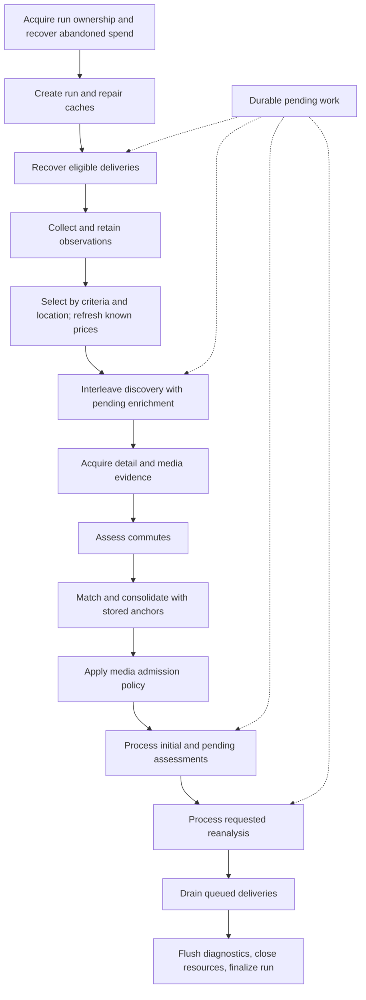

# Pipeline structure and terminology

The pipeline is a recurring workflow with durable queues. A run collects new
evidence and advances eligible work; it does not need to discover a new listing
to process pending enrichment, assessment, reanalysis, or delivery.

## Reading order

Start at [`pipeline/flow.py`](../src/home_finder/pipeline/flow.py). Its main body
shows the execution sequence; resource, accounting, and callback helpers follow
it. [`main.py`](../src/home_finder/main.py) only parses CLI options and dispatches.
The web scheduler calls the same workflow.

| Read next | Responsibility |
| --- | --- |
| [`pipeline/contracts.py`](../src/home_finder/pipeline/contracts.py) | Stage results, interrupted-work progress, and outcome summaries |
| [`pipeline/candidates.py`](../src/home_finder/pipeline/candidates.py) | Collection, selection, enrichment admission, commute assessment, consolidation, media admission |
| [`pipeline/collection.py`](../src/home_finder/pipeline/collection.py) | Source coordination and observation retention |
| [`pipeline/matching.py`](../src/home_finder/pipeline/matching.py) | Match against stored anchors and persist consolidation |
| [`pipeline/assessment.py`](../src/home_finder/pipeline/assessment.py) | Initial assessments and shared bounded execution |
| [`pipeline/reanalysis.py`](../src/home_finder/pipeline/reanalysis.py) | One queue processor shared by full runs and the CLI |
| [`pipeline/image_recovery.py`](../src/home_finder/pipeline/image_recovery.py) | Restore missing cached analysis images from stored URLs |
| [`pipeline/run_lock.py`](../src/home_finder/pipeline/run_lock.py) | Single-host exclusion and abandoned-spend recovery |

Follow a stage into its domain implementation only when that detail matters:
`scrapers/` acquires source data; `enrichment/` adds evidence and commute
measurements; `matching/` scores and groups listings; `analysis/` owns provider
requests, prompts, response validation, and evidence reconciliation. `filters/`
owns candidate admission, fit scoring, and notification selection policies.

Persistence has explicit owners on `PropertyStorage`:

- `processing`: preparation and assessment transitions, recovery, and reanalysis
  requests, implemented by `ProcessingRepository`.
- `runs`: run metrics, scraper metrics, and buffered diagnostic events,
  implemented by `RunRepository`.
- `spend`: paid attempts, reservations, reconciliation, and visual checkpoints.
- `deliveries`: durable notification decisions and transport receipts.

They share the existing owned connection and transaction boundaries. Network
operations remain outside database ownership. `db/enrichment_recovery.py` holds
the specific enrichment recovery transition; it is separate from run telemetry.

## Execution sequence

The diagram shows logical order. Empty preparation takes a short path to initial
assessment recovery. Initial result handlers persist the assessment and its
notification decision before invoking an immediate delivery callback. Dry runs
skip delivery transport and retain pending intents.

Detailed acquisition precedes commute measurement because it can supply missing
coordinates. Matching follows enrichment because images and fuller addresses can
disambiguate homes. Existing anchors retain their identity and history when new
source evidence is consolidated into them. The media rule runs after matching:
it accepts a source-declared floorplan, an exclusively exempt source set, or
sufficient gallery photos when that alternative is enabled.

## Vocabulary

| Term | Meaning in this code |
| --- | --- |
| Source listing | One platform's advertisement and source identity |
| Observation | Evidence received at a particular time; distinct from the latest stored projection |
| Property aggregate | One home represented by one or more source listings |
| Canonical listing | The listing whose identity represents the aggregate |
| Stored anchor | An established aggregate against which candidates are matched |
| Candidate | An aggregate being considered for the next stage; not yet a notification decision |
| Collection | Acquiring and retaining observations; scraping is the source-specific mechanism |
| Enrichment | Adding detail-page, media, or other evidence |
| Matching | Deciding which listings refer to the same home using heuristic evidence scores |
| Consolidation | Combining matched evidence while preserving identity, membership, and history |
| Analysis | Producing observations and an assessment from evidence |
| Assessment | The resulting judgment about a home; distinct from a match score or personal fit score |
| Admission | Selecting eligible work under readiness and capacity rules |
| Deferred | Work remains eligible but cannot proceed now |
| Exhausted | An explicit automatic-attempt ceiling has been reached |
| Reanalysis | Refreshing an existing assessment, including after new source evidence |
| Delivery intent | A durable decision that a notification should be attempted |
| Delivery receipt | Evidence that an external send was acknowledged |

Pipeline signatures use `SourceListing` and `PropertyAggregate`. These are aliases
for the existing `Property` and `MergedProperty` Pydantic models; their serialized
shape and identity rules are unchanged. Existing consumers can keep those model
names while new orchestration uses the more specific vocabulary.

`CommuteAssessor.assess_commutes` annotates every candidate. Outside-limit,
unreachable-in-this-search, missing-coordinate, and API-error outcomes do not
remove homes. `PropertyQualityAnalyzer` produces assessments; alert selection
remains a separate policy. Match confidence is a heuristic tier, not a probability.

## Stage and outcome contracts

`prepare_candidates` always returns a `CandidateBatch`, including an empty batch.
Its `candidates` are prepared aggregates and its `commute_lookup` contains measured
projections. The separate mutable `CandidateProgress` survives exceptions and
cancellation so partial counts can be persisted in the workflow's cleanup path.
`CollectedListings`, `FilteredListings`, `CommuteAssessments`,
`ConsolidationResult`, and `CandidateAdmission` name the other
stage results instead of relying on tuple positions.

`EnrichmentResult.with_usable_media` and `.without_usable_media` partition results
by gallery-image/floorplan readiness. Either group may contain acquired text or
details. Missing media is a readiness deferral, not proof that enrichment obtained
nothing, and media presence does not guarantee complete evidence coverage.

`AnalysisOutcome` tags each returned provider result as assessed, skipped,
deferred, or failed, with an explicit reason and optional assessment. Provider
compatibility values are translated once, before queue-specific persistence.
`InitialAssessmentSummary` separates assessed, skipped, deferred, and failed work.
`ReanalysisSummary` separates completed, deferred, and failed reassessments. Count
caps contribute to deferred totals; provider unavailability and spend admission
can defer admitted work too. Empty queues return empty summaries. These summaries
describe work processed by the queue; a completed phase does not mean every home
received an assessment or notification.

## Queue limits and compatibility

| Setting | Scope |
| --- | --- |
| `max_enrichment_per_run` | Discovery and recovered enrichment share this allowance |
| `max_initial_analyses_per_run` | Discovery and pending initial assessments share this allowance |
| `max_reanalyses_per_run` | Requested reassessments have an independent allowance |
| `max_analysis_per_run` | Legacy fallback for each unset assessment limit at configuration creation |

Both assessment limits default to 75. Explicit queue settings override the legacy
fallback. Setting each limit to one can admit two properties during a full run:
one initial assessment and one reassessment. The standalone reanalysis command
uses the same reassessment limit and queue implementation. These are property
admission caps, not HTTP-request or dollar limits; the separate spend policy still
controls paid operations.

The environment prefix is `HOME_FINDER_`. Existing `ENABLE_QUALITY_FILTER`,
`QUALITY_FILTER_MAX_IMAGES`, and `REQUIRE_FLOORPLAN` keys remain compatible even
though analysis is not a filter and floorplan admission has documented exceptions.
Existing database status values are also preserved. `NotificationStatus` is a
legacy combined processing/notification projection; consult delivery intent and
receipt state for transport outcomes. No schema migration is part of this change.

## Run metrics and diagnostics

New code uses explicit metric names. `CandidateProgress.run_columns()` translates
them to the existing `pipeline_runs` columns at the persistence boundary.

| Explicit metric | Legacy column | Population or unit |
| --- | --- | --- |
| `observed_listing_count` | `scraped_count` | Received source observations reported by collectors; may exceed the selected processing batch |
| `criteria_passed_count` | `criteria_filtered_count` | Listings surviving criteria selection |
| `location_passed_count` | `location_filtered_count` | Listings surviving location selection |
| `new_listing_count` | `new_property_count` | Newly selected listings, excluding enrichment recovery |
| `media_ready_count` | `enriched_count` | Enrichment results with gallery images or a floorplan, including recovery |
| `commute_within_limit_count` | Same | Candidate homes with a measured journey within the limit; advisory |
| `unmatched_candidate_count` | `post_dedup_count` | Candidates left after consolidation against anchors |
| `media_admitted_count` | `post_floorplan_count` | Candidates surviving media admission |
| `prepared_candidate_count` | `new_count` | Prepared candidates, potentially including recovery |
| `anchors_updated` | Same | Established anchors refreshed during consolidation |
| `InitialAssessmentSummary.processed_count` | `analyzed_count` | Handled initial items, including skipped analysis; not provider calls |
| `callback_deliveries_completed` | `notified_count` | Successful immediate initial-assessment delivery callbacks only |
| `collection_seconds` | `scraping_seconds` | Collection wall time |
| `filtering_seconds` | Same | Selection, known-price handling, and loading enrichment recovery |
| `preparation_seconds` | `enrichment_seconds` | Enrichment admission/persistence, detail acquisition, commute, consolidation, media admission |

`analysis_seconds` covers initial assessment orchestration (including immediate
callbacks and throttling) plus reanalysis. `notification_seconds` measures only
the final delivery drain. These phase times do not isolate provider latency.
The final drain's completed count is
`pipeline_complete.final_drain_completed_deliveries`; startup recovery reports
`delivery_recovery_complete.completed`. Neither is included in `notified_count`.
Initial returned token totals exclude reanalysis and may be incomplete after an
interruption; the spend ledger is authoritative for reconciled charges.

Counts are not a single decreasing funnel: sources can report observations beyond
a processing cap, recovery adds work, consolidation changes identities, and
commute measurements annotate rather than select. Collection health is separate
from property outcomes. A successfully executed run can report partial collection
and leave deferred work pending.

Assessment persistence records `assessment_completed` before the delivery
callback. Analysis disabled or unconfigured records `analysis_skipped` instead.
Diagnostic events are buffered; database `created_at` records insertion time.
IDs preserve local recording order, not exact occurrence times or a global order
across concurrent analyses. Historical events retain their old names; see the
[operations guide](operations.md#pipeline-names-and-queue-limits) for log changes.
