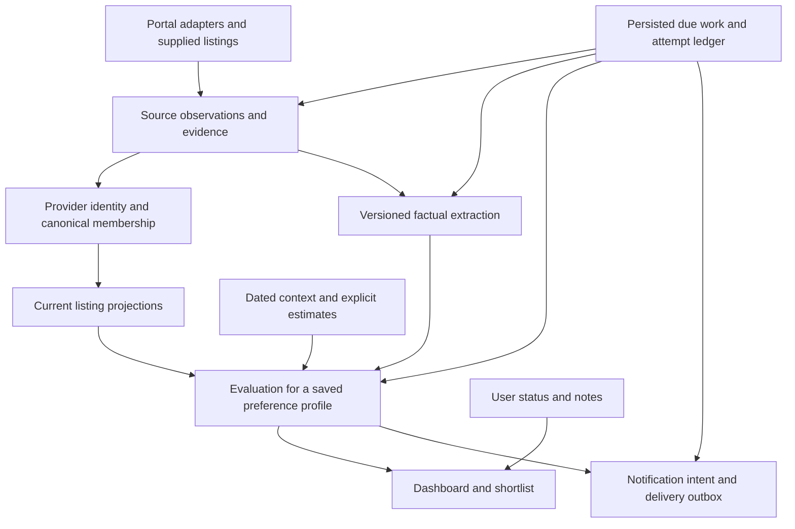

# Home Finder: research synthesis and sequential delivery plan

**Reviewed:** 28 September 2026. **Code baseline:** `a86e51e`.

**10 October review stack:** the accumulated 37 implementation commits are presented as **26 draft PRs**, [GitHub #3 through #28](https://github.com/MarcelCutts/home-finder/pull/28), in native stack #29. The [stack review index](2026-10-10-stacked-pr-review.md) maps every boundary to its rationale, architectural prerequisites, author review, verification and limits. All boundaries pass fresh local checks; remote CI remains `disabled_inactivity` while the old `main` workflow still contains live-test scheduling and automatic deployment. The original branch and user-owned corpus remain preserved. PR07b-2 is committed as `545ad7c`; PR07b-3 is the next implementation slice. The full delivery goal remains active.

**29 September batch update:** the owner authorized [a 50-listing experiment with a US$10 ceiling](2026-09-29-fifty-listing-pipeline-experiment.md). All 50 live listings enriched; 15 cross-portal pairs became 35 homes. Model processing stopped after one invalid visual response and an evaluation grammar-compilation 503: three requests, US$0.080853, zero complete assessments, all 35 retained pending. Offline replays reproduced exact memberships, matched 15 later listings to prior anchors and produced no new work for known listings. Online investigation and a separate curl capture led to the terminal-page repair `6ed6164` and safe output diagnostics `42f41f9`; runner/observability tooling is `7414332`. Changed-angle photos, a same-portal duplicate candidate and contradictory furnishing evidence now inform PR07b, PR11 and PR19. The report gives ordered follow-up and evidence limits; production remains paused.

**29 September dedup review:** [direct inspection of all 50 listings](../reviews/2026-09-29-deduplication-quality-review.md) supports all 15 accepted pairs and identifies a missed Southborough pair plus a three-listing Wilmot group. These imply three additional consolidations, or 32 provisional homes instead of 35; one further Cheshire pair remains uncertain. The agent labels are development evidence, not independent human truth. A network-blocked threshold experiment recovered nothing at 10–12 and created a wrong Cheshire merge at 22, before recovering one Wilmot link at 24. Keep matching thresholds unchanged; PR07b must support multiple listing IDs per portal and reversible review decisions. The same inspection found a bathroom photo incorrectly promoted to a floorplan, now an explicit PR11/14/21 case. No new provider calls or live membership changes occurred.

**29 September identity implementation:** [PR07b-1](2026-09-29-pr07b1-provider-identities.md) adds exact provider keys, immutable original-representation claims and a read-only audit. The historical mapping resolves 3,267 source rows to 3,006 provider listings while retaining all 261 duplicate representations and 17 ownership conflicts across 28 homes. All original rows survive isolated migrations of both the historical backup and the recent batch, including eight price-history rows across six affected homes. Distinct advertisements on one portal retain separate identities. Stable home IDs, legacy link resolution and reversible membership are the next PR07 slices; automatic matching and live membership remain unchanged.

**9–10 October stable-home implementation:** [PR07b-2](2026-10-09-pr07b2-stable-home-links.md) adds persisted home UUIDs, exact legacy links and redirects for the existing guarded staging-absorption operation. Web and Telegram mutations resolve inside their write transaction; new callbacks fit within 48 bytes, while original image/history keys remain intact. Network-blocked copy rehearsals preserved all original rows, all 1,016 historical homes and 201 aliases; the 50-listing replay still yields the same 35 homes with no paid work. The 17 ownership conflicts remain separate. Reversible membership decisions are next in PR07b-3; the accumulated verified work is now in the reviewed draft stack linked above. This is not a production cutover or completion of PR07.

**Status:** PR01 committed as `1dfdcb4`, PR02 as `84fb43b`, PR03 as `8bb73cc`, PR04 as `55f3171`, PR06a as `19d6f24`, PR17a as `b4cf2f9`, PR16a as `3e0c05d`, PR08a as `9149e48`, PR09a as `67a34a9` and PR12a as `b5d9859` on `codex/pr01-ci-baseline`. PR18a tooling and a read-only historical sample are committed as `02a75f1`; actual live capture still requires qualified source access. PR10 search/legacy repairs are committed as `11d08d7`; the [captured indexed-detail decoder](2026-09-28-pr10-indexed-detail.md) is committed as `9aba945`. Search date metadata is retained in PR06b-2; typeahead and full adapter qualification remain open. [PR20a's native SDK transport](2026-09-28-pr20a-sdk-transport.md) is committed as `03e3e4c`; [PR20b phase configuration/provenance](2026-09-28-pr20b-analysis-configuration.md) is committed as `fee3448` with unchanged defaults. [PR20c required output and typed failures](2026-09-28-pr20c-output-failures.md) is committed as `f632dd4`. [PR13a durable spending foundation](2026-09-28-pr13a-spend-ledger.md) is committed as `02093c0`; [PR13b native attempt enforcement](2026-09-28-pr13b-native-spend-enforcement.md) is committed as `58d538b`. Every native analysis attempt needs an explicit policy and reservation. No normal-operation budget is active; the separately authorized one-property smoke used two requests for US$0.082314500, as recorded below. [PR05a backup/restore and authority work](2026-09-28-pr05a-backup-and-authority.md) is committed as `ad34ba9`, including a fresh DB and all 27,517 retained asset files, with the retained hosted store/new-episode decision. [PR19a development reference tooling](2026-09-28-pr19a-blind-reference-pack.md) is committed as `9498f39` with a private 48-case pack, exact retained images and blank human-review labels; fresh text, independent review and holdout qualification remain open. [PR06b-1 observation foundations](2026-09-28-pr06b1-source-observation-ledger.md) are committed as `a48fcb2`. [PR06b-2 search integration](2026-09-28-pr06b2-search-observation-capture.md), `f305e04`, retains all received search revisions, verified Rightmove date/branch/floorplan metadata and assessment text references. [PR06b-3 detail integration](2026-09-28-pr06b3-detail-observation-capture.md), `d736289`, records each source’s own ID and saves detail evidence before image work. [PR06b-4 current text](2026-09-29-pr06b4-current-text-projections.md), `e5f1a9e`, derives description/features from retained evidence, preserves equal-rank conflicts and supplies the saved projection to analysis. [PR06b-5 raw references](2026-09-29-pr06b5-raw-capture-references.md), `9d41a13`, connects offline replay to exact raw hashes, stable normalized observations and explicit managed-body expiry. [PR06b-6 source quantities](2026-09-29-pr06b6-source-area-quantities.md), `7361f43`, retains exact decimal units/bounds and prevents a range or minimum from becoming a total-area scalar. [PR06b-7 receipt context/material](2026-09-29-pr06b7-request-context-and-material.md), `6a9be22`, records requested query/page metadata separately from facts and provides material fingerprints independent of receipt clocks/parser provenance. Historical data remains unchanged. Local observation groundwork permits isolated PR07 identity/preservation work; source qualification, non-text projections, coverage, artifact dependencies, retention scheduling and any required remote transport remain explicit follow-on work. No production cutover is implied. See the [PR01 handoff](2026-09-28-pr01-ci-baseline.md), [PR02 record](2026-09-28-pr02-owner-access.md), [PR03 record](2026-09-28-pr03-runtime-and-maps.md), [PR04 record](2026-09-28-pr04-database-ownership.md), [PR06a record](2026-09-28-pr06a-listing-text.md), [PR17a record](2026-09-28-pr17a-costs-and-guidance.md), [PR16a record](2026-09-28-pr16a-commute-outcomes.md), [PR08a record](2026-09-28-pr08a-price-and-availability.md), [PR09a record](2026-09-28-pr09a-observations-and-accounting.md), [PR12a record](2026-09-28-pr12a-recovery-and-scheduling.md) and [PR18a record](2026-09-28-pr18a-isolated-capture.md). Runtime audit findings and map activation checks remain explicit. Local commits do not imply merge or deployment. Continue sequential verified commits under the owner's latest instruction; per-segment pauses are superseded.
**Audience:** the owner, reviewers, and agents implementing one PR at a time.
**Revision:** incorporates the verified findings from [Fable's final review](2026-09-28-research-synthesis-and-delivery-plan-review.md); see §11 for accepted corrections, qualifications and fresh checks.

**Latest execution evidence — 29 September:** the [bounded pipeline smoke and debugging record](2026-09-29-bounded-pipeline-smoke.md), committed as `b6bddb0`, documents one fresh property, two successful Sonnet 5.5 requests, US$0.082314500 in usage estimates and 26.223 seconds end to end. The initial attempt exposed the [search-feature parser defect](2026-09-29-pr10-search-feature-objects.md), repaired in `16c4633`. Both attempts used isolated databases. Structured diagnostics now expose stage health, selection, physical model requests, reservations, latency and settlement; the smoke separately audits scope, spend and database integrity. The two-request authorization is exhausted. Review found a missed printed floorplan total, uncertainty issues, image-subset ambiguity and encoded listing markup; these enter PR19/21, PR14 and text-projection follow-ups. [PR07a merge preservation](2026-09-29-pr07a-merge-preservation.md) now protects established history, makes staging retirement atomic and retains original caches. A network-blocked production-copy rehearsal preserved every application table and deferred 19 destructive proposals. PR07b identity reconciliation and reversible membership are next. This does not qualify the source canary, promote a default model or resume production collection.

Navigation: [verified evidence](#3-independent-verification-performed-for-this-synthesis) · [execution order](#6-execution-rules-for-implementing-agents) · [PR specifications](#7-sequential-pr-backlog) · [milestones and operating gates](#8-milestones-measurable-gates-and-operating-cost) · [Fable review assessment](#11-assessment-of-fables-final-review).

## 1. Recommendation and product scope

Make Home Finder a dependable rental decision tool before making it a larger service. Its most important problems are currently loss of listing evidence, unsafe write ownership, misleading lifecycle states, incomplete collection visibility, and fragile recovery. More capable models, additional portals, PostgreSQL, and a workflow framework cannot repair those meanings by themselves.

Keep the Python modular monolith, FastAPI, server-rendered Jinja/HTMX dashboard, Telegram, existing source adapters, and deterministic scoring. Preserve the useful separation between visual observation and evaluation. Improve the contracts between these components, then change providers or deployment topology behind those contracts.

The original [product brief](../../CLAUDE.md) is unusually important: this is a London rental finder for someone who works from home, wants separation between work and sleep, likes cooking and interesting spaces, and wants to host people without disturbing neighbours. These are preferences with room for compromise. A generic property score, an office commute, or an arbitrary photo count must not silently become the product's purpose. The six existing fit weights express one person's preferences; they are not an objective measure of property quality.

The later [pipeline review](../../astra-pipeline-rewview.md) and [production review](../reviews/production-data-2026-09-27.md) explicitly target tens to hundreds of users. This plan reconciles that with the original brief:

1. **Immediate actions and small repair slices:** protect the exposed dashboard, resolve source-use feasibility, restore builds, retain descriptions/features, correct misleading facts/costs/commutes, and repair collection. Start bounded collection into an isolated capture store as soon as its narrow gate passes.
2. **Private pilot:** complete authoritative storage, retained evidence and recoverable work, while using fresh captures for evaluation. SDK compatibility and initial model comparisons need not wait for a complete hosted architecture.
3. **Hosted rollout:** qualify separate user state, independently deployable workers where justified, and gradual cohorts through PR25–28.
4. **Optional enhancements:** select from PR29–32 only when their evidence gates pass. Small location-context experiments can run earlier without becoming release prerequisites.

The 32 PR identifiers remain stable for traceability. **The execution order and named `a`/`b` slices in §6 supersede the original numerical order.** A slice is a separate reviewable PR with a bounded outcome; completing an early fix does not claim its larger parent specification is finished.

**The owner explicitly selected “A small hosted service for tens to hundreds of users, introduced gradually” in this conversation on 28 September 2026.** Fable could not see that exchange; the scope does not need reconfirmation. PR24 is a single-owner pilot milestone; PR25–28 remain required for the hosted target, subject to a viable source-access model and operational gates. Source permissions/licences and content-use options must be assessed at the start, not after building the hosted machinery. Do not assume that a free home computer, residential connectivity, a production TravelTime licence, or unlimited provider quotas are available. The research's £50–£200/month reference is a planning envelope, not an established all-inclusive budget or a demonstrated cost at hundreds of users.

**Product success:** find worthwhile homes promptly, explain why they may suit the user, expose missing evidence, and help the user act. Preserve a promising home with uncertainty rather than rejecting it through fabricated certainty. Measure useful shortlists and viewings alongside collection coverage, correctness, latency, and spend. Do not optimise notification volume, model-generated prose, or schema-valid JSON as ends in themselves.

## 2. What was reviewed and how much confidence to place in it

The recent corpus contains **24 research/workflow documents**: six root reports, fourteen Fable tracks, the production-data review, and three experiment documents. Dates here are the documents' stated research dates and available filesystem history; an untracked file is not necessarily newly written. Repository guidance and older reviews were read as context, not counted as new research.

Evidence order used in this synthesis:

1. Current code and reproducible application-level probes; reproducible queries over the frozen database.
2. Retained request/response artefacts and narrowly scoped experiments with stated inputs.
3. Current primary documentation, for supported interfaces, prices, rules, and lifecycle status.
4. Predictions, architectural proposals, model agreement, and general benchmarks.

Agreement between reports is useful corroboration, but does not turn shared assumptions into independent evidence. Online verification concentrated on claims that change the plan; this is not a claim to have rerun every benchmark, URL, vulnerability scan, or dependency-version comparison in the reports.

### 2.1 Main reports and experiment records

| Document | Assessment | Consequence for this plan |
| --- | --- | --- |
| [astra-research.md](../../astra-research.md) | Strong quality-first framing and sensible separation of acquisition, facts, and personal evaluation. Broad alternatives are research options, not an implementation specification. | Retain the modular monolith and gated comparisons; replace open-ended exploration with explicit acceptance gates. |
| [astra-pipeline-rewview.md](../../astra-pipeline-rewview.md) | Most useful architecture review for the later hosted scope: write authority, durable work, observations, personal state, and delivery. Its production-data follow-up is stronger than its earlier hypotheticals. | Adopt the contracts. Sequence database and queue adoption after correctness repairs. Preserve the existing filename, including its spelling. |
| [opus-research.md](../../opus-research.md) | Valuable concrete parser, dependency, transport, and UI investigations. Its personal/home-hosted assumptions do not fully match the confirmed service scope. Its model/cost recommendations are estimates and external-benchmark extrapolations, not its own paid model experiments. | Retain migration warnings and proposed comparisons. Obtain fresh retained fixtures: successful portal captures from this report were not found in the available corpus. Correct its “Legacy” label for Sonnet 4.6 without misattributing a model experiment to it. |
| [fable-research.md](../../fable-research.md) | Broadest coverage of product, regulation, data, models, and operations. Distinguish later production-aware synthesis from tracks written before that audit. Token/reasoning and caching interpretations need correction; its explicit statement that Sonnet 4.6 is not deprecated is correct. | Retain decision-oriented UX and evidence separation; do not use its numerical forecasts as a production budget or its version advice as permanent truth. |
| [astra-experiments.md](../../astra-experiments.md) | A substantial experiment backlog, with later status updates distinguishing completed probes from larger unfinished trials. | The proposed longer canaries, independent human labels, and end-to-end comparison remain work to do. Do not mark the original backlog completed from small probes. |
| [astra-labbook.md](../../astra-labbook.md) | Useful chronology, including changed hypotheses and corrected experiments. Chronological notes are not all simultaneously current recommendations. | Prefer corrected/replayed results and the latest stated limitations; preserve provenance when adopting a result. |
| [Production-data review](../reviews/production-data-2026-09-27.md) | Strongest account of historical data, with 51 reproducible queries and unusually careful separation of observations from causes. | Evidence preservation, identity repair, freshness, and projection invariants precede capacity work. |
| [Experiment README](../../experiments/modernization/README.md) | Clear separation of offline work, paid opt-in probes, retained attempts, and smaller-than-production contracts. | Reuse its bounded experiment conventions; do not treat its reference database as a writable development database. |
| [Initial findings](../../experiments/modernization/findings-2026-09-27.md) | Useful description-loss reproductions and initial model/text comparisons. Five visual cases and synthetic text are insufficient for model promotion. | Retain the cases as development regressions, not a hidden test set. |
| [Adaptive findings](../../experiments/modernization/adaptive-findings-2026-09-27.md) | Improves the initial work through real text, a corrected outdoor-space rubric, commute and recovery probes, and a dedup-corpus audit. It explicitly acknowledges absent independent human truth. | These results narrow the next experiments; they do not establish a winning production model or durable application implementation. |

### 2.2 All fourteen Fable tracks

All links in this table point into [the track directory](../research/fable-2026-09-27/).

| Track | Retain | Qualification or change |
| --- | --- | --- |
| [01: Claude/API quality](../research/fable-2026-09-27/01-claude-api-quality.md) | Smaller factual contracts, explicit reasoning settings, structured output, measured caching. | Phase two already uses native structured output. Schema validity does not establish truth; retain local validation and refusal/truncation handling. |
| [02: scraping/anti-bot](../research/fable-2026-09-27/02-scraping-antibot.md) | Current fixtures, transport comparisons, challenge classification, bounded retries. | A couple of successful requests do not establish a dependable source. Browser rendering does not prove application parsing. |
| [03: Jev](../research/fable-2026-09-27/03-jev-decision-models.md) | Cheap, constrained text decisions are worth a later comparison. | Synthetic success and confidence thresholds cannot justify hard rejection. Real descriptions exposed confident errors. |
| [04: listing sources](../research/fable-2026-09-27/04-listing-sources.md) | Native alerts and user-supplied listings can close acquisition gaps. | First repair the four sources and support bounded manual ingestion. Additional portals need evidence of unique relevant homes and sustainable access. |
| [05: dedup/vision](../research/fable-2026-09-27/05-dedup-embeddings-vision.md) | Copy-detection approaches and careful image comparison deserve testing. | Existing assignments are not labels; most historical pairs lack reproducible inputs. Semantic similarity, repeated floorplans, and stock images are insufficient identity evidence. |
| [06: UK open data](../research/fable-2026-09-27/06-uk-open-data.md) | EPC, address, council-tax and broadband evidence may improve shortlisted homes. | Verify unit matching, licence, coverage, and freshness separately. An outcode/approximate coordinate cannot establish flat-level facts. |
| [07: market/regulation](../research/fable-2026-09-27/07-uk-rental-market-regulation.md) | Date- and jurisdiction-aware costs and tenancy context are necessary. | Remove unsupported tenant service-charge estimates and fixed negotiation discounts. Separate law, advertised facts, and estimates; review actual applicability. |
| [08: Python stack](../research/fable-2026-09-27/08-python-stack.md) | Repair CI and dependency automation; account for TemplateResponse and SDK transport changes. | Upgrade compatible groups with security priority. Do not perform a blanket latest-version sweep or adopt prerelease Python. |
| [09: infrastructure](../research/fable-2026-09-27/09-infra-deploy-observability.md) | Backups, source health, freshness, and explicit operating cost. | The snapshot gives no database-volume reason to scale. Home-only hosting and hosted workers solve different operating problems. |
| [10: web/Telegram](../research/fable-2026-09-27/10-web-ux-telegram.md) | Shortlists, evidence links, manageable notifications, and clear next actions. | Authentication and delivery semantics come first. Preserve the lightweight web stack; prove whether richer Telegram features help before adding them. |
| [11: commute/geo](../research/fable-2026-09-27/11-commute-geo.md) | Explicit times, modes, batching, uncertainty and location precision. | Current error handling produces a zero-minute pass. Commute should be profile-specific and normally advisory for this WFH use case. |
| [12: agentic opportunities](../research/fable-2026-09-27/12-agentic-opportunities.md) | Bounded research and viewing preparation on a shortlist. | Keep the main pipeline deterministic. Read-only tools and user-requested drafts precede autonomous actions or agent runtimes. |
| [13: code audit](../research/fable-2026-09-27/13-codebase-audit.md) | Concrete write, lifecycle, retention, and security defects. | Reconcile with existing tests and implemented older tickets; counts of tests or vulnerabilities do not measure correctness or exploitability. |
| [14: model landscape](../research/fable-2026-09-27/14-model-landscape.md) | Compare task-appropriate models with controlled inputs and full cost. | Current official docs supersede capabilities/prices in a frozen survey. No model wins this application's workload on the evidence available. |

### 2.3 Older context that should not be mistaken for new work

The [older review collection](../reviews/), [tickets](../tickets/), existing layout/dedup experiment briefs, [morepostcoderesearch.md](../../morepostcoderesearch.md), and [rental_market_research.md](../../rental_market_research.md) help explain design intent and previous trade-offs. Several older roadmap recommendations already have implementations: migrations, CSP-related work, decomposed database modules, and pipeline integration tests exist. Reinspect the code before opening replacement tickets. Refresh time-sensitive market and provider facts instead of carrying February assumptions into a September restart.

## 3. Independent verification performed for this synthesis

No application implementation, production database, configuration, live notification, or paid inference was changed by this review. The new supporting code is an isolated [offline characterization script](../../experiments/modernization/synthesis_checks.py). Existing user work was left intact.

### 3.1 Frozen database: the census reproduced

Reference: `data/production-review/2026-09-27T122222Z/properties.db`, 23,683,072 bytes, SHA-256:

```text
e50897b46ebefea0119fd62951ac277d764684f9590d52801e66c964b1352c63
```

The audit used immutable, read-only SQLite. All **51 query results** reproduced the existing audit exactly, and the reference hash remained unchanged. The database contains 1,016 canonical properties, 3,267 source rows, 1,001 assessments and 57 runs. Collection/assessment data are from **13–28 February**, not September; retained property events cover only 17 runs on 23–28 February. Collection was intentionally stopped. **74 of the 135 commits reachable from the reviewed HEAD occurred inside that collection window.** This is a retained development-period dataset from a deployed application, mixing changing code and instrumentation; it is not a steady-state reliability sample.

| Verified finding | Interpretation and limit |
| --- | --- |
| No nonempty description in 1,016 canonical descriptions, their description maps, or 3,267 source rows | A definite retention failure. The snapshot alone cannot prove that historical model calls never received descriptions. |
| 940 of 972 extraction objects say council-tax Band C; the other 32 say unknown | Every concrete band is C. A generic Band C estimate appears in the property prompt: strong contamination hypothesis, not proof that 940 bands are wrong. |
| 261 duplicate `(source, URL)` groups; 17 link different canonical records, affecting 28 properties | Reconcile provider identity before tuning fuzzy matching. Preserve conflicting histories; equal URL is not automatic permission to merge homes. |
| No availability checks at canonical or source level | `is_off_market=false` means unverified here, not currently available. |
| 13 historical `running` rows | Incomplete finalization, not proof of 13 present-day crashed workers. |
| Three completed runs have zero scrape totals despite 3,255 retained criteria events | A demonstrated accounting defect. Early returns must still finalize accurate totals. |
| 19 OpenRent failed pages in five scraper runs labelled healthy | A demonstrated difference between partial acquisition and health reporting. |
| 25 `sent` properties have an unrated fallback assessment | Analysis state and delivery state are conflated. `sent` and a `notified` event are not Telegram delivery receipts. |
| Zero pending analyses/reanalyses, zero stored zero-minute commutes, zero eligible unsent price drops | The snapshot does not demonstrate those proposed incidents. Current-code probes establish the risks separately. |
| 66 prices outside their stored range; 23 value objects disagree with current price minus stored area average | Projection invariants are broken. Existing price histories themselves have coherent arithmetic and latest prices. |
| 30 personal status transitions, 18 properties ever represented in that history, 17 currently non-new | Insufficient and biased feedback for automatic taste learning. Unseen/new is not a negative label; archived has ambiguous meaning. |
| 15 cost-instrumented runs, 200 counted analyses, $32.1247557 recorded model cost | Useful historical cohort, not a complete invoice, current unit cost, or whole-service forecast. |

The follow-up audit adds material historical context:

- All 261 duplicate URL groups include backfill rows: 63 groups have one and 198 have two. This supports migration reconciliation, not a claim that normal current ingestion continuously creates those duplicates.
- All 23 inconsistent value objects last changed price on 19–21 February. Commit `5bf905d` added deterministic value recomputation on 22 February. Preserve and test that implementation; the old rows do not justify rebuilding an already-implemented feature.
- Of 66 prices outside their stored range, 65 have a collapsed `min_price == max_price` range. This reduces the visible range-display impact, but `detect_and_record_price_change()` still does not update the range, so the current invariant needs a narrow repair.
- Cost tracking arrived on 23 February. Later unmetered completed/cancelled runs after that instrumentation point have no recorded analyses; the two earlier positive-analysis runs that day preceded the cost-tracking commit. Do not call 42/57 an ongoing metering failure rate or infer a deployment timestamp from a commit timestamp.
- Twelve of the 13 unfinalized runs precede cancellation handling added on 22 February; one later run remains unexplained. Development restarts are plausible, not proven. Availability-check timestamps arrived on 24 February, and checking remained a separate command rather than a scheduled collection stage.

PR05 now explicitly compares an in-place repair with a fresh search episode or fresh active database plus a retained archive. The 106 price changes, 30 status events, aliases and saved message remain worth preserving; neither seven-month-old inventory nor a migration artefact requires expensive repair of every historical row before fresh collection can begin.

The retained token ledger attributes **67.6733% of those dollars to output tokens**. It does not split visible answers from reasoning. At its historical rates, repricing the same token mix with all input uncached gives **$35.898909**, so net cache savings are **$3.7741533, or 10.5133%** of that counterfactual. Neither “most cost is definitely reasoning” nor “caching only saves about 2%” follows from this ledger. The $0.160624 recorded average per counted analysis includes an incompletely characterised cohort; extrapolating it is a scenario, not a budget.

### 3.2 Application probes and baseline tests

The supporting script exercises current application code with synthetic listings, mocked network boundaries, and in-memory databases. It is a characterization of defects, not the desired future test specification. The description and commute rows replicate the earlier probes by importing their functions; they are **replications, not independently designed experiments**. The transaction, pagination and added web-only interleaving probes were written for this synthesis. The code paths and retained results were also independently inspected.

| Probe | Reproduced result | Required repair |
| --- | --- | --- |
| Successful detail enrichment supplies a description | Neither the canonical description nor source-description map retains it | Carry fetched text/features through enrichment and persistence. |
| Sparse source refresh follows a rich description | Rich text is overwritten with missing data | Define missing, explicit empty, correction, and stale update semantics. |
| Aggregate source-map refresh follows a rich map | The rich map is erased | Derive projections from retained observations, not a destructive sparse rebuild. |
| Two tasks share one storage connection: one writes then rolls back, another calls `mark_notified` between them | Original price 2,200 becomes 1,234 despite rollback; the other method committed the first task's write | Give transactions exclusive connection ownership across every awaited operation and commit path. |
| Two overlapping `_transaction()` contexts | `cannot start a transaction within a transaction` | Define unit-of-work ownership and prohibit unintended nesting. |
| Two operations used by web mutations, with no pipeline: a status update fails while a reanalysis request commits | Status remains `interested` after the failed request, with zero status-history rows; reanalysis is queued | Write ownership matters on the web-only deployment too. This is a controlled fault/interleaving, not a claimed observed production incident. |
| Fetched page contains only a known listing with an updated price | One page fetched, zero observations returned | Persist observed known listings before applying the pagination stopping policy. |
| Commute provider raises an exception | Returned as zero minutes and within limit | Preserve unknown/error and retryability; never manufacture a successful route. |
| Destination cannot be geocoded / all routes unreachable | Both return an empty list | Distinguish configuration failure, bounded-search unreachable, and valid results. |
| Mock route takes 1,801 seconds against a 30-minute limit | Floored to 30 and accepted by local response handling | Defensive boundary test only: the real request caps the search at 1,800 seconds, so this is not evidence of a normal provider-path error. Compare seconds if accepting broader/cached results. |

The commute stage deliberately documents advisory behaviour, and an existing test deliberately asserts its zero-minute outage fallback. Preserve the intended fail-open experience while representing the result as unknown. The inconsistent all-unreachable early exit and “dropped” accounting still need reconciliation with that advisory policy; passing known-over-limit homes through is not, by itself, a filter defect.

Validation completed:

- Default application suite: **2,378 passed**, 152 warnings, **85.18% branch-inclusive coverage**; default slow/browser exclusions retained.
- Existing modernization research suite: **18 passed** with network sockets blocked.
- Ruff checks and strict mypy passed on the application; the new script was linted and formatted.
- Local SQLite runtime is **3.53.4**. This does not establish the deployed image's SQLite build.

The sandbox stalled on an `aiosqlite` probe; tests and the complete offline characterization were rerun outside that restriction with network-blocking tests retained. This was an execution-environment issue, not counted as an application failure. Browser tests, current portal canaries, a fresh full dependency audit, remote CI run history and new paid model calls were **not** performed in this synthesis. The follow-up did make read-only GETs to the live dashboard/health endpoint: both returned 200, and the unauthenticated dashboard response contained listing links. No mutations or deployment changes were attempted. Its package checks and new web-only offline probe are recorded in §11; the original full-suite result above is not presented as a fresh rerun after a documentation change.

Reproduce from the repository root using the installed locked environment. These commands create new local output files, not changes to the reference database:

```bash
.venv/bin/python scripts/audit_pipeline_snapshot.py \
  --db data/production-review/2026-09-27T122222Z/properties.db \
  --output /tmp/home-finder-synthesis-audit-2026-09-28.json

.venv/bin/python experiments/modernization/synthesis_checks.py \
  --output /tmp/home-finder-synthesis-checks-2026-09-28.json

.venv/bin/python -m pytest experiments/modernization/tests \
  -o addopts='' --disable-socket --allow-unix-socket -q

.venv/bin/python -m pytest --cov --cov-report=term -n 4
.venv/bin/ruff check src tests experiments/modernization/synthesis_checks.py
.venv/bin/ruff format --check src tests experiments/modernization/synthesis_checks.py
.venv/bin/mypy src
```

Choose a fresh output filename when rerunning the characterization; it refuses to overwrite evidence. The research suite has its own scope, so the application coverage threshold is not applied to those isolated prototypes. The successful outputs for this review were saved under `/tmp`; the durable record is this report plus the scripts and existing query definitions, not a promise that temporary files survive another agent session.

### 3.3 What the earlier experiments establish

The recorded modernization model experiments comprise **145 calls** and an estimated **$0.533518365**. They were not new calls in this review. The initial 73 calls cost approximately $0.472086; the adaptive 72 approximately $0.061432. All recorded HTTP responses succeeded, but this is not a reliability comparison with retries or outages.

- Five visual examples compare a compact factual contract, not the application's full two-phase assessment. Model agreement and valid JSON are not independent accuracy labels. Four configurations had a contract failure on at least one example; Sol's five valid outputs do not establish a production winner.
- Targeted floorplan transcription supports copying printed units and converting in code. Converting 492 sq ft to about 45.7 m² does not turn a marketing floorplan into an exact survey. Additional reasoning misread a door in one case; gallery removal was tested for floorplan questions, not appliances, condition or sound insulation.
- The text set is **12 decisions on four real descriptions plus eight authored challenges**, all with assistant-provisional labels. On the real subset, rules scored 12/12, Luna 11/12, and Jev 10/12. On the challenges, rules scored 2/8 and both models 7/8; combined totals are 14/20, 18/20 and 17/20 respectively. Jev confidently misread “No Garden Access” as absence of all private outdoor space. Neither four descriptions nor deliberately difficult challenges establish population superiority. The repaired rubric reused development cases; it was not a new holdout.
- The retention prototype's 17 checks and recovery prototype's 30 checks are promising design demonstrations. The latter includes three real child-process exits with mocked inference; it is not a proof of concurrent claims, lease fencing, provider billing, or production durability.
- Only 40 of 140 historical dedup pairs have both source rows available; original image/vector inputs are absent. The 140 pairs contain only 33 connected groups, including one large group of 38. Random pair splitting would leak identities across training and evaluation.
- Ten collection requests found useful detail text on OnTheMarket/OpenRent, a Rightmove detail 429 and Zoopla 403. The harness used simplified transport/session behaviour, not a complete run of each production adapter: these responses do not establish application-wide source failure. Later browser rendering improved one Rightmove example but left Zoopla challenged. The retained Rightmove detail bodies are two 463-byte 429 responses, not fixtures proving the new successful detail format. The corrected OpenRent replay is `collection-v1/summary-reparsed.json`; use it instead of the initial mocked-response result.

These results justify focused follow-up. They do not justify selecting a global model, adding an eight-photo rejection rule, removing all browser fallback, or forecasting a production-wide cost reduction.

## 4. Online verification that changes implementation decisions

The following primary sources were checked on 28 September 2026. Recheck moving versions and commercial terms in the implementation PR that depends on them.

| Decision | Verified source and consequence |
| --- | --- |
| Do not force a model migration on a false retirement deadline | Anthropic's [deprecation page](https://platform.claude.com/docs/en/about-claude/model-deprecations) lists Sonnet 4.6 as active. Earliest possible retirement dates are not announced shutdown dates. Compare models on the application task. |
| Separate SDK migration from model/prompt changes | Anthropic's [v1 migration guide](https://github.com/anthropics/anthropic-sdk-python/blob/main/MIGRATION.md) documents the `httpx2` transport and timeout/client incompatibilities. A test-only alias can hide a production incompatibility; use the supported production transport in tests. |
| Keep local validation with native structured output | Anthropic's [structured-output documentation](https://platform.claude.com/docs/en/build-with-claude/structured-outputs) describes supported schema handling, refusals and token-limit cases. Valid output is still subject to domain/evidence validation. Phase two already uses this capability. |
| Treat lower advertised price as a candidate, not a result | Anthropic's [Sonnet 5 announcement](https://www.anthropic.com/news/claude-sonnet-5) gives current $2/$10 per million input/output tokens. Total tokens, retries, image scope and factual errors still determine workload economics. |
| Correct frozen model capability claims | Official [Luna](https://developers.openai.com/api/docs/models/gpt-6-luna) and [Sol](https://developers.openai.com/api/docs/models/gpt-6-sol) documentation supports image input and structured output. Use a pinned model/configuration and controlled comparison, not a landscape table as a rollout decision. |
| Account for cache writes as well as hits | OpenAI's [caching-mode documentation](https://developers.openai.com/api/docs/guides/prompt-caching#choose-a-caching-mode) distinguishes implicit and explicit caching; current default writes can cost 1.25× uncached input, with discounted reads. Measure stable-prefix reuse and avoid assuming one-use image payloads benefit. |
| Treat spatial vision claims cautiously | OpenAI's [vision limitations](https://developers.openai.com/api/docs/guides/images-vision#limitations) include small text and spatial reasoning. Use a human rubric and evidence; no model is ground truth for a floorplan. |
| Do not use classifier confidence as an automatic rejection guarantee | TypeSafe's [confidence documentation](https://docs.typesafe.ai/confidence) describes a distribution-derived statistic. Establish calibration and false-rejection rates on real, independent rental descriptions. |
| Repair form handling in a compatible dependency group | The primary [Starlette advisory](https://github.com/Kludex/starlette/security/advisories/GHSA-82w8-qh3p-5jfq) covers ignored URL-encoded form limits in affected versions and names 1.3.1 as the fix. The app calls `request.form()`. Check current exposure and choose a compatible FastAPI/Starlette release; do not override dependency constraints blindly. |
| Verify SQLite inside the shipped runtime | SQLite's [WAL-reset advisory](https://sqlite.org/wal.html#walreset) identifies the multi-connection write/checkpoint race and fixed releases including 3.51.3 and backports 3.44.6/3.50.7. Check the actual build/backport, not only the Python or base-image label. |
| Retain SQLite until topology justifies a change | SQLite's [appropriate-use guidance](https://www.sqlite.org/whentouse.html) makes writer concurrency and deployment shape relevant. This 24 MB snapshot supplies no volume-based reason for an immediate database migration. |
| Repair dependency automation for the actual lockfile | GitHub's [supported ecosystems](https://docs.github.com/en/code-security/reference/supply-chain-security/supported-ecosystems-and-repositories) includes the `uv` ecosystem. Verify a real release/full commit in [setup-uv releases](https://github.com/astral-sh/setup-uv/releases); do not copy another unverified major tag. |
| Validate the map visually and commercially | CARTO's [API-key policy](https://carto.com/basemaps/apikey/) documents authentication/watermark and usage-tier implications. A tile returning HTTP 200 may still be unsuitable. Preserve attribution and confirm the plan for the actual hosted use. |
| Make rental guidance specific to England and the tenancy | The government's [tenant overview](https://www.gov.uk/guidance/renters-rights-act-overview-for-tenants) and [rent-in-advance guidance](https://www.gov.uk/government/publications/asking-for-rent-in-advance-guidance-for-local-authorities/asking-for-rent-in-advance-guidance-for-local-authorities) explain the changes from 1 May 2026, with applicability and transitional details. Do not generalise them to all UK tenancy types or encourage above-asking bids. |
| Remove invented tenant service-charge totals | Use the current [Tenant Fees Act guidance for tenants](https://www.gov.uk/guidance/tenant-fees-act-2019-guidance-for-tenants), updated 7 July 2026, rather than the older collection's withdrawn core guidance. A leaseholder-style service-charge estimate is not evidence of an additional tenant liability. Preserve explicitly advertised included/excluded bills and qualifying context. |
| Preserve route units and bounded-search meaning | TravelTime's [matrix reference](https://docs.traveltime.com/api/reference/travel-time-distance-matrix) describes travel times and unreachable results. Compare seconds, retain the request window/mode, and do not turn a failed request into a route. Commercial entitlement still needs verification before production use. |
| Qualify a queue rather than assuming a library solves recovery | Procrastinate supports [external transactions](https://procrastinate.readthedocs.io/en/stable/howto/production/external_connection.html), but [stalled-job recovery](https://procrastinate.readthedocs.io/en/stable/howto/production/retry_stalled_jobs.html) still needs explicit operational handling. Recheck maintenance and test crash semantics before choosing it. |
| Recheck EPC access and licence, not just an old endpoint | The current [energy performance data service](https://get-energy-performance-data.communities.gov.uk/) and [API documentation](https://get-energy-performance-data.communities.gov.uk/api-technical-documentation) are the implementation starting point. Flat-level matching and licence permission are separate gates; unrestricted address-data reuse was not established here. |
| Promise durable intent, not exactly-once Telegram delivery | The [Telegram Bot API](https://core.telegram.org/bots/api#sendmessage) returns message identifiers on acknowledged sends. The application must handle the gap between a successful remote send and recording its result, plus partial multi-message sends. |

### 4.1 Source access and content use are an early feasibility decision

Fable is right to move this check forward. Technical access, permission to store/redisplay text or photos, permission to send material to a model, and permission to cache derived provider data are separate questions. Record a dated source/feature matrix before live collection qualification and before committing to a hosted acquisition/display model. Recheck it at onboarding, not for the first time at PR28. A portal's terms are relevant evidence; this review does not decide enforceability or declare every possible use unlawful.

| Source | Fresh primary-source check | Plan consequence |
| --- | --- | --- |
| Rightmove | [Terms](https://www.rightmove.co.uk/c/terms-of-use/), §§5.2/5.5 and 8.3, restrict automated access and copying/redistribution without the specified permission. | Assess an authorised access/content arrangement or another viable source model before assuming a shared scraped catalogue is deliverable. |
| Zoopla | [Terms](https://www.zoopla.co.uk/terms/) restrict scraping/mining and commercial content use, explicitly including AI solutions; the mining clause also contains an applicable-law qualification. | Treat acquisition, model processing and hosted redisplay as distinct scope decisions. A working transport or a forwarded alert does not establish those rights. |
| OnTheMarket | [Terms](https://www.onthemarket.com/terms/), §3.3, make a qualified exception for uniquely identified, robots-compliant programs; §2.2 separately restricts copying/storage. | Do not interpret the crawler exception as unrestricted permission to retain and redistribute content. |
| OpenRent | Current applicable terms were not independently established in this follow-up. The prior corpus cites an endpoint the later review could not retrieve. | Record unresolved access/content status; obtain the applicable source before claiming the fourth portal is qualified. |
| TravelTime | Current [terms §7.3](https://traveltime.com/terms-of-service) require caching permission in the Order. Where permitted, refresh at least every **60 days**, or the specified alternative, and delete on expiry/termination or earlier request. | Fable's Enterprise/non-commercial/30-day summary is not the current contract wording. Resolve the actual account's Order, permitted retention and end-user use before enabling route-result persistence/reuse. |

If the shared-portal-content model is not viable, preserve the hosted product goal and evaluate narrower alternatives: permitted feeds/direct-agent arrangements, user-provided material with appropriate rights, or a link-and-personal-notes workflow. These are options to investigate, not assumed licences. Offline correctness work can continue while source arrangements are resolved. Do not build costly source-specific hosted machinery on an unresolved commercial premise.

### 4.2 Additional dependency and location checks

The publisher's [curl_cffi redirect advisory](https://github.com/lexiforest/curl_cffi/security/advisories/GHSA-qw2m-4pqf-rmpp) affects versions below 0.15.0; the lock contains 0.14.0. Add that specific upgrade/redirect-policy check to PR03/11, especially before manual URL ingestion. Host/redirect validation remains an application requirement.

The Crawlee 1.3.2b4 release JSON endpoint returned 404, but a HEAD request to the exact wheel URL in `uv.lock` returned **200**. Therefore an unavailable release entry does not establish that `uv sync --locked` currently fails. PR01 must exercise a cache-free locked install; PR11 should select a supported stable release with parser/session tests instead of blindly copying a newer version.

Location-only enrichment is worth restoring as an optional earlier experiment, but coordinates are not all equally precise. TfL publishes [PTAL on a 100-metre grid](https://tfl.gov.uk/info-for/open-data-users/our-open-data?intcmp=3671); select the correct base/scenario year. Defra's [noise maps](https://www.gov.uk/government/publications/strategic-noise-mapping-2022/explaining-the-2022-noise-maps) model road/rail exposure, not measured indoor insulation or neighbours' tolerance. The Environment Agency's [long-term flood service](https://www.gov.uk/check-long-term-flood-risk) describes area risk, not the probability that an individual flat will flood. These constraints belong in PR29's data contract and UI, alongside licences and location precision.

## 5. Architecture to implement incrementally

### 5.1 Boundaries and ownership



One authoritative database owns catalogue changes, user actions, jobs and delivery intent. Initially it may be SQLite with a single application/worker deployment and explicit write ownership. A collector running elsewhere submits observations through an authenticated, bounded ingestion interface; it never replaces the authoritative database file. Choose collector placement from measured portal behaviour and operating constraints.

Use ordinary relational records and versioned artefacts. This does not require a graph database, vector database, full event-sourced rewrite, message broker, or distributed agent system. Keep typed component interfaces so the database, queue, and model provider can change separately later.

### 5.2 Data contracts

The names below are logical contracts; extend existing tables where adequate instead of creating every proposed table in one PR.

| Contract | Required meaning |
| --- | --- |
| Provider listing | Stable provider + provider listing ID where known; URLs and legacy IDs are aliases. A listing/relisting is not automatically a distinct home or the same home. Unresolved identities remain explicit. |
| Source observation | Immutable observation time, ingestion time, query/source scope, parser version, fetch outcome and evidence reference. Material content revision excludes volatile fetch timestamps. Preserve each source's contradictory claims. |
| Field evidence | Value/status, source observation, method, evidence span or image reference, and relevant confidence/precision. Distinguish missing, explicit empty, estimated, inferred, conflicting, and verified. Confidence is not proof. |
| Canonical membership | Stable internal property ID and reversible source-membership decisions with reasons. Preserve old links, prices, assessments, statuses, and notes through merges/splits. |
| Artefact | Content hash, media type, source, capture time, storage reference and retention/access policy. Atomic file publication plus manifest reconciliation; a database row must not imply a missing file is readable. |
| Extraction | Source-only facts keyed by material evidence hash + extraction/prompt/schema/model version. Dated area assumptions and user preferences cannot become extracted facts. |
| Evaluation | Factual revision + selected price revision + dated context revision + preference/scoring version. Recompute cheap policy changes without repeating visual extraction. |
| Work item | Kind, target, input/policy revision, due time, attempts, outcome, claim owner/expiry/generation and next action. `completed`, `deferred`, `failed`, `cancelled` and `superseded` have different meanings. |
| Model attempt | Work key, provider/model/request configuration, reservation, request ID when available, usage/cost components, timestamps and confirmed/unknown outcome. Do not release ambiguous spend merely because the client timed out. |
| Notification intent | Recipient + logical event + event revision, created atomically with the domain transition. Delivery attempts and individual message effects are separate; the original discovery event survives reanalysis without being recreated. |
| Personal state | Owner, saved search/profile revision, status history, notes, shortlist, delivery settings and consented actions. Shared factual analysis cannot expose another user's preferences or notes. |

A sparse search response must not clear a richer detail description. An authoritative later detail correction can replace it, including an explicitly confirmed empty value. Older observations arriving late must not overwrite newer authoritative facts. Choosing the longest string forever is not a valid correction policy.

The minimum conceptual state progression is:

```text
observed -> detail due -> evidence ready -> extraction due -> facts ready
         -> evaluation due -> evaluated -> notification intent -> delivery outcome
```

Each arrow is a persisted transition with explicit reasons for deferral or failure. Missing images, a parser challenge, absent credentials, quota exhaustion, schema refusal, and a confirmed off-market listing are different outcomes. A single enum need not encode every possible combination; keep evidence, work, evaluation and delivery states independently understandable.

### 5.3 Reuse, identity and freshness rules

- A price-only change invalidates price-dependent evaluation, not unchanged visual extraction.
- A preference change invalidates that profile's evaluation, not shared source facts.
- A prompt/model/schema change creates a new extraction/evaluation version; it does not silently overwrite historical evidence or notify everyone again.
- A changed image URL with identical bytes can reuse a content-addressed artefact. A reused stock image is not proof that two properties are the same.
- Geocoding to an outcode centroid must not count as precise coordinates and independently as postcode evidence in matching.
- A failed fetch is unknown availability. A related listing's “let agreed” badge is not the target property's status. Define source-specific evidence and confirmation policies.
- A new assessment timestamp does not refresh a listing. Track observation, availability check, assessment and projection update times separately.
- Listing text is untrusted input: escape it in the UI, bound its size, and prevent model-produced text/URLs from authorising tool actions.

## 6. Execution rules for implementing agents

**Use the ordered queue below, not ascending PR numbers.** The original IDs identify stable work packages; named `a`/`b` slices separate a small immediate repair from its fuller contract. Each card retains the final outcome, tests and rollback; the slice description limits what its early PR must implement. The status line and linked handoffs record completed local segments; operational gates remain outstanding. An implementation agent takes the next eligible item, records evidence and hands off; it does not silently declare the parent package complete after its `a` slice.

**Execution instruction (owner update after PR01 review, 28 September 2026):** commit each completed step and continue through the tasks using goals. This supersedes the earlier requirement to pause after every segment. Verify each bounded change, write its handoff, commit only its files and continue to the next eligible queue item. Keep the goal and this conversation as continuity records; the latest owner instruction takes precedence over the goal's older pause wording. External rollout, source-access and elapsed-evidence gates still apply. Completing a segment does not complete the full hosted-service goal. See [OpenAI's long-running-work guidance](https://learn.chatgpt.com/docs/long-running-work) and [PR01's goal protocol](2026-09-28-pr01-ci-baseline.md#goal-and-review-protocol).

### 6.1 First operating actions

**O1 — Protect the existing deployment now, before publishing an exposure report or reactivating it.** The read-only follow-up confirmed a publicly readable dashboard. Use a private ingress/access layer or private maintenance state as the first release action, with an owner recovery path and consistent backup. Do not wait for callback-token redesign or database migration. Do not delete volumes or stop an unrelated service. This review made no deployment changes; O1 is an outstanding implementation/operating task. Application authentication and form limits still follow in PR02/03.

**O2 — Establish the source/product feasibility matrix from §4.1.** Record permissible acquisition, storage, model processing, redisplay and caching for the chosen source/channel, including the actual TravelTime account terms. Choose a viable initial coverage model before activating new collection and before building source-dependent hosted features. Unresolved sources remain outside the enabled live cohort; independent offline fixes continue. This is not a request to reconsider the owner-confirmed hosted goal.

**O3 — Define active search, paused and dormant operation.** Keep the current collector explicitly paused during repairs. In dormant mode, retain protected history, backups and a tested restore/resume path while avoiding unnecessary continuous analysis or an always-on performance VM. Confirm actual billing before quoting savings; the roughly $35 figure is a configuration-based estimate, not an inspected invoice. On resume, open a new search episode, refresh references/source support, and suppress historical rediscovery. A full tenancy-management product is outside scope.

### 6.2 Ordered implementation queue

Within a row, implement the listed items left to right. An elapsed canary or pending human annotation may run while the next **independent** item is implemented; it cannot satisfy a dependent gate until its evidence exists. No parallel agents are required.

| Order | Work | Bounded outcome and dependency rule |
| --- | --- | --- |
| 1 | PR01 | Reproducible CI, manual release activation during repairs, cache-free install check, temporary SDK compatibility bound and corrected operating documentation. |
| 2 | PR02 → PR03 | Owner access/application protection, compatible security/runtime updates. The map-only change may land independently within PR03. O1 remains the immediate containment action. |
| 3 | PR04 | Minimal complete connection/write ownership repair, including web-only mutations; no generic persistence rewrite. |
| 4 | PR06a → PR17a → PR16a | Preserve descriptions/features through the actual model request; remove contextual Band C contamination/guessed costs; represent commute failure honestly. Full observation/profile systems are not prerequisites. |
| 5 | PR08a → PR09a → PR12a | Fix price-range updates/target-status parsing, retain known-page observations and accurate early-return counters, drain existing due work on zero discovery, repair cron/run exclusion. |
| 6 | PR18a | Start bounded **collection-only capture into a separate staging store** for any already-qualified source. No production database replacement, paid analysis, commute calls or notifications. Do not wait for all four sources or full PR05–17. |
| 7 | PR10 → PR11 | Repair/qualify current source contracts and transports with retained successful fixtures; add sources to the capture cohort only as qualified. If none works at order 6, complete this row first or use rights-appropriate supplied examples. |
| 8 | PR20 → PR13 | Migrate SDK transport/configuration with unchanged baseline semantics; add complete per-call accounting and enforced spend admission before new paid comparisons. Human labels do not block the SDK change. |
| 9 | PR19 → PR21 | Build a small independently checked reference set from captures, then compare candidates under a budget. A qualified result may be merged before production rollout; enable it only with the later recovery/delivery controls. |
| 10 | PR05 → PR06b | Choose authoritative placement and archive/search-episode strategy, prove restore, retire file replacement, then implement complete versioned observations/provenance. This independent work can proceed while labels are pending. |
| 11 | PR07 → PR08b → PR09b | Preserve identity/history in the chosen active/archive design; finish price/availability projections and source-scope freshness/accounting. |
| 12 | PR12b → PR14 → PR15 | Persist claims/recovery, artefact/checkpoint reuse and delivery effects. Set simple alert tiers, limits and quiet hours before the first pilot sends. |
| 13 | PR16b → PR17b → PR18b | Version personal policy and permitted route caching; finish dated context; qualify a seven-day authoritative collection canary. Earlier captures inform this gate but do not replace it. |
| 14 | PR22 → PR23 → PR24 | Supported supplied-listing workflow, full shortlist experience, and 7–14 days of end-to-end private pilot evidence. |
| 15 | PR25 → PR26 → PR27 → PR28 | User isolation, hosted storage/worker qualification and gradual invited cohorts, using the source/product feasibility decision already made. |
| 16 | Selected PR29–32 | Optional improvements only. PR29's small location-context pilot may be brought forward after evidence/precision contracts exist; it cannot delay the core pilot. |

The early slices are deliberately narrow:

- **PR06a:** carry per-source descriptions and features through enrichment, persistence and the model-call boundary; prevent missing values clearing richer data; test corrections/empty semantics explicitly. **PR06b:** full source observations, replay/provenance and historical classification. Fable's 25-line patch is useful evidence of a small repair, but leaves features, source-row writeback and explicit clears unresolved.
- **PR08a:** fix current price-range updates and primary-listing availability parsing. **PR08b:** cross-source selection/rebuild/version policy and necessary legacy repair; do not reimplement value recomputation already present.
- **PR09a:** persist fetched known listings and correct early-return/partial-result accounting. **PR09b:** full per-query coverage, freshness, heartbeat/readiness and diagnostic contracts.
- **PR12a:** run existing recovery paths without new discoveries and implement reliable single-runner scheduling/exclusion. **PR12b:** the durable work/claim/fairness contract. An in-process lock alone cannot exclude a separate cron/CLI process.
- **PR16a:** preserve advisory/fail-open intent using unknown/error states and fix the all-unreachable accounting/abort inconsistency. **PR16b:** versioned profiles, explicit time/mode/precision and contract-permitted cache reuse.
- **PR17a:** remove unsupported service-charge/negotiation assumptions and source-fact contamination; add current dated England context. **PR17b:** complete versioned reference data and projection/UI handling.
- **PR18a:** safe acquisition capture for learning, under an explicit request budget and output namespace. **PR18b:** sustained collection against the repaired authority. `--dry-run` is not a collection-only control: it still runs analysis and can incur charges.

### 6.3 Common implementation and handoff requirements

Before each PR:

1. Read repository guidance, this plan, the relevant source document, and current code/tests. Rebase the assumptions against the current branch; do not reimplement an already-completed repair.
2. Inspect the working tree and preserve unrelated user changes. Never run the app against the frozen reference export or commit databases, images, raw personal data, keys, or generated caches.
3. Confirm dependencies from merged code and evidence, not a checkbox alone. If a prerequisite failed, document the blocking invariant and repair it before dependent work.
4. Use an isolated writable database copy for migrations. Record pre/post counts, foreign-key checks, protected histories, and a restore exercise. Backups use a consistent SQLite backup/snapshot process, not a blind copy of an active database/WAL pair.
5. For a bug fix, first reproduce the undesired behaviour and then assert the desired behaviour. Existing research probes that assert the bug must not be mistaken for regression tests of the repair.

Every implementation PR must contain the concrete behaviour change, scope exclusions, migration/configuration impact, relevant tests, rollout/rollback steps and evidence of its exit gate. Keep the full default CI checks; add focused failure/concurrency/browser tests where they establish a real property, not tests that mirror implementation details. Update source docs when transport/parser policy changes. A docs-only PR does not need invented application tests.

Required handoff entry, appended under the implemented card or in a linked PR record:

```text
PR ID / commit or review URL / state: planned | in progress | ready for review | committed | merged | deferred
Behaviour implemented and any justified deviation:
Migrations and backup/restore evidence:
Commands run and results; live calls and estimated/recorded spend, if any:
Acceptance criteria met, remaining limitations, and rollout state:
Rollback point and preserved compatibility:
Next eligible PR and any unresolved decision:
```

Do not mark a rollout gate complete because code merged. A seven-day canary takes seven days of observations; a labelled holdout needs references independent of the model being evaluated. Keep normal production processing paused until its gates pass, while allowing the bounded isolated capture stage above. Individually validated security and small correctness fixes can be released earlier. This plan is not a record that any production restart, paid benchmark, or user onboarding has already happened.

Effort labels below describe the **complete parent package**, not an early slice: **S** is narrow, **M** spans a few components, **L** includes a substantial migration or cross-cutting contract. Use the named slices above instead of making a quick repair wait for its L-sized parent. Additional splits must preserve dependency and exit-gate clarity. Planning ranges and assumptions are in §8.4; they are not delivery promises.

## 7. Sequential PR backlog

### PR01 — Restore a reproducible CI baseline and control release activation [S]

**Implementation record:** [local segment, verification and review handoff](2026-09-28-pr01-ci-baseline.md). The owner accepted the review checkpoint and requested a commit followed by continued implementation.

**Depends on:** none. **Outcome:** subsequent changes can be evaluated without accidentally restarting the production pipeline.

**Work:** inspect `.github/workflows/ci.yml`, `.github/dependabot.yml`, `pyproject.toml`, `uv.lock`, Dockerfiles and deployment configuration. Replace unresolved/moving action references with verified releases pinned to full commits, with readable version comments. In particular, verify the current `setup-uv@v8` reference rather than copying it forward. Retain separate lint, typecheck and test gates. Review the main-branch automatic Fly deploy before making previously broken CI green; make production activation an explicit configured release step while the repair series lands. Do not disable useful checks to achieve a green run.

Use `uv sync --locked --all-extras` in a clean environment. Correct Dependabot to maintain the actual uv lockfile. Document the currently tested Python version and the mismatch between advertised 3.11+ support and deployed/tested 3.14; make the supported-runtime decision in PR03.

Check the remote workflow's enabled/disabled state as well as its YAML; the final review reports `disabled_inactivity`. Perform the clean install without an existing environment or package cache, and distinguish release-index availability from the pinned wheel's availability. Add a temporary documented `anthropic<1` compatibility constraint while the deliberate PR20 migration is pending; the existing locked 0.81.0 is already fixed, so this protects future dependency resolution rather than repairing a spontaneously changing runtime.

Correct `CLAUDE.md`, README and operating/source notes that agents will read: actual pipeline order, phase two's native `output_config`, writable dashboard endpoints, the historical cost cohort and its limits, scheduling semantics, and the confirmed hosted target. Replace the unsupported $0.05–0.07 headline with dated measurements, not a universal $0.16 promise. Keep documentation aligned as subsequent slices land.

**Verify:** clean CI resolves all actions, installs the lock, runs Ruff/format/mypy/default tests, and builds the distribution. A pull request cannot deploy or access deployment secrets. Demonstrate that repairing CI alone cannot activate collection. Preserve the 75% coverage floor; today's 85.18% is a baseline, not a new arbitrary required threshold.

**Rollout/rollback:** workflow-only change first; record the previous deploy configuration and keep an explicit known-good release available. No data migration.

### PR02 — Protect the private dashboard, mutations, and Telegram callbacks [M]

**Depends on:** PR01 for the implementation; O1 operational containment is immediate and independent. **Outcome:** only the configured owner can view private data, change status, or request paid work.

**Work:** introduce one consistent authentication dependency in `web/app.py` and `web/routes.py`, using an established access/session mechanism suitable for the deployment. Cover full pages, HTMX fragments, detail endpoints and private cached images, as well as status/reanalysis mutations. Validate CSRF/origin for cookie-authenticated mutations and apply bounded request bodies/rate limits. A reanalysis click must coalesce into one pending intent, not create unlimited paid jobs. Do not put credentials into shareable query-string URLs.

In `web/telegram_webhook.py`, retain the existing secret-token check, add configured Telegram user/chat authorisation, validate callback targets, and deduplicate replayed update IDs. These protections matter for an owner-only bot too. The longest retained canonical ID is 20 characters, so the 40-character truncation has no demonstrated historical collision. Reject invalid/truncated targets now; introduce stable short tokens/aliases alongside PR07's new identity forms before they can exceed the callback representation. That future-proofing must not delay initial access protection. Keep the minimal unauthenticated liveness endpoint free of sensitive operational detail; protect richer diagnostics.

**Verify:** unauthenticated requests cannot read private data or mutate state; cross-site form submission is rejected; authorised HTMX flows still work. Wrong chat/user, replayed update and unknown/truncated target cannot alter a listing or schedule another reanalysis. Check the actual ingress after rollout; the follow-up GET already established public read access, while live mutation was deliberately not attempted.

**Rollout/rollback:** provision the owner/access configuration before requiring it, with a tested recovery path. Roll back to a private maintenance page or protected ingress, not publicly writable endpoints. Multi-user account design is deferred to PR25.

### PR03 — Patch the supported runtime and web dependencies; fix the map contract [M]

**Depends on:** PR01–02. **Outcome:** a supported, reproducible runtime with relevant security fixes and functioning dashboard assets.

**Work:** run a fresh lockfile/container vulnerability audit and distinguish affected code paths from package counts. Migrate old `TemplateResponse(name, context)` calls to the supported request-first form before changing Starlette. Select a compatible FastAPI/Starlette group containing the form-limit fix; retain explicit application/proxy limits. Patch other reachable advisories in small compatible groups and record justified deferrals.

Explicitly include the locked `curl_cffi` redirect advisory and current Pillow/image-decoder advisories in that audit. Apply the smallest supported compatible fix and keep representative image/parser tests; a package count is not proof of exploitability. Source-specific transport qualification and Crawlee's prerelease replacement continue in PR11. The map configuration fix is an independent small change and need not wait for unrelated dependency groups.

Choose and document a supported Python policy: either test the advertised minimum as well as 3.14, or deliberately raise the minimum after dependency/platform checks. Align local/container/Fly/CI runtime claims. Inspect `sqlite3.sqlite_version` and vendor backports in the shipped image for the WAL fix. Do not use a prerelease interpreter. Keep SDK transport migration isolated for PR20; a temporary Anthropic `<1` constraint is acceptable only if the fresh audit permits it and the reason is documented. If a security fix requires the SDK migration now, bring that bounded part of PR20 forward explicitly.

Configure a suitable map provider/key in both map modules, with CSP, attribution, allowed origins, quotas and a usable no-map fallback. Confirm CARTO terms for the actual use; a keyless HTTP 200 is not acceptance.

**Verify:** default checks, build, dependency audit, representative form/detail/HTMX browser flows, and visual map inspection in the supported browser. Test limits on oversized URL-encoded forms. Record residual warnings and actual versions.

**Rollout/rollback:** release pinned compatible groups; retain the previous image and compatible database. No model/prompt changes or wholesale frontend migration.

### PR04 — Give every database write an explicit unit of work [M]

**Implementation record:** [complete operation ownership, failure tests and reference-data verification](2026-09-28-pr04-database-ownership.md).

**Depends on:** PR01; execute at queue order 3 after initial access/runtime protection. **Outcome:** one task cannot commit or roll back another task's writes, including with `--no-pipeline`.

**Work:** audit every write and `commit()` in `db/storage.py`, `pipeline_repo.py`, `source_listing_ops.py` and related repository helpers. Define a unit-of-work API owning the connection and transaction through all awaited operations. For the initial shared SQLite connection, serialize all writers through that ownership boundary; alternatively use dedicated transaction connections with consistent busy handling. A lock only around `_transaction()` is insufficient while standalone methods can still commit the same connection.

Repository operations inside a unit of work must accept its transaction handle and must not commit independently. Explicitly prohibit accidental nested transactions or implement documented savepoint semantics. Handle cancellation/rollback and read-after-write requirements. Route unrelated reads through a separate connection or the appropriate ownership boundary so they cannot observe another task's uncommitted state. Keep network/model calls outside write transactions. Do not conflate SQLite's one-writer rule with coroutine-level transaction safety.

Implement the smallest complete ownership boundary using the existing repositories; do not introduce a generic transaction framework. Fable is right that the pipeline's result writes are sequential and Fly disables its collector, but concurrent dashboard/status/reanalysis operations still share a connection. The new web-only probe reproduces that case.

**Verify:** deterministically interleave a failing price update and notification/status write: the price rolls back and the unrelated committed action remains correct. An unrelated reader cannot see the uncommitted price. Two concurrent writes and cancellation during a transaction recover cleanly. Cover nested calls, busy/retry behaviour, exception paths and connection closure. Run database and orchestration suites plus default CI.

**Rollout/rollback:** no destructive schema change. Monitor lock wait/transaction durations. Keep a single writer process until the concurrency contract is proven; do not claim this PR qualifies multiple independent worker processes.

### PR05 — Establish one database authority and retire live file replacement [L]

**Delivery slices:** [PR05a](2026-09-28-pr05a-backup-and-authority.md) establishes consistent backup/restore, inventories the actual stores, retires the replacement script and chooses the retained hosted authority with a new search episode. Complete the bounded observation interface with PR06b and the final write-pause/reconciliation/cutover as a later operational slice; repository changes alone do not retire old installed writers.

**Depends on:** PR02–04. **Outcome:** dashboard actions and collector writes cannot erase each other during deployment or sync.

**Work:** inventory the live local/hosted databases, image stores, scheduled collectors and all writers. Create consistent backups and a restore rehearsal. Reconcile both stores, including personal status/events, saved messages, prices, aliases and source observations; do not choose whichever entire file has the newest modification time. Preserve unresolved conflicts and their origins for explicit reconciliation.

Decide explicitly between (a) repairing the existing active database, (b) starting a new search episode while keeping historical records separately visible, and (c) a fresh active database with a protected historical archive and a manifest of imported user state/identity links. Prefer a fresh active search episode over treating February inventory as current. A new database is reasonable if it reduces migration work, but is not permission to discard history. Preserve access to all 106 price events, 30 status events and the saved message, and test legacy links, current decisions and suppression on resume. Archive-only migration conflicts need not all be resolved before new observations arrive.

Replace `scripts/sync-to-fly.sh`'s active database/WAL/SHM deletion-and-copy workflow with a documented authoritative-store deployment. Choose the initial placement based on measured collector access: colocated collection is simplest if it works; otherwise use an authenticated, idempotent observation ingestion interface from the collector. That interface accepts bounded source data, not arbitrary SQL or a replacement database. Stage the wire observation contract with PR06 if needed, but do not enable a second writing path before it exists.

Use a short write pause for the final reconciliation/cutover, drain or fence old writers, verify hashes/counts and resume exactly one authority. Copying user events back and then swapping files while writes continue is still unsafe. Reconcile image manifests separately; “directory already exists” cannot mean every new image has been copied.

**Verify:** status and note edits made around a simulated collection/deploy survive; duplicate ingestion is idempotent; old collectors cannot overwrite the new authority. Restore a backup into an isolated environment and verify protected histories and assets.

**Rollout/rollback:** keep both consistent pre-cutover snapshots. Rollback requires a write pause and preservation of post-cutover events; blindly restoring yesterday's file is data loss. Delete or disable every obsolete sync/scheduler entry after the authority is established.

### PR06 — Preserve descriptions, features, corrections and source provenance [L]

**Delivery slices:** [PR06b-1](2026-09-28-pr06b1-source-observation-ledger.md), `a48fcb2`, adds immutable normalized observations, historical source-row baselines and deterministic field replay. The isolated production-copy migration preserves all original application data. [PR06b-2](2026-09-28-pr06b2-search-observation-capture.md) connects all search boundaries, retains repeated revisions atomically with source-row updates, extracts verified Rightmove metadata and preserves observation IDs with actual assessment text. These captures are normalized-only, with no invented raw-body reference. [PR06b-3](2026-09-28-pr06b3-detail-observation-capture.md) adds detail-response capture, fixes cross-source request IDs, and retains detail evidence before image work with cancellation-safe persistence and actual assessment references. [PR06b-4](2026-09-29-pr06b4-current-text-projections.md) connects deterministic current description/features to save/reload, assessment inputs and an explicit dashboard conflict notice. Its production-copy rehearsal preserves all original application rows. [PR06b-5](2026-09-29-pr06b5-raw-capture-references.md) adds verified raw-reference resolution, stable offline observation export and operator-invoked expiry for explicitly managed captures; rollout still needs retention scheduling and monitoring. Existing collectors continue to retain normalized-only observations. [PR06b-6](2026-09-29-pr06b6-source-area-quantities.md) retains source area units, decimal precision and range/minimum/maximum semantics, withholding unsupported scalar totals. [PR06b-7](2026-09-29-pr06b7-request-context-and-material.md) adds query/page/request context outside source facts and stable whole-observation/per-field material fingerprints. The local contract is ready for isolated PR07 development; this does not activate authority cutover. Any required authenticated collector transport remains conditional on placement. PR08b owns the remaining non-text projections, PR09b failed/empty/partial query coverage, and PR14 artifact dependencies.

**Delivery slices:** PR06a depends on PR01/04; PR06b implementation follows PR05a's authority/restore decision and PR06a. PR05's final operational cutover waits for the observation contract and PR12b episode/work handling; it does not block isolated development of the contract it needs. **Outcome:** promptly repair missing model inputs, then make every assessment's source evidence replayable.

**Work:** repair `filters/detail_enrichment.py` so fetched descriptions and features reach the returned property/source map. Replace destructive sparse upserts and aggregate rebuilds in storage with explicit observation semantics. Store source-specific observations/revisions, distinguish search/detail authority, and derive current projections without erasing richer evidence on missing fields. A later authoritative correction, including explicit empty, must still be possible; reject stale overwrites.

PR06a must reach the **actual analysis request**, not merely a populated in-memory map: `quality.py` currently passes `features=None`, and `MergedProperty` needs a suitable source-feature representation. Persist fetched values back to the appropriate source rows and maintain the selected canonical/display representation. Use an explicit narrow missing/correction rule rather than assuming `COALESCE` handles deliberate clearing. Test a complete mocked scrape/detail/save/reload/analyse path. The broader immutable observation/revision system is PR06b, not a prerequisite for that repair.

As source adapters are updated, retain portal-reported listing/first-visible date, its exact semantics, agent/branch identifiers and observed floorplan count alongside the source revision. The saved Rightmove search body contains these fields; current normalised models discard them. Store source dates separately from collector `first_seen_at`, and preserve relisting ambiguity. Do not infer the agent/branch from an unverified free-text guess.

Retain bounded raw/normalised inputs sufficient for replay under a documented retention/access policy. Include parser version and content hashes; never persist secrets or authentication headers. Put generic area costs/assumptions in a separate evaluation context, outside source-only extraction. Record the actual description and feature inputs selected for each assessment, including disagreements across sources. Escape text in views and bound model inputs without losing the original evidence reference.

**Migration:** mark historical absent text as unavailable; do not invent it from model summaries. Preserve original row provenance/backfill flags. New observations can refresh current candidates; do not refetch all 1,016 historical listings or rebill their analyses automatically.

**Verify:** success, sparse refresh, aggregate refresh, explicit correction/clear, stale arrival, conflicting portals and Unicode/HTML cases. Inject a Band C budgeting estimate without listing evidence: extracted council-tax band must remain unknown. A reference snapshot round-trip loses no status, price or alias data.

**Rollout/rollback:** additive tables/columns and dual-readable projections first. Compare old/new projections on an isolated copy. Rollback keeps the new evidence rather than dropping it.

### PR07 — Reconcile provider identity and make canonical merges reversible [L]

**New development cases:** the [50-listing experiment](2026-09-29-fifty-listing-pipeline-experiment.md) and [direct quality review](../reviews/2026-09-29-deduplication-quality-review.md) now provide [versioned agent adjudications](../reviews/2026-09-29-deduplication-labels.json): 19 positive pairs, 38 different-home pairs and one uncertain pair. All 15 accepted merges are supported. The five image vetoes comprise two supported Wilmot missed links and three correct rejections; Southborough's two Rightmove IDs and Wilmot's one Rightmove plus two OnTheMarket IDs expose the representation gap. Retain distinct listing IDs before changing the same-source guard or portal-keyed projections. Add an inspectable review outcome for insufficient comparable imagery, distinct from conflicting unit evidence. Thresholds 10–12 recovered nothing; 22/24 incorrectly merged two Cheshire flats. Keep matching policy unchanged in the identity foundation, preserve uncertain cases, and require independent validation before new automatic matching. Same-run/split-run baseline replays must preserve existing correct groups and suppress known work; explicit reviewed merges/splits must retain all member evidence and user/history state.

**PR07a implementation record:** [history preservation and atomic staging absorption](2026-09-29-pr07a-merge-preservation.md). Established candidates are retained for review; this is a protective slice, not completed identity reconciliation or merge/split support. PR07b must add the remaining identity and reversible-membership contract before dependent projection work.

**PR07b-1 implementation record:** [exact provider identities and preservation evidence](2026-09-29-pr07b1-provider-identities.md). Migration 011 adds a unique provider registry and immutable raw-ID/URL resolution claims without changing legacy rows or ownership. All source-save paths record the persisted representation in their owning transaction. The audit distinguishes duplicate representations from conflicting owners and returns multiple source IDs per portal. Continue with PR07b-2 stable home identity/link resolution, PR07b-3 reversible membership decisions, and PR07b-4 complete member projections/reconciliation before PR08b/09b. The parent PR07 is still open.

**Depends on:** PR06b and PR05's active/archive decision. **Outcome:** one provider listing has one resolved identity; canonicalisation cannot discard history.

**Work:** normalise genuine provider IDs, retain URL/legacy forms as aliases, and represent unresolved backfilled identities explicitly. Give canonical properties a stable internal identity independent of which portal currently anchors them. Preserve legacy web/Telegram links through aliases. Add repeatable reconciliation tooling for the 261 duplicate URL groups, with a report for the 17 cross-canonical conflicts affecting 28 properties.

Resolve exact equivalent representations only when evidence supports it. Conflicting homes/units remain separate until resolved. Model canonical membership changes as reversible decisions: reassociate observations and retain price history, assessments, delivery history, status events and saved messages. Define how conflicting personal states survive a merge or subsequent split. Replace destructive retroactive merge paths in storage/dedup orchestration.

**Migration:** dry-run first, with an old-to-new identity map, unresolved-conflict file and protected-history counts. Exact resolved IDs can be unique in the additive provider registry while conflicting legacy representations remain preserved. Enforce a single canonical owner per resolved provider identity only after its ownership conflicts have been addressed. Re-running the migration must not create new aliases or duplicate events.

If February is retained as an archive, a complete repair of its 261 backfill groups is not a release prerequisite. Preserve the archive and any imported identity/history mapping, then enforce correct identities on new active observations. Reassign/preserve child rows before any destructive merge deletion in the current path; this narrow protection is valuable even before richer merge/split tooling. Add long-ID Telegram callback compatibility here as new identity forms are introduced.

**Verify:** source-ID/URL alias equivalence, unresolved URL conflict, relisting, merge then split, long callback ID resolution and legacy deep links. Preserve all eight price-history rows across the six homes with history in the affected historical conflict set, and all user history in broader fixtures. No fuzzy auto-merge is introduced here.

**Rollout/rollback:** additive aliases/membership history; keep old identifiers resolvable. Revert a membership decision through the recorded map rather than reconstructing deleted records.

### PR08 — Repair price projections and evidence-based availability [M]

**Delivery slices:** PR08a depends on PR04/06a; PR08b depends on PR06b/07. **Outcome:** promptly fix current range/status parsing, then give cross-source projections consistent, explainable meanings.

**Work:** preserve source-specific price observations and choose a documented canonical display policy. Compute `min_price`, `max_price`, selected price and value/fit inputs over the same eligible current source set. Record projection revision/time. Recompute deterministic price-dependent evaluation without another visual call; distinguish a same-source reduction from choosing a cheaper cross-portal observation.

Repair `filters/off_market.py` and source-specific detail parsing to inspect the target listing's status, not incidental “let agreed” text anywhere in HTML. Store availability as unknown/observed-active/confirmed-removed with reason, source and check time. Define how 404/410, explicit removed pages, redirects, challenge pages, incomplete searches and conflicting portals affect that state. Reappearance should restore current evidence without erasing history.

**Migration:** for records retained in the active catalogue, recompute the 66 inconsistent ranges and 23 old value differences where source semantics support it; otherwise mark them unresolved. Preserve archive-only values as historical rather than rewriting every row to current reference data. Value recomputation already exists from 22 February: retain and test it instead of implementing it again. Mark unchecked availability unknown. Do not change the coherent price-history chain to force a projection to fit.

**Verify:** price increase/decrease, source disagreement and staleness, repeated observations, historical projection rebuild, related-card “let agreed”, real target removal, 429/403/timeout, redirect and relisting. Repeating the rebuild yields identical revisions/values when inputs have not changed.

**Rollout/rollback:** preserve old projections for comparison; switch reads after invariant checks. No historical availability or price alert is emitted merely because the migration ran.

### PR09 — Preserve known-page observations and report collection coverage honestly [M]

**New coverage case:** the 50-listing run retained 55 observed source rows but selected exactly 50. Keep these counters distinct. Its Rightmove terminal pages were misclassified because the total count was a decimal string and remained positive on a page beyond the final result. Repair `6ed6164` checks coherent requested/echoed pagination; preserve tests for empty first pages, contradictory metadata and real parse drift. One corrected capture does not qualify sustained source health.

**Delivery slices:** PR09a depends on PR06a; PR09b depends on PR06b/08b. **Outcome:** promptly stop losing known-page observations, then report complete source/query coverage and freshness.

**PR09a implementation record:** [observation retention, partial outcomes and cancellation accounting](2026-09-28-pr09a-observations-and-accounting.md). Full per-query coverage, periodic deeper refresh and source readiness remain PR09b.

**Work:** in `scrapers/base.py`, retain fetched known listings before stopping pagination. Feed their prices, last-seen information and changed evidence through normal observation handling without re-running unchanged analysis. Separate “stop looking for new listings” from refreshing the current watchlist; otherwise a known first page can indefinitely conceal changes on older pages. Define periodic bounded refresh/deeper-sweep policy and expose its coverage limitations.

Replace scraper-health booleans with attempt/coverage outcomes: source, query scope, attempted/completed areas and pages, parsed/eligible/known/new observations, failure type, stop reason and timing. Distinguish configured cap, known-page stop, empty verified results, parse drift, challenge/rate limit and partial failure. Finalize run counters before every early return/cancellation. Update `pipeline/scraping.py`, event recording, run repositories and diagnostics together.

Expose process liveness separately from database readiness, worker heartbeat, source freshness and intentional pause. A paused collector is visible as paused; the web server being alive does not mean collection works. Record parser/configuration versions and make metrics distinguish observation counts from unique listings.

**Verify:** the known-only page returns its changed-price observation; unchanged known data do not trigger inference. Reproduce the three zero-total run paths and partial OpenRent page failure. Simulate cancellation, empty result, query cap and parse drift; each has the correct totals/status. No off-market inference follows solely from absence in a partial search.

**Rollout/rollback:** add diagnostic fields first; retain old readers temporarily. Alert on meaningful freshness/coverage failures without paging for an intentional pause.

### PR10 — Repair and fixture the Rightmove parsing contract [M]

**Implementation records:** [structured search and legacy JSON repair](2026-09-28-pr10-rightmove-contracts.md), then [captured indexed-detail decoder](2026-09-28-pr10-indexed-detail.md). The [29 September search-feature repair](2026-09-29-pr10-search-feature-objects.md) handles current feature objects and logs validation reason counts, verified against retained response bytes and a fresh application search. These are partial slices: typeahead, dated metadata projections, additional encoded floorplan examples and full adapter qualification remain open. Continue independent PR20; do not mark PR10/11 or the scheduled live PR18 capture complete.

**Depends on:** PR01, PR06a/09a and O2 for live acquisition. **Outcome:** supported current Rightmove payloads are parsed deterministically or fail visibly; work does not wait for full coverage infrastructure.

**Work:** use the reported `__PAGE_MODEL`/reference-array change as a hypothesis requiring retained current examples. Obtain and sanitise successful search/detail/typeahead responses for the configured areas, preserving payload shape and parser-relevant fields. Add a bounded decoder supporting the observed new form and the currently supported old form, including reference identity, arrays, missing/null values, cycles/invalid references and depth/size limits where the format requires them. Do not implement a speculative generic graph decoder from a report alone.

Update `scrapers/rightmove.py`, relevant `detail_fetcher.py`/`parsing.py` logic, and [the source notes](../sources/rightmove.md). Verify area identifiers, bedroom/price/property filters and URLs generated from typeahead/mapping data. Local criteria/location filtering remains the final guard against portal query leakage. Differentiate 429/challenge bodies from a legitimate changed data schema.

Preserve `firstVisibleDate`, agent/branch identity and floorplan-count metadata from successful search payloads, with source semantics and timestamps. Do not treat third-party scraper commits or the two retained 429 bodies as successful application detail fixtures. Fresh successful captures must exercise this adapter's actual headers, session and parser path.

**Verify:** old and new captured payloads yield correct provider IDs, price, address/precision, description, features, image/floorplan references and target availability. Malformed payloads cannot hang or silently produce an empty healthy result. Include a complete search-to-observation integration fixture, not only a decoder unit test.

**Rollout/rollback:** feature-gate the new parser if successful current fixtures remain unavailable; mark the source degraded rather than claiming repair. Run a small bounded canary and preserve both parsers until the sustained PR18 canary qualifies the change. Do not remove browser fallback based on one rendered page.

### PR11 — Qualify portal transports and OpenRent/Zoopla contracts [M]

**Captured asset-role case:** the [direct batch review](../reviews/2026-09-29-deduplication-quality-review.md) found that Turin Street `onthemarket:19983662` declares no floorplan but a bathroom gallery photo was promoted by the local heuristic. Preserve what the source actually declared separately from derived classifications. Include this distinction, and the batch's contradictory furnishing evidence, in source/filter qualification; neither should be attributed to a transport failure without evidence.

**New source-contract case:** the batch's `rightmove:93075393` / `onthemarket:9750088` features describe furnished accommodation despite an unfurnished/part-furnished query. Local filtering checked price, bedrooms and location. Retain the conflicting evidence and qualify furnishing semantics before treating these search parameters as a reliable local eligibility decision.

**Depends on:** PR03, PR09a/10 and O2 for live acquisition. **Outcome:** each enabled source has an explicit tested acquisition strategy and bounded failure behaviour.

**Work:** compare the currently locked `curl_cffi` with a candidate supported version using the same environment, query, small request budget and retained responses. Report source/endpoint/time separately. The reported 0.14 versus 0.16.3 Zoopla outcomes are a starting point, not proof of lasting access or causality. Keep source-specific clients where justified; do not remove Crawlee solely because an isolated HTTP request worked.

Qualify a supported stable Crawlee replacement for the old prerelease if needed, and preserve clean locked-install evidence. Account for the curl redirect security fix from PR03 independently of anti-bot success. Compare **complete application adapters**, including warm-up/session behaviour, against any simplified probe; a cold one-request harness is not an equivalent transport trial.

Capture Zoopla search/detail payloads, OnTheMarket fields and OpenRent current result/pagination behaviour. Prove or reject the claim that one OpenRent response contains the complete intended inventory; do not simply set the pagination limit to one. Cover rooms/shared tenancies and out-of-range leakage with local filters. Introduce shared error classification, bounded backoff with jitter, Retry-After handling, and circuit breaking without an aggressive transport/fingerprint rotation loop.

Document selective local-browser fallback or supplied-listing alternatives where they actually add coverage. A challenge response is an acquisition failure, not an instruction to automate a challenge interaction. Keep a capture budget and a named stop condition for every live comparison.

**Verify:** source-specific fixture suites, query/result coverage reconciliation, transient/permanent failures, rate limits and partial pages. Show successful current detail extraction through the application adapter, not merely a browser screenshot or HTTP 200.

**Rollout/rollback:** pin the qualified transport/version/configuration, keep a source disable switch and the old working path where available. Sustained source reliability remains a PR18 gate, not a claim made by this PR.

### PR12 — Drain persisted work independently of discovery [L]

**New recovery case:** the batch left 35 saved homes pending after one visual validation failure and a temporary evaluation 503; 33 had never dispatched model work. A scoped resume must select explicit identities, use the existing lifetime ledger, distinguish completed/failed/rejected/undispatched phases, and share one cap across discovery, recovery and reanalysis. Do not start a fresh ledger or reset an attempt to conceal prior cost.

**Delivery slices:** PR12a depends on PR01/04 and relevant early retention/accounting fixes; PR12b depends on PR05, PR06b/09b and PR12a. **Outcome:** first remove discovery-dependent recovery and scheduling defects, then establish durable claimed work.

**PR12a implementation record:** [recovery outcomes, cross-process exclusion and scheduling](2026-09-28-pr12a-recovery-and-scheduling.md). The general durable-work, due-time and claim-generation contract remains PR12b.

**Work:** refactor `main.py`, `pipeline/commands.py`, `stages.py` and `analysis.py` around typed stage outcomes and a minimal persisted work contract. Discovery schedules work; independent bounded drainers claim due items. Return explicit completed/deferred/failed/cancelled/superseded outcomes rather than using `(property, None)` as success. In particular, missing cached images must remain a recoverable evidence problem, not mark analysis processed or notification sent.

PR12a can repair the existing early return and outcome checks using current pending flags before introducing PR12b's general work table. Fix `crontab` and its README example: `*/55 * * * *` fires at minute 00 and 55 each hour, giving alternating 55- and 5-minute gaps, not a steady 55-minute interval. Choose one documented scheduler/interval policy. The serve loop already has an in-process `_pipeline_lock`; extend run exclusion to all authorised CLI/cron/serve entry points on the same authority, with safe crash release and an explicit duplicate-run outcome. Do not run both schedulers accidentally. Test clock boundaries, a run longer than its interval, and two separate starter processes.

Give work a stable key based on operation/target/input revision, attempt count, next-attempt time and reason. Add single-runner claim ownership/expiry/generation even before a framework is selected; a restarted process must reject stale completion from an older claim. Use fair ordering or explicit quotas so fresh discoveries cannot starve older due work. Separate discovery scheduling, evidence recovery, evaluation and eventual delivery drainers. Keep existing notification retry behaviour working; it already runs before discovery.

Represent active, paused and dormant search episodes explicitly. A deliberate pause must stop new automatic acquisition/paid admission without pretending the source failed, and resume must retain user decisions and suppress historical discovery events. Document which pending effects are drained, deferred or cancelled on each transition. In hosted mode this becomes per-search/user policy; one user's pause cannot stop another's shared work.

**Migration:** classify existing pending flags as work intents once, preserving attempts and suppression history. Historical `running` rows become historical incomplete/unknown outcomes where appropriate, not automatically runnable jobs.

**Verify:** zero-discovery runs still drain all eligible work classes; missing images defer with a reason; duplicate scheduling coalesces; cancellation and expired claims recover; an old worker cannot finish a superseded item. Include retry taxonomy and bounded attempts. Preserve fair progress under continuously arriving work.

**Rollout/rollback:** one active drainer initially; fence/disable the old orchestration entry before enabling the new one. Do not have both loops independently consume the same work. Normal paid processing remains paused until PR13/14 protections exist; separate bounded calibration through the recorded experiment harness may run after PR13/19/20 without requiring the production worker migration.

### PR13 — Account for every paid attempt and reserve spend before admission [M]

**Delivery slices:** [PR13a ledger, exact rates and reservation contract](2026-09-28-pr13a-spend-ledger.md), committed as `02093c0`, is followed by [PR13b native per-attempt enforcement and guarded reconciliation](2026-09-28-pr13b-native-spend-enforcement.md). Both analysis phases and all three application entry points now require an explicit spending policy. Chargeable route/browser boundaries and PR12b work integration remain separate; ordinary paid processing still needs PR14 checkpoints.

**Depends on:** PR04, PR06a and PR12a. Integrate with PR12b's work IDs when that contract lands. **Outcome:** initial analysis, retries and user-requested reanalysis obey the same measurable cost controls.

**Work:** introduce an attempt ledger around paid provider boundaries, starting with both analysis phases and extending the same accounting principle to chargeable route/browser services. Record provider/model, configuration, request ID, input/output/cache-write/cache-read units, rate version, timestamps, result class and estimated/confirmed cost. Use exact monetary units/Decimal rather than accumulating binary floats. Log enough to audit a request without leaking keys, private notes or full payloads into routine logs.

Reserve a conservative maximum before a request under per-call/day/month/provider limits, alongside concurrency and retry limits. Include all entry points; the current 75-new-analyses cap is not a money limit and does not cover all reanalysis. Commit reservations atomically with attempt admission. A timeout or crash after dispatch leaves an unknown-cost reservation until reconciled; do not release it and immediately issue another potentially billable call. Respect provider usage/billing semantics rather than promising a perfect remote spend cap.

Provide an operator-visible usage report for reservations, confirmed costs and unresolved attempts. Classify validation, refusal, quota, authentication, rate-limit and transient failures; retry only appropriate classes. Make budget exhaustion a deferred outcome with a reset/review path.

Start with the one-runner implementation and existing bounded experiment conventions. Recording an ambiguous paid call and retaining its spend reservation are useful for one owner; they are not exclusively multi-user features. Keep the ledger small and explicit rather than introducing a distributed billing system.

**Verify:** concurrent admissions cannot overspend the local reservation limit; reanalysis cannot bypass it; timeout/process exit retains the reservation; cache writes/read discounts reconcile; no retry storm during provider outage. Use mocked billing responses and failure injection.

**Rollout/rollback:** begin with conservative configured caps and comparison logging, then enforce before paid work resumes. Keep the ledger and unknown reservations across rollback; old unmetered paths stay disabled.

### PR14 — Persist evidence artefacts and phase-one checkpoints [M]

**Captured selection case:** [Turin Street's bathroom-as-floorplan defect](../reviews/2026-09-29-deduplication-quality-review.md) demonstrates why source asset roles, heuristic decisions and actual model-input roles require separate provenance. Retain original gallery membership, classifier version/score and the exact selected image manifest. An unverified classification must not silently satisfy a reliable-floorplan requirement. Exercise abstention and gallery preservation alongside phase reuse; do not tune a new cutoff on this one photograph.

**Observed need:** in the 50-listing batch, a paid valid visual response was followed by an evaluation 503, with no reusable visual checkpoint. Persist phase-one artifacts and their input/configuration identity before phase two so recovery can avoid repurchasing unchanged visual work. Failed-output diagnostics are now redacted in logs (`42f41f9`), but this does not implement phase checkpoints or recover the earlier rejected response's field-level cause.

**Depends on:** PR06b, PR12b and PR13. **Outcome:** a phase-two failure, price change or retry does not repeat unchanged visual work. This is not a prerequisite for isolated collection or a bounded model comparison.

**Work:** content-address retained image/text inputs and version extraction keys by actual material content, model, prompt, schema and preprocessing. Preserve source URLs and roles without making URL stability the cache key. Record which images were selected and their quality/precision. Publish files atomically and reconcile manifests/orphans; support bounded retention without deleting evidence still referenced by an assessment.

Persist phase-one output only after schema/domain validation, with its input references and attempt ID. Schedule phase two from that checkpoint. Distinguish complete visual facts, incomplete/uncertain extraction and failed extraction. On phase-two retry, reuse the compatible checkpoint; on price/profile/context change, reuse visual facts but re-evaluate dependent fields. On material image/text or extraction-contract change, create a new version. Prevent obsolete work from overwriting a newer result.

Do not turn the prototype into a generic model platform. Implement the application contracts and a small provider boundary, preserving historical output readers. Make missing-file recovery explicit and avoid deriving “image exists” from a URL/reference count.

**Verify:** kill a child process after artefact publication, after phase-one commit, and before/after phase-two persistence. On restart, assert which phases run, which reservations remain, and that no stale completion wins. Test changed URLs/same bytes, same URL/changed bytes, removed cache files and partial reads. Mock inference; process interruption itself must be real.

**Rollout/rollback:** add versioned artefacts/checkpoints and new readers first. Keep legacy records readable; rollback may disable checkpoint reuse but must not delete new evidence or repeat uncertain paid attempts automatically.

### PR15 — Introduce durable notification intent and an effect-aware outbox [L]

**Depends on:** PR07, PR12b, PR13/14. **Outcome:** delivery can recover without conflating it with assessment or repeating a discovery alert after every reanalysis.

**Work:** create outbox intent in the same unit of work as the triggering domain transition. Key it by recipient, logical event and event revision: discovery, a genuine qualifying price change, or an explicitly requested update. Reanalysis is not by itself a new discovery event. Separate evaluated-with-score, partial facts, listing-only fallback, suppressed notification and actual delivery.

Move network sending out of database transactions into a drainer. Record attempts, Telegram message IDs and each effect in an album/message sequence. Resume only missing effects after partial success. Handle retry-after and permanent chat failures. If Telegram may have accepted a send but the acknowledgement was lost, mark the outcome uncertain and apply a documented reconciliation/retry policy. Exactly-once external delivery cannot be guaranteed by a local unique key alone.

Preserve aliases and outbox keys across canonical merges. Cancel/supersede obsolete price messages before delivery where safe. Migrate historical `sent` rows to a legacy recorded outcome without manufacturing message receipts. Suppress rediscovery of the historical catalogue on restart; allow deliberate owner-selected updates.

Before enabling the first pilot sends, add a simple owner-configurable immediate/digest/silent policy, quiet hours and a maximum immediate-alert rate, with a preview of queued intents. Preserve promising uncertain homes in the dashboard/digest; reducing interruption must not mean deleting evidence or silently discarding listings. The complete comparison/shortlist UI remains PR23, but attention control cannot wait until after delivery is active. The 1,001 historic `sent` flags and 17 current non-new statuses do not measure messages read or prove a specific notification conversion rate.

**Verify:** transactional intent rollback, duplicate scheduling, crash before send, crash after acknowledgement, ambiguous timeout, partial album, rate limit, blocked chat, merge and reanalysis. Assert at-most-one logical intent and documented possible duplicate handling at the remote boundary. Missing images cannot silently mark a message delivered.

**Rollout/rollback:** shadow-build intents without sending, compare to expected cases, then enable only the pilot recipient. Fence the old sender first. Keep delivery history during rollback and never bulk-reset notification flags.

### PR16 — Correct commute semantics and version personal decision policy [M]

**Delivery slices:** PR16a needs baseline tests and the early model/state repair; PR16b depends on PR06b/12b and the applicable route-provider entitlement. **Outcome:** fix the false zero-minute success promptly, then make route/profile evaluation reproducible.

**Work:** repair `filters/commute.py`, commute stage handling and core models. Store seconds, mode, destination/profile, request time/window, origin precision, result state and provider evidence. Choose explicit future London-local weekday arrival/departure scenarios and persist the resolved timezone-aware instant, including daylight-saving behaviour. Missing destination geocoding, provider error, bounded-search unreachable and known-over-limit are separate states; errors never become a zero-minute pass.

Apply thresholds in seconds, round for display, and define the actual soft/hard policy in one place. Preserve the stage's documented advisory behaviour and reconcile the misleading dropped counters and inconsistent zero-reachable abort with it. A hard filter is opt-in to a versioned user/profile rule; preserve unknowns for review by default. The 1,801-second mock exceeds the current request's search cap, so keep it as a defensive test rather than a demonstrated normal-path incident.

Batch compatible requests. Persist/cache provider results only to the extent the actual Order permits, with provider-specific expiry, refresh and deletion controls; include destination, mode, time scenario and coordinate precision in permitted cache keys. Without that entitlement, keep the feature disabled or use an allowed transient path rather than assuming non-commercial use grants indefinite storage. Operational audit metadata can remain separate from licensed route payloads.

Introduce a versioned preference/scoring profile, initially owned by the configured owner. Preserve the current six weights as that profile's starting values and expose their meaning; do not rebrand them as universal quality. Keep transit convenience separate from the WFH-oriented workspace/hosting decision.

Map existing price/bedroom/floorplan choices into named profile rules with visible rejection reasons. Preserve explicit user choices. Separate “insufficient evidence for this analysis” from “unsuitable home”; do not automatically raise the gallery threshold from five to eight or turn a photo-count heuristic into a universal suitability rule.

**Verify:** provider outage, bad credentials, missing coordinates/destination, all-unreachable, mixed over/under/unknown results, 1,799/1,800/1,801 seconds, daylight-saving transitions and changed profile/mode. Evaluation replay is deterministic and does not re-run visual extraction.

**Rollout/rollback:** retain legacy commute values with an unknown provenance/version marker; refresh only active candidates. Revert presentation/policy without discarding new factual route observations.

### PR17 — Make costs, market context and rental guidance evidence-based [M]

**Delivery slices:** PR17a depends on PR06a, not a versioned commute/profile system; PR17b depends on PR08b/16b. **Outcome:** remove misleading costs/facts promptly, then complete dated reference-data and presentation contracts.

**Work:** revise `utils/cost_calculator.py`, `utils/negotiation.py`, `data/area_context.py`, prompts, quality models and templates. Stop adding a guessed leaseholder service charge to tenant monthly cost. Model rent, explicitly advertised included/excluded bills, supported tenant payments and estimated recurring costs separately. Council-tax/EPC bands remain unknown unless supported by property evidence; an estimated Band C budget or generic EPC D cannot populate factual extraction.

Version reference values with source, geography, effective date and applicability. Show ranges/assumptions for unknown utility costs, not fabricated exact totals. Explain excluded items and household assumptions. Treat postcode-centroid/broad area data as context rather than flat-level truth. Recalculate deterministic totals when rent or reference data changes without another image call.

Remove fixed negotiation discounts and language that overstates market evidence. Resolve numeric-versus-text trend conflicts deterministically; label first-seen as this collector's first observation, not time-on-market. Do not derive London market medians from this heavily filtered historical catalogue. Reflect current England tenancy rules with tenancy/date qualifiers and primary-source links; keep legal guidance distinct from a property fact and from advice about an individual contract.

**Verify:** unknown council tax/EPC, bills included/excluded/ambiguous, advertised service-charge wording requiring review, conflicting context, price change, stale reference, and first-seen versus listed date. Golden examples cannot encourage prohibited above-asking bidding or display an unsupported precise total.

**Rollout/rollback:** label historical inferred/assumed facts rather than silently replacing them with “verified” values. Retain versioned prior evaluations for audit, but do not continue displaying known unsupported totals during rollback.

### PR18 — Run a controlled collection restart and qualify source coverage [M + elapsed canary]

**PR18a implementation record:** [bounded response capture, parser replay and historical projection export](2026-09-28-pr18a-isolated-capture.md). The supplied production copy supports development regression cases; it contains no retained descriptions or original source bodies and does not qualify fresh acquisition or model accuracy. Live source qualification and the PR18b elapsed canary remain open.

**Delivery slices:** PR18a needs O1/O2, PR01–04, PR06a/09a and a qualified enabled source; PR10/11 are prerequisites only for sources requiring those repairs. PR18b needs the completed authority/evidence/work contracts in PR05–17. **Outcome:** learn from fresh capture early, then qualify the complete authoritative collector.

**Work:** PR18a uses a separately named staging database/capture directory, a single collector, a fixed request budget and qualified sources. It must not modify the live/historical database, infer notifications, invoke paid analysis/commute, or replace a Fly database. Implement an explicit collection-only entry point or use a suitable bounded capture harness; `--dry-run` alone is insufficient. Retain complete adapter inputs/responses, parser versions, source metadata and content hashes for tests/evaluation. This can begin while the larger schema and worker changes are still outstanding.

For PR18b, execute the authoritative restart runbook: confirm one authority, backups/restore, owner access, collector placement, source switches, quotas and pause controls. Treat February records as historical; refresh a bounded current watchlist and query scope. Enable collection/evidence capture with paid analysis and delivery disabled. Establish the new-observation cutoff and suppress bulk rediscovery alerts.

PR18b runs a **seven-day** bounded canary across intended source/query coverage at documented times. Measure successful searches and details, description/image retention, meaningful parser failures, relevant unique homes, query leakage, challenges, page/area completeness, source freshness, and overlap. Compare direct HTTP, qualified fallback and supplied samples only where necessary. Record the request budget and do not automatically escalate to more aggressive collection after blocking. Early PR18a captures are useful observations but do not prove seven days of operation of the later authoritative path.

**Exit gate:** every source has a current support status and evidence, and the enabled subset achieves its declared coverage/refresh policy. If one source remains degraded, expose that limitation and disable misleading healthy status; do not fabricate full-market coverage. If acquisition cannot produce sufficient relevant retained evidence, pause downstream model promotion and use PR22's supplied-listing path as an explicitly recorded dependency exception.

**Verify:** no model charges or Telegram sends during collection-only operation; duplicate collection is harmless; status edits survive; source failure raises the right diagnostic; an intentional pause clears expected freshness alarms appropriately. Audit a sample from portal response to visible stored description and assets.

**Rollout/rollback:** bounded owner pilot only; stop schedulers without dropping observations or due work. Preserve a daily source report and restore checkpoint. Completion requires actual elapsed observations, not merely committed canary tooling.

### PR19 — Build independent evaluation data and task-specific rubrics [M + human labelling]

**Additional development set:** the [50-listing quality review](../reviews/2026-09-29-deduplication-quality-review.md) supplies explicit agent labels and an image-hashed local deck. Prior exposure to matcher outcomes is recorded. Independent review, especially of the Wilmot triple and uncertain Cheshire pair, remains outstanding; these examples are not an untouched holdout. Group all advertisements for one home in the same split and keep unreviewed pairs distinct from true negatives.

**Delivery slices:** [PR19a retained development pack](2026-09-28-pr19a-blind-reference-pack.md) provides a 48-case private, candidate-blind pack from the restored cache, exact input hashes, an offline review interface and a versioned rubric/validator. It contains 352 images, 24 floorplan cases, no retained descriptions and **zero human labels**. It is development-only; prior exposure is unproven. PR19b still needs independent human review/adjudication, suitable fresh text, an exposure-checked holdout and a frozen evaluation protocol. These gates block model comparison/promotion, not independent PR06b engineering.

**Depends on:** PR06a, PR17a and PR18a's retained capture manifest; a rights-appropriate supplied corpus is an alternative if acquisition is blocked. **Outcome:** model and policy changes can be judged against evidence rather than model agreement; full production checkpoint infrastructure is not required to build the set.

**Work:** create a versioned manifest of fresh retained descriptions, image/floorplan hashes and source observations. Start with roughly **40–60 distinct homes**, then expand towards 60–100 if gaps or a promotion decision justify it. Cover sources, areas, rooms versus whole homes, floorplans/no floorplans, low-quality media, missing/negated text, price bands and uncertain addresses. These are practical coverage targets, not statistically proven sample sizes. Separate development and untouched holdout by canonical home/connected identity group; repeated photos, relistings and paired portals cannot cross the split.

Create an annotation pack with explicit field definitions, permitted evidence, unknown/conflicting states, critical errors and examples. “Independent” means independent of the candidate model's output, not a mandatory hired annotation team: the owner can check printed floorplan text, units, explicit listing statements and selected preferences. Use deterministic arithmetic and authoritative reference data where applicable; resolve exact unit/date/measurement-method differences before treating EPC area as a floorplan reference. OCR and another model are aids requiring verification, not automatically ground truth. Seek a second human check/adjudication for ambiguous critical cases; otherwise retain unknown. Use user judgements for workspace/hosting suitability separately from verifiable facts. Existing visual/rubric-repair cases remain development controls.

Score unsupported assertions, missed evidence, correct abstention, severe false rejection of a promising home, floor-area transcription/unit conversion, layout uncertainty, schema failures and complete useful-assessment cost. Measure confidence/calibration only where meaningful. A floorplan's printed dimensions, gross area and usable living area are different labels; photo appearance cannot establish sound insulation or guaranteed broadband speed.

**Verify/exit gate:** provenance, split membership and labels are reviewable; evaluation consumes the exact retained bytes; rubric/version is frozen before the comparison. Do not substitute an agent's own labels for the required independent reference. Report sample sizes and uncertainty: zero errors in 100 independent cases still gives an approximate 95% upper bound near 3%, not proof of <1% risk.

**Rollout/rollback:** no production behaviour change. Keep access-controlled evidence and de-identified manifests; licence/retention constraints still apply. Version corrections instead of silently editing holdout labels after seeing a candidate's output.

### PR20 — Isolate SDK transport, phase configuration and output contracts [M]

**Batch follow-up:** `42f41f9` adds bounded validation field paths/types to physical-settlement and property-failure logs without response values or model-generated key text. The evaluation 503 reported temporary grammar-compilation unavailability; current official documentation and the earlier successful smoke do not establish a permanent schema incompatibility. Keep schema hashes/request IDs and distinguish provider failures from invalid visual contracts. Evaluate a smaller strict visual contract in PR21 instead of guessing the missing field or turning on unrestricted retries.

**Delivery records:** [PR20a native SDK transport](2026-09-28-pr20a-sdk-transport.md) verifies the unchanged baseline requests; [PR20b phase configuration/provenance](2026-09-28-pr20b-analysis-configuration.md) makes effective settings explicit; [PR20c required output and typed failures](2026-09-28-pr20c-output-failures.md) prevents incomplete evaluation from completing an assessment. All three original PR20 slices are implemented and verified. The [PR20d / PR13c bounded smoke](2026-09-29-bounded-pipeline-smoke.md) adds explicit Sonnet 5.5 compatibility, fixed rates, lifetime/attempt limits and detailed diagnostics; normal model defaults remain unchanged. Two live requests verified transport, not model quality. Durable accounting/admission belongs to PR13; phase checkpoints belong to PR14.

**Depends on:** PR01/03 and recorded request/response fixtures. No dependency on human labelling, PR19 or full worker/checkpoint infrastructure. **Outcome:** provider upgrades can be tested separately from model-quality changes.

**Work:** migrate the Anthropic SDK through its documented transport boundary, using supported timeout/client types and the same transport in production and tests. Update `test_quality_respx.py` and other mocks that no longer intercept the actual client; an `httpx`/`httpx2` alias existing only in tests is not a fix. Keep the chosen baseline model, prompts and effective reasoning behaviour constant during transport migration.

Introduce explicit per-phase provider/model, reasoning/effort, output-token limit, timeout and output-contract configuration. Record it in attempts/extraction keys. Keep phase two's existing native schema path. Retain domain validation and bounded legacy-output repair for historical records; refusal, truncation, unsupported schema and malformed output are typed outcomes, not silently invented values. Prototype any simplified strict phase-one schema behind a candidate version for PR21 rather than changing transport, prompt and model at once.

Use a small adapter boundary for the two analysis operations. Avoid a universal agent/model framework. Preserve request cancellation, provider-specific cache accounting and stable-prefix composition without putting unique listing metadata ahead of shared prompt content unnecessarily.

**Verify:** native mocked transport catches every intended call; forbidden real network access remains blocked in tests. Exercise both phases, timeouts, schema/refusal/token-limit paths, retries and cache usage. Compare captured request semantics and replayed response parsing with the baseline; a transport migration does not require new human-labelled model-quality data. Integrate the configuration/usage metadata into PR13/14 as those contracts land.

**Rollout/rollback:** pin compatible versions and configuration together. Revert the SDK/configuration pair while preserving versioned attempts/checkpoints. If PR03 already performed the required transport fix, verify it and complete only the remaining contract work.

### PR21 — Compare model, reasoning and image policies; promote only measured winners [M]

**Input-quality case:** retain the [bathroom incorrectly selected as a floorplan](../reviews/2026-09-29-deduplication-quality-review.md) as an upstream failure example. Evaluate input role/coverage errors separately from model errors, using the exact selection manifest. The batch never assessed that home, so this capture does not demonstrate a model response to the bad role.

**Depends on:** PR13, PR19/20 and the retained evaluation manifest for the bounded comparison. Production promotion additionally requires PR14/15 and the pilot controls. **Outcome:** qualify a candidate early, or keep the baseline; do not delay the experiment behind unrelated hosted machinery.

**Work:** pre-register the comparison, budget, complete regression set and promotion thresholds before using the holdout. Compare the current supported baseline with a small candidate set, not every model in the landscape. Use the same evidence, rubric and output contract. Separate provider/model changes from schema changes, floorplan crops, gallery selection, resolution and reasoning settings; an uncontrolled cheaper task is not a cost reduction for the existing task.

Test phase-specific choices. Floorplan transcription may use a focused image path with deterministic unit conversion; kitchen/condition needs relevant gallery evidence. Escalation to a stronger model should be triggered by explicit unresolved fields or validation problems, bounded by the attempt budget, and evaluated as a complete policy. Preserve uncertain layout classifications instead of asserting topology from more verbose reasoning.

Measure per-field human-reference results, severe errors, abstentions, full assessment completion, p50/p95 latency, retries and total cost including cache writes, failed calls and escalation. Report repeated-call variability on a limited subset. Do not optimise a candidate on the holdout after opening results; a changed candidate needs new independent examples.

**Exit gate:** no material regression on critical field/policy cases, useful improvement on the predefined quality/cost/latency objective, and stated uncertainty. A small sample cannot certify a <1% false-rejection rate; approximately 300 independent zero-error cases would be needed for even the simple corresponding 95% bound. Keep hard exclusions conservative regardless.

**Rollout/rollback:** merge the comparison report/configuration separately from production activation if later controls are still pending. Once qualified, shadow the candidate and enable it for a bounded pilot cohort. Pin model/configuration versions, retain the baseline switch and compare drift. No bulk historical reanalysis. If no candidate qualifies, publish that result and retain the baseline; the service rollout can continue. Check official lifecycle notices periodically without turning an earliest possible retirement date into an announced deadline.

### PR22 — Add bounded manual and forwarded-alert ingestion [M]

**Depends on:** PR02, PR06b/07, PR12b–15 and O2's content-use decision. The full authenticated workflow follows §6; earlier rights-appropriate supplied files can support PR18a/19 without implementing this whole feature. **Outcome:** a useful home discovered outside the automated collector can enter the same trustworthy workflow.

**Work:** accept a user-pasted supported portal URL and a deliberately forwarded supported alert through an authenticated UI/bot flow. Parse the listing identity and ingest into the normal observation/dedup/work path. If an existing listing is supplied, attach the user's interest and refresh if due; do not duplicate the home, spend, or discovery message.

Bound fetches by supported hosts, safe schemes, canonical paths, payload sizes, time and redirect limits. Validate resolved destinations/redirects against local/private addresses and reject embedded credentials; an arbitrary URL fetcher introduces SSRF. Treat forwarded text as untrusted source material and distinguish it from portal-verified details. Preserve received time separately from advertised/listed time.

Keep this interaction narrow: no general mailbox access, browser-account automation, new portal catalogue, or automatic agent/landlord contact. Unsupported sources can be saved as a link/note with an honest unsupported status without pretending to have analysed them.

**Verify:** supported fresh/known URL, URL variants/aliases, expired listing, bad redirect, private destination, large response, malformed forwarded text, repeated submission and two later users submitting the same listing. The normal budget and delivery policies apply.

**Rollout/rollback:** pilot with the owner's supplied examples. Disable fetching independently of retaining the user's saved link. Keep this as a measured coverage channel rather than claiming it substitutes for reliable automated search.

### PR23 — Build a decision-focused shortlist and controlled notification experience [M]

**Depends on:** PR08b, PR15, PR16b/17b and PR22. PR21 may retain the existing model; a new model is not a UI prerequisite. **Outcome:** users can judge promising homes quickly and understand what still needs checking.

**Work:** improve existing templates/HTMX/Leaflet rather than replacing the frontend stack. Show source freshness/availability, current price and source disagreement, evidence-backed strengths, important unknowns, and the profile's fit drivers. Make description, floorplan, costs and source links easy to inspect. Keep properties with missing/partial analysis visible with clear status; do not hide a worthwhile home behind a failed model call.

Support a concise shortlist and useful status reasons, with clear distinctions between saved, viewed, unsuitable and no longer available. Do not infer dislikes from “new” or every archive action. Offer comparison of a few shortlisted homes using known facts and explicit unknowns. Make work-from-home space, hosting practicality and trade-offs legible without presenting subjective vibe as fact or promising noise insulation from photos.

Build immediate alerts, quiet hours, digest/batching and optional existing-message updates on PR15's outbox. Start with simple cards and a dashboard link; use richer Telegram features only if they improve a measured task. Preserve urgent relevant discoveries while reducing repeated low-information updates. Provide explicit per-profile policies, not one global attention threshold.

**Verify:** browser tests for mobile/desktop shortlist, filters, evidence/unknowns, status persistence, comparison and keyboard operation. Test missing images/analysis, long descriptions, stale records, map failure and notification preference changes. Audit a sample of homes suppressed by any ranking/notification policy for missed good candidates.

**Rollout/rollback:** pilot behind presentation/policy switches. Preserve status history and notification intent through rollback; do not reset personal decisions or rediscover the catalogue.

### PR24 — Qualify the complete single-owner pilot with failure drills [M + elapsed shadow]

**Depends on:** PR01–23. **Outcome:** the complete system works repeatedly before adding other users.

**Work:** run **7–14 days** of end-to-end shadow/pilot operation with a configured spend cap, retained input/output versions and a declared notification policy. Include new discoveries, known-listing changes, missing images, zero-discovery periods, manual submissions and realistic interruptions. Start with shadow notification intents; enable the pilot recipient only after intent review and dedup checks. Do not present a seven-day collection-only canary as an end-to-end model/delivery trial.

Rehearse provider outage/rate limit, process exit at the important persistence boundaries, disk/asset failure, stale claims, pause/resume, restore and release rollback. Compare source observations to dashboard freshness and eventual delivery outcomes. Reconcile the attempt ledger with available provider usage records; unresolved spend/delivery stays visible. Measure total operator effort and useful shortlist decisions, not only successful runs.

**Exit gate:** no reproduced evidence-loss/write-isolation defect; all due work has a terminal or explained deferred state; restore preserves user actions; no unexplained repeated logical alerts; active source coverage meets its declared policy; quality and spend meet the agreed pilot envelope. Unknown Telegram outcomes may exist only with their documented reconciliation policy. Persistent defects return to their responsible PR; do not declare readiness from aggregate uptime.

**Rollout/rollback:** publish a pilot report with actual baselines, remaining source limitations and a pinned release. The owner can continue using this release while PR25–28 land. The hosted target remains required; the pilot is the first reliable release, not the end of the roadmap.

### PR25 — Separate the shared catalogue from user-owned searches and decisions [L]

**Depends on:** PR24. **Outcome:** a second user can use the service without seeing or changing the first user's personal state.

**Work:** introduce users, saved searches, preference profiles, per-user property state/history and notification subscriptions. Seed the existing owner and preserve every legacy decision, message and link. Make ownership an explicit repository/service argument for personal reads and writes, not a route-only filter. The shared catalogue contains source evidence and factual extraction; per-profile evaluation contains preferences, fit and presentation choices. Audit both model phases to prevent personal context from entering globally reused facts.

Deduplicate acquisition across overlapping saved searches using bounded coverage plans, and extract unchanged factual evidence once. Route a shared observation to matching subscriptions; a user's dismissal cannot suppress another user's discovery. Add per-user admission limits and global fairness for reanalysis/route work. Keep arbitrary free-form searches bounded by supported coverage rather than letting each signup launch an unconstrained scrape.

Give saved searches an active/paused/dormant episode state and a clear resume policy. Shared collection should follow aggregate active demand. Preserve access to history for a user who has found a home, without charging them for continued automatic analysis or disabling other users' searches.

Treat forwarded private text, uploaded documents and personal notes as user-owned evidence unless an explicit sharing policy permits otherwise. Public portal facts fetched independently can join the shared catalogue. Isolate Telegram recipient mappings, callback authorisation, digests and saved searches. Use an established invitation/account mechanism; do not build an unnecessary identity platform.

**Verify:** two-user tests across dashboard, direct URLs, fragments, API mutations, cached private evidence, reanalysis, callback tokens and logs. Shared listings reuse factual extraction but get different fit scores and statuses. Deletion/export and duplicate submissions preserve the other user's legitimate data. Include a property outside one search but within another.

**Rollout/rollback:** invite a second test user only after isolation tests pass. Add owner columns/relations before enforcing constraints and migrate legacy data to the initial owner. Rollback must preserve multi-user ownership; a single-owner reader cannot safely serve newly created users.

### PR26 — Qualify PostgreSQL and shared artefact storage for hosted web/workers [L]

**Depends on:** PR04–08, PR12–15, PR25. **Outcome:** web and worker processes can be deployed and recovered independently without sharing a mutable SQLite file.

**Work:** the default target for this topology is PostgreSQL, selected for concurrent transactional ownership and operational boundaries, not the number of rows in the snapshot. Preserve the repository/unit-of-work interfaces and domain contracts. Introduce supported migrations and database access without rewriting business logic into an ORM. Test real PostgreSQL semantics for unique keys, JSON, timestamps/timezones, booleans, upsert behaviour, locking, pagination, rollback and claims.

Make artefacts accessible to both processes through a consistent object store or bounded serving/storage interface; local volume paths are not portable references. Preserve hashes, access control, thumbnails and manifests. Evaluate fixed hosting/backup/storage cost, region, restore time, maintenance and connection limits before selecting a service. Keep one authoritative database throughout; avoid indefinite dual writes.

**Migration:** rehearse an export/import on an isolated copy, reconcile counts and representative content hashes, identity maps, protected personal histories, work reservations and delivery effects. Pause/fence writes for final cutover, take a consistent backup, migrate, verify, then start one controlled writer/drainer before broader traffic. Run a real restore exercise. If independently deployed workers are deliberately deferred, document a bounded SQLite operating envelope and explicit migration trigger instead of claiming an untested PostgreSQL rollout; the hosted topology gate still must be satisfied.

**Verify:** integration tests against the actual engine, concurrent user writes plus worker transitions, atomic domain/outbox commits, restart and rollback rehearsal. Reject SQLite-only mocks as migration proof. Measure connection saturation and representative query plans before adding indexes.

**Rollout/rollback:** deploy additive schema/read compatibility first. After new writes, rollback needs event/data reconciliation or a forward fix; retaining the old SQLite file alone is not a safe rollback. Do not drop the old consistent snapshot until the retention window and restore checks pass.

### PR27 — Qualify the hosted job runner against the application's crash contract [M/L]

**Depends on:** PR12–15, PR24–26. **Outcome:** due work makes fair, bounded progress with multiple workers and repeated interruption.

**Work:** compare the minimal persisted runner with a supported PostgreSQL-backed queue candidate, using Procrastinate as one candidate rather than a predetermined winner. Verify maintenance, supported Python/database versions, atomic enqueue support, stalled-worker handling and operational burden. Consider DBOS or another durable runtime only if a concrete workflow/replay requirement is not met; do not adopt Temporal solely to run this currently straightforward stage graph.

Run the same failure harness against the candidate: two simultaneous claimants, process exit after claim, lease expiry and stale completion, cancellation, repeated rate limit, scheduling duplicates, long provider calls, atomic domain/job commit and provider acknowledgement ambiguity. Test fairness under continuous new arrivals and per-user quotas. Library retry settings cannot replace the application's typed outcomes, attempt ledger, artefact checkpoints or outbox.

Choose one owner of execution/claim state, with application work IDs and consistent mapping to terminal/deferred outcomes. If the queue wakes application work, document that boundary instead of maintaining two independent competing schedulers. Enqueue without losing atomicity: same database transaction where supported, otherwise a transactional dispatch/outbox bridge.

**Exit gate:** the selected runner survives the complete harness on the actual deployment/database, exposes due/claimed/expired/stalled work, and has a tested operator recovery procedure. Keeping the current runner is valid if it meets these requirements and its maintenance cost is lower; publish the comparison either way.

**Rollout/rollback:** stop/fence the old consumer, migrate or translate pending items, and start the replacement with one worker before scaling. Keep stable work keys and histories; never let both consumers independently perform the same effects during a trial.

### PR28 — Roll out the hosted service gradually and prove its operating envelope [M + cohorts]

**Depends on:** PR25–27 and the continuing PR24 reliability gates. **Outcome:** a usable small hosted service with measured cost, isolation and recoverability.

**Work:** progress from the owner plus one invited user to roughly 10, then 50, then toward 100 users; these are cohort checkpoints, not a promise that every step must use exactly those counts. Measure overlap of saved searches, shared extraction reuse, acquisition coverage, per-user evaluation/route work, queue fairness, useful alerts, support effort and fixed/variable cost. Test both highly overlapping and substantially different search scopes.

Set an explicit service envelope: supported London coverage, refresh policy, source limitations, per-user saved-search/reanalysis limits, notification choices and observed freshness. Complete user export/deletion, retention and access-control operations, including how shared observations and backups are handled. Check portal/provider terms, image/data rights, model processing and open-data licences for this hosted use; permission or pricing adequate for a personal tool is not automatically adequate for a service.

Exercise automated backups, a timed restore, secrets rotation, release rollback and provider/source disable controls in the deployed topology. Measure actual GBP costs with dated FX/tax assumptions rather than treating USD model estimates as the whole monthly bill. Keep analysis reuse and fair quotas before increasing worker concurrency.

Revalidate the source/content decisions made in O2 against actual hosted behaviour and contracts. Test low-cost warm standby/dormant operation when there are no active searches or due effects, including backup access and restore/resume latency. Right-size always-on resources from measured demand; do not assume the current performance VM or a free home machine is the permanent answer.

**Exit gate for each cohort:** no unresolved cross-user data exposure; prior correctness gates hold; source coverage and queue-age objectives meet the declared envelope; spend/reservations reconcile; recovery works; observed operator workload is sustainable. A noisy or blocked source is transparently degraded, not hidden behind overall web uptime.

**Rollout/rollback:** pause new invitations and reduce workload before costs or queue age become uncontrolled. Preserve existing users' status/notes and service visibility while degrading expensive enrichment. Publish the measured cohort report and the next capacity trigger. Reaching this gate fulfils the hosted product target; optional research follows only where it improves outcomes.

### PR29 — Optional: add location context, then unit-specific reference facts [M]

**Trigger:** missing location or property facts repeatedly change real shortlist/viewing decisions. **Depends on:** PR06b and the relevant PR16b/17b precision/context contracts for an owner-only pilot; PR07 for unit matching and PR25 for multi-user exposure. It need not wait for PR28 and is never a core release prerequisite.

**PR29a — location context:** first compare noise, flood and PTAL on a small shortlist with checked coordinates. The snapshot has 938 coordinate-bearing records, but that does not establish 938 exact building locations. Retain coordinate origin/precision and test uncertainty buffers against grid boundaries. Use the correct dataset/scenario year, licensing and attribution. Label road/rail noise as modelled outdoor exposure, flood as area context, and PTAL as public-transport access rather than a journey time. Do not infer internal sound insulation, neighbour tolerance or a particular flat's flood probability. Show coarse/unknown results when the location cannot support precision. See the primary sources in §4.2.

**PR29b — unit-specific facts:** use a small manually checked set, for example 30 shortlisted homes with known units. Qualify current EPC access and licences, address/UPRN matching, council-tax evidence and broadband availability sources separately. Store source, fetch/effective date, match granularity and uncertainty. Whole-building and flat-level records can disagree; require abstention when the unit cannot be resolved. A UPRN is useful evidence where appropriate, not automatic permission to merge all associated adverts.

Implement the smallest useful source first with a cached, quota-bounded adapter. Keep estimates separate from retrieved facts. Treat building energy performance, network availability, actual subscribed speed, outdoor noise and internal sound insulation as different claims. Do not add attractive but weak area statistics merely because an API exists.

**Verify/exit gate:** for location context, test exact/approximate coordinates, boundary changes, stale/scenario data and unsupported precision in the UI. For unit facts, held-out matches have no unexplained cross-flat assignment and ambiguous cases abstain. Licence/redistribution/retention terms fit the service, and measured user value justifies cost. Record failures and false matches, not just successful lookups. Exact-match precision takes precedence over speculative coverage.

**Rollout/rollback:** shortlist-only opt-in enrichment first, then broader scope if justified. Provider failure preserves unknowns and existing user decisions. If the gate fails, defer this PR with the missing evidence identified; do not substitute model guesses.

### PR30 — Optional: improve duplicate detection with a recovered, grouped corpus [M]

**Fresh development evidence:** the [September quality review](../reviews/2026-09-29-deduplication-quality-review.md) records a changed-angle triple, same-portal duplicate IDs, close different-flat negatives, one abstention and a reproducible harmful threshold change. Use these for development and regression, not as an untouched holdout. The baseline recovers 15 of 19 agent-labelled positive pair relationships; same-portal exclusions belong in the denominator. Preserve the existing PR07/19/28 dependency gates and prefer bounded review suggestions before new automatic merges.

**Trigger:** measured duplicate or false-merge incidents remain significant after PR07 and fresh collection. **Depends on:** PR07, PR19, PR28.

**Work:** recover original dedup inputs or build a fresh consent/licence-appropriate labelled corpus with retained image bytes, source observations and canonical/negative labels. Keep complete connected identity groups in one split; the old 140-pair set is not ready for a credible model comparison. Include same-building/different-flat negatives, repeated marketing floorplans, stock photos, mirrored/cropped photos, changed furnishing and relistings.

Compare the current deterministic matcher against targeted copy-detection/image features such as an appropriately licensed SSCD candidate. Count coordinates/postcodes derived from the same geocode once. Discount high-frequency reused assets and distinguish no usable images from conflicting images. Change the current thin-image veto or matching weights only when error analysis supports it. Semantic resemblance of two kitchens is not home identity.

**Verify/exit gate:** evaluate pair errors and resulting cluster contamination/splits, not only pair accuracy. Report false merges separately as the more destructive class. Review proposed merges in shadow, retain evidence/reasons, and prove reversibility. Model/weight licence and operating cost must fit hosted use. No transitive chain may silently merge conflicting units.

**Rollout/rollback:** suggestions/review first; narrowly bounded automatic cases only after independent validation. Preserve membership decisions and aliases so a mistaken merge can be undone without losing personal or price history. If inputs remain missing, publish a corpus-repair result rather than a winning embedding claim.

### PR31 — Optional: introduce a cheap specialist text policy in shadow [M]

**Trigger:** measured full-pipeline cost/latency or deterministic rule limitations justify a specialist. **Depends on:** PR13, PR19–21, PR28.

**Work:** compare simple rules, the retained general model and a pinned Jev/other specialist on independently labelled real descriptions. Target narrow fields such as explicit tenancy type or clearly stated pet/outdoor policy; define unknown and negation precisely. Keep the existing synthetic cases and rubric-repair examples as development controls. Include “no garden” with unknown balcony/terrace, communal versus private access, rooms versus whole homes, qualifications and conflicting source descriptions.

Begin with the rules baseline; adding a specialist is not an assumed next step. Rules won 12/12 provisional decisions on four actual descriptions, versus Luna 11/12 and Jev 10/12, but failed six of eight authored challenges. Report natural and challenge cohorts separately and weight a deployment decision using measured real error frequency. This evidence strengthens the gate; it neither validates broad rules-only rejection nor establishes a specialist winner.

Record the complete call/caching/retry cost and latency. Calibrate confidence on the deployment distribution; confidence 1.0 or a threshold such as 0.97 does not itself establish safe rejection. Assess domain drift and abstention. Use the specialist as a suggestion/fact extractor before allowing it to control spend or suppress a home.

**Verify/exit gate:** a meaningful quality/cost gain with no unacceptable increase in missed promising homes on the frozen independent set and shadow traffic. Predefine the error tolerance and sample-size limitation. Hard exclusion needs substantially stronger evidence than a 20-case agreement score; a cheap wrong rejection is still a product failure.

**Rollout/rollback:** shadow first, then limited field extraction with an immediate disable switch. Keep ambiguous homes in the review path and preserve original text. If rules or the existing model are adequate, explicitly decline the extra provider/dependency.

### PR32 — Optional: provide bounded shortlist research and viewing preparation [M]

**Trigger:** users repeatedly need the same missing evidence or viewing questions after shortlisting. **Depends on:** PR15, PR23, PR25, PR28; PR29 where relevant facts are used.

**Work:** offer a user-requested shortlist brief using retained facts and bounded read-only lookups. Identify uncertainties to check at a viewing: work/sleep separation, likely furniture fit, appliances, actual broadband service, bills, noise and neighbour considerations. Link every factual claim to evidence and distinguish a suggested question from an assertion. Produce editable drafts for enquiries or viewing checklists; keep public portal data separate from private notes.

Expose narrow application read tools only if a concrete integration benefits. Apply user ownership, source allowlists, call/time/spend caps and auditable attempts. Retrieved listing text cannot authorise new tools, change recipients or send a message. The deterministic acquisition/evaluation pipeline remains the main workflow.

**Verify/exit gate:** users find the brief useful in an actual shortlist/viewing task; no unsupported factual claim or cross-user leakage in the evaluation set; tool calls stay within scope; drafts remain drafts until a separately authorised send action exists. Compare against a deterministic template before adding autonomous reasoning.

**Rollout/rollback:** optional per-user feature with read-only tools and editable drafts first. No automatic enquiries, negotiation, booking, deposits or tenancy decisions. Disable research independently of the core catalogue/shortlist service if its cost or reliability is poor.

## 8. Milestones, measurable gates and operating cost

### 8.1 Delivery checkpoints

| Checkpoint | PRs | Demonstrable result | What remains deliberately incomplete |
| --- | --- | --- | --- |
| Immediate operating protection | O1–O3 | Protected dashboard, explicit source/product feasibility and paused/dormant operating policy | Application repairs and source qualification |
| Small repairs and fresh captures | §6 queue orders 1–7, including PR18a | Reproducible baseline, private access, isolated writes, retained inputs, honest cheap decisions and bounded acquisition into a separate capture store | Full observation/work/outbox architecture and authoritative restart |
| Early compatibility and model evidence | PR20, PR13, PR19/21 | SDK upgrade separated from model choice; a small independently checked reference set and controlled comparison | Production model activation and full worker recovery |
| Trustworthy authoritative operation | PR05; complete `b` slices; PR07, PR14/15, PR18b | Archive/episode decision, coherent observations/identity/projections, recoverable work and seven-day source qualification | End-to-end pilot completion and hosted user onboarding |
| Useful single-owner pilot | PR22–24 plus preceding gates | Manual ingress, shortlist UX and 7–14 days of recovery/delivery evidence with a qualified supported model | General user onboarding and independently qualified hosted operation |
| Small hosted service | 25–28 | User isolation, shared factual work, qualified storage/runner, gradual cohorts and measured economics | Optional enrichment/model/research features |
| Evidence-led improvements | Selected 29–32 | A demonstrated user benefit for each adopted addition | No obligation to implement enhancements that fail their gates |

A failed model comparison is not a failed product milestone if the supported baseline meets the quality and spend objective. A source unavailable from one deployment is not a reason to add a distributed system before testing placement and supplied-listing coverage. A successful queue demo is not a substitute for the application-level crash drills.

### 8.2 Acceptance matrix

These are proposed operating checks, not claims about today's service. Establish actual baselines in PR18/24 and record any justified target revision before judging the hosted cohorts.

| Dimension | Metric / initial gate | Why it matters |
| --- | --- | --- |
| Evidence preservation | Every new completed extraction points to readable, versioned inputs; sparse updates do not erase retained rich facts | Outputs remain inspectable and reusable. |
| Transaction safety | Interleaving/cancellation tests preserve rollback isolation and domain/outbox atomicity | A user action cannot accidentally commit unrelated work. |
| Identity | Resolved provider IDs are unique; every membership change has a recoverable mapping | Dedup cannot silently delete history or merge two units. |
| Price | Selected price/range/value use the same declared eligible observations; rebuild is deterministic | A “good value” claim cannot lag its price inputs invisibly. |
| Availability | Every active/removed claim has evidence and a freshness policy; failed fetch remains unknown | Historical or blocked pages are not advertised as verified available. |
| Source coverage | Completed/attempted scope and stop reasons per source; freshness within its declared schedule, initially alerting after two missed scheduled refresh opportunities | A green web health check cannot conceal a dead collector. |
| Work recovery | Every due item is claimed or has an explained deferral; stale workers cannot win; oldest due age is visible | New listings cannot starve retries or older useful homes. |
| Latency | Initial pilot targets: p95 observation-to-visible record ≤2 minutes; eligible evidence-ready-to-assessed ≤10 minutes; ready intent-to-acknowledged delivery ≤2 minutes under normal provider operation | Local targets provide a starting point; they are not provider SLAs or discovery-delay guarantees. |
| Deferred work | Report counts/ages for budget, outage, missing evidence and unsupported source separately | Do not improve “normal” latency by hiding the slow or deferred population. |
| Model quality | Frozen independent rubric; no unacceptable critical regression; false rejection/unsupported assertions and uncertainty reported per field/cohort | Fluency and agreement do not establish useful accuracy. |
| Delivery | One logical intent per recipient/event revision, per-effect acknowledgement tracking and explicit uncertain outcomes | Reanalysis and restart do not recreate original alerts. |
| Cost | Reservations + confirmed usage + unknown outcomes reconciled; all paid paths use limits | A low average from successful calls cannot conceal expensive retries. |
| Personal data | Two-user isolation suite and export/deletion checks pass; shared/private artefacts are distinguished | A multi-user retrofit cannot leak notes, searches or callbacks. |
| Recovery | Restored backup retains source identity, user actions, pending work/reservations and delivery history; record elapsed restore time | A backup file without a restoration test does not establish recoverability. |
| User value | Shortlist/save/viewing decisions, false exclusions found by audit, notification usefulness and operator effort | The service exists to help find homes, not maximise processed listings. |

For source discovery delay, measure from the earliest defensible portal/native-alert observation, if available, to this system's observation. Do not label `first_seen_at` as the portal's publication time. For model accuracy, report group-aware sample sizes and error severity; thousands of fields from a handful of homes do not constitute thousands of independent homes.

PR06/10 must retain the portal's own date and agent/branch metadata so the discovery-delay comparison has an actual input. Relisting, re-uploading and a portal's first-visible timestamp still need explicit semantics; none is automatically the date the home first entered the wider market.

### 8.3 Budget model for the hosted target

Build the cohort budget from measured work, using a dated provider-price table:

```text
monthly cost = fixed web/database/storage/backup/monitoring
             + collection/paid browser or proxy work
             + unique material-evidence revisions × factual extraction cost
             + profile/context/price evaluation work × evaluation cost
             + route/reference-data requests
             + delivery/storage/egress and operational overhead
```

Keep confirmed variable cost, reserved unknown cost, tax/FX assumptions and operator time visible separately. Set per-request, daily and monthly limits for the components that can grow automatically. Reserve room for failed attempts and evaluation work; a paid comparison is part of the operating budget, not free research.

The decisive scalability variable is **unique evidence needing new factual extraction**, followed by personal evaluation/route work. Ten users with heavily overlapping London searches can share acquisition and visual facts. Ten users with disjoint coverage or frequent bespoke reanalysis may not. Do not assume cost grows exactly with users or stays constant because a catalogue is shared. Measure overlap/reuse at each cohort.

The historical $32.1247557/200 cohort is useful as a conservative scenario input, with its stated limitations. Neither that rate nor the compact experiment's sub-cent calls is a forecast. Before raising a cohort, publish actual costs per newly relevant home, completed useful assessment and active user, plus the total monthly run rate. If the run rate is unacceptable, first remove redundant inference, reduce unnecessary work and tighten admission; do not silently reduce factual quality or discard uncertain promising homes.

### 8.4 Effort and calendar assumptions

Fable is right that 32 complete specifications can represent months of work. More PR labels do not make implementation cheap. The revised slices are meant to deliver useful repairs and acquisition evidence sooner, while preserving the confirmed hosted destination.

Use these as initial planning allowances for **one experienced implementer with review/testing time**, then replace them with measured estimates after the first few slices:

| Increment | Initial engineering allowance | Elapsed or external constraint |
| --- | --- | --- |
| Immediate protection and initial small repairs/capture | Roughly 5–10 active engineering days | Source permissions/usable fixtures and compatible dependency selection can extend this; O1 should not wait for the whole increment. |
| Remaining contracts and a dependable owner pilot | Roughly 20–35 additional days | Reference checking plus a seven-day source canary and 7–14-day end-to-end trial; independent implementation can overlap observation periods. |
| Hosted isolation/storage/worker/cohort qualification | Roughly 25–45 additional days | Source/content arrangements, infrastructure decisions and cohort observation are separate waits. |
| Optional PR29–32 | Estimate individually after their trigger is met | No assumed commitment to implement all four. |

The core envelope is therefore approximately **50–90 active days**, or **10–18 working weeks at full-time availability**, before external delays; it is not a promise of a week-long hosted rebuild. Complexity, failed source qualification or a difficult migration can push it higher. Fable's five-to-six-month scenario is plausible at a slower review/implementation rate, but not a measured duration. Re-estimate at first capture, the owner pilot and each hosted cohort; cut speculative scope before weakening correctness gates. A newly viable licensed/feed-based acquisition model can also remove work that is currently devoted to fragile portal adapters.

## 9. Decisions deliberately not made by this review

| Proposal | Decision now | Reconsider when |
| --- | --- | --- |
| Rewrite in another language, SPA framework or microservices | Decline | An observed constraint cannot be fixed within the existing modular application. |
| Move everything to a home server or buy residential/proxy infrastructure | Do not assume | Measured source placement/availability and operating requirements justify it. A home collector can remain a bounded input to the hosted authority. |
| PostgreSQL immediately because there may be 100 users | Sequence through PR26 | Correctness contracts are stable and the independent web/worker topology is being qualified. |
| Select a workflow framework before fixing application state | Defer to PR27 | The actual crash, atomicity, fairness and maintenance comparison is available. |
| Replace Sonnet 4.6 solely because a newer model exists | Decline automatic replacement | PR21 demonstrates a useful controlled improvement or an actual lifecycle/security requirement forces migration. |
| Reduce all images, disable all reasoning, or switch both phases together | No global assumption | Per-task evaluation establishes quality, latency and full-cost effects. |
| Delete all validation/repair because structured output exists | Decline | Keep domain validation and versioned legacy readers; remove only redundant code with demonstrated equivalent handling. |
| Eight-photo minimum, mandatory floorplan, 30-minute commute or BTR rejection for everyone | Decline universal rules | A user explicitly chooses a rule, or independent evidence supports an advisory policy with audited false exclusions. |
| Train personal taste from historical status flags | Defer | Sufficient consented, interpretable feedback exists with exposure bias understood. Current sparse events are inadequate. |
| Add EPC/broadband/crime/noise layers to every listing | Shortlist-led, gated; location-context pilot may run earlier | Appropriate coordinate/unit precision, permitted use, dated data and demonstrated decision value justify each layer. |
| Adopt semantic embeddings/vector storage as the identity system | Decline | A recovered, grouped identity corpus shows improvement over the deterministic baseline without unacceptable false merges. |
| Autonomous enquiries, negotiation, bookings or tenancy decisions | Outside this delivery plan | A separately defined product action, user authorisation and tested effect/recipient controls exist. Drafting and research alone do not authorise sending. |

Remaining implementation choices are concrete: a viable source/content-use model, hosted region/provider and monthly envelope, invitation/session mechanism, enabled query coverage and refresh schedules, initial notification preferences, and entitlements for external data/tiles/routes. They do not block independent repository repairs; the relevant source/entitlement decision does gate dependent live collection, caching and hosted rollout. Record each choice in its responsible PR with evidence and cost, rather than silently inheriting a vendor preference from a research report.

## 10. Maintainer overview

The research is valuable, but the most consequential new finding is that this application already has enough capability to be useful and not enough trustworthy state to operate confidently. It can analyse images, calculate fit, show a dashboard and notify Telegram. It cannot yet reliably demonstrate what evidence supported an assessment, which work remains due, whether a notification was delivered, or whether a sync preserved a user's action.

The highest-return work therefore preserves evidence and intent. Once those contracts hold, cost reduction becomes safer: visual facts can be reused for new prices and users; failures can resume from a checkpoint; a cheaper model can be compared against real labels; a new portal can join through the same observation contract. The same work also makes the hosted service feasible without rebuilding the product around infrastructure.

The intended end state is a modest, explainable service: a shared factual catalogue within the permitted source model, a dependable acquisition/recovery loop, separate personal preferences and decisions, and timely, useful alerts. The review improves the route: protect the existing deployment, resolve acquisition feasibility, ship small verified repairs, and obtain fresh evidence before completing the larger contracts. O1–O3 are the immediate operating tasks; PR01 starts the implementation queue in §6; PR28 remains the required hosted-service milestone. Optional additions earn their place through actual rental decisions.

## 11. Assessment of Fable's final review

**Conclusion:** worthwhile and incorporated. Its strongest contribution is sequencing and historical attribution: ship small certain fixes sooner, distinguish an evolving February dataset from steady-state production, and evaluate source feasibility before investing in hosted machinery. Its suggestion to revisit the hosted goal is unnecessary because the owner explicitly confirmed it in this conversation. Some of its factual and causal claims also require qualification.

The [review](2026-09-28-research-synthesis-and-delivery-plan-review.md) remains unchanged as an independent record. This section documents what changed in the plan, rather than silently adopting every recommendation.

| Review finding or recommendation | Assessment after checking | Incorporated change |
| --- | --- | --- |
| The hosted premise was not verified | The reviewer lacked the conversation in which the owner selected that target. | Record the explicit decision in §1; retain hosted milestones and avoid another scope question. |
| Access/content terms were considered too late | Agreed; relevant restrictions are present in the current primary terms. Technical source success is not sufficient product feasibility. | O2/§4.1 precede live qualification and hosted source-dependent work. Separate acquisition, storage, AI processing and redisplay. |
| TravelTime means Enterprise/non-commercial caching and a 30-day refresh | Not supported by the current terms checked here. §7.3 requires permission in the Order and specifies 60 days unless varied. The account's actual Order was not inspected. | Correct the wording and make PR16's retention/cache policy conditional on the actual entitlement. |
| The dashboard is public now | Confirmed by read-only unauthenticated GET: `/` returned 200 with 681,598 bytes and listing links; `/health` also returned 200. No live mutation was attempted. | Immediate O1 operating action; do not bury initial containment behind all of PR02. |
| The retention repair is small | Agreed about the first useful repair. The illustrated patch leaves features, source-row writeback and deliberate-empty semantics unfinished; passing old tests does not cover them. | PR06a explicitly fixes and tests the full model-input path before PR06b's observation architecture. |
| Every historical paid call lacked text, explaining all Band C results | Current code strongly supports the suspected mechanism, but original requests are unavailable and code changed repeatedly. Neither universal historical absence nor the cause/accuracy of all Band C values is proven. | Preserve the hypothesis/observation distinction and require source-only extraction tests. |
| The dataset reflects active development | Confirmed: 74/135 reachable commits fall in the collection window. | Add commit-timeline context and avoid treating old incomplete rows as present-day incident rates. |
| Duplicate identities are migration artefacts | Confirmed for the 261 exact URL groups: 63 have one backfill row and 198 have two. Current destructive merge behaviour still needs protection. | Offer archive/fresh-episode alternatives in PR05/07; do not require every retired conflict to be repaired before capture. |
| Value recomputation was already implemented | Confirmed in `5bf905d`; all 23 mismatches predate it. The current price-range update omission remains. | Narrow PR08a; distinguish historical cleanup from a current missing feature. |
| Commute is deliberately advisory; the 1,801-second probe exceeds the requested limit | Confirmed in the stage docstring, existing test and request construction. The zero-minute error representation is still misleading. | Preserve advisory/fail-open intent, correct unknown states/accounting and relabel the boundary probe as defensive. |
| Transaction isolation matters only with web and pipeline sharing a connection | Rejected by a new controlled web-only probe: a reanalysis request commits a failed status update, leaving `interested` with no status event. | Keep the smallest complete PR04 ownership repair early, including tests for concurrent web mutations. |
| The original plan unfairly described Fable's model lifecycle view and Opus's experiments | Agreed. Fable explicitly says Sonnet 4.6 is not deprecated; Opus's model claims are estimates/external comparisons, not its own model-call trial. | Correct the report appraisal table and attribution. |
| Captures and probe transports were overstated | Confirmed that no successful Rightmove detail fixture is available in the retained collection set; the two bodies are 429s. The harness uses simplified clients/session behaviour. | Require retained successful application-adapter fixtures in PR10/11; do not label a simplified probe as application-wide failure. |
| “20 real-text cases” is incorrect | Confirmed: four actual descriptions × three decisions, plus eight authored challenges. Rules win the tiny natural subset and lose most challenges. | Correct §3.3, keep a rules-first baseline, and strengthen rather than automatically accept/drop PR31. |
| Reused probe functions are not independent experiment design | Agreed. The earlier script imports description/commute probes. | Label those as replications; distinguish newly designed transaction/pagination experiments. |
| SDK migration should not depend on human labels | Agreed. Recorded transport/request/response compatibility tests can qualify that change. | Move PR20 earlier and remove PR19 from its dependencies. Preserve quality evaluation for actual model/prompt changes. |
| Human reference work is unrealistic for one owner | A hired labelling team is unnecessary, but model-generated agreement cannot replace verification. Printed facts, deterministic arithmetic and owner-checked labels are feasible on a small set. | Start PR19 with 40–60 homes, objective references where valid, and independent checking of ambiguous critical examples. |
| Cron, documentation drift, dependency pins and listing metadata were omitted | Confirmed in code/docs and retained search payloads. An in-process scheduler lock already exists. | Add cross-entry-point run exclusion/interval repair, current operating docs, guarded SDK resolution and source date/agent fields to named early work. |
| Crawlee's missing release means a clean install is broken | Release JSON returned 404, but the exact locked wheel returned HTTP 200 to HEAD. A clean installation was not rerun in this follow-up. | Require a cache-free locked-install check and a tested supported-release decision; do not claim failure from the release listing alone. |
| Dormancy and coordinate-only enrichment were lost | Agreed that both deserve explicit consideration. Coordinates alone do not establish flat-level precision, indoor acoustics or flood probability. | Restore search episodes/paused/dormant operation and an optional earlier location-context pilot before unit-specific EPC work. |
| Alerts and effort estimates arrive too late | Agreed. Historical `sent` counts still cannot establish a read/conversion rate. | Add attention controls before PR15 sends, and planning ranges/re-estimation checkpoints in §8.4. |

### Follow-up verification record

- Re-read all 397 lines of the review and the affected plan/code/report sections. Checked the current portal, TravelTime, tenant-guidance, curl advisory and location-data primary sources linked above.
- Ran additional immutable SQL aggregations for backfill groups, price ranges, value-change dates, metering/run timing, ID length and coordinate coverage. The snapshot hash remained unchanged. No full database re-audit was needed to answer those narrower questions.
- Recomputed text-model/rules results directly from `real-text-fixtures.json`, `rules-baseline.json` and `text-v2/call-*.json`, separating natural and authored cohorts.
- Inspected git history/diffs for value recomputation, cancellation handling, availability timestamps and cost instrumentation. Code commit dates support historical interpretation but are not deployment receipts.
- Made four read-only GETs for PyPI release metadata and the public dashboard/health, plus one HEAD to the locked wheel. The default sandbox could not resolve hosts, so these fixed read-only checks were rerun with approved network access. No source listing, message, production data or deployment was mutated.
- Extended [the offline characterization script](../../experiments/modernization/synthesis_checks.py) with `web_only_interleaving()`, then ran it using synthetic in-memory records and no network calls. Its new result is `pipeline_running=false`, status request failed/rollback attempted, one reanalysis scheduled, stored status `interested`, and zero status-history rows. Output for this review: `/tmp/home-finder-fable-review-checks-2026-09-28.json`; choose a fresh output path to reproduce it.
- The earlier 2,378-test/85.18% application baseline remains applicable evidence from the first synthesis. This follow-up changes the plan and the research probe, not application code; it does not claim another full application-suite run. Research-script lint/format and document integrity/link/sequence checks are the appropriate final checks.

Not independently established here: current GitHub workflow run state, actual Fly invoices, applicable OpenRent terms, permission/licence agreements or the actual TravelTime Order, a successful current Rightmove detail capture, and deployment-specific exploitation of the unauthenticated mutation/form paths. These are explicitly assigned implementation checks, not assumptions silently promoted to facts.
