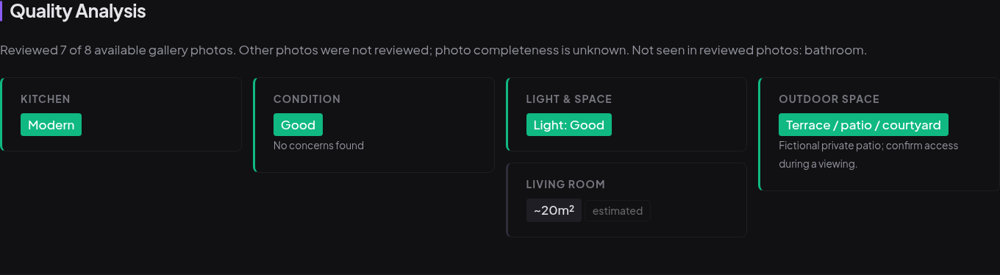
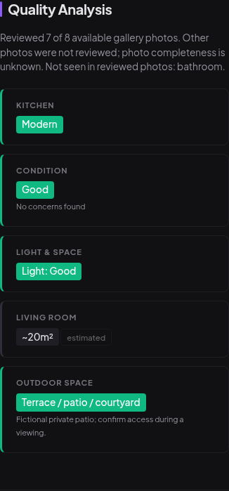

# Image review coverage UI verification

The quality section states how many available gallery photos were supplied for
analysis. Source-declared floorplans are excluded from those counts. A partial
review identifies unreviewed photos and scopes missing-room observations to the
reviewed subset; it does not imply that the advert omitted those rooms.

These captures use authored fixtures in a separate temporary database, fake owner
credentials, and a local dashboard with provider credentials and scheduling
disabled. They contain no actual listings, real photographs or trial assessments.
The stored fixture combines seven-of-eight gallery coverage with a positive patio.

At 1440×1000 and 390×844, the coverage message and outdoor state are readable and
the page has no horizontal overflow. The mobile capture wraps the complete
qualification without clipping. These captures use integrated application code
at `5446ba3`; this documentation commit does not change application behavior.

Native transport, persistence and restart tests separately verify that the counts
come from actual image blocks, cannot be forged by either model phase, and change
checkpoint identity when available coverage changes. A complete supplied-gallery
review still does not establish completeness of the original portal advert.
