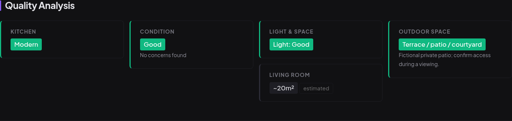
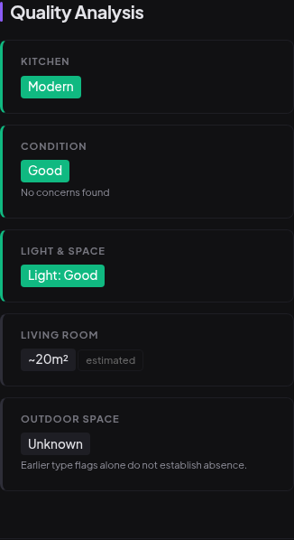

# Outdoor evidence UI verification

The dashboard distinguishes known outdoor access, explicit absence and unknown
availability. Historical all-false type flags remain unknown. The raw historical
JSON and its notes remain unchanged, while unsupported absence chips are hidden.

These screenshots use authored fixtures in a temporary local database, fake owner
credentials and no provider clients or scheduler. They contain no trial listings,
real photographs or private assessment content. Browser inspection used the actual
dashboard at 1440×1000 and 390×844; neither viewport had horizontal overflow.

The desktop example presents a patio as outdoor space. The mobile example retains
an older record with all type flags false and no availability field: it displays
“Unknown,” keeps its note and has no “No outdoor space” chip. Query tests separately
verify matching grid, count, tag and map behavior for yes, no and unknown filters.

The captures used the UI at `28b8e6d`; the final integration through `1d006a3`
does not change those templates or presentation paths. Its 2,479-test combined
suite passed. The additional fix isolates app logging configuration in web tests;
it does not change production logging or weaken capture assertions.
