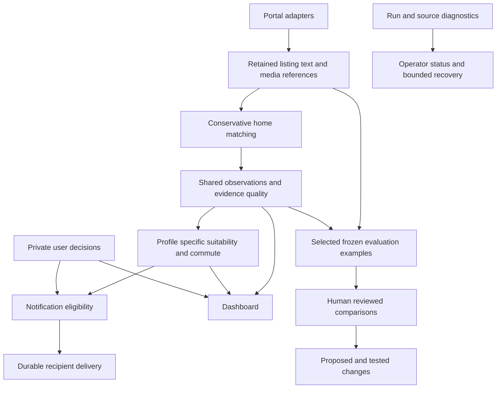

# Home Finder architecture assessment and proposed work

13 October 2026. Review of `opus-ultra-refactor-and-other-items-report.md` (local input report), the application at `7605ced`, and the current working tree, including the unfinished offline evaluation work. The input report and that separate uncommitted prototype are context for this starting-state review; they are not published as part of the reliability PR series.

Implementation follow-up: this assessment describes the starting state. Subsequent
repairs and exposure containment are tracked in the
[goal-driven execution record](../plans/2026-10-13-goal-driven-implementation.md)
and [core reliability audit](2026-10-13-core-reliability-completion-audit.md).

**My recommendation is to keep the existing application, repair its observable failures, and develop it toward a small service for invited friends.** The report is strongest on superseded code, concrete defects, and preserving the October reliability work. Its weakest premise is that a dormant, permanently single-user application is the only useful target. Your answers in section 17 establish a different direction: selective alerts, useful availability checks, different commute needs, and an ingestion pipeline whose behaviour can be inspected and improved.

The highest-value work is making the system trustworthy from source collection to a person's shortlist. Removing code helps where it eliminates competing implementations; a target number of deleted lines does not help choose that work. Evaluation and diagnostics are part of this product's quality control. They should remain bounded and separate from the live decision path.

**There is an immediate operational finding.** During this review, an unauthenticated HTTPS GET to the configured Fly dashboard returned **200**, no authentication challenge, and HTML containing property cards and property links. This independently strengthens the report's exposure concern. Only status and structural booleans were retained; no mutation endpoint was exercised. Current source code has owner authentication, but that does not establish the protection of the deployed service. Address this before inviting anyone or resuming unattended operation. This review changed no deployment, database, credential, or application code.

The main decisions I would make are:

- Keep Python, FastAPI, Jinja/HTMX, SQLite, one database authority, and one active collection scheduler.
- Keep the spend ledger, delivery outbox, conservative merge rules, output validation, and transaction ownership.
- Fix selection and scoring before introducing a notification threshold. Make lower-ranked homes dashboard-only by default, with an optional digest.
- Keep off-market checking and commute support. Make their uncertainty and freshness explicit.
- Complete the small offline evaluation workflow. Add diagnosis and bounded recovery before considering automatic improvements.
- Introduce user identity, independent decisions, and preference profiles before friends use the same service independently. A shared password is not that boundary.
- Reject automatic forgetting of uncertain spend, unversioned replacement of planned notification assets, removal of request bounds, and a broad schema or framework rewrite.

Navigation: [report judgments](#judgment-on-the-report), [verified defects](#verified-defects-and-their-implications), [diagnostics and evaluation](#diagnostics-and-controlled-improvement), [deletion decisions](#which-deletions-are-valuable), [proposed tasks](#proposed-tasks-and-acceptance-criteria), [verification record](#verification-record-and-limits).

## Context and strength of evidence

The earlier [PR disposition](2026-10-10-pr-disposition.md) deliberately reduced an extensive infrastructure programme to a dependable owner workflow. That was a reasonable delivery boundary. The [operating qualification](2026-10-10-focused-repair-verification.md) also describes that workflow as a first stage of a small hosted service. Your answers in the new report clarify what should come next; they do not justify reviving the entire rejected programme.

The current tree has existing edits to `main.py`, observability tests, README and operations, plus untracked evaluation modules, scripts, fixtures, and review assets. Those were left intact. In particular, the source report excluded evaluation work that is relevant to your stated requirement. This assessment includes it.

The evidence below distinguishes three things:

| Evidence | What it establishes |
| --- | --- |
| Code inspection and small offline executions | Current control flow, deterministic defects, and the behaviour of synthetic inputs. |
| Read-only historical database queries and replay | What the September export and October trial contain; not what the live database contains today. |
| Official online documentation and a bounded dashboard read | External API contracts, geography and tenancy constraints, and the dashboard's anonymous read exposure at the time checked. |

The selected existing offline suite passed **331 tests in 50.16 seconds**. It covers spending, analysis admission and output failures, runtime defaults, delivery recovery, pagination, owner access, and both evaluation modules. The exact command is recorded at the end. The first sandboxed run timed out in `aiosqlite`; a minimal in-memory connection also stalled there and succeeded outside the sandbox. The successful test run used that environment with pytest socket blocking still enabled. This is a focused verification, not a new full-suite, browser, container, or live-provider qualification.

The source report's agent counts, verifier counts, deletion estimates, and historical timing measurements are not independent evidence in this assessment. Its detailed findings are useful because many are reproducible, not because many agents agreed. Research on agent-assisted development and repository instructions supports deliberate quality control and concise guidance, but does not establish that a particular abstraction or test in this repository is wasteful. See the original [Cursor adoption study](https://arxiv.org/abs/2511.04427) and [repository context study](https://arxiv.org/abs/2602.11988).

## What the application should be

The appropriate near-term scope is an **invite-only rental search service with a small number of independently configured searches**, operated by one person. It collects permitted listing evidence, avoids repeated work on the same home, distinguishes facts from inferences, assesses suitability, and alerts each person about promising matches. The operator should be able to see why a home was excluded or deferred, why a source stopped producing results, and what recovery will do.

That scope has two different kinds of complexity:

| Necessary complexity | Complexity that can wait |
| --- | --- |
| Independent users' decisions and notification recipients | Organisations, teams, roles, subscriptions and billing plans |
| Search criteria and a small set of preference dimensions | A general search-rule language or arbitrary workflow builder |
| Shared collection and reusable property observations | Distributed ingestion, microservices and an event bus |
| Bounded paid requests and truthful uncertainty | An accounting platform or comprehensive provider marketplace |
| Source health, queue age, retained reasons and review samples | A telemetry warehouse or automatic diagnosis agent on every run |
| Reliable backups and a tested restore procedure | Multi-region replication and high-availability orchestration |

Small user count is a reason to keep deployment simple. It is not a reason to conflate different people's preferences, private decisions, or recipients.

### Keep a modular monolith

The existing application already has useful boundaries: portal adapters, shared models, SQLite repositories, pipeline orchestration and presentation. Its long modules do not automatically need replacement. Several contain coherent state machines, transactions or preference tables.

SQLite remains suitable for a small service whose database stays on one machine and whose transactions are short. More users do not, by themselves, require PostgreSQL. Revisit the database when measured write contention, multiple independently deployed writers, or availability requirements justify it. The important SQLite limitation here is one writer at a time and the application's connection ownership, not the current database file size. [SQLite deployment guidance](https://www.sqlite.org/whentouse.html), [connection isolation](https://www.sqlite.org/isolation.html).

The conceptual target is:



These are responsibilities, not a mandate to create thirteen packages or services. SQLite can continue holding their durable state. The evaluation path proposes changes; it does not directly rewrite live preferences or promote new prompts.

### The important future boundary is facts versus preferences

`Property` represents a portal listing and `MergedProperty` represents the application's grouped home. That distinction is worth documenting. Renaming every occurrence now would add little value.

More consequentially, the current fit function explicitly implements one person's preferences, and both paid prompts include personal assumptions: work-space separation, hosting and room-size judgments. For example, the visual prompt's spaciousness guidance already assumes an office and hosting eight or more people. Moving just the fit weights into a profile would not make the whole assessment neutral. See [quality prompts](https://github.com/MarcelCutts/home-finder/blob/7605ced6fd9b2a1cc42b0d3d3caaf13509593aac/src/home_finder/filters/quality_prompts.py) and [fit scoring](https://github.com/MarcelCutts/home-finder/blob/7605ced6fd9b2a1cc42b0d3d3caaf13509593aac/src/home_finder/filters/fit_score.py).

Reuse defensible observations across users: listed rent, source text, visible room connections, evidence of outdoor access, and measurement provenance. Derive suitability from those observations and the particular profile. Keep uncertainty about the observation separate from dislike of the feature. Some current fields can remain during transition, but their personal meaning must be explicit.

Before a second independent user, the data model needs these ownership distinctions, using ordinary tables and explicit keys:

| Information | Appropriate owner |
| --- | --- |
| Listing identity, current source evidence, grouping | Shared collection |
| Physical observations and their input/configuration identity | Shared assessment, where the observation is actually profile-independent |
| Budget, bedrooms, areas, commute destination, preferences | Search profile belonging to a user |
| Interested, rejected, viewed, notes and application progress | User and home |
| Fit and eligibility, with policy version and reason | Search profile and home |
| Delivery intent, recipient, receipts and retry state | User/profile destination and logical event |

Today `properties.user_status`, the configured chat ID, and keys such as `discovery:{property_id}` are global. A second user cannot safely share those semantics. Migration must assign existing decisions and deliveries to the original owner without replaying historical alerts.

## Judgment on the report

| Proposal or conclusion | Judgment and justification |
| --- | --- |
| Preserve the October money, delivery, identity and transaction safeguards | **Strongly agree.** These protect external side effects and user state. Their correctness is not made unnecessary by low average API cost. |
| Remove replaced implementations and obsolete dependencies | **Agree selectively.** Competing writers and superseded senders create real maintenance risk. Verify callers and retained behaviours, then delete. |
| The application no longer selects anything | **The wording is too broad; the central problem is real.** Cheap price, bedroom and area gates still select. There is no meaningful post-assessment notification eligibility policy. |
| A few import repairs are sufficient | **Useful but incomplete.** Repair upward imports and import side effects. User ownership and shared evidence versus personal suitability matter more for the next product stage. |
| Evaluation should stay outside the application package | **Reject as a blanket rule.** Optional, tested, offline modules can live under `src` without joining the live execution path. Runtime imports, side effects, dependencies and ownership are the relevant tests. |
| Off-market checking is too large and unused | **Reject deletion for the stated scope.** Usage absence in an old dataset says the feature was not activated; it does not say availability is unimportant. Simplify and qualify it. |
| Spend holds should age out | **Revise substantially.** Recover abandoned execution slots, but preserve the liability. Calendar expiry must not silently manufacture budget. |
| Retry uncertain Telegram sends automatically | **A possible policy, not a repair to apply silently.** It trades possible duplicates for fewer missing alerts. Persist the choice and retry allowance. |
| Remove rate limiting and body limits | **Reject the combined recommendation.** The failed-auth limiter has a narrow weakness, but mutation and body bounds protect against accidental loops, oversized requests and future users. |
| Delete the embedded scheduler | **Not currently justified.** One explicit, opt-in scheduler on the authoritative host is a reasonable operating model. Deleting it still leaves a scheduling and supervision requirement. |
| Delete old documents and experiments behind a tag | **Useful housekeeping after extracting live knowledge.** Not a prerequisite for reliability. Untracked research is not protected by a tag. |
| Turn many settings into constants | **Defer.** Credentials and deployment controls differ from preference settings; a small shared service needs more explicit profile semantics, not fewer useful controls. |
| Replace wheel CI with a Docker build | **Add deployment-artifact verification; retain a cheap package check.** Container assembly and package contents catch different failures. |
| No ORM, workflow engine, frontend rewrite or distributed platform | **Agree for this stage.** None addresses the verified failures more directly than the existing stack. |

Several effort estimates are too optimistic. A silent notification flag must be frozen in the delivery plan and applied to every relevant part. A safe cache prune must consider references, checkpoints and incomplete deliveries. Recovery of a paid attempt must retain its accounting meaning. These are bounded changes, but they are not reliably “five lines” or “one function.”

## Verified defects and their implications

The report's issue numbers are retained here to make comparison easy. **Reproduced** means executed in this review; **inspected** means the relevant source path was checked. An inspected defect still needs a focused regression scenario during implementation.

| Report item | Evidence and assessment | Consequence |
| --- | --- | --- |
| 1 Deployed access | **Reproduced live.** Anonymous GET returned 200 with property cards/links and no Basic challenge. The previous report only had October 10 observations. | Contain exposure and qualify the actual deployment before further sharing. This did not verify current mutation access or deployed revision. |
| 2 JSON cleaning | **Reproduced offline.** Validated visual data with `kitchen.notes = "[Not visible in photos]"` passed the live output validator, then `_merge_analysis_results` returned `None`. | Remove repair from the validated live path. Keep historical decoding separately. |
| 3 Collection failure | **Reproduced offline.** Four consecutive `None` pages caused four pagination calls and ended as `page_limit`. Unrecognised HTML passed through both OpenRent and Zoopla as an empty page with zero parse errors. | A provider failure can waste requests; a layout change can look healthy. Repair before regular collection. |
| 4 Provider error vocabulary | **Reproduced offline.** `billing_error`, `conflict_error` and `timeout_error` fail `ProviderRejection` validation. Official API documentation includes expanding error types. | Avoid trapping recognised error envelopes behind a stale enum. Keep charge classification explicit. |
| 5 Spend recovery | **Inspected.** Old `reserved`, `dispatched` and `unknown` amounts count in subsequent windows; `reserved` and `dispatched` also occupy concurrency slots. | Startup recovery is needed, but execution-slot recovery and charge reconciliation are different operations. |
| 6 CLI flags | **Reproduced with dispatch mocked.** `--no-pipeline` and `--all` alone call the full pipeline; `--serve --dry-run` calls `create_app(..., run_pipeline=True)`. | Reject invalid combinations before loading settings or initiating side effects. |
| 7 Maintenance scripts | **Inspected.** `audit_merges.py` deletes images, assessments and homes with raw SQL; its default is mutation. This bypasses the current application's merge preservation contract. | Retire or quarantine unsafe tools. Do not interpret a script called “audit” as read-only. |
| 8 Partial analysis configuration | **Reproduced.** Normal settings use Sonnet 5.5; explicit `{}` selects 4.6. Existing tests deliberately preserve this legacy parsing behaviour. | This is an unsafe configuration interface, not evidence that historical deserialization should change. Separate runtime overrides from stored configuration decoding. |
| 9 Delivery recovery | **Inspected and existing contract tests passed.** 429 persists a retry; definite rejection blocks; ambiguous outcomes stop. | Correctly conservative mechanism with poor operator visibility. Improve visibility before changing delivery semantics. |
| 10 Telegram Details | **Inspected and externally verified.** HTTPS selects `WebAppInfo`; Telegram limits this button to private user/bot chats. | A normal URL button is the appropriate dashboard link. Do not claim all mobile clients fail without testing them. |
| 11 Fit disagreement | **Reproduced on all 1,001 historical assessments.** Telegram-style scoring differs from stored fit on 407: 382 rated rows and 25 unrated rows. | Share assessment eligibility, normalization, contextual inputs and scoring. A helper that only adds hosting tolerance is insufficient for unrated fallbacks. |
| 12 HTMX extension | **Inspected and externally verified.** The app enables `idiomorph`; the extension registers as `morph`. | Fix registration and exercise actual card replacement in a browser. The report's exact nested-DOM behaviour was not rerun here. |
| 13 Tag filter | **Reproduced using the SQL expression.** Searching for `Washing machine` matches JSON containing `No washing machine`. | Use exact JSON array membership; add positive/negative collision tests. |
| 14 Pagination | **Inspected.** The hand-built query macro omits floor-area, living-room-area and off-market filters. | Serialize the validated filter state, including repeated tags, into pagination links. |
| 15 Dead-end anchors | **Inspected.** Anchor selection excludes pending enrichment but includes dropped, failed and analysis-exhausted homes. | Repair lifecycle recovery. Simply excluding all such anchors can create duplicate homes or detach source identity. |
| 16 Refused save merge | **Inspected.** Save paths call protected source linking inside a batch transaction without the per-group handling present in cross-run deduplication. | Isolate a refused group and preserve unrelated progress; do not catch the error and commit a partially written group. |
| 17 Two retry limits | **Inspected.** The ledger defaults to two attempts per operation, initial analysis to three; `SpendDeferred` does not update a property's terminal disposition. | A permanently exhausted operation can appear endlessly deferred. Record a specific reviewable outcome, not a fabricated provider failure. |
| 18 Commute bounds | **Inspected and externally verified.** Request duration equals the preference limit. TravelTime's `unreachable` can mean over that duration, inaccessible, or too far from transit. | Request a wider supported bound for useful durations, retain provider reason/state, and never convert all unreachable results into measured over-limit trips. |
| 19 Cache before merge approval | **Inspected.** Deduplicator assembly copies secondary images before the pipeline's transactional acceptance; a later copy also exists after acceptance. | Remove side effects from candidate assembly. After-commit copies must be idempotent and recoverable. |
| 20 Sound score | **Reproduced data prevalence and inspected rule.** 975 of 976 rated historical rows have nonempty noise notes; any nonempty list produces a negative factor. | Do not interpret unstructured text as a negative boolean. Remove this score input pending a defensible typed signal. |

Key implementation references: [quality assembly](https://github.com/MarcelCutts/home-finder/blob/7605ced6fd9b2a1cc42b0d3d3caaf13509593aac/src/home_finder/filters/quality.py#L1681), [live validation](https://github.com/MarcelCutts/home-finder/blob/7605ced6fd9b2a1cc42b0d3d3caaf13509593aac/src/home_finder/filters/analysis_contracts.py), [spend middleware](https://github.com/MarcelCutts/home-finder/blob/7605ced6fd9b2a1cc42b0d3d3caaf13509593aac/src/home_finder/filters/analysis_spend.py), [spend repository](https://github.com/MarcelCutts/home-finder/blob/7605ced6fd9b2a1cc42b0d3d3caaf13509593aac/src/home_finder/db/spend.py), [CLI](https://github.com/MarcelCutts/home-finder/blob/7605ced6fd9b2a1cc42b0d3d3caaf13509593aac/src/home_finder/main.py), [pagination](https://github.com/MarcelCutts/home-finder/blob/7605ced6fd9b2a1cc42b0d3d3caaf13509593aac/src/home_finder/scrapers/base.py#L90), [delivery](https://github.com/MarcelCutts/home-finder/blob/7605ced6fd9b2a1cc42b0d3d3caaf13509593aac/src/home_finder/notifiers/delivery.py), [database filtering](https://github.com/MarcelCutts/home-finder/blob/7605ced6fd9b2a1cc42b0d3d3caaf13509593aac/src/home_finder/db/web_queries.py#L307), [pipeline persistence](https://github.com/MarcelCutts/home-finder/blob/7605ced6fd9b2a1cc42b0d3d3caaf13509593aac/src/home_finder/db/pipeline_repo.py), [merge assembly](https://github.com/MarcelCutts/home-finder/blob/7605ced6fd9b2a1cc42b0d3d3caaf13509593aac/src/home_finder/filters/deduplication.py#L315).

External contract checks: [Anthropic errors](https://platform.claude.com/docs/en/api/errors), [Telegram button parameters](https://core.telegram.org/bots/api#inlinekeyboardbutton), [HTMX Idiomorph configuration](https://htmx.org/extensions/idiomorph/), [TravelTime response semantics](https://docs.traveltime.com/api/reference/travel-time-distance-matrix).

### What the historical data can tell us

Read-only queries confirmed the main dataset sizes:

| Dataset | Confirmed contents |
| --- | --- |
| September 27 export of the earlier search | 1,016 homes, 3,267 source listings, 1,001 assessments; 976 rated. |
| Owner decisions in that export | 999 homes still `new`; 10 archived, 4 interested, 2 offered, 1 enquired. There are 30 status events and 17 homes with a current non-new state. |
| October 10 trial database | 93 homes, 91 assessments, 91 queued deliveries, 206 settled paid attempts, $6.50768335 accounted. |

The stored fit-score histogram contains 221 assessments at 70 or above and 780 below 70. That illustrates the possible reduction in alert volume; **it does not validate 70 as a suitable threshold**. These scores include the defects discussed above, and unrated rows must not be treated as eligible. The historical data is neither a representative sample of today's market nor a sufficiently labelled preference dataset. `new` does not mean rejected, and archived does not necessarily mean a bad match.

Keep the data as historical evidence and a source of regression examples. Preserve its dates and original owner decisions. Do not reintroduce all February homes into a current search merely because their old `is_off_market` flag is false, and do not rewrite historical outputs to resemble today's model.

## Selection and scoring

Your stated preference is alerts for good matches. I would make that an explicit product policy, with a dashboard explanation for every non-alerted home. Muting hundreds of messages reduces sound but leaves the same reading burden, so silent delivery alone does not meet the intent.

The policy should distinguish:

1. **Eligibility:** supported area, price and bedrooms, plus any genuinely hard profile constraints.
2. **Assessment readiness:** adequate evidence and a successful assessment, or a clearly named exception the user has opted into.
3. **Suitability:** a deterministic score and explanation using the profile's preferences.
4. **Notification decision:** alert, digest, dashboard-only, or defer, with a policy version and reason.

Unknowns should not be silently treated as rejection or as a pass. A missing commute is not a zero-minute commute; an unseen room is not an absent room. For a hard constraint with unknown evidence, defer or present it for review according to a visible policy. An assessment error cannot become a recommendation because a scoring function supplies defaults.

Use the same eligibility predicate and normalized score inputs for storage, web cards, detail pages, notification plans and threshold comparisons. Retain the score/version used for a decision. If an unsent home is reassessed, decide whether the unplanned delivery can refresh; after parts have been sent, preserve the existing delivery meaning.

Avoid forcing suitability into the Telegram transport layer. It belongs immediately before creating or activating delivery intent, so a decision and its durable consequence commit together. The current `notification_status` also represents pipeline stages. A dashboard-only decision must therefore have an explicit terminal delivery disposition without being mislabelled `sent` or retried forever. Document the transition table before changing the SQL.

For the first policy, calibrate on a small, deliberately mixed set of manually reviewed homes after fixing score defects. Run the policy in shadow mode to record what it would send. Choose an initial threshold from reviewed examples and desired alert burden, then monitor rejected alerts and missed candidates. Do not train or automatically tune it from the 17 historical decisions.

Price changes need a separate rule: meaningful changes on a still-relevant home, respecting that user's status and current availability. A proposed percentage or pound threshold is a preference decision, not a refactor. Multiple users may value the same price drop differently.

## Diagnostics and controlled improvement

The report is right that detection without a useful owner signal is incomplete. It is wrong to treat rich diagnostics and a modest evaluation workflow as inherently outside scope. The service's value depends on interpreting imperfect external data; understanding that interpretation is product work.

### Operational diagnosis

Start with existing `pipeline_runs`, `scraper_runs`, `property_events`, paid attempts and delivery states. They are not valueless because a web page does not yet read them. This review and previous reviews already use them to explain behaviour.

Build a small status read model from those tables. Keep database reads separate from a pure function that classifies the resulting snapshot using an injected time. That makes stale, degraded and recovered states testable without fabricating whole pipeline runs.

| Question the operator needs answered | Minimal useful signal |
| --- | --- |
| Did the intended collection run? | Run mode, enabled sources/areas, start/end, terminal outcome, and time since the last successful live run. |
| Is a source empty or broken? | Per-source recognised pages, parse failures, HTTP/challenge outcomes, requested versus completed area coverage, last success. |
| Where did candidate homes go? | Counts by explicit gate/reason, distinguishing listings from grouped homes. |
| Is work stuck? | Queue length **and oldest age**, retry exhaustion, deferral reasons, unresolved spend, blocked delivery parts. |
| Is evidence getting worse? | Detail-text completeness, usable image coverage, field unknown rates, identity mismatches and selected contradiction flags. |
| What did it cost? | Accounted spend, unresolved liability, cost per completed assessment and calls repeated after failures. |
| Is the host becoming unsafe to use? | Free disk space, last verified off-host backup, and restore-drill date. |

Persist run mode rather than inferring it from logs. The working-tree observability changes correctly explain that dry runs update the same run tables; a recent dry run must not make the live collection heartbeat look healthy.

Alert on a change into a meaningful fault, suppress repeated identical notifications, and send a recovery notice. Persist the incident fingerprint or last-notified state so a restart does not flood the operator. Treat disabled sources, rotated search areas and deliberately dormant collection differently from failures. “Zero listings for three runs” is not sufficient on its own.

Keep public `/health` as liveness. Put operational detail behind authentication. A simple external heartbeat is useful because the application cannot report its own total absence; Telegram alone also cannot report a Telegram outage. No monitoring cluster is required.

### Assessment diagnosis

The unfinished local evaluation validator (`src/home_finder/evaluation.py`), review workflow (`src/home_finder/evaluation_review.py`), contracts (`src/home_finder/models/evaluation.py`), and usage document (`docs/quality-evaluation.md`) already address real requirements:

- Evidence files are bounded, contained within a corpus directory and checked against hashes.
- Retained evidence is distinguished from evidence actually supplied to a model.
- Partial historical captures cannot masquerade as exact request replays.
- Related adverts and image families cannot leak across evaluation splits.
- Human review distinguishes unsupported claims, unknown evidence and unreviewed material.
- A local review page can be generated without sending data or invoking a provider.

Those are useful capabilities. Their presence under `src` does not turn them into an online evaluation platform. Keep the live pipeline from importing the evaluation/reporting path; keep real listings and reviews private; expose no production route by default. Reorganize the files only if it improves their ownership or packaging.

The current tooling validates and presents evidence. It does **not** demonstrate semantic accuracy, create an unbiased benchmark, or prove that historical reconstructed inputs were the model's inputs. A small corpus is a diagnosis tool before it is a population-quality measurement.

Measure materially important errors: unsupported outdoor absence, room-access mistakes, office separation, bills inclusion, area attribution, and false merges. Report reviewed denominators, abstentions, missing outputs, split/exposure status and disagreements. Track false negative claims as well as false positives; a pipeline that avoids every mistake by returning unknown everywhere is not useful.

Use a fixed development set for diagnosis, then an unexposed holdout for a candidate change. Label by home and image family, not just by portal advert. Compare model/prompt/image changes one at a time with cost and latency alongside the relevant error rates. This follows the useful part of [task-specific evaluation guidance](https://platform.claude.com/docs/en/test-and-evaluate/develop-tests), without treating automated grading as ground truth.

### Automatic actions should have narrow boundaries

| Capability | Appropriate initial automation |
| --- | --- |
| Detect | Deterministic invariant checks, source-shape changes, stale work, missing evidence and unusual distributions. |
| Diagnose | Link the affected run/home to retained reason codes and a small evidence sample; propose likely causes with uncertainty. |
| Recover | Bounded retries for known transient failures, undispatched reservation release, retry after an explicit provider delay, and idempotent cache repair. |
| Improve | Produce a proposed change and an offline comparison. Require reviewed promotion of scoring, prompts and collection behaviour. |

Do not let a model label its own outputs correct, raise its own budget, relax identity checks, rewrite historical decisions, or automatically deploy a parser repair because it increases yield. A larger result count can mean worse parsing. Keep the improvement loop inspectable and budgeted.

## Money and delivery: improve recovery without erasing uncertainty

### Spend recovery

The report correctly identifies a liveness failure: an abandoned `dispatched` attempt can occupy a paid-request slot indefinitely, while unresolved liabilities reduce every subsequent budget window. The proposed cure combines several decisions that should remain separate.

1. **Execution ownership:** after acquiring the runner lock and establishing that the previous owner is no longer executing, release reservations that were never dispatched. Move abandoned dispatched attempts to `unknown`, preserving their reserved liability and evidence. Age alone cannot prove that another process has stopped.
2. **Financial reconciliation:** resolve unknown charges from trustworthy usage or billing evidence. A new day is not evidence that the request was free. Recovery must remain idempotent and leave an audit trail.
3. **Conservative automatic accounting:** if manual reconciliation proves burdensome, an explicit policy may book a trustworthy maximum liability as an assumed charge. Preserve `cost_basis`, reason, original reservation, accounting period and later correction. Do not relabel it measured usage. This can remove a permanent hold without forgetting potential spend.

The third option is reasonable for this application's scale, but the source report's proposal to let unresolved holds disappear across calendar boundaries is not equivalent. If an unrecognised billing dimension invalidates the assumed ceiling, the system still needs a held/review state.

The five-minute cache reservation proposal is promising. The request middleware already rejects a one-hour cache TTL. Make the reservation tariff reflect an enforced request policy, give that policy an identity, and retain frozen rate cards on historical attempts. Test the admission calculation together with the request gate. A pricing constant changed independently of the request gate would weaken the guarantee.

Likewise, a new response field should not necessarily disable analysis. But “warn on every unknown usage field and settle” is too permissive. Separate additive non-billing metadata from fields that might represent unpriced usage. Preserve bounded raw usage for diagnosis, accept known harmless extensions, and fail conservatively when complete pricing cannot be established. Anthropic documents both an evolving response contract and an expanding error vocabulary; permissive envelope parsing does not require permissive accounting. [API versioning](https://platform.claude.com/docs/en/api/versioning), [API errors](https://platform.claude.com/docs/en/api/errors).

Keep runtime configuration distinct from stored historical configuration. Merge supported partial overrides onto the current runtime profile, or require a complete explicit profile; either can be safe if validated and documented. Log the effective model, effort, request bounds, SDK retries and reservation before paid work. Do not change historical 4.6 attempt decoding merely to remove a runtime default.

The current Sonnet 5.5 configuration also deserves an evaluation, not an intuition-driven edit. The model documentation explains that disabling thinking maps to `between_tools`, which has different implications for a JSON task without tools. Compare the actual visual and evaluation tasks with a small fixed corpus, frozen input bytes, latency and charged usage before changing reasoning effort. [Sonnet 5.5 prompting guidance](https://platform.claude.com/docs/en/build-with-claude/prompt-engineering/prompting-claude-sonnet-5-5).

### Telegram delivery

The outbox's part receipts and frozen payloads are valuable. A request accepted by Telegram can lose its response; the documented send methods provide no application-supplied idempotency key. Retrying can duplicate a message. Keeping it parked can lose an alert. A single retry is a bounded duplicate-risk policy, **not a guarantee of at-least-once delivery**. Manual release likewise means the current system is not unconditionally at-most-once. [Telegram Bot API](https://core.telegram.org/bots/api#sendmediagroup).

For this product, I favour one delayed retry of an uncertain part if the owner chooses that tradeoff, followed by a visible operator task. Persist the allowance and retry time so restarts cannot renew it. Never resend acknowledged parts. Respect an explicit `retry_after` response separately. Do not introduce this policy while an unhealthy alert selection rule is still generating excessive messages. [Telegram response parameters](https://core.telegram.org/bots/api#responseparameters).

Do not quietly replace a hash-checked local image with a mutable remote URL after planning. That changes the evidence and payload behind the same logical delivery. Prefer immutable cached assets. If they are irrecoverable, explicitly revise an unsent part or issue a defined text-only fallback while retaining the earlier plan and its receipts. A partly delivered album needs a specific policy, not a generic retry.

Show sanitized error categories, status codes and provider request identifiers in the operator view. Printing arbitrary exception text can expose a bot-token URL or other sensitive values. Keep enough completed-delivery evidence to explain what was sent and prevent duplicates; deleting snapshots to save a fraction of a small SQLite file is not urgent. A later retention policy can compact old snapshots once their remaining recovery and audit uses are defined.

## Collection, geography and rental-domain judgments

### Collection is the critical dependency

The collector should declare whether it recognized the page it parsed. “Recognised search with zero results,” “unrecognized layout,” “challenge,” “transport failure,” and “partial coverage” are different outcomes. A fallback parser earns its place by extracting verified evidence from supported fixtures, not by converting every unexpected page to an empty list.

Before restarting after dormancy, bound new enrichment and paid assessment work separately. Prefer newest eligible homes, retain a backlog with age/reason, and make the limits observable. A run-level cap is useful even with a monthly money limit: it limits portal load, local media growth and the amount of evidence awaiting review.

Source access also affects product feasibility. Rightmove and Zoopla currently publish restrictions on automated collection. Their terms are a material dependency to resolve through permitted access, permission or an alternative feed before expanding a shared hosted service. A low request rate is good operational practice but does not itself grant permission. This is a product/access decision; changing HTTP clients is not a resolution. [Rightmove terms](https://www.rightmove.co.uk/c/terms-of-use/), [Zoopla terms](https://www.zoopla.co.uk/terms/).

### Use outcodes internally, offer understandable areas

I would **not** make users learn outcodes as the only search interface. I would keep validated outcodes as the initial collection unit and offer a small set of named area presets that expand transparently into those codes. Show the resulting coverage and let the user edit it. Reject an unknown name before a run; never silently turn a typo into an empty search or unexpectedly broad fallback.

Outcodes are not borough boundaries. ONS explains that postal areas do not generally align with administrative geography; even a unit postcode's assignment is approximate. The Postcodes.io outcode example for BR8 includes multiple administrative districts. Thus one authoritative mapping can eliminate contradictory tables, but it cannot make a borough-to-outcode expansion geographically exact. [ONS postal geography](https://www.ons.gov.uk/methodology/geography/ukgeographies/postalgeography), [Postcodes.io outcode lookup](https://postcodes.io/docs/outcode/lookup/).

Use the distinction explicitly:

- **Collect broadly:** outcodes and supported portal location IDs, derived from one validated area definition.
- **Describe honestly:** named presets are approximate coverage, with the included outcodes visible.
- **Filter precisely when needed:** a reliable full postcode or suitably precise coordinates can support a later borough/distance rule. Keep missing or approximate locations unknown.

Avoid a polygon editor, arbitrary GIS query engine or street-level precision inferred from an outcode centroid. Remove weak text-only micro-area matches that key off generic words. Retain reliable ward/postcode matches and display an outcode-level overview when that is all the evidence supports.

### Keep commute and availability, with better semantics

Commute belongs to a profile: destination, mode, arrival/departure convention and tolerated time. The destination is personal data; it is not a property attribute. A wider TravelTime request bound can distinguish an observed 50-minute journey from a 40-minute preference. However, an unreachable result still cannot always be interpreted as a measured journey beyond the bound: the API documents several reasons for it. Keep those states distinct and expose freshness. [TravelTime response semantics](https://docs.traveltime.com/api/reference/travel-time-distance-matrix).

Keep off-market checking. A stale attractive home wastes a user's time and can distort price-change alerts. Schedule bounded checks of shortlisted, recently relevant or soon-to-be-alerted homes, rather than repeatedly checking the entire historical database. Track source-level status, evidence and time; a source URL removed is not proof that the property was let.

For grouped homes, use a declared rule: a fresh, identity-matched active source supports availability even if another advert has been removed; all relevant sources reliably removed can support unavailability. Without a fresh active source, stale observations, unresolved sources or conflicting identity evidence leave uncertainty. An outage or challenge must not erase the last-known observation. Separate “last observed active” from “last checked.” Count transport/challenge failures in the source circuit breaker separately from honest unknown content. The current breaker treats every unknown as a failure, which makes this distinction operationally important.

### Value, guidance and presentation

Drop the undated benchmark value rating, as your answer permits, and remove its unsupported benchmark inputs from prompts as well as the dashboard. A model's value-for-quality judgment may remain as labelled qualitative advice; it is not a verified market valuation. If comparable asking rents are introduced later, show date, sample size, area/bedroom definition, source and deduplication. The application's selected listings are a biased asking-rent sample, not achieved rents. Price-sensitive outputs also need an explicit refresh rule after price changes.

Keep concise offer preparation only where it adds a next action: confirm advertised terms and availability, inspect documented price changes, and prepare relevant questions. Remove repetitive decorative scoring. The English rental bidding rule prohibits inviting or accepting rent above the advertised amount; it does not make all below-asking negotiation obsolete. Keep legal guidance dated and scoped to the relevant tenancy rather than assuming every UK listing follows the same rules. [Government rental bidding guidance](https://www.gov.uk/assured-periodic-tenancies-tenants/rental-bidding), [Renters' Rights overview](https://www.gov.uk/guidance/renters-rights-act-overview-for-tenants).

Rewrite area commentary that uses religious or demographic composition as a suitability proxy. Describe verifiable property-relevant factors such as road noise, opening hours, venue proximity, transport and building rules, with sources and uncertainty. This is especially important when the current owner's lifestyle assumptions become advice to other users.

“I Hate Moving” is a reasonable display name. Keep `home_finder`, package names, environment variables and the CLI stable unless a technical reason emerges. A label change does not justify a repository-wide rename.

## Deployment, retention and maintenance

### Two operating modes are enough

Keep one authoritative database host and one collector owner. An explicit embedded scheduler is a reasonable first active mode once `--serve` defaults to dashboard-only and an explicit option enables collection. Extract orchestration from the CLI when touching that area, after the existing working-tree changes are reconciled. A separately supervised process on the same host can also work; do not introduce a scheduler service merely to remove a Python loop.

The scheduler needs graceful shutdown, runner exclusion, recovery, and a terminal run outcome. An in-memory scheduler in a request-driven machine that auto-stops is not dependable: Fly's autostop decisions follow traffic and machine settings. For active scheduled collection, keep the appropriate machine running. For a dormant dashboard, request-driven stopping can reduce compute cost. Verify wake-up and attached-volume behaviour. [Fly autostop/autostart](https://docs.fly.io/launch/autostop-autostart/).

Do not casually put web and worker on separate Fly Machines and assume they can share the current volume. A Fly Volume attaches to one Machine and is not automatically replicated. Stopped machines also do not eliminate retained-volume cost. [Fly Volumes](https://docs.fly.io/volumes/overview/).

For the exposed deployment, choose a concrete containment action that also accounts for automatic restart, then deploy and verify an authenticated dashboard when qualified. A one-time stop alone is not lasting containment if inbound requests can start it again. This assessment did not apply a containment action because the requested work is review and documentation.

### Back up state; retain evidence deliberately

For an active search I would target at most 24 hours of lost decisions, plus an explicit pre-migration backup. Make consistent database backups off-host, verify a manifest/checksum, and periodically restore into an isolated directory using the documented application version. Use the existing backup command and SQLite backup mechanisms rather than copying a live main database file without its transactional context. Fly snapshots are useful additional protection, not the only copy. [SQLite backup API](https://www.sqlite.org/backup.html), [Fly Volume backup guidance](https://docs.fly.io/volumes/overview/).

Database recovery and image recovery are different. Cached photos can disappear upstream; they may be the only retained evidence for an assessment, a frozen evaluation example or an undelivered message. A “last seen more than 30 days ago” prune is therefore insufficient.

Start with a dry-run reference report. Protect active delivery assets, required checkpoints, selected evaluation evidence, current shortlists and shared references. Define retention for the rest, then delete in bounded batches. Use atomic temporary-file replacement for generated/copied assets. Move cache writes after accepted database merges and make interrupted copies repairable. Do not claim all deleted cache content can be fetched again.

### Dependencies and boundaries

Remove unused Crawlee and declare the actual Beautiful Soup/lxml runtime requirement. Remove genuinely unused development dependencies. Keep the current HTTP clients until a targeted change demonstrates value; the SDK's use of a different HTTP package does not require a simultaneous scraper migration.

Update the pinned Python patch deliberately: the repository's 3.14.7 image predates the official 3.14.8 security release. Refresh digests and verify the assembled image's SQLite runtime. SQLite documents a WAL-reset fix in 3.51.3 and selected backports, so assess the actual runtime and fixed versions rather than a blanket claim that every lower version is vulnerable. Keep a cheap wheel/package-content check alongside the Docker build. [Python 3.14.8](https://www.python.org/downloads/release/python-3148/), [SQLite WAL advisory](https://www.sqlite.org/wal.html).

Do not combine this with a broad unlocked dependency upgrade. The report's package-version table is not a qualification of a new lockfile, and this review did not perform a complete independent advisory scan.

Apply a few import rules around concrete risks: paid provider access goes through its metered owner; Telegram side effects go through the delivery owner or the explicit operator-status path; web imports orchestration rather than the CLI; pure models/policy do not load network clients. Existing Ruff banned-import rules may cover the first cases. Add a dedicated import-contract tool only if the useful contracts outgrow that mechanism. Static imports constrain entry points; they do not prove accounting correctness. A wildcard exemption for all notifiers would permit a new bypass.

Extract pure value/fit policy from modules that import Anthropic before enforcing an exhaustive layer hierarchy. Treat type-only imports and small pure-policy dependencies according to their actual coupling. Do not introduce repository interfaces, generic services or new packages solely to achieve a diagram.

## Which deletions are valuable

The report's A/B identifiers are retained below. These are recommended dispositions, not claims that every listed line is independently proven dead. Before deleting, search the current tracked **and untracked** tree and preserve unique behaviour tests. A script's caller may be an operator, so code search alone does not prove it unused.

| Items | Disposition |
| --- | --- |
| A1–A2: Crawlee and unused test dependencies | Proceed as a focused dependency change; explicitly install/test `beautifulsoup4[lxml]`. |
| A3: re-exports and lazy loaders | Proceed after changing real consumers to direct imports; smoke-test operator entry points. |
| A4–A5: dead accessors, union-find, unused constants | Good cleanup. Preserve stored tables/history and migrate fixture setup where needed. |
| A6: disabled early-stop plumbing | Remove the misleading flag/path; preserve newest-first behaviour and explicit run limits. |
| A7: old Telegram senders | High-value deletion after the outbox path is qualified. Preserve unique formatting assertions and the bounded operator-status path needed for diagnostics. |
| A8: live JSON repair | Urgent correctness repair, independent of bulk cleanup. Historical tolerant readers are a separate decision. |
| A9: unused prompt/cost plumbing | Remove only after checking that effective prompt bytes and checkpoint identities remain intended. |
| A10 and B9: maintenance scripts/cache audit | Retire unsafe mutations. Keep a useful read-only cache inventory by narrowing it or replacing it before deletion; do not keep hidden repair/reanalysis flags by accident. |
| A11: obsolete floorplan heuristic | Remove if no current consumer; preserve the reason the heuristic was retired in a concise decision record. |
| A12: stale/inaccurate tests | Remove redundant implementations and tests that cannot exercise their claimed contract; first retain unique portal URL assertions. |
| A13: root leftovers | Housekeeping after checking operator/documentation references. No need to mix with application changes. |
| A14: ineffective `mark_enriched` | Remove after a lifecycle test proves completion/enqueue transitions still occur through the authoritative path. |
| A15: wrappers only reached from tests | Prefer tests of the production entry point. “Only tests call it” is evidence to inspect, not a universal deletion rule for deliberate public/pure interfaces. |
| A16: superseded storage methods | Prioritize competing notification writers. Seed tests explicitly and retain real upgrade/read compatibility. |
| A17: dead branches/context/styles | Reasonable cleanup, checking current templates and untracked evaluation assets. Keep the functioning availability feature. |
| A18: social metadata | Low-value either way. Private listing pages need no preview; public landing/marketing pages may later have a legitimate one. The present deployment exposure invalidates the report's blanket factual premise that all those URLs already return 401. |
| A19: image-hash setting | Make one truthful policy. Remove only after deployment configuration and the maintenance command are reconciled. |
| A20: nonfunctional live CI job | Remove or replace with an explicitly controlled source smoke procedure. Keep network-free CI and browser tests useful. |
| B1: legacy JSON parsing | Keep what real retained rows need. Remove only after a fixture-backed read audit; do not conflate it with A8's live-path bug. |
| B2: default model selection | Fix runtime overrides; preserve historical model/rate-card decoding. |
| B3: parser fallbacks | Remove unsupported fallbacks after adding fixtures that distinguish a supported empty page from a layout failure. Retain a genuinely useful fallback if it has an explicit contract. |
| B4: `--dedup-existing` and thumbnail fallback | Retire the misleading merge command if normal runs already perform its only safe mutation. A read-only duplicate report is useful. A new explicit repair command should exist only for a demonstrated stranded-state recovery; never restore broad retrospective merging. |
| B5: thumbnail command | First make ordinary download/repair produce thumbnails. Then retain a narrowly useful repair entry point or remove a redundant command. |
| B6: per-result callback | Simplify to the delivery intent/key while retaining timely per-completion delivery. An end drain after lengthy reanalysis is not equivalent. |
| B7: offer preparation | Keep only actionable, non-duplicative guidance; remove ornamental scores. |
| B8: mutation testing | Optional targeted development tool for money, cancellation, merge and receipt invariants; no broad CI gate or permanent mutant-specific commentary requirement. |

Do not squash migrations or drop historical schema as a tidying exercise. The app has real data and only twelve migrations. In particular, migration 012 calls a live delivery helper; freeze the historical migration behaviour before changing that helper's semantics. Keep upgrade fixtures, old identifiers and tolerant reads where they protect actual stored records.

Extract a short authoritative architecture description, current commands and operating modes from the document pile, then archive obsolete prose. Fix `CLAUDE.md` claims that contradict current scrapers or floorplan handling. A tag preserves committed history only: it does not protect the substantial untracked research and evaluation work in this tree.

### Testing should follow failure boundaries

Keep tests that protect paid dispatch, cancellation, transaction rollback, rejected merges, checkpoint identity, recipient routing, partial delivery and historical migration. These are places where a small implementation mistake has a persistent effect.

Remove tests that reimplement the algorithm, assert incidental helper calls, sleep without testing time, or cover deliberately deleted behaviour. Put shared fixtures/builders in a small `tests/support` area rather than importing one test module into another. Do not adopt a blanket ban on private-function tests: a deterministic policy function can be the clearest boundary available.

The autouse cleanup fixture really does traverse garbage-collected objects looking for SQLite connections after ordinary tests. Repair fixture ownership and leaked connections, then narrow the fallback if still necessary. The source report's exact percentage speedup was not independently remeasured here. Avoid deleting cleanup first and accepting nondeterministic worker hangs later.

Use browser tests for query preservation, morphing, reset behaviour and real click/navigation flows; unit snapshots cannot establish those interactions. Keep frozen HTML parser fixtures and explicit recognized-empty/layout-change cases. No blanket source-line/test-line ratio, global complexity quota or full mutation-testing programme is warranted.

## Proposed tasks and acceptance criteria

These are possible implementation tickets, **not changes made by this review**. They are ordered by consequence and dependency, not by the number of source lines removed. Sizes are relative: S is a localized change; M crosses a few existing boundaries; L involves a data migration or product contract. They are not delivery-time promises.

### T01 — Contain and qualify deployed access

**P0 · S/M · Independent of refactoring.** Anonymous property access was reproduced against the configured dashboard.

Choose containment that survives autostart, then qualify the actual release image and configuration before making the dashboard available again. Preserve the volume and take a consistent backup before a schema-changing deployment. Record the deployed revision, operating mode and verification time.

**Done when:** an anonymous request cannot read cards, details, media or operational data; owner access works; protected mutations require the intended identity/origin; health and the secret-checked webhook behave as designed. Test the deployed service, not only `create_app` locally. Do not infer that today's authenticated source proves a past deployment was protected.

### T02 — Stop valid paid outputs being discarded; make request configuration explicit

**P1 · M · Before further routine paid analysis.** The bracketed-string failure and silent partial-config model switch were reproduced.

Remove JSON repair after strict live validation. Make runtime overrides resolve consistently to a validated effective profile. Extend provider error-envelope parsing without guessing charge outcomes. Keep historical model and tolerant stored-row support.

**Done when:** validated bracketed prose survives assembly; malformed paid output remains correctly accounted; `{}`, partial overrides and explicit null each have documented, tested semantics; startup reports the effective phase configuration; recognised billing/conflict/timeout envelopes do not fail merely because of a closed enum; unknown charge semantics remain conservative. Historical attempts and assessments still deserialize.

### T03 — Make CLI modes safe before execution

**P1 · S · Reconcile existing `main.py` work first.** Orphan modifiers and conflicting modes currently initiate unintended work.

Validate mutually exclusive modes and permitted modifiers before initializing side-effecting components. Make serving dashboard-only by default; require explicit collection activation. Keep run mode available to diagnostics. Separate the small behavioural repair from a later file move.

**Done when:** `--serve --dry-run`, orphan `--no-pipeline`/`--all` and other incompatible combinations fail with useful usage; no provider, database mutation or notifier starts on rejected arguments; documented valid commands retain their intended semantics. Include a dispatch matrix with mocked effects, then entry-point smoke checks after any extraction.

### T04 — Make collection failures visible and bounded

**P1 · M · Before unattended collection.** Changed layouts currently look like empty searches, and failed pagination continues to its limit.

Give every scraper explicit recognized-page outcomes. Stop according to a declared consecutive-failure policy. Validate search areas before network calls. Bound new enrichment separately from paid calls, preserving backlog reasons and requested/completed source coverage.

**Done when:** known empty, normal results, challenge, malformed layout, transport failure and partial pagination fixtures yield distinct durable outcomes; all-failed pagination terminates early; a bad area fails preflight; a cap postpones rather than loses candidates. Source access decisions and supported collection methods are documented before expanding use.

### T05 — Repair stranded lifecycle states and merge side effects

**P1 · M · Before routine revival of historical data.** Existing identity anchors can trap new observations, while rejected merges can affect unrelated work or cache files.

Write down allowed transitions for availability, processing, personal status and delivery separately. Provide a bounded recovery action for demonstrated stranded enrichment/analysis states, preserving source identity, paid-attempt bounds and user history. Isolate refused groups transactionally. Remove filesystem writes from merge proposal construction and repair accepted-but-incomplete copies idempotently.

**Done when:** a dropped/failed anchor receiving fresh evidence has a deliberate outcome; exhausted paid attempts become a named disposition rather than perpetual generic deferral; one refused group does not roll back unrelated homes; no partial group commits; rejected proposals do not alter cache assets; a crash after database acceptance can be repaired without another merge or lost evidence.

### T06 — Recover execution capacity without forgetting paid liability

**P1 · M · Depends on runner ownership, not on score work.** Stale attempts can block all paid work.

Implement startup inspection under the runner fence, with undispatched release and dispatched-to-unknown transitions. Surface unresolved liability and oldest age. Align cache reservation pricing with the enforced request policy. Consider assumed maximum-charge settlement only as a separately specified accounting policy and migration.

**Done when:** recovery refuses to interfere with a live owner, survives interruption and is repeatable; an undispatched attempt frees its slot and hold; a possibly charged attempt frees stale execution ownership while retaining liability; crossing a day/month boundary does not erase unresolved exposure; old rate cards remain readable. If assumed settlement is added, it is distinguishable from measured cost and supports later audited reconciliation.

### T07 — Make fit consistent, then make alerts selective

**P1 · M · Depends on explicit terminal dispositions from T05.** Score disagreement and noisy sound evidence undermine any threshold.

Use one eligibility check and normalized input builder across persisted, web and notification scores. Remove the noise-note truthiness penalty. Version the policy. Review a mixed sample, run the candidate threshold in shadow mode, then apply the chosen alert policy transactionally before delivery intent. Define price-drop eligibility separately.

**Done when:** a rated home has the same contextual score everywhere; an unrated/failed assessment cannot receive a fallback recommendation; score explanations identify evidence and unknowns; below-threshold homes remain visible with a reason and do not retry forever; replaying a run does not create repeated alerts; price changes respect user status. Report reviewed denominators and expected alert volume before enabling a cutoff.

### T08 — Qualify delivery and expose actionable recovery

**P1 · M · Selection policy precedes broad sending; identity design precedes multiple recipients.** Reliable transport exists but its blocked states are difficult to operate.

Use ordinary dashboard URL buttons. Add an authenticated view of queued, waiting, uncertain and blocked parts with sanitized reasons. Keep immutable plan assets. Specify whether an uncertain part gets one persisted delayed retry; retain the conservative behaviour until that policy is deliberately enabled.

**Done when:** 429 delay, definitive rejection, lost response, changed/missing media, cancellation and restart have documented outcomes; acknowledged parts are never resent; a retry allowance cannot reset on restart; recipient changes cannot redirect an old plan. A separately authorized controlled live delivery establishes the real transport path before retiring the old sender. Fallback payload revisions preserve receipts and explain what changed.

### T09 — Fix dashboard interactions that change search meaning

**P1 · S/M · Can proceed independently.** Filtering and pagination currently misrepresent the selected query.

Use exact JSON tag membership, serialize the validated filter object for pagination, register the correct HTMX morph extension and make reset return controls and URL state to the same default. Retain repeated tags and all area/off-market filters.

**Done when:** `Washing machine` does not match `No washing machine`; page 2 preserves every active filter; reset and back/forward navigation show consistent controls/results; status mutation replaces the intended card cleanly in an actual browser. Capture dashboard evidence for the implementation PR.

### T10 — Establish a recoverable active operating mode

**P1 · M · Depends on T01/T03 and shutdown/recovery contracts.** A scheduled service needs a host, backup and restart policy, not merely a Python loop.

Choose the single collector owner and explicit activation mechanism. Add graceful termination and terminal run recording. Configure active/dormant machine behaviour, off-host consistent backups, pre-migration backup and a restore drill. Add the deployed Docker artifact check while retaining package verification; update the Python patch in a focused change.

**Done when:** shutdown cannot leave an apparently successful incomplete run; restarting cannot create two collectors; active scheduling survives absence of web traffic; dormancy performs no collection; a restored isolated database retains decisions, ledger and delivery state. Verify actual Python/SQLite versions and dashboard startup in the assembled image. Document the recovery-point target and media coverage separately.

### T11 — Add a small operational status and incident workflow

**P1 for unattended use · M · Build on T04/T05/T06 outcomes.** Logs alone cannot make an absent or stuck collector apparent.

Create a status query over existing durable tables and a pure classifier with injected time. Persist run mode and incident deduplication/recovery state. Show source coverage, completion freshness, queue ages, unresolved money, blocked deliveries, disk and backup status. Route a concise fault transition to the operator and use an independent absence check.

**Done when:** healthy empty, disabled, dry-run-only, stale, partial and broken states are distinguishable; a persistent fault alerts once across restart and produces a recovery notice; dashboard-only/dormant mode does not generate false stale-run alarms; public health reveals no operational detail. Clicking a reason reaches the relevant retained evidence.

### T12 — Complete the offline evidence-review workflow

**P2 · M · Before claiming that prompt/model changes improve quality.** The existing unfinished tooling is a useful foundation.

Land the current bounded validator/reviewer with its tests and private-corpus instructions. Select a small mixed corpus from historical and fresh permitted evidence, explicitly labelling reconstructed versus exact inputs. Record reviewed errors and disagreements. Establish development and untouched holdout splits by home/image family.

**Done when:** a reviewer can trace an important claim to the evidence actually supplied; missing evidence cannot silently become a false label; related listings do not cross splits; a candidate comparison reports relevant errors, abstentions, cost and latency. The normal pipeline does not import review tooling or run evaluation automatically. No semantic-improvement claim is made from schema validation alone.

### T13 — Restore useful availability and commute checks

**P2 · M · Before relying on them for alerts or friends' searches.** These features answer concrete rental decisions.

Retain reason and freshness at source level, separate operational failures from honest unknown availability, and schedule bounded checks for relevant homes. For commute, separate the requested calculation bound from the user's tolerated duration and attach destination/mode/time assumptions to the result.

**Done when:** active, removed, challenge, redirect, unknown and conflicting source fixtures preserve conservative home-level availability; repeated unknown content does not automatically masquerade as a source outage; stale evidence is visible. Commute distinguishes measured over-limit, unreachable-within-search, missing coordinates and provider failure. These are two separable implementation tickets, not a reason to change both subsystems in one commit.

### T14 — Unify geography and retire unsupported market claims

**P2 · M · Area typo rejection belongs earlier in T04.** Better naming should not imply false geographic or price precision.

Use one area definition for collection and filters, support clear named presets with disclosed outcode expansion, and remove weak generic-word micro-area matching. Remove undated benchmark scoring and its prompt inputs. Keep sourced, scoped guidance and only actionable offer preparation; revise demographic-proxy area commentary.

**Done when:** every supported name expands consistently; unknown names fail; boundary-straddling outcodes are labelled approximate; centroid-only locations cannot claim street precision. Value commentary is explicitly qualitative or backed by dated comparable evidence. Price changes invalidate the outputs that depend on price. Legal guidance identifies its geographic/tenancy scope and review date.

### T15 — Introduce independent user state and recipient ownership

**P2, mandatory before independent friends' access · L.** A shared password, status column and chat ID cannot represent multiple people safely.

Add minimal invitation-based identity, search profiles, user/home decisions and notes, profile/home fit decisions, and recipient-owned delivery keys. Select a maintained authentication mechanism that fits deployment; do not invent a general identity service. Migrate existing rows to the original owner. Authorize list, detail, media, exports, mutations and callbacks according to their intended visibility; possession of a property ID is not authorization.

**Done when:** two users can give the same home different states and receive different eligibility decisions; neither sees or mutates the other's notes or commute destination; delivery receipts and retries cannot cross recipients; migration sends no old alerts again. Shared collection remains shared. Define whether one user with overlapping profiles receives one deduplicated alert or separate alerts, and encode that rule in the event key.

### T16 — Separate shared property observations from personal suitability

**P2, mandatory for materially different profiles · L · Coordinate with T12/T15.** Today's paid prompts already contain owner-specific judgments.

Classify output fields as observed, inferred, or preference-dependent. Move profile assumptions out of shared observation prompts where practical, without replacing the whole schema at once. Version assessment inputs and personal scoring independently. Reuse shared physical evidence and make commute/profile outputs separately keyed.

**Done when:** identical physical evidence can produce different justified fit decisions for two profiles without overwriting either; changing a preference does not automatically repurchase visual analysis; a prompt/image/source change invalidates the correct shared assessment; historical outputs retain their original meaning and version. Corpus comparisons show whether removing personal assumptions damages useful observations.

### T17 — Remove competing code and improve maintenance boundaries

**P2/P3 · Several S changes · Follow the deletion table, not a bulk rewrite.** Cleanup is most valuable when it eliminates misleading interfaces or extra writers.

First retire unsafe scripts, live repair code and superseded notification writers. Then remove unused dependencies, wrappers, imports and dead flags. Extract orchestration/pure policy only where existing dependencies warrant it. Fix stale project instructions; preserve untracked work before archiving. Freeze migration 012's historical behaviour before refactoring its live helper. Narrow the expensive global test cleanup after fixing ownership.

**Done when:** caller searches include work in progress; retained scenarios test the authoritative production path; relevant lint, formatting, typing and tests pass; operator commands and packaged assets still work. No historical schema, decision evidence or unique regression scenario is deleted merely to meet a line-count target.

### Suggested sequence and stopping points

1. **Secure the current service:** T01. Review source-access feasibility alongside this work.
2. **Make the owner's next run dependable:** T02–T06 and T09; correct score inputs from T07. Implement the necessary backup/restart pieces of T10 before deployment or unattended runs.
3. **Run a bounded qualification:** complete T07/T08, add the useful first version of T11, and inspect the resulting source coverage, assessment sample and delivery evidence. A paid/live qualification is a separate execution task with explicit bounds, not something this review performed.
4. **Improve evidence and relevance:** T12–T14; continue only the cleanup in T17 that pays for itself.
5. **Invite independent users:** T15 and the relevant T16 work, then repeat privacy/routing and profile-quality checks with two distinct test users before real invitations.

Do not make all seventeen tasks one launch programme. T01–T11 contain the immediate defects and operating requirements; some parts are localized repairs, others can be minimal operator commands initially. T15–T16 are the main additional cost of serving friends independently. If that direction is deferred, stop at a dependable single-owner service and retain those boundaries as future design constraints.

Decisions that remain product choices are the alert threshold after calibration, the explicit uncertain-delivery retry policy, and whether to add assumed maximum-charge settlement. My recommended starting point is dashboard-only below the reviewed threshold, conservative spend reconciliation with visible recovery, and a deliberately enabled single uncertain-send retry if missing alerts proves more costly than occasional duplicates. Those recommendations are not treated as answers you have already given.

## Verification record and limits

The selected suite was run from the repository root, against the existing environment and lockfile, without dependency installation:

```sh
UV_CACHE_DIR=/tmp/home-finder-review-uv uv run --offline --no-sync pytest -n 2 \
  tests/test_db/test_spend.py \
  tests/test_filters/test_analysis_spend.py \
  tests/test_filters/test_analysis_output_failures.py \
  tests/test_filters/test_runtime_analysis_defaults.py \
  tests/test_notifiers/test_delivery_recovery.py \
  tests/test_scrapers/test_pagination.py \
  tests/test_web/test_access.py \
  tests/test_evaluation.py \
  tests/test_evaluation_review.py \
  --durations=8 -q
```

Result: **331 passed in 50.16 seconds**. The successful invocation ran outside the filesystem sandbox after the isolated `aiosqlite` experiment established an environment-specific stall; pytest's default socket prohibition remained enabled. This does not prove every application test passes or remove the need for focused new regression tests when implementing the repairs.

Additional probes used synthetic existing assessment fixtures, mocked CLI side effects, mocked scraper requests and an in-memory SQLite expression. Historical queries used SQLite `mode=ro` plus `PRAGMA query_only=ON`, without application initialization or migrations:

- `data/production-review/2026-09-27T122222Z/properties.db`
- `data/operating-trials/2026-10-10/properties.db`

The live check was a bounded unauthenticated GET to the host configured in `fly.toml`; only HTTP status and structural booleans were retained. It established read exposure at review time. It did not identify the deployed revision, test unauthenticated mutation, inspect Fly credentials or query the current production database.

Online research used the official API, framework, platform, geography, government and portal documentation linked beside the relevant conclusions, plus the original research papers. Time-sensitive claims describe the material checked on 13 October 2026. No claim of complete dependency-security coverage or legal clearance for collection is made.

No paid provider call, Telegram send, portal collection, production mutation, migration, deployment, branch cleanup or application-code change was performed. Existing working-tree work was preserved. The new artifact from this review is this assessment and proposed task list.
