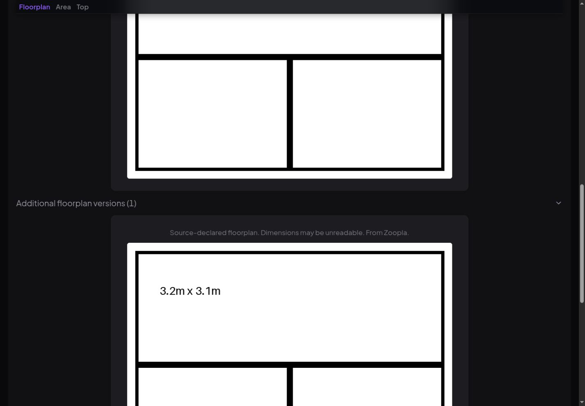
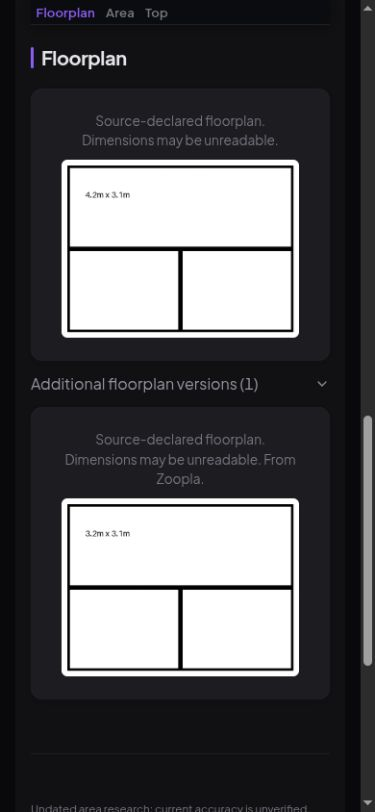

# Review of the 21 October dashboard changes

Reviewed PR #75 at `559813d`, its tests and the rendered application. The count,
filter sizing, studio wording, static bars and named quick actions are useful
improvements. Keep them. Best-fit sorting is a reasonable default, with Newest
still available. It does not establish that the underlying score is calibrated.

## Findings and repairs

**Preserve floorplan evidence.** A perceptual hash measures similarity, not exact
identity. A reproducible pair of drawings differing only in `4.2m` versus `3.2m`
has identical hashes. The original PR dropped one completely. Similar versions
now go into an expandable “Additional floorplan versions” section; all remain
in the full-size gallery with their source-declared/unverified status. Keyboard
links open the selected version and Escape restores focus. Missing cache files
are treated as unavailable for comparison, including removal between lookup
and stat. There is no image fetch during rendering. This use of similarity for
presentation, rather than evidence deletion, matches the purpose of
[perceptual hashing](https://phash.org/docs/design.html).

**Preserve uncertainty.** The noise label is now “Potential road or rail noise”
across cards, details, Telegram and filters. The stored enum and filter values
remain compatible. An inferred proximity indicator is not a measurement of noise.

**Keep accessibility claims bounded.** The named quick actions are commands, so
they do not need toggle-button `aria-pressed` semantics. The coarse-pointer
targets are 44px; WCAG 2.2 AA's minimum-size criterion is 24px with exceptions,
not a general 44px rule. These changes are useful, but do not certify the whole
application. See the [button pattern](https://www.w3.org/WAI/ARIA/apg/patterns/button/)
and [target-size criterion](https://www.w3.org/WAI/WCAG22/Understanding/target-size-minimum/).

## Walkthrough and evidence

| Step | Health after review | Verification |
| --- | --- | --- |
| Browse/filter homes | Good in sampled views | 1440px desktop and 390px phone; readable wrapped controls, no horizontal clipping |
| Inspect quality and warnings | Good in sampled view | Five displayed warnings matched the heading; evidence language retained |
| Compare floorplans | Repaired | Changed dimensions survive similarity grouping; source status visible |
| Open the alternative plan | Repaired | Keyboard activation opens its full-size image, Escape returns focus |
| Map and live delivery | Limited | Automated tests use fixture tiles; no live map-provider or notification claim |

Browser inspection used an isolated copy of the experiment's 91-home snapshot,
plus one clearly named synthetic home for the regression. It did not reuse the
original author's claimed 1,004-home review as fresh verification. Screenshots
below show the synthetic fixture, not a real listing with altered dimensions.

## Checks

Four floorplan regression tests failed before the repair: dropped similar plans,
missing full-size alternatives, the changed-dimension counterexample, and a cache
eviction race. After repair: 610 related web/filter/notification tests and 64
Chromium browser tests pass. Ruff lint, Ruff formatting and strict mypy pass.
No paid model calls, production-data edits or deployment were performed.
